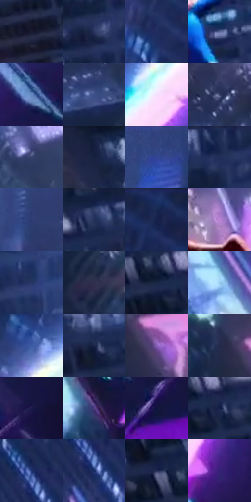

# 电影参考 001

- 状态：条件／仅归档；来源世界：early-montage-unverified。
- 视角：high-angle；景别：environment-wide；场景：city。
- 时段：night-appearance（外观依据，中置信度；具体时间／晨昏未知）；光照：night-mixed。
- 材质候选：glass, metal, sky, fabric（帧级，不是像素分割）。
- 明暗组：dark；L* P5/P50/P95：10.42949 / 23.76648 / 79.73364。
- 资格门禁：archive。
- 原截图 SHA-256：`7f1eb4b13f236fe09477e3d9493bcb2ff0769cde9b658af0a4f13b40108508f3`；尺寸：2880 × 1202。
- sRGB 像素 SHA-256：`379cb73c52ea88bf3c695106f4cf2122520acb435d6344f9d7e80e3f5b736cdf`。

## 观察与迁移

夜城下坠与强亮弧，世界来源未核实，保留归档。

早期归档原帧：本轮纳入统计，世界来源未逐镜头核实，不恢复到活跃转绘库。

本公开版保存32个128×128原像素色卡上下文；图集格子并非原场景相邻位置。原rect、图集tile和像素SHA见 `data/palette-crops.json`。上下文不足时不得批准替色，不能以小样推断完整构图。

## 实测色卡

颜色比例分母为保留采样像素，不是材料面积；全部 32 色参与全库匹配。表内四舍五入仅用于阅读，原精度在 JSON。

| ID | HEX | Lab | 原图 xy | 像素数 | 比例 | 明度角色 |
| --- | --- | --- | --- | ---: | ---: | --- |
| 001-S01 | #191B30 | [10.58591, 5.776096, -14.28552] | [1056, 660] | 10609 | 5.506935% | deep-shadow |
| 001-S02 | #2C3761 | [24.098494, 8.866337, -26.38752] | [1328, 232] | 8928 | 4.634359% | shadow |
| 001-S03 | #202C5F | [19.778876, 13.088645, -32.027411] | [2368, 88] | 8625 | 4.477077% | deep-shadow |
| 001-S04 | #566495 | [43.155275, 7.927313, -28.521124] | [1540, 660] | 8448 | 4.385200% | midtone |
| 001-S05 | #6588C0 | [56.266665, 3.131265, -32.999523] | [2528, 776] | 8266 | 4.290727% | midtone |
| 001-S06 | #3C4F87 | [34.602356, 10.043217, -33.637181] | [112, 252] | 7807 | 4.052469% | shadow |
| 001-S07 | #F3E0FC | [91.412553, 11.418265, -11.211292] | [2512, 456] | 7729 | 4.011980% | highlight |
| 001-S08 | #343D64 | [26.698591, 7.983105, -24.182694] | [144, 144] | 7622 | 3.956439% | shadow |
| 001-S09 | #3C466F | [30.612314, 7.884457, -25.002623] | [372, 404] | 7557 | 3.922698% | shadow |
| 001-S10 | #17223F | [13.738513, 5.637496, -20.013062] | [648, 64] | 6847 | 3.554151% | deep-shadow |
| 001-S11 | #334481 | [30.45396, 13.203393, -36.574003] | [2016, 44] | 6656 | 3.455006% | shadow |
| 001-S12 | #1F2D54 | [19.257484, 7.831443, -25.562795] | [1328, 28] | 6634 | 3.443586% | deep-shadow |
| 001-S13 | #2E3C73 | [26.876307, 12.441715, -33.520373] | [1824, 356] | 6595 | 3.423342% | shadow |
| 001-S14 | #24315B | [21.307486, 8.852836, -26.926706] | [1084, 68] | 6379 | 3.311220% | shadow |
| 001-S15 | #17274F | [16.491078, 8.442431, -26.644418] | [2632, 44] | 6006 | 3.117603% | deep-shadow |
| 001-S16 | #BD88DA | [64.555354, 34.948323, -34.167366] | [1812, 948] | 5999 | 3.113970% | light |
| 001-S17 | #243564 | [23.138543, 9.459962, -29.898569] | [1520, 88] | 5910 | 3.067771% | shadow |
| 001-S18 | #30314D | [21.43408, 7.432983, -17.352268] | [172, 392] | 5413 | 2.809788% | shadow |
| 001-S19 | #192745 | [15.938292, 4.832741, -20.682603] | [880, 140] | 5311 | 2.756841% | deep-shadow |
| 001-S20 | #97C8EA | [78.359997, -7.828204, -21.944831] | [2160, 852] | 5161 | 2.678979% | light |
| 001-S21 | #3B57A2 | [38.469788, 14.158438, -43.808042] | [2532, 292] | 5140 | 2.668079% | shadow |
| 001-S22 | #1F2A4F | [17.970582, 8.066153, -24.251208] | [1188, 104] | 4891 | 2.538827% | deep-shadow |
| 001-S23 | #8A60BB | [48.706331, 35.495006, -41.811928] | [788, 800] | 4795 | 2.488995% | midtone |
| 001-S24 | #24294B | [17.776742, 8.648778, -21.824274] | [700, 756] | 4701 | 2.440202% | deep-shadow |
| 001-S25 | #1F1D4B | [13.696851, 16.069742, -28.376255] | [2788, 736] | 4610 | 2.392965% | deep-shadow |
| 001-S26 | #58408B | [33.1469, 28.198626, -38.273524] | [2376, 1128] | 4560 | 2.367011% | shadow |
| 001-S27 | #10143E | [8.637668, 14.380493, -27.533539] | [2652, 888] | 4538 | 2.355592% | deep-shadow |
| 001-S28 | #131D46 | [12.346166, 11.411975, -27.144996] | [948, 152] | 4538 | 2.355592% | deep-shadow |
| 001-S29 | #233977 | [25.608102, 13.869131, -38.128303] | [2152, 588] | 4534 | 2.353515% | shadow |
| 001-S30 | #132762 | [17.786549, 15.781159, -37.263317] | [2164, 644] | 3624 | 1.881151% | deep-shadow |
| 001-S31 | #262D54 | [19.756026, 9.607201, -24.739296] | [812, 88] | 2576 | 1.337154% | deep-shadow |
| 001-S32 | #382377 | [21.484822, 32.528199, -44.741345] | [2404, 816] | 1639 | 0.850774% | shadow |

## 色阶与空间分布

- 采样 ROI：`[0.01, 0.02, 0.98, 0.94]`；步长：4；样本数：192648。
- 排除区：`[]`。
- 深暗、暗、中、亮、高光五段计数：`[67371, 85582, 19082, 11076, 9537]`。
- RGB 各 256 箱、L* 100 箱、13×5 色相明度表和 3×3 空间统计全部保存在 [总数据](../film-library.json)。
- [可视化档案](../../references/library.html)按需绘制直方图，不存 2,094 张重复图表图片。

## 纹理特征占比

**这是分块图像特征的面积占比，不是波点／排线／丝网／错版的精确语义覆盖率。** 窗格、发丝、织物也会产生方向或周期特征。
原图 ROI 像素 3087370；已测块覆盖 3087370（100.0000%）；未测 0。

| 特征 | 块覆盖像素 | 占已测面积 | 阈值敏感范围 |
| --- | ---: | ---: | --- |
| low-contrast | 43136 | 1.3972% | 0.8665% ~ 1.8366% |
| directional-structure | 311296 | 10.0829% | 4.7761% ~ 22.1931% |
| periodic-structure | 2683786 | 86.9279% | 76.9404% ~ 89.6725% |
| mixed-detail | 49152 | 1.5920% | 0.0000% ~ 3.7147% |

阈值敏感范围不是统计置信区间。逐块坐标、尺度、对比、方向一致性、频谱集中度、频率与角度见 [全量特征记录](../texture-features.jsonl)，以帧号定位。
四种印刷层的真实像素覆盖仍标为 `null`，不能填 0，也不能拿上表代替。不得据这些代理测量删除唯一证据。

[测量方法与保留策略](../../references/library-retention.md) · [分类索引](../archive/README.md)
