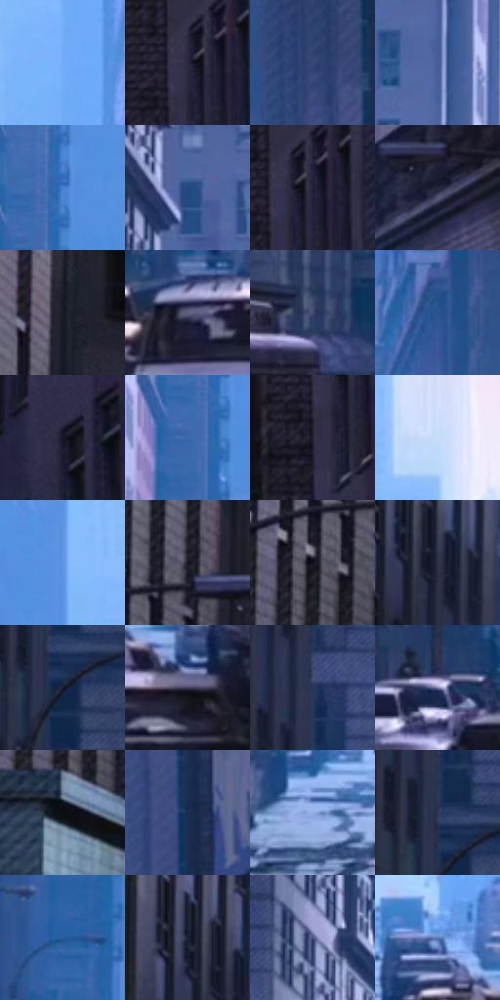

# 电影参考 002

- 状态：条件／仅归档；来源世界：early-montage-unverified。
- 视角：near-level；景别：environment-wide；场景：city。
- 时段：daylight-time-unspecified（外观依据，中置信度；具体时间／晨昏未知）；光照：cool-day。
- 材质候选：stone, glass, asphalt, metal, sky（帧级，不是像素分割）。
- 明暗组：dark；L* P5/P50/P95：6.43991 / 29.25243 / 72.07887。
- 资格门禁：archive。
- 原截图 SHA-256：`1f92366980864b8d8e1989e4907a924d940a84d593c5db00dc710990f4e6f277`；尺寸：2880 × 1198。
- sRGB 像素 SHA-256：`4112511eeff537a9b5eb04759420741e8399c627927c5e3c23bef7f8c8fdb967`。

## 观察与迁移

纵深街谷，冷空气层、楼体暗面与车辆分层。

早期归档原帧：本轮纳入统计，世界来源未逐镜头核实，不恢复到活跃转绘库。

本公开版保存32个128×128原像素色卡上下文；图集格子并非原场景相邻位置。原rect、图集tile和像素SHA见 `data/palette-crops.json`。上下文不足时不得批准替色，不能以小样推断完整构图。

## 实测色卡

颜色比例分母为保留采样像素，不是材料面积；全部 32 色参与全库匹配。表内四舍五入仅用于阅读，原精度在 JSON。

| ID | HEX | Lab | 原图 xy | 像素数 | 比例 | 明度角色 |
| --- | --- | --- | --- | ---: | ---: | --- |
| 002-S01 | #73AEF8 | [69.958792, 1.485159, -42.618887] | [1564, 152] | 10626 | 5.515759% | light |
| 002-S02 | #2C2B41 | [18.561204, 6.481418, -13.708924] | [2408, 64] | 10526 | 5.463851% | deep-shadow |
| 002-S03 | #334677 | [30.437314, 8.256287, -30.354903] | [2028, 72] | 8851 | 4.594390% | shadow |
| 002-S04 | #465F99 | [40.873005, 8.211109, -34.570031] | [1028, 84] | 8729 | 4.531062% | midtone |
| 002-S05 | #4882CF | [53.862807, 5.45567, -45.385439] | [1192, 216] | 8172 | 4.241933% | midtone |
| 002-S06 | #244B82 | [31.848033, 6.013432, -35.012717] | [824, 64] | 7983 | 4.143827% | shadow |
| 002-S07 | #232337 | [14.597253, 5.773648, -12.96482] | [2432, 28] | 7529 | 3.908164% | deep-shadow |
| 002-S08 | #23273D | [16.231396, 4.863634, -14.629004] | [2260, 488] | 7499 | 3.892592% | deep-shadow |
| 002-S09 | #1B1D29 | [11.076792, 2.601721, -8.398599] | [368, 44] | 7274 | 3.775798% | deep-shadow |
| 002-S10 | #60617F | [42.105269, 6.685583, -16.852756] | [1100, 1100] | 7236 | 3.756073% | midtone |
| 002-S11 | #434A70 | [32.392346, 7.639666, -22.806372] | [756, 916] | 7036 | 3.652257% | shadow |
| 002-S12 | #345691 | [36.797423, 7.302177, -36.27578] | [1840, 36] | 5945 | 3.085939% | shadow |
| 002-S13 | #191827 | [9.044594, 4.928128, -10.073635] | [2660, 92] | 5798 | 3.009634% | deep-shadow |
| 002-S14 | #3B6AAE | [44.649225, 6.324227, -41.046644] | [1156, 276] | 5743 | 2.981085% | midtone |
| 002-S15 | #222131 | [13.528565, 4.945212, -10.359832] | [2388, 128] | 5609 | 2.911528% | deep-shadow |
| 002-S16 | #C7DDFB | [87.396618, -1.093448, -17.032466] | [1412, 108] | 5531 | 2.871039% | highlight |
| 002-S17 | #6096E4 | [61.566227, 5.062682, -44.899004] | [1272, 152] | 5516 | 2.863253% | light |
| 002-S18 | #151621 | [7.615001, 2.826463, -7.811077] | [320, 248] | 5486 | 2.847681% | deep-shadow |
| 002-S19 | #121219 | [5.703264, 1.681949, -4.568963] | [252, 332] | 5469 | 2.838856% | deep-shadow |
| 002-S20 | #30324A | [21.593731, 5.797912, -15.090478] | [576, 136] | 5458 | 2.833146% | shadow |
| 002-S21 | #1B1D33 | [11.62544, 6.024889, -14.810282] | [648, 600] | 5446 | 2.826917% | deep-shadow |
| 002-S22 | #403F57 | [27.66314, 6.490871, -14.189517] | [1600, 1116] | 5260 | 2.730368% | shadow |
| 002-S23 | #253757 | [23.045024, 3.399531, -21.53425] | [636, 360] | 5244 | 2.722063% | shadow |
| 002-S24 | #787EA5 | [53.632984, 6.833358, -21.495916] | [848, 1068] | 5198 | 2.698185% | midtone |
| 002-S25 | #0D0E12 | [4.00435, 0.443042, -2.177205] | [224, 456] | 4651 | 2.414248% | deep-shadow |
| 002-S26 | #192E53 | [19.160948, 5.372813, -25.068565] | [2092, 412] | 4592 | 2.383622% | deep-shadow |
| 002-S27 | #92ADE5 | [70.631168, 4.181663, -31.099454] | [1364, 1100] | 3888 | 2.018189% | light |
| 002-S28 | #2C395B | [24.375439, 5.355566, -22.035951] | [632, 552] | 3835 | 1.990677% | shadow |
| 002-S29 | #285A99 | [37.953667, 5.654698, -39.292533] | [1136, 796] | 3661 | 1.900357% | shadow |
| 002-S30 | #1B2437 | [14.233542, 2.267829, -13.584209] | [536, 92] | 3610 | 1.873884% | deep-shadow |
| 002-S31 | #4B5682 | [37.412893, 7.821037, -26.075094] | [764, 288] | 3241 | 1.682343% | shadow |
| 002-S32 | #5B75B6 | [49.885199, 8.958216, -37.311104] | [1492, 1016] | 2006 | 1.041277% | midtone |

## 色阶与空间分布

- 采样 ROI：`[0.01, 0.02, 0.98, 0.94]`；步长：4；样本数：192648。
- 排除区：`[]`。
- 深暗、暗、中、亮、高光五段计数：`[71209, 61111, 36245, 18826, 5257]`。
- RGB 各 256 箱、L* 100 箱、13×5 色相明度表和 3×3 空间统计全部保存在 [总数据](../film-library.json)。
- [可视化档案](../../references/library.html)按需绘制直方图，不存 2,094 张重复图表图片。

## 纹理特征占比

**这是分块图像特征的面积占比，不是波点／排线／丝网／错版的精确语义覆盖率。** 窗格、发丝、织物也会产生方向或周期特征。
原图 ROI 像素 3081782；已测块覆盖 3081782（100.0000%）；未测 0。

| 特征 | 块覆盖像素 | 占已测面积 | 阈值敏感范围 |
| --- | ---: | ---: | --- |
| low-contrast | 0 | 0.0000% | 0.0000% ~ 0.0000% |
| directional-structure | 849536 | 27.5664% | 14.8859% ~ 43.3578% |
| periodic-structure | 2071222 | 67.2086% | 56.1106% ~ 73.6796% |
| mixed-detail | 161024 | 5.2250% | 0.5316% ~ 11.4344% |

阈值敏感范围不是统计置信区间。逐块坐标、尺度、对比、方向一致性、频谱集中度、频率与角度见 [全量特征记录](../texture-features.jsonl)，以帧号定位。
四种印刷层的真实像素覆盖仍标为 `null`，不能填 0，也不能拿上表代替。不得据这些代理测量删除唯一证据。

[测量方法与保留策略](../../references/library-retention.md) · [分类索引](../archive/README.md)
