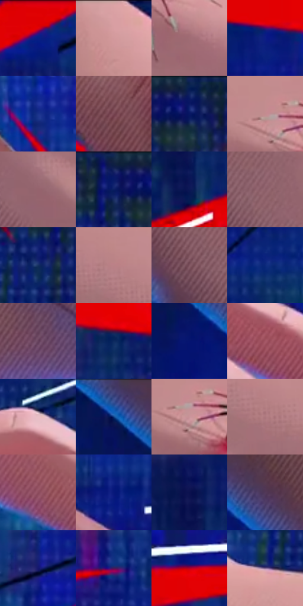

# 电影参考 003

- 状态：条件／仅归档；来源世界：early-montage-unverified。
- 视角：high-angle；景别：detail；场景：graphic。
- 时段：graphic-no-physical-time（外观依据，中置信度；具体时间／晨昏未知）；光照：graphic-field。
- 材质候选：skin（帧级，不是像素分割）。
- 明暗组：dark；L* P5/P50/P95：12.28771 / 37.32597 / 70.92264。
- 资格门禁：archive。
- 原截图 SHA-256：`8477912898e143d2a806b339829b16598f1bf0120544ab4ac34a93cf2f95d975`；尺寸：2880 × 1200。
- sRGB 像素 SHA-256：`8cc4452f8d3cab0411ebbc199b883772f2afdd939dd331c3de6111bd9ab6cc75`。

## 观察与迁移

手部与红蓝放射图形，不能作为普通皮肤照明。

早期归档原帧：本轮纳入统计，世界来源未逐镜头核实，不恢复到活跃转绘库。

本公开版保存32个128×128原像素色卡上下文；图集格子并非原场景相邻位置。原rect、图集tile和像素SHA见 `data/palette-crops.json`。上下文不足时不得批准替色，不能以小样推断完整构图。

## 实测色卡

颜色比例分母为保留采样像素，不是材料面积；全部 32 色参与全库匹配。表内四舍五入仅用于阅读，原精度在 JSON。

| ID | HEX | Lab | 原图 xy | 像素数 | 比例 | 明度角色 |
| --- | --- | --- | --- | ---: | ---: | --- |
| 003-S01 | #E10103 | [47.028464, 72.804804, 60.241145] | [2432, 24] | 9928 | 5.153440% | midtone |
| 003-S02 | #D99FA3 | [71.004974, 22.109574, 6.439842] | [724, 24] | 9807 | 5.090632% | light |
| 003-S03 | #A06C74 | [51.222268, 21.882476, 4.015891] | [1392, 632] | 9434 | 4.897014% | midtone |
| 003-S04 | #0C1D86 | [18.702461, 36.411674, -58.944804] | [208, 436] | 9386 | 4.872098% | deep-shadow |
| 003-S05 | #18318A | [24.401588, 25.607985, -52.044503] | [1864, 1060] | 9063 | 4.704435% | shadow |
| 003-S06 | #7A4754 | [36.527325, 23.581109, 1.698405] | [2244, 1080] | 8810 | 4.573107% | shadow |
| 003-S07 | #102370 | [17.834923, 24.195706, -46.332128] | [1300, 52] | 8464 | 4.393505% | deep-shadow |
| 003-S08 | #C38B8F | [63.386251, 21.899438, 6.394858] | [1180, 472] | 7845 | 4.072194% | light |
| 003-S09 | #95636D | [47.518866, 21.695042, 2.672906] | [904, 588] | 7549 | 3.918546% | midtone |
| 003-S10 | #0B1D63 | [14.681274, 22.698267, -43.01476] | [1220, 64] | 7411 | 3.846913% | deep-shadow |
| 003-S11 | #0B1856 | [11.930996, 20.874963, -38.828815] | [356, 1000] | 7391 | 3.836531% | deep-shadow |
| 003-S12 | #8C5F69 | [45.332432, 19.852755, 1.780855] | [776, 512] | 6717 | 3.486670% | midtone |
| 003-S13 | #173161 | [20.985915, 8.62409, -31.427024] | [1168, 156] | 6595 | 3.423342% | shadow |
| 003-S14 | #BA8287 | [60.028945, 22.305762, 6.006842] | [968, 420] | 6436 | 3.340808% | light |
| 003-S15 | #825762 | [41.914627, 19.476815, 0.93431] | [660, 504] | 6327 | 3.284228% | midtone |
| 003-S16 | #0B297B | [20.386669, 24.103566, -49.206253] | [2084, 84] | 5822 | 3.022092% | shadow |
| 003-S17 | #67425D | [33.072357, 20.663038, -9.41573] | [1200, 1036] | 5377 | 2.791101% | shadow |
| 003-S18 | #0C2A5F | [18.187338, 11.428371, -34.645631] | [376, 456] | 5230 | 2.714796% | deep-shadow |
| 003-S19 | #061370 | [13.67284, 34.076379, -53.218482] | [164, 208] | 5189 | 2.693514% | deep-shadow |
| 003-S20 | #A45765 | [46.512362, 33.146331, 6.309436] | [2284, 520] | 5184 | 2.690918% | midtone |
| 003-S21 | #E7BFC7 | [80.947312, 15.506756, 1.358036] | [2132, 368] | 4914 | 2.550766% | highlight |
| 003-S22 | #345095 | [35.274404, 12.706945, -41.129061] | [72, 40] | 4866 | 2.525850% | shadow |
| 003-S23 | #CA9499 | [66.549174, 21.042449, 5.399588] | [1196, 496] | 4844 | 2.514430% | light |
| 003-S24 | #AE787E | [56.027247, 21.985379, 5.277282] | [1000, 472] | 4714 | 2.446950% | midtone |
| 003-S25 | #8E4D5E | [41.0055, 29.38263, 2.279799] | [2184, 700] | 4494 | 2.332752% | midtone |
| 003-S26 | #07177B | [15.939337, 35.777888, -56.551568] | [2500, 504] | 4058 | 2.106432% | deep-shadow |
| 003-S27 | #0A114F | [9.236426, 22.906261, -38.481399] | [340, 884] | 4001 | 2.076845% | deep-shadow |
| 003-S28 | #533959 | [28.078566, 17.911189, -14.679503] | [268, 148] | 3456 | 1.793945% | shadow |
| 003-S29 | #15166E | [14.726849, 32.456167, -50.14778] | [2300, 292] | 3322 | 1.724389% | deep-shadow |
| 003-S30 | #491859 | [19.187201, 34.129528, -28.749228] | [528, 696] | 2726 | 1.415016% | deep-shadow |
| 003-S31 | #B20025 | [37.117788, 61.831236, 33.85196] | [148, 716] | 2256 | 1.171048% | shadow |
| 003-S32 | #7C628E | [45.597947, 19.270422, -20.293054] | [1084, 232] | 1032 | 0.535692% | midtone |

## 色阶与空间分布

- 采样 ROI：`[0.01, 0.02, 0.98, 0.94]`；步长：4；样本数：192648。
- 排除区：`[]`。
- 深暗、暗、中、亮、高光五段计数：`[58565, 44402, 58925, 29258, 1498]`。
- RGB 各 256 箱、L* 100 箱、13×5 色相明度表和 3×3 空间统计全部保存在 [总数据](../film-library.json)。
- [可视化档案](../../references/library.html)按需绘制直方图，不存 2,094 张重复图表图片。

## 纹理特征占比

**这是分块图像特征的面积占比，不是波点／排线／丝网／错版的精确语义覆盖率。** 窗格、发丝、织物也会产生方向或周期特征。
原图 ROI 像素 3084576；已测块覆盖 3084576（100.0000%）；未测 0。

| 特征 | 块覆盖像素 | 占已测面积 | 阈值敏感范围 |
| --- | ---: | ---: | --- |
| low-contrast | 16384 | 0.5312% | 0.0000% ~ 0.9710% |
| directional-structure | 1323264 | 42.8994% | 28.7407% ~ 56.6431% |
| periodic-structure | 1630240 | 52.8513% | 42.8257% ~ 63.2504% |
| mixed-detail | 114688 | 3.7181% | 0.5312% ~ 7.0379% |

阈值敏感范围不是统计置信区间。逐块坐标、尺度、对比、方向一致性、频谱集中度、频率与角度见 [全量特征记录](../texture-features.jsonl)，以帧号定位。
四种印刷层的真实像素覆盖仍标为 `null`，不能填 0，也不能拿上表代替。不得据这些代理测量删除唯一证据。

[测量方法与保留策略](../../references/library-retention.md) · [分类索引](../archive/README.md)
