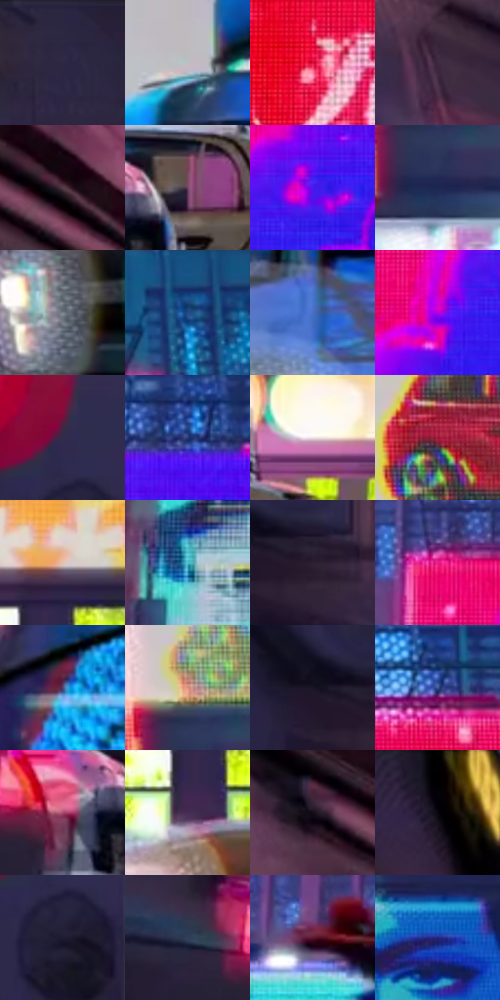

# 电影参考 004

- 状态：条件／仅归档；来源世界：early-montage-unverified。
- 视角：low-angle；景别：environment-wide；场景：city。
- 时段：night-appearance（外观依据，中置信度；具体时间／晨昏未知）；光照：night-mixed。
- 材质候选：screen, glass, metal, asphalt（帧级，不是像素分割）。
- 明暗组：dark；L* P5/P50/P95：6.59646 / 32.86093 / 80.29416。
- 资格门禁：archive。
- 原截图 SHA-256：`51dfa7b75a0bc1056a4488b4601d7bd8ae88db78f1a61209556e3e7ea636d8e8`；尺寸：2880 × 1204。
- sRGB 像素 SHA-256：`1910c9f22e921e5e552d9bcb0f366d61cac488b1b3f5237c5e82c074da772b82`。

## 观察与迁移

广告显示色与街面、车辆反光分开。

早期归档原帧：本轮纳入统计，世界来源未逐镜头核实，不恢复到活跃转绘库。

本公开版保存32个128×128原像素色卡上下文；图集格子并非原场景相邻位置。原rect、图集tile和像素SHA见 `data/palette-crops.json`。上下文不足时不得批准替色，不能以小样推断完整构图。

## 实测色卡

颜色比例分母为保留采样像素，不是材料面积；全部 32 色参与全库匹配。表内四舍五入仅用于阅读，原精度在 JSON。

| ID | HEX | Lab | 原图 xy | 像素数 | 比例 | 明度角色 |
| --- | --- | --- | --- | ---: | ---: | --- |
| 004-S01 | #2B2643 | [17.012675, 10.306037, -17.508308] | [504, 48] | 10872 | 5.643453% | deep-shadow |
| 004-S02 | #BAC0C3 | [77.32757, -1.500274, -2.224226] | [2804, 484] | 9421 | 4.890266% | light |
| 004-S03 | #E40D3E | [48.429652, 73.75046, 34.451767] | [1328, 700] | 9034 | 4.689382% | midtone |
| 004-S04 | #3C283F | [19.379763, 14.152368, -10.922303] | [616, 808] | 8848 | 4.592833% | deep-shadow |
| 004-S05 | #573B49 | [28.473586, 14.817505, -3.580866] | [796, 672] | 8786 | 4.560649% | shadow |
| 004-S06 | #714662 | [35.544336, 22.989939, -8.734245] | [1116, 1068] | 8573 | 4.450085% | shadow |
| 004-S07 | #4A18EB | [34.200913, 71.491193, -93.301117] | [1456, 228] | 8443 | 4.382605% | shadow |
| 004-S08 | #1F2654 | [17.071699, 12.926652, -29.062033] | [2060, 832] | 8355 | 4.336925% | deep-shadow |
| 004-S09 | #77808B | [53.19379, -0.924958, -7.064814] | [2432, 1128] | 6751 | 3.504319% | midtone |
| 004-S10 | #224C87 | [32.38564, 6.994343, -37.245967] | [1972, 64] | 6647 | 3.450334% | shadow |
| 004-S11 | #4570C7 | [48.228615, 13.194219, -49.80263] | [2808, 980] | 6582 | 3.416594% | midtone |
| 004-S12 | #B600D8 | [45.502627, 81.586505, -63.354884] | [1360, 276] | 6298 | 3.269175% | midtone |
| 004-S13 | #332B4A | [19.744657, 11.714168, -17.949712] | [416, 508] | 6221 | 3.229206% | deep-shadow |
| 004-S14 | #273972 | [25.478712, 12.663434, -35.148126] | [1592, 120] | 6168 | 3.201694% | shadow |
| 004-S15 | #F0E0E7 | [90.600185, 6.648825, -1.439928] | [1240, 968] | 6129 | 3.181450% | highlight |
| 004-S16 | #9A1633 | [33.318097, 52.808502, 19.295545] | [2072, 560] | 6001 | 3.115008% | shadow |
| 004-S17 | #E2C1B1 | [80.451563, 9.257221, 12.403884] | [1488, 964] | 5948 | 3.087496% | highlight |
| 004-S18 | #52C1D1 | [72.583792, -26.707183, -17.470624] | [1012, 528] | 5946 | 3.086458% | light |
| 004-S19 | #2B2032 | [14.270102, 9.56741, -9.84825] | [456, 768] | 5766 | 2.993024% | deep-shadow |
| 004-S20 | #EA1B87 | [51.871799, 78.037214, -5.027758] | [1296, 136] | 5660 | 2.938001% | midtone |
| 004-S21 | #51476E | [32.659964, 13.50462, -21.03897] | [2596, 724] | 5561 | 2.886612% | shadow |
| 004-S22 | #D58D7A | [65.439251, 25.15533, 21.380173] | [2044, 736] | 5275 | 2.738155% | light |
| 004-S23 | #191424 | [7.536581, 6.981322, -10.165429] | [380, 744] | 4647 | 2.412171% | deep-shadow |
| 004-S24 | #455A95 | [39.150267, 9.819244, -34.899126] | [1832, 104] | 4606 | 2.390889% | shadow |
| 004-S25 | #A74A6C | [44.515222, 41.873787, -0.79034] | [1008, 1100] | 4373 | 2.269943% | midtone |
| 004-S26 | #452D54 | [22.937642, 19.418102, -19.507619] | [1460, 1076] | 4336 | 2.250737% | shadow |
| 004-S27 | #130B17 | [3.971409, 5.119024, -5.548741] | [640, 640] | 4086 | 2.120967% | deep-shadow |
| 004-S28 | #030205 | [0.666016, 0.678596, -1.043066] | [936, 40] | 3970 | 2.060753% | deep-shadow |
| 004-S29 | #1D1C31 | [11.368983, 6.777856, -13.755061] | [428, 600] | 3754 | 1.948632% | deep-shadow |
| 004-S30 | #31405A | [26.898356, 1.747927, -17.418359] | [884, 1076] | 2845 | 1.476787% | shadow |
| 004-S31 | #571830 | [19.612038, 31.197805, 0.318475] | [1064, 308] | 2176 | 1.129521% | deep-shadow |
| 004-S32 | #1D227B | [19.369493, 30.446104, -50.849768] | [2460, 76] | 570 | 0.295876% | deep-shadow |

## 色阶与空间分布

- 采样 ROI：`[0.01, 0.02, 0.98, 0.94]`；步长：4；样本数：192648。
- 排除区：`[]`。
- 深暗、暗、中、亮、高光五段计数：`[50928, 69183, 39002, 23153, 10382]`。
- RGB 各 256 箱、L* 100 箱、13×5 色相明度表和 3×3 空间统计全部保存在 [总数据](../film-library.json)。
- [可视化档案](../../references/library.html)按需绘制直方图，不存 2,094 张重复图表图片。

## 纹理特征占比

**这是分块图像特征的面积占比，不是波点／排线／丝网／错版的精确语义覆盖率。** 窗格、发丝、织物也会产生方向或周期特征。
原图 ROI 像素 3092958；已测块覆盖 3092958（100.0000%）；未测 0。

| 特征 | 块覆盖像素 | 占已测面积 | 阈值敏感范围 |
| --- | ---: | ---: | --- |
| low-contrast | 143744 | 4.6475% | 3.5880% ~ 5.1772% |
| directional-structure | 516864 | 16.7110% | 6.2366% ~ 26.3122% |
| periodic-structure | 2202974 | 71.2255% | 66.3918% ~ 75.8729% |
| mixed-detail | 229376 | 7.4161% | 3.7080% ~ 12.7133% |

阈值敏感范围不是统计置信区间。逐块坐标、尺度、对比、方向一致性、频谱集中度、频率与角度见 [全量特征记录](../texture-features.jsonl)，以帧号定位。
四种印刷层的真实像素覆盖仍标为 `null`，不能填 0，也不能拿上表代替。不得据这些代理测量删除唯一证据。

[测量方法与保留策略](../../references/library-retention.md) · [分类索引](../archive/README.md)
