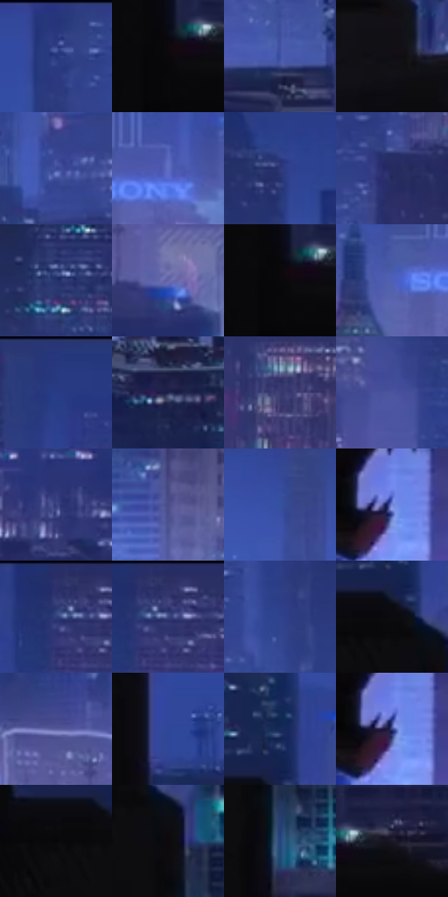

# 电影参考 005

- 状态：条件／仅归档；来源世界：early-montage-unverified。
- 视角：high-angle；景别：environment-wide；场景：city。
- 时段：night-appearance（外观依据，中置信度；具体时间／晨昏未知）；光照：night-mixed。
- 材质候选：glass, sky, fabric（帧级，不是像素分割）。
- 明暗组：dark；L* P5/P50/P95：2.36987 / 28.33471 / 49.48379。
- 资格门禁：archive。
- 原截图 SHA-256：`7f65bcd2bf5f88183654b3ca9dccf8b47c0021bfa7e377ea62842c23ea3c2094`；尺寸：2870 × 1204。
- sRGB 像素 SHA-256：`cae8f39b23c70d96780baf2703be84df14a481e3c6c60c84974a0accf368a26f`。

## 观察与迁移

蓝暮楼群与稀疏彩色灯窗，远近层级明确。

早期归档原帧：本轮纳入统计，世界来源未逐镜头核实，不恢复到活跃转绘库。

本公开版保存32个128×128原像素色卡上下文；图集格子并非原场景相邻位置。原rect、图集tile和像素SHA见 `data/palette-crops.json`。上下文不足时不得批准替色，不能以小样推断完整构图。

## 实测色卡

颜色比例分母为保留采样像素，不是材料面积；全部 32 色参与全库匹配。表内四舍五入仅用于阅读，原精度在 JSON。

| ID | HEX | Lab | 原图 xy | 像素数 | 比例 | 明度角色 |
| --- | --- | --- | --- | ---: | ---: | --- |
| 005-S01 | #2F3E84 | [28.681279, 17.569271, -41.300751] | [636, 52] | 9642 | 5.019365% | shadow |
| 005-S02 | #0A080B | [2.36987, 0.943536, -0.960378] | [204, 624] | 8415 | 4.380622% | deep-shadow |
| 005-S03 | #3E52A4 | [37.367874, 18.70484, -46.761146] | [2772, 892] | 8152 | 4.243711% | shadow |
| 005-S04 | #100E14 | [4.288283, 1.873287, -3.006196] | [660, 740] | 7939 | 4.132829% | deep-shadow |
| 005-S05 | #3A4994 | [33.566784, 18.151411, -43.24287] | [1184, 148] | 7855 | 4.089101% | shadow |
| 005-S06 | #606EC3 | [48.979356, 18.527211, -46.218683] | [1680, 240] | 7441 | 3.873584% | midtone |
| 005-S07 | #2D3878 | [25.985963, 16.833545, -38.121988] | [2612, 144] | 7198 | 3.747085% | shadow |
| 005-S08 | #242C60 | [20.126298, 14.328267, -32.112452] | [2624, 572] | 6887 | 3.585187% | shadow |
| 005-S09 | #25336D | [23.218733, 14.55382, -35.587431] | [2260, 84] | 6687 | 3.481072% | shadow |
| 005-S10 | #6666AB | [45.997672, 17.643441, -36.986046] | [764, 440] | 6657 | 3.465455% | midtone |
| 005-S11 | #09080A | [2.29127, 0.539448, -0.664445] | [200, 624] | 6541 | 3.405068% | deep-shadow |
| 005-S12 | #4F60B4 | [43.244418, 18.639893, -46.735611] | [1576, 264] | 6386 | 3.324379% | midtone |
| 005-S13 | #26377D | [25.636904, 18.119338, -41.863683] | [2396, 28] | 6354 | 3.307721% | shadow |
| 005-S14 | #1F234C | [15.565655, 12.043428, -26.05491] | [1732, 1052] | 6281 | 3.269719% | deep-shadow |
| 005-S15 | #3B3B70 | [27.37255, 15.304674, -30.764724] | [1084, 448] | 6210 | 3.232759% | shadow |
| 005-S16 | #4A54A0 | [38.434622, 18.527251, -42.617476] | [2372, 280] | 6125 | 3.188510% | shadow |
| 005-S17 | #3A4281 | [30.352466, 16.121906, -36.709693] | [2760, 496] | 5887 | 3.064614% | shadow |
| 005-S18 | #494C88 | [34.726396, 15.605396, -33.996232] | [1452, 704] | 5669 | 2.951129% | shadow |
| 005-S19 | #35519E | [36.193753, 15.544381, -45.081404] | [1564, 80] | 5568 | 2.898551% | shadow |
| 005-S20 | #7487DA | [58.132797, 15.187413, -44.672208] | [1364, 932] | 5552 | 2.890222% | midtone |
| 005-S21 | #30356F | [24.708156, 16.275116, -34.436006] | [2012, 40] | 5504 | 2.865234% | shadow |
| 005-S22 | #2E3167 | [22.849156, 15.707513, -32.270481] | [2044, 28] | 5476 | 2.850658% | shadow |
| 005-S23 | #2F438D | [30.738007, 17.530026, -43.550774] | [744, 108] | 5471 | 2.848055% | shadow |
| 005-S24 | #0C0B0E | [3.154405, 0.762755, -1.202211] | [144, 300] | 5437 | 2.830356% | deep-shadow |
| 005-S25 | #585A9C | [40.874908, 16.875169, -36.279654] | [668, 332] | 5324 | 2.771531% | midtone |
| 005-S26 | #324797 | [32.740085, 19.087653, -46.423552] | [60, 88] | 5140 | 2.675745% | shadow |
| 005-S27 | #172957 | [17.717665, 10.288762, -30.0622] | [156, 216] | 4752 | 2.473763% | deep-shadow |
| 005-S28 | #3C4589 | [31.857741, 17.357531, -39.244352] | [1360, 940] | 4423 | 2.302495% | shadow |
| 005-S29 | #070608 | [1.742923, 0.539483, -0.664511] | [92, 320] | 4330 | 2.254081% | deep-shadow |
| 005-S30 | #0D090C | [2.777536, 1.546577, -0.785097] | [192, 364] | 3127 | 1.627832% | deep-shadow |
| 005-S31 | #24467F | [30.125084, 8.210307, -35.900527] | [220, 476] | 2905 | 1.512265% | shadow |
| 005-S32 | #1A1827 | [9.151504, 5.32443, -9.899468] | [292, 600] | 2761 | 1.437302% | deep-shadow |

## 色阶与空间分布

- 采样 ROI：`[0.01, 0.02, 0.98, 0.94]`；步长：4；样本数：192096。
- 排除区：`[]`。
- 深暗、暗、中、亮、高光五段计数：`[51615, 109245, 29488, 1711, 37]`。
- RGB 各 256 箱、L* 100 箱、13×5 色相明度表和 3×3 空间统计全部保存在 [总数据](../film-library.json)。
- [可视化档案](../../references/library.html)按需绘制直方图，不存 2,094 张重复图表图片。

## 纹理特征占比

**这是分块图像特征的面积占比，不是波点／排线／丝网／错版的精确语义覆盖率。** 窗格、发丝、织物也会产生方向或周期特征。
原图 ROI 像素 3081888；已测块覆盖 3081888（100.0000%）；未测 0。

| 特征 | 块覆盖像素 | 占已测面积 | 阈值敏感范围 |
| --- | ---: | ---: | --- |
| low-contrast | 348032 | 11.2928% | 8.2900% ~ 11.8244% |
| directional-structure | 158848 | 5.1542% | 0.8763% ~ 10.5421% |
| periodic-structure | 2131872 | 69.1742% | 60.4346% ~ 77.4466% |
| mixed-detail | 443136 | 14.3787% | 3.7214% ~ 26.8646% |

阈值敏感范围不是统计置信区间。逐块坐标、尺度、对比、方向一致性、频谱集中度、频率与角度见 [全量特征记录](../texture-features.jsonl)，以帧号定位。
四种印刷层的真实像素覆盖仍标为 `null`，不能填 0，也不能拿上表代替。不得据这些代理测量删除唯一证据。

[测量方法与保留策略](../../references/library-retention.md) · [分类索引](../archive/README.md)
