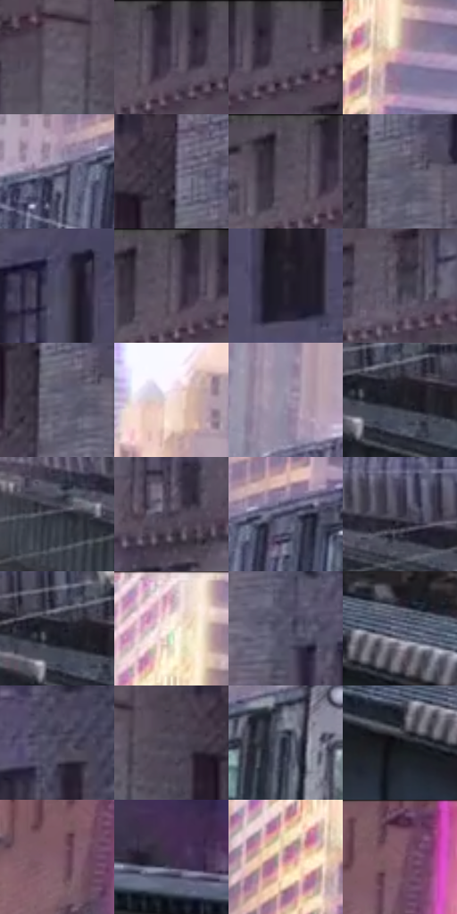

# 电影参考 006

- 状态：条件／仅归档；来源世界：early-montage-unverified。
- 视角：near-level；景别：environment-wide；场景：city。
- 时段：daylight-time-unspecified（外观依据，中置信度；具体时间／晨昏未知）；光照：warm-day。
- 材质候选：metal, stone, glass, sky, fabric（帧级，不是像素分割）。
- 明暗组：dark；L* P5/P50/P95：11.39464 / 32.66686 / 74.57744。
- 资格门禁：archive。
- 原截图 SHA-256：`177bac317b6c3a91f0ec934d45c43bb866e7079dbb3e1514cc9bbf12b2a616cd`；尺寸：2880 × 1202。
- sRGB 像素 SHA-256：`c98b5abc2fd060eccd523a2f6d5afb386018e6f5045aaf0de71d67f23c2b9827`。

## 观察与迁移

日光列车与楼体，车身条带不等于排线。

早期归档原帧：本轮纳入统计，世界来源未逐镜头核实，不恢复到活跃转绘库。

本公开版保存32个128×128原像素色卡上下文；图集格子并非原场景相邻位置。原rect、图集tile和像素SHA见 `data/palette-crops.json`。上下文不足时不得批准替色，不能以小样推断完整构图。

## 实测色卡

颜色比例分母为保留采样像素，不是材料面积；全部 32 色参与全库匹配。表内四舍五入仅用于阅读，原精度在 JSON。

| ID | HEX | Lab | 原图 xy | 像素数 | 比例 | 明度角色 |
| --- | --- | --- | --- | ---: | ---: | --- |
| 006-S01 | #645C6C | [40.322275, 6.583773, -7.927943] | [2204, 96] | 10543 | 5.472676% | midtone |
| 006-S02 | #483E4F | [27.811407, 8.075018, -8.67816] | [1972, 32] | 8519 | 4.422055% | shadow |
| 006-S03 | #544C5C | [33.618728, 6.806833, -8.16662] | [2028, 32] | 8489 | 4.406482% | shadow |
| 006-S04 | #CB96B1 | [67.787945, 24.075135, -6.223105] | [552, 200] | 8484 | 4.403887% | light |
| 006-S05 | #7B7991 | [51.757744, 5.905175, -12.689736] | [388, 560] | 8032 | 4.169262% | midtone |
| 006-S06 | #332D3C | [19.666766, 6.341177, -8.516262] | [2372, 84] | 7796 | 4.046759% | deep-shadow |
| 006-S07 | #514756 | [31.64183, 7.433698, -7.344603] | [1912, 40] | 7572 | 3.930485% | shadow |
| 006-S08 | #5A586B | [38.224724, 5.108682, -10.558784] | [2412, 156] | 7051 | 3.660043% | shadow |
| 006-S09 | #4C4D64 | [33.486845, 5.211817, -13.496715] | [2580, 240] | 6852 | 3.556746% | shadow |
| 006-S10 | #5B5161 | [35.930554, 7.499873, -7.776071] | [1940, 52] | 6576 | 3.413480% | shadow |
| 006-S11 | #292532 | [15.616995, 5.161129, -7.807997] | [2760, 312] | 6522 | 3.385449% | deep-shadow |
| 006-S12 | #413D4B | [26.64705, 4.990505, -7.883257] | [1948, 212] | 6516 | 3.382335% | shadow |
| 006-S13 | #6D6B7E | [46.005607, 4.898106, -10.22748] | [2396, 172] | 6465 | 3.355861% | midtone |
| 006-S14 | #F4DEDC | [90.157617, 7.208803, 3.723116] | [260, 180] | 6378 | 3.310701% | highlight |
| 006-S15 | #968FA4 | [60.612871, 6.762468, -10.114064] | [200, 544] | 6221 | 3.229206% | light |
| 006-S16 | #1C1C24 | [10.592294, 2.206608, -5.449067] | [400, 832] | 6137 | 3.185603% | deep-shadow |
| 006-S17 | #2A2B37 | [17.899507, 2.739244, -7.832844] | [108, 816] | 5932 | 3.079191% | deep-shadow |
| 006-S18 | #3F3748 | [24.503553, 7.435514, -9.161609] | [1972, 388] | 5753 | 2.986275% | shadow |
| 006-S19 | #3F3F58 | [27.617285, 6.418364, -14.91742] | [476, 540] | 5644 | 2.929696% | shadow |
| 006-S20 | #373644 | [23.229686, 3.917874, -8.497043] | [224, 776] | 5597 | 2.905299% | shadow |
| 006-S21 | #20212C | [13.086982, 2.608259, -7.461402] | [372, 816] | 5531 | 2.871039% | deep-shadow |
| 006-S22 | #D0B1BC | [75.130547, 12.991827, -1.427785] | [516, 40] | 5431 | 2.819131% | light |
| 006-S23 | #545267 | [35.788228, 5.687416, -11.812064] | [2444, 452] | 5282 | 2.741788% | shadow |
| 006-S24 | #60667D | [43.46286, 3.118204, -13.573492] | [784, 944] | 4911 | 2.549209% | midtone |
| 006-S25 | #48465B | [30.672106, 5.888997, -12.100263] | [2588, 436] | 4851 | 2.518064% | shadow |
| 006-S26 | #4B4454 | [30.08414, 6.54746, -8.463037] | [2284, 96] | 4457 | 2.313546% | shadow |
| 006-S27 | #2E3444 | [21.777614, 1.875434, -10.782682] | [660, 540] | 4348 | 2.256966% | shadow |
| 006-S28 | #121419 | [6.314751, 0.432764, -3.670825] | [720, 992] | 4195 | 2.177547% | deep-shadow |
| 006-S29 | #805C6A | [43.1892, 17.046061, -2.12742] | [876, 108] | 4046 | 2.100203% | midtone |
| 006-S30 | #3C2E48 | [21.515056, 12.357675, -13.766983] | [2628, 984] | 3533 | 1.833915% | shadow |
| 006-S31 | #AD738C | [55.114155, 26.552985, -4.225033] | [476, 200] | 3021 | 1.568145% | midtone |
| 006-S32 | #6F475B | [35.285412, 20.34639, -4.723073] | [912, 32] | 1963 | 1.018957% | shadow |

## 色阶与空间分布

- 采样 ROI：`[0.01, 0.02, 0.98, 0.94]`；步长：4；样本数：192648。
- 排除区：`[]`。
- 深暗、暗、中、亮、高光五段计数：`[32640, 100796, 35706, 16839, 6667]`。
- RGB 各 256 箱、L* 100 箱、13×5 色相明度表和 3×3 空间统计全部保存在 [总数据](../film-library.json)。
- [可视化档案](../../references/library.html)按需绘制直方图，不存 2,094 张重复图表图片。

## 纹理特征占比

**这是分块图像特征的面积占比，不是波点／排线／丝网／错版的精确语义覆盖率。** 窗格、发丝、织物也会产生方向或周期特征。
原图 ROI 像素 3087370；已测块覆盖 3087370（100.0000%）；未测 0。

| 特征 | 块覆盖像素 | 占已测面积 | 阈值敏感范围 |
| --- | ---: | ---: | --- |
| low-contrast | 0 | 0.0000% | 0.0000% ~ 0.0000% |
| directional-structure | 725514 | 23.4994% | 14.3908% ~ 32.7780% |
| periodic-structure | 2132480 | 69.0711% | 64.5686% ~ 73.4036% |
| mixed-detail | 229376 | 7.4295% | 2.6534% ~ 12.2056% |

阈值敏感范围不是统计置信区间。逐块坐标、尺度、对比、方向一致性、频谱集中度、频率与角度见 [全量特征记录](../texture-features.jsonl)，以帧号定位。
四种印刷层的真实像素覆盖仍标为 `null`，不能填 0，也不能拿上表代替。不得据这些代理测量删除唯一证据。

[测量方法与保留策略](../../references/library-retention.md) · [分类索引](../archive/README.md)
