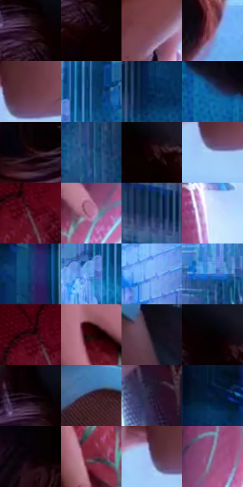

# 电影参考 007

- 状态：条件／仅归档；来源世界：early-montage-unverified。
- 视角：near-level；景别：close-up；场景：portrait。
- 时段：night-appearance（外观依据，中置信度；具体时间／晨昏未知）；光照：night-mixed。
- 材质候选：skin, hair, fabric（帧级，不是像素分割）。
- 明暗组：dark；L* P5/P50/P95：0.77316 / 23.82385 / 80.23031。
- 资格门禁：archive。
- 原截图 SHA-256：`dbac0793ba9717969d9b6d0589360ab732e93ac1be3719f5b1e248a76c39b9dc`；尺寸：2880 × 1204。
- sRGB 像素 SHA-256：`915ec84875999bf78e05e0d7f28a9cb7a4052db03678dd78465d202b04130cc8`。

## 观察与迁移

近景接触与蓝冷环境、皮肤暖色，人物关系不迁移。

早期归档原帧：本轮纳入统计，世界来源未逐镜头核实，不恢复到活跃转绘库。

本公开版保存32个128×128原像素色卡上下文；图集格子并非原场景相邻位置。原rect、图集tile和像素SHA见 `data/palette-crops.json`。上下文不足时不得批准替色，不能以小样推断完整构图。

## 实测色卡

颜色比例分母为保留采样像素，不是材料面积；全部 32 色参与全库匹配。表内四舍五入仅用于阅读，原精度在 JSON。

| ID | HEX | Lab | 原图 xy | 像素数 | 比例 | 明度角色 |
| --- | --- | --- | --- | ---: | ---: | --- |
| 007-S01 | #230D17 | [6.387278, 12.761549, -1.783778] | [724, 112] | 9390 | 4.874175% | deep-shadow |
| 007-S02 | #0E0001 | [0.8634, 3.922428, 0.954641] | [748, 196] | 9164 | 4.756862% | deep-shadow |
| 007-S03 | #7B4552 | [36.132701, 24.860767, 2.409415] | [1384, 832] | 9116 | 4.731946% | shadow |
| 007-S04 | #96566D | [44.582336, 29.499767, -1.591581] | [1404, 1128] | 8067 | 4.187430% | midtone |
| 007-S05 | #643640 | [28.690656, 21.82989, 2.862835] | [1576, 828] | 7914 | 4.108010% | shadow |
| 007-S06 | #306198 | [40.317657, 2.079217, -34.921093] | [2792, 240] | 7690 | 3.991736% | midtone |
| 007-S07 | #072B51 | [17.304571, 3.864145, -26.730256] | [264, 376] | 7588 | 3.938790% | deep-shadow |
| 007-S08 | #1D4F86 | [33.078251, 3.899912, -35.535451] | [632, 1128] | 7106 | 3.688593% | shadow |
| 007-S09 | #190307 | [2.594226, 8.1468, 1.160958] | [652, 360] | 7022 | 3.644990% | deep-shadow |
| 007-S10 | #204572 | [28.844206, 3.09814, -29.796461] | [2748, 912] | 7006 | 3.636685% | shadow |
| 007-S11 | #140002 | [1.38342, 6.304883, 1.366677] | [848, 144] | 6974 | 3.620074% | deep-shadow |
| 007-S12 | #ABC7F4 | [79.633297, 0.727132, -25.253677] | [1548, 888] | 6872 | 3.567128% | light |
| 007-S13 | #50222C | [20.170824, 22.736222, 3.761575] | [2048, 120] | 6866 | 3.564013% | shadow |
| 007-S14 | #B27195 | [55.529534, 30.937897, -8.791277] | [2148, 428] | 6676 | 3.465388% | midtone |
| 007-S15 | #1E345A | [21.835011, 4.959435, -25.450584] | [136, 360] | 6612 | 3.432166% | shadow |
| 007-S16 | #CDE3FC | [89.366675, -2.180474, -14.559855] | [2332, 92] | 6217 | 3.227129% | highlight |
| 007-S17 | #103B6D | [24.770061, 5.639509, -33.144336] | [404, 228] | 6203 | 3.219862% | shadow |
| 007-S18 | #5A9AE5 | [62.456113, 1.914113, -44.068875] | [2724, 296] | 6077 | 3.154458% | light |
| 007-S19 | #7FB7F7 | [72.951858, -1.167644, -37.366351] | [2572, 196] | 6030 | 3.130061% | light |
| 007-S20 | #367DC6 | [51.297477, 2.50075, -44.378316] | [2680, 604] | 6016 | 3.122794% | midtone |
| 007-S21 | #3A0611 | [9.565749, 25.772218, 7.393527] | [2016, 88] | 5821 | 3.021573% | deep-shadow |
| 007-S22 | #240407 | [4.31191, 14.570237, 3.851691] | [1952, 308] | 5801 | 3.011191% | deep-shadow |
| 007-S23 | #100C18 | [3.965854, 3.796479, -6.346966] | [1236, 128] | 5533 | 2.872078% | deep-shadow |
| 007-S24 | #050102 | [0.527195, 1.185024, -0.009836] | [812, 108] | 5281 | 2.741269% | deep-shadow |
| 007-S25 | #090001 | [0.544566, 2.492538, 0.450823] | [704, 48] | 4928 | 2.558033% | deep-shadow |
| 007-S26 | #361926 | [13.349251, 16.394495, -2.42124] | [1064, 68] | 4223 | 2.192081% | deep-shadow |
| 007-S27 | #221B31 | [11.591235, 9.371241, -13.367908] | [1832, 988] | 3572 | 1.854159% | deep-shadow |
| 007-S28 | #091D39 | [10.791786, 3.791861, -20.511915] | [304, 144] | 3161 | 1.640816% | deep-shadow |
| 007-S29 | #0D0309 | [1.539479, 3.51715, -1.325116] | [632, 580] | 3113 | 1.615901% | deep-shadow |
| 007-S30 | #712537 | [27.047741, 35.038978, 6.805116] | [2008, 492] | 3002 | 1.558282% | shadow |
| 007-S31 | #53496E | [33.413577, 12.892505, -19.85351] | [1524, 848] | 1869 | 0.970163% | shadow |
| 007-S32 | #7E7795 | [51.609202, 9.03866, -15.231452] | [2244, 284] | 1738 | 0.902164% | midtone |

## 色阶与空间分布

- 采样 ROI：`[0.01, 0.02, 0.98, 0.94]`；步长：4；样本数：192648。
- 排除区：`[]`。
- 深暗、暗、中、亮、高光五段计数：`[84949, 56057, 26204, 15589, 9849]`。
- RGB 各 256 箱、L* 100 箱、13×5 色相明度表和 3×3 空间统计全部保存在 [总数据](../film-library.json)。
- [可视化档案](../../references/library.html)按需绘制直方图，不存 2,094 张重复图表图片。

## 纹理特征占比

**这是分块图像特征的面积占比，不是波点／排线／丝网／错版的精确语义覆盖率。** 窗格、发丝、织物也会产生方向或周期特征。
原图 ROI 像素 3092958；已测块覆盖 3092958（100.0000%）；未测 0。

| 特征 | 块覆盖像素 | 占已测面积 | 阈值敏感范围 |
| --- | ---: | ---: | --- |
| low-contrast | 174464 | 5.6407% | 4.5812% ~ 7.2298% |
| directional-structure | 1101406 | 35.6101% | 20.5184% ~ 52.5611% |
| periodic-structure | 1735168 | 56.1006% | 42.8576% ~ 64.5833% |
| mixed-detail | 81920 | 2.6486% | 0.0000% ~ 7.6685% |

阈值敏感范围不是统计置信区间。逐块坐标、尺度、对比、方向一致性、频谱集中度、频率与角度见 [全量特征记录](../texture-features.jsonl)，以帧号定位。
四种印刷层的真实像素覆盖仍标为 `null`，不能填 0，也不能拿上表代替。不得据这些代理测量删除唯一证据。

[测量方法与保留策略](../../references/library-retention.md) · [分类索引](../archive/README.md)
