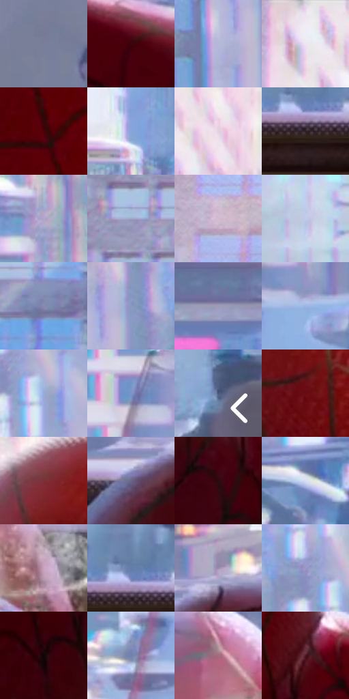

# 电影参考 008

- 状态：条件／仅归档；来源世界：early-montage-unverified。
- 视角：near-level；景别：medium；场景：interior。
- 时段：daylight-time-unspecified（外观依据，中置信度；具体时间／晨昏未知）；光照：neutral-day。
- 材质候选：fabric, glass, skin（帧级，不是像素分割）。
- 明暗组：light；L* P5/P50/P95：7.31631 / 62.04919 / 89.25455。
- 资格门禁：archive。
- 原截图 SHA-256：`4e0606d6fd7258ca98a3581307de30c76903376f758470c3f242ebec1261b739`；尺寸：2880 × 1204。
- sRGB 像素 SHA-256：`fcd4ab4f8bc0dc594ab6dae24d6412f89349aea53b741096d17cc4506503ab2b`。

## 观察与迁移

窗外日景、室内人物与透明杯分层。

早期归档原帧：本轮纳入统计，世界来源未逐镜头核实，不恢复到活跃转绘库。

本公开版保存32个128×128原像素色卡上下文；图集格子并非原场景相邻位置。原rect、图集tile和像素SHA见 `data/palette-crops.json`。上下文不足时不得批准替色，不能以小样推断完整构图。

## 实测色卡

颜色比例分母为保留采样像素，不是材料面积；全部 32 色参与全库匹配。表内四舍五入仅用于阅读，原精度在 JSON。

| ID | HEX | Lab | 原图 xy | 像素数 | 比例 | 明度角色 |
| --- | --- | --- | --- | ---: | ---: | --- |
| 008-S01 | #7A7E9D | [53.484999, 5.480856, -17.073153] | [68, 612] | 11051 | 5.736369% | midtone |
| 008-S02 | #39030B | [8.648715, 26.5473, 9.076413] | [1756, 868] | 9591 | 4.978510% | deep-shadow |
| 008-S03 | #B5B7D9 | [75.264135, 6.197782, -17.269769] | [2340, 140] | 8784 | 4.559611% | light |
| 008-S04 | #EFEAF3 | [93.305888, 3.274592, -3.746696] | [916, 32] | 7785 | 4.041049% | highlight |
| 008-S05 | #4C0109 | [13.098248, 33.308109, 16.819966] | [1464, 644] | 7731 | 4.013019% | deep-shadow |
| 008-S06 | #87A5DB | [67.407111, 3.012389, -30.650649] | [1780, 636] | 7090 | 3.680287% | light |
| 008-S07 | #E4D0E1 | [85.525466, 9.884973, -5.850446] | [1068, 152] | 6886 | 3.574395% | highlight |
| 008-S08 | #2D2225 | [14.5996, 5.869656, -0.00621] | [2572, 1028] | 6648 | 3.450853% | deep-shadow |
| 008-S09 | #B2A7C7 | [70.333816, 10.169237, -14.876735] | [2100, 392] | 6603 | 3.427495% | light |
| 008-S10 | #9EA8C9 | [69.105062, 3.574083, -17.987367] | [136, 164] | 6576 | 3.413480% | light |
| 008-S11 | #D0BDD1 | [78.699623, 10.268804, -7.570911] | [692, 96] | 6571 | 3.410884% | light |
| 008-S12 | #C0CBE7 | [81.66762, 1.92787, -15.088406] | [1944, 236] | 6550 | 3.399983% | highlight |
| 008-S13 | #818AB0 | [58.016038, 5.43841, -21.038688] | [356, 204] | 6506 | 3.377144% | midtone |
| 008-S14 | #8A98C3 | [63.17619, 4.943689, -23.815866] | [2408, 72] | 6469 | 3.357938% | light |
| 008-S15 | #9D9BB7 | [64.985822, 6.452288, -14.210402] | [720, 528] | 6153 | 3.193908% | light |
| 008-S16 | #9DB7E4 | [73.955436, 1.48659, -25.387691] | [2104, 704] | 5887 | 3.055832% | light |
| 008-S17 | #99ABD7 | [70.037642, 3.72118, -24.307622] | [2576, 112] | 5659 | 2.937482% | light |
| 008-S18 | #7895C9 | [61.397398, 3.120122, -30.018579] | [2032, 600] | 5615 | 2.914642% | light |
| 008-S19 | #4E5A7E | [38.617103, 4.969732, -21.735681] | [2820, 580] | 5609 | 2.911528% | shadow |
| 008-S20 | #6A0B12 | [21.387597, 39.832588, 24.097591] | [1364, 232] | 5516 | 2.863253% | shadow |
| 008-S21 | #7C3037 | [31.057684, 33.674559, 12.646293] | [1284, 100] | 5507 | 2.858581% | shadow |
| 008-S22 | #6B6688 | [44.809454, 9.628065, -18.051737] | [680, 1016] | 5349 | 2.776567% | midtone |
| 008-S23 | #270D0F | [6.808883, 13.63821, 3.99963] | [1240, 920] | 5086 | 2.640048% | deep-shadow |
| 008-S24 | #D6DFF1 | [88.648338, 0.445197, -9.792747] | [2452, 708] | 4847 | 2.515988% | highlight |
| 008-S25 | #C9A4BE | [71.342148, 17.94453, -8.190536] | [2212, 1068] | 4801 | 2.492110% | light |
| 008-S26 | #657DAB | [52.256392, 3.425633, -27.200145] | [2568, 980] | 4737 | 2.458889% | midtone |
| 008-S27 | #9B8BAF | [60.363599, 13.107396, -16.700463] | [772, 936] | 4458 | 2.314065% | light |
| 008-S28 | #9A99CA | [64.8958, 10.96841, -24.986862] | [2520, 68] | 4142 | 2.150035% | light |
| 008-S29 | #0E0506 | [1.942724, 2.614844, 0.494113] | [1520, 1120] | 3967 | 2.059196% | deep-shadow |
| 008-S30 | #7281AE | [54.378469, 5.612437, -25.576502] | [1980, 764] | 3893 | 2.020784% | midtone |
| 008-S31 | #A56C7E | [52.098777, 25.308957, -0.549322] | [2068, 948] | 3750 | 1.946555% | midtone |
| 008-S32 | #4C151F | [16.366166, 26.777426, 7.529735] | [1584, 832] | 2831 | 1.469520% | deep-shadow |

## 色阶与空间分布

- 采样 ROI：`[0.01, 0.02, 0.98, 0.94]`；步长：4；样本数：192648。
- 排除区：`[]`。
- 深暗、暗、中、亮、高光五段计数：`[37276, 13349, 38868, 76791, 26364]`。
- RGB 各 256 箱、L* 100 箱、13×5 色相明度表和 3×3 空间统计全部保存在 [总数据](../film-library.json)。
- [可视化档案](../../references/library.html)按需绘制直方图，不存 2,094 张重复图表图片。

## 纹理特征占比

**这是分块图像特征的面积占比，不是波点／排线／丝网／错版的精确语义覆盖率。** 窗格、发丝、织物也会产生方向或周期特征。
原图 ROI 像素 3092958；已测块覆盖 3092958（100.0000%）；未测 0。

| 特征 | 块覆盖像素 | 占已测面积 | 阈值敏感范围 |
| --- | ---: | ---: | --- |
| low-contrast | 254592 | 8.2313% | 6.1125% ~ 9.1046% |
| directional-structure | 498526 | 16.1181% | 8.3585% ~ 34.0375% |
| periodic-structure | 2296448 | 74.2476% | 59.8500% ~ 79.5448% |
| mixed-detail | 43392 | 1.4029% | 0.0000% ~ 2.9921% |

阈值敏感范围不是统计置信区间。逐块坐标、尺度、对比、方向一致性、频谱集中度、频率与角度见 [全量特征记录](../texture-features.jsonl)，以帧号定位。
四种印刷层的真实像素覆盖仍标为 `null`，不能填 0，也不能拿上表代替。不得据这些代理测量删除唯一证据。

[测量方法与保留策略](../../references/library-retention.md) · [分类索引](../archive/README.md)
