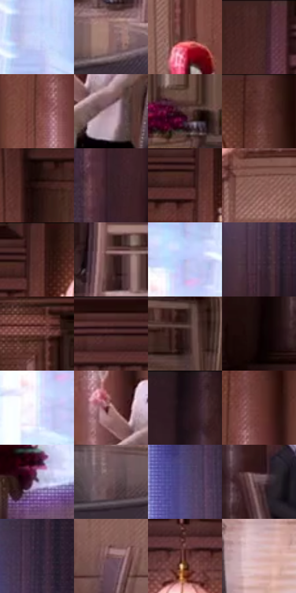

# 电影参考 009

- 状态：条件／仅归档；来源世界：early-montage-unverified。
- 视角：near-level；景别：environment-wide；场景：interior。
- 时段：interior-time-unknown（外观依据，中置信度；具体时间／晨昏未知）；光照：interior-mixed。
- 材质候选：wood, stone, fabric, glass（帧级，不是像素分割）。
- 明暗组：dark；L* P5/P50/P95：5.50352 / 30.10452 / 86.61431。
- 资格门禁：archive。
- 原截图 SHA-256：`8fa1c17a87a0a7977f83b64fccce6572a04a5e64cac20c1facad4f9a038074e2`；尺寸：2880 × 1208。
- sRGB 像素 SHA-256：`9e8e6beba6e72c3eae87549d658188657285b156baba4c8c98d88e095d4e5de4`。

## 观察与迁移

暖灯餐厅与冷窗，保留多材料响应差异。

早期归档原帧：本轮纳入统计，世界来源未逐镜头核实，不恢复到活跃转绘库。

本公开版保存32个128×128原像素色卡上下文；图集格子并非原场景相邻位置。原rect、图集tile和像素SHA见 `data/palette-crops.json`。上下文不足时不得批准替色，不能以小样推断完整构图。

## 实测色卡

颜色比例分母为保留采样像素，不是材料面积；全部 32 色参与全库匹配。表内四舍五入仅用于阅读，原精度在 JSON。

| ID | HEX | Lab | 原图 xy | 像素数 | 比例 | 明度角色 |
| --- | --- | --- | --- | ---: | ---: | --- |
| 009-S01 | #C8D7FA | [85.896716, 2.139164, -18.758124] | [256, 100] | 10792 | 5.581703% | highlight |
| 009-S02 | #8C6563 | [46.690635, 15.42341, 7.348366] | [1048, 1076] | 10312 | 5.333444% | midtone |
| 009-S03 | #67413D | [31.810749, 15.981996, 9.286148] | [1728, 568] | 8437 | 4.363680% | shadow |
| 009-S04 | #452523 | [18.842869, 14.873642, 7.903078] | [996, 36] | 7866 | 4.068354% | deep-shadow |
| 009-S05 | #794540 | [35.385019, 21.7252, 12.696181] | [2108, 320] | 7753 | 4.009910% | shadow |
| 009-S06 | #B797A5 | [65.684826, 14.25659, -2.829373] | [2244, 816] | 7751 | 4.008875% | light |
| 009-S07 | #543735 | [26.37448, 12.661869, 6.519735] | [2608, 704] | 7744 | 4.005255% | shadow |
| 009-S08 | #5E3431 | [26.899314, 18.491339, 10.106281] | [2136, 48] | 7470 | 3.863540% | shadow |
| 009-S09 | #2A1515 | [9.6632, 10.722102, 4.549604] | [2320, 168] | 7204 | 3.725963% | deep-shadow |
| 009-S10 | #362025 | [15.228032, 11.507227, 1.058975] | [756, 424] | 7125 | 3.685103% | deep-shadow |
| 009-S11 | #3A1D19 | [14.672214, 13.658107, 8.976923] | [1836, 92] | 6554 | 3.389778% | deep-shadow |
| 009-S12 | #8A5D56 | [44.096293, 17.476208, 11.497077] | [1264, 356] | 6446 | 3.333920% | midtone |
| 009-S13 | #552B27 | [23.01949, 18.867958, 11.265223] | [1872, 52] | 6076 | 3.142553% | shadow |
| 009-S14 | #492D2A | [21.801826, 12.474383, 7.276647] | [1132, 960] | 5684 | 2.939807% | shadow |
| 009-S15 | #B3BCE9 | [76.939956, 6.430658, -23.402563] | [136, 208] | 5556 | 2.873605% | light |
| 009-S16 | #473140 | [23.360061, 12.848182, -5.435346] | [616, 672] | 5529 | 2.859640% | shadow |
| 009-S17 | #82524D | [40.109749, 19.430774, 11.299868] | [2408, 344] | 5291 | 2.736545% | midtone |
| 009-S18 | #2A090D | [6.474926, 17.082594, 4.587455] | [1432, 64] | 5267 | 2.724132% | deep-shadow |
| 009-S19 | #301B1B | [12.553972, 10.412614, 4.364491] | [2448, 948] | 5246 | 2.713271% | deep-shadow |
| 009-S20 | #100303 | [1.642984, 3.679511, 1.296582] | [812, 900] | 5184 | 2.681204% | deep-shadow |
| 009-S21 | #E8EEFA | [93.971963, 0.229509, -6.463548] | [104, 300] | 5159 | 2.668273% | highlight |
| 009-S22 | #A77877 | [55.053546, 18.238255, 7.848904] | [2168, 744] | 5145 | 2.661033% | midtone |
| 009-S23 | #190D14 | [4.923474, 6.268363, -1.97406] | [840, 32] | 4991 | 2.581383% | deep-shadow |
| 009-S24 | #6B3733 | [29.658329, 22.571004, 12.876758] | [2160, 232] | 4890 | 2.529145% | shadow |
| 009-S25 | #837499 | [51.400142, 13.440769, -17.849696] | [284, 864] | 4846 | 2.506388% | midtone |
| 009-S26 | #6B5156 | [37.267322, 11.71657, 1.282001] | [896, 1096] | 4790 | 2.477424% | shadow |
| 009-S27 | #504477 | [32.193949, 17.638272, -27.426733] | [564, 220] | 4404 | 2.277782% | shadow |
| 009-S28 | #5E444A | [31.826687, 12.232857, 0.796039] | [916, 756] | 4111 | 2.126240% | shadow |
| 009-S29 | #34253A | [17.267274, 11.784033, -10.790133] | [624, 72] | 4110 | 2.125723% | deep-shadow |
| 009-S30 | #775253 | [38.86693, 15.630293, 5.638416] | [1412, 756] | 3992 | 2.064692% | shadow |
| 009-S31 | #47181A | [15.839211, 22.716738, 10.236202] | [1180, 128] | 3864 | 1.998490% | deep-shadow |
| 009-S32 | #DCB8BC | [77.951141, 13.534304, 2.817139] | [1188, 1128] | 3757 | 1.943149% | light |

## 色阶与空间分布

- 采样 ROI：`[0.01, 0.02, 0.98, 0.94]`；步长：4；样本数：193346。
- 排除区：`[]`。
- 深暗、暗、中、亮、高光五段计数：`[56350, 72985, 31358, 13775, 18878]`。
- RGB 各 256 箱、L* 100 箱、13×5 色相明度表和 3×3 空间统计全部保存在 [总数据](../film-library.json)。
- [可视化档案](../../references/library.html)按需绘制直方图，不存 2,094 张重复图表图片。

## 纹理特征占比

**这是分块图像特征的面积占比，不是波点／排线／丝网／错版的精确语义覆盖率。** 窗格、发丝、织物也会产生方向或周期特征。
原图 ROI 像素 3104134；已测块覆盖 3104134（100.0000%）；未测 0。

| 特征 | 块覆盖像素 | 占已测面积 | 阈值敏感范围 |
| --- | ---: | ---: | --- |
| low-contrast | 0 | 0.0000% | 0.0000% ~ 0.0000% |
| directional-structure | 607104 | 19.5579% | 11.0923% ~ 30.7616% |
| periodic-structure | 2458374 | 79.1968% | 68.7106% ~ 83.6997% |
| mixed-detail | 38656 | 1.2453% | 0.5278% ~ 5.2080% |

阈值敏感范围不是统计置信区间。逐块坐标、尺度、对比、方向一致性、频谱集中度、频率与角度见 [全量特征记录](../texture-features.jsonl)，以帧号定位。
四种印刷层的真实像素覆盖仍标为 `null`，不能填 0，也不能拿上表代替。不得据这些代理测量删除唯一证据。

[测量方法与保留策略](../../references/library-retention.md) · [分类索引](../archive/README.md)
