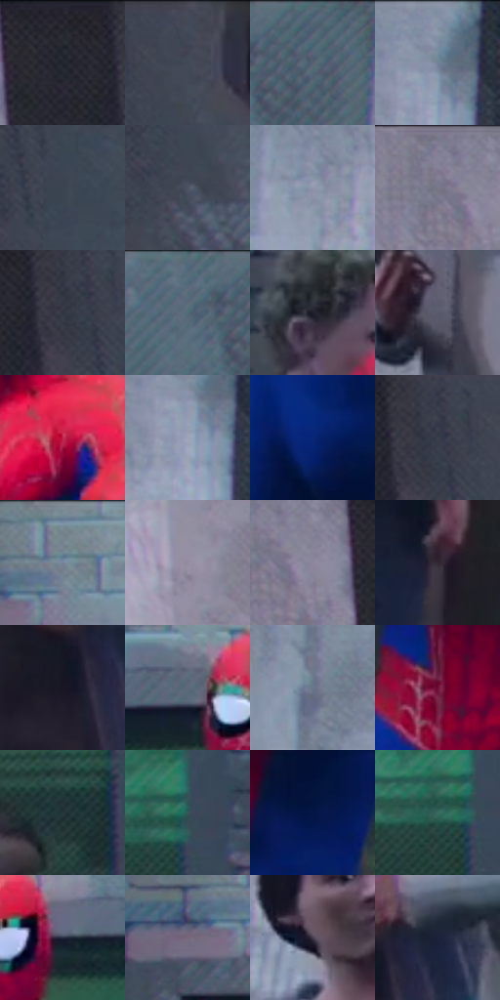

# 电影参考 010

- 状态：条件／仅归档；来源世界：early-montage-unverified。
- 视角：low-angle；景别：medium；场景：street。
- 时段：daylight-time-unspecified（外观依据，中置信度；具体时间／晨昏未知）；光照：neutral-day。
- 材质候选：skin, fabric, brick, stone（帧级，不是像素分割）。
- 明暗组：dark；L* P5/P50/P95：11.26661 / 35.13735 / 62.92787。
- 资格门禁：archive。
- 原截图 SHA-256：`f8531ec6eba037190ad975ed35a4013b2c63eebd12d2e2b9f6700cb61740c60e`；尺寸：2880 × 1204。
- sRGB 像素 SHA-256：`64b5985efb6c633943ef647cfe9fa826a42db7ba41ca38aed2583133744b773c`。

## 观察与迁移

灰绿砖墙前人物，非本次已核实世界基准。

早期归档原帧：本轮纳入统计，世界来源未逐镜头核实，不恢复到活跃转绘库。

本公开版保存32个128×128原像素色卡上下文；图集格子并非原场景相邻位置。原rect、图集tile和像素SHA见 `data/palette-crops.json`。上下文不足时不得批准替色，不能以小样推断完整构图。

## 实测色卡

颜色比例分母为保留采样像素，不是材料面积；全部 32 色参与全库匹配。表内四舍五入仅用于阅读，原精度在 JSON。

| ID | HEX | Lab | 原图 xy | 像素数 | 比例 | 明度角色 |
| --- | --- | --- | --- | ---: | ---: | --- |
| 010-S01 | #242730 | [15.692972, 1.117344, -6.325389] | [2512, 52] | 13495 | 7.005004% | deep-shadow |
| 010-S02 | #434755 | [30.292233, 1.815809, -8.865214] | [2712, 44] | 11147 | 5.786201% | shadow |
| 010-S03 | #4D6171 | [40.112571, -3.370672, -11.493975] | [288, 28] | 9172 | 4.761015% | midtone |
| 010-S04 | #8391A4 | [59.667435, -0.813562, -11.6837] | [792, 28] | 8876 | 4.607367% | midtone |
| 010-S05 | #3B4451 | [28.53258, -0.265424, -9.004979] | [2684, 208] | 8432 | 4.376895% | shadow |
| 010-S06 | #4E5364 | [35.451529, 2.125238, -10.494106] | [2744, 464] | 8146 | 4.228437% | shadow |
| 010-S07 | #9297AC | [62.694838, 2.604859, -11.558716] | [668, 180] | 7039 | 3.653814% | light |
| 010-S08 | #828197 | [54.741658, 5.02473, -11.63049] | [2360, 40] | 6891 | 3.576990% | midtone |
| 010-S09 | #333542 | [22.455255, 2.492339, -8.362536] | [2596, 88] | 6864 | 3.562975% | shadow |
| 010-S10 | #556878 | [43.044412, -3.074335, -11.26544] | [192, 36] | 6816 | 3.538059% | midtone |
| 010-S11 | #1E1F2A | [12.110745, 2.645598, -7.520047] | [996, 432] | 6811 | 3.535464% | deep-shadow |
| 010-S12 | #595A6B | [38.721006, 3.50471, -9.81825] | [636, 848] | 6562 | 3.406212% | shadow |
| 010-S13 | #C2284E | [43.566589, 60.954846, 17.105832] | [1548, 428] | 6519 | 3.383892% | midtone |
| 010-S14 | #9EA2B9 | [66.98493, 3.315194, -12.313511] | [784, 112] | 6479 | 3.363129% | light |
| 010-S15 | #092677 | [19.121742, 24.453109, -48.732667] | [1324, 936] | 6113 | 3.173145% | deep-shadow |
| 010-S16 | #383E4A | [26.099416, 0.605128, -8.131994] | [2616, 72] | 5930 | 3.078153% | shadow |
| 010-S17 | #768498 | [54.679237, -0.530031, -12.395996] | [1208, 64] | 5781 | 3.000810% | midtone |
| 010-S18 | #958DA2 | [59.931986, 7.129975, -10.003035] | [2228, 228] | 5674 | 2.945268% | midtone |
| 010-S19 | #8C879C | [57.369999, 6.139289, -10.484629] | [2412, 80] | 5633 | 2.923986% | midtone |
| 010-S20 | #342735 | [17.636763, 9.144522, -6.734334] | [1092, 1064] | 5604 | 2.908932% | deep-shadow |
| 010-S21 | #1A1625 | [8.367768, 6.208738, -9.620065] | [1768, 1012] | 5585 | 2.899070% | deep-shadow |
| 010-S22 | #60697C | [44.297146, 1.054452, -11.707106] | [1384, 148] | 5426 | 2.816536% | midtone |
| 010-S23 | #69778A | [49.534127, -0.71537, -12.07183] | [496, 184] | 5210 | 2.704414% | midtone |
| 010-S24 | #6B1035 | [22.84207, 41.074996, 2.020101] | [1336, 764] | 4807 | 2.495224% | shadow |
| 010-S25 | #26373A | [21.76204, -6.010292, -4.109729] | [1772, 580] | 4401 | 2.284477% | shadow |
| 010-S26 | #39565A | [34.525169, -9.605942, -5.762846] | [1824, 380] | 3637 | 1.887899% | shadow |
| 010-S27 | #041545 | [8.921336, 14.90999, -32.052951] | [1492, 672] | 3268 | 1.696358% | deep-shadow |
| 010-S28 | #3B6C62 | [42.055789, -19.264303, 0.42162] | [1788, 400] | 3088 | 1.602923% | midtone |
| 010-S29 | #262B40 | [17.963186, 4.034567, -13.991963] | [1576, 164] | 3028 | 1.571779% | deep-shadow |
| 010-S30 | #76677E | [45.714221, 10.563888, -10.584723] | [1128, 112] | 2850 | 1.479382% | midtone |
| 010-S31 | #433B4B | [26.242587, 7.102179, -8.474766] | [664, 552] | 2337 | 1.213093% | shadow |
| 010-S32 | #1B223A | [13.723798, 4.844341, -16.501481] | [1840, 956] | 1027 | 0.533097% | deep-shadow |

## 色阶与空间分布

- 采样 ROI：`[0.01, 0.02, 0.98, 0.94]`；步长：4；样本数：192648。
- 排除区：`[]`。
- 深暗、暗、中、亮、高光五段计数：`[44735, 68860, 59909, 19075, 69]`。
- RGB 各 256 箱、L* 100 箱、13×5 色相明度表和 3×3 空间统计全部保存在 [总数据](../film-library.json)。
- [可视化档案](../../references/library.html)按需绘制直方图，不存 2,094 张重复图表图片。

## 纹理特征占比

**这是分块图像特征的面积占比，不是波点／排线／丝网／错版的精确语义覆盖率。** 窗格、发丝、织物也会产生方向或周期特征。
原图 ROI 像素 3092958；已测块覆盖 3092958（100.0000%）；未测 0。

| 特征 | 块覆盖像素 | 占已测面积 | 阈值敏感范围 |
| --- | ---: | ---: | --- |
| low-contrast | 24192 | 0.7822% | 0.4387% ~ 0.7822% |
| directional-structure | 331648 | 10.7227% | 3.3356% ~ 24.1229% |
| periodic-structure | 2595422 | 83.9139% | 74.9087% ~ 84.8420% |
| mixed-detail | 141696 | 4.5812% | 0.5297% ~ 11.0402% |

阈值敏感范围不是统计置信区间。逐块坐标、尺度、对比、方向一致性、频谱集中度、频率与角度见 [全量特征记录](../texture-features.jsonl)，以帧号定位。
四种印刷层的真实像素覆盖仍标为 `null`，不能填 0，也不能拿上表代替。不得据这些代理测量删除唯一证据。

[测量方法与保留策略](../../references/library-retention.md) · [分类索引](../archive/README.md)
