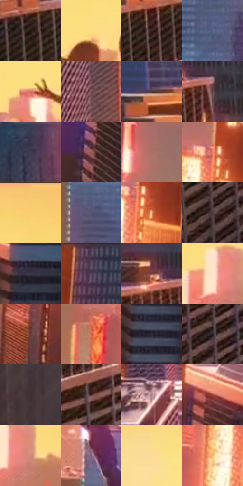

# 电影参考 011

- 状态：条件／仅归档；来源世界：early-montage-unverified。
- 视角：high-angle；景别：environment-wide；场景：city。
- 时段：daylight-time-unspecified（外观依据，中置信度；具体时间／晨昏未知）；光照：warm-day。
- 材质候选：glass, stone, sky, fabric（帧级，不是像素分割）。
- 明暗组：dark；L* P5/P50/P95：12.77442 / 38.20943 / 89.14586。
- 资格门禁：archive。
- 原截图 SHA-256：`cfc1168c2ef439ea4ebd9a159a3bdc5ea618cd43b8b4220cfec73791645abed8`；尺寸：2880 × 1206。
- sRGB 像素 SHA-256：`4ca30aea424e9ad9f319b58e57c5a37a6a243264502a13d0dcca5ccc990a2b37`。

## 观察与迁移

金色城市和深暗服装，高亮面积小于整体暖色面积。

早期归档原帧：本轮纳入统计，世界来源未逐镜头核实，不恢复到活跃转绘库。

本公开版保存32个128×128原像素色卡上下文；图集格子并非原场景相邻位置。原rect、图集tile和像素SHA见 `data/palette-crops.json`。上下文不足时不得批准替色，不能以小样推断完整构图。

## 实测色卡

颜色比例分母为保留采样像素，不是材料面积；全部 32 色参与全库匹配。表内四舍五入仅用于阅读，原精度在 JSON。

| ID | HEX | Lab | 原图 xy | 像素数 | 比例 | 明度角色 |
| --- | --- | --- | --- | ---: | ---: | --- |
| 011-S01 | #261712 | [9.55047, 6.77627, 6.248297] | [300, 476] | 9473 | 4.899507% | deep-shadow |
| 011-S02 | #FBDD81 | [88.832792, -1.183999, 48.69002] | [1224, 148] | 9393 | 4.858130% | highlight |
| 011-S03 | #3B2421 | [16.996302, 10.507362, 6.513948] | [456, 460] | 8627 | 4.461949% | deep-shadow |
| 011-S04 | #5B688B | [44.216068, 4.022508, -20.869236] | [1976, 728] | 8601 | 4.448502% | midtone |
| 011-S05 | #D47866 | [60.241972, 34.030471, 25.611194] | [1104, 196] | 8042 | 4.159383% | light |
| 011-S06 | #7C525A | [39.679051, 18.770526, 2.538851] | [1320, 868] | 7764 | 4.015599% | shadow |
| 011-S07 | #4D3839 | [25.867657, 9.509732, 3.023496] | [72, 284] | 7235 | 3.741996% | shadow |
| 011-S08 | #66464A | [33.350115, 14.382227, 3.124475] | [668, 392] | 7082 | 3.662863% | shadow |
| 011-S09 | #3E3C54 | [26.435902, 6.925731, -14.136286] | [668, 80] | 6994 | 3.617349% | shadow |
| 011-S10 | #9C5A58 | [45.752415, 26.838107, 12.943636] | [2584, 920] | 6891 | 3.564077% | midtone |
| 011-S11 | #AA7067 | [53.075613, 21.851685, 14.450295] | [2188, 872] | 6658 | 3.443567% | midtone |
| 011-S12 | #EF8770 | [67.166732, 37.437026, 29.79042] | [2496, 324] | 6557 | 3.391330% | light |
| 011-S13 | #F9CD71 | [84.482915, 4.858352, 51.106476] | [2160, 52] | 6458 | 3.340126% | highlight |
| 011-S14 | #535373 | [36.485909, 7.858771, -18.224389] | [1628, 836] | 6400 | 3.310128% | shadow |
| 011-S15 | #F2AC7E | [76.003328, 20.440174, 33.820456] | [2528, 368] | 6310 | 3.263579% | light |
| 011-S16 | #523D42 | [28.180764, 10.098131, 0.507697] | [580, 912] | 6298 | 3.257373% | shadow |
| 011-S17 | #3A3345 | [22.642795, 7.392023, -10.03312] | [2772, 704] | 6240 | 3.227375% | shadow |
| 011-S18 | #52435B | [30.791876, 11.568743, -11.827534] | [2636, 296] | 6174 | 3.193239% | shadow |
| 011-S19 | #7D3D3A | [33.991396, 27.371384, 14.700137] | [588, 352] | 5771 | 2.984804% | shadow |
| 011-S20 | #FDE4CD | [92.033352, 4.98367, 14.345905] | [2020, 192] | 5719 | 2.957910% | highlight |
| 011-S21 | #693735 | [29.395846, 21.932881, 11.171055] | [2456, 668] | 5546 | 2.868433% | shadow |
| 011-S22 | #D0634D | [54.941435, 41.386691, 32.809279] | [2292, 432] | 5404 | 2.794989% | midtone |
| 011-S23 | #302C39 | [18.907643, 5.015726, -7.632196] | [2748, 1064] | 5018 | 2.595347% | deep-shadow |
| 011-S24 | #2A2125 | [13.906027, 5.168802, -1.066559] | [620, 760] | 4798 | 2.481562% | deep-shadow |
| 011-S25 | #3F2E31 | [20.952538, 8.345418, 1.10251] | [928, 1056] | 4749 | 2.456218% | shadow |
| 011-S26 | #512C2B | [22.742443, 16.922516, 8.08341] | [568, 560] | 4513 | 2.334157% | shadow |
| 011-S27 | #AF828A | [58.896091, 18.544273, 2.495895] | [1260, 636] | 4288 | 2.217786% | midtone |
| 011-S28 | #9E443B | [40.769492, 36.787181, 23.920377] | [2628, 640] | 4130 | 2.136067% | midtone |
| 011-S29 | #D48C7D | [65.150156, 25.633866, 19.292839] | [2076, 208] | 4129 | 2.135550% | light |
| 011-S30 | #806580 | [46.251742, 15.857483, -10.876329] | [1600, 564] | 3693 | 1.910047% | midtone |
| 011-S31 | #FBDC9B | [88.953269, 1.914829, 35.896717] | [1440, 96] | 2536 | 1.311638% | highlight |
| 011-S32 | #F6C17B | [81.383093, 10.714758, 42.314688] | [2428, 408] | 1855 | 0.959420% | highlight |

## 色阶与空间分布

- 采样 ROI：`[0.01, 0.02, 0.98, 0.94]`；步长：4；样本数：193346。
- 排除区：`[]`。
- 深暗、暗、中、亮、高光五段计数：`[28315, 74062, 42350, 22299, 26320]`。
- RGB 各 256 箱、L* 100 箱、13×5 色相明度表和 3×3 空间统计全部保存在 [总数据](../film-library.json)。
- [可视化档案](../../references/library.html)按需绘制直方图，不存 2,094 张重复图表图片。

## 纹理特征占比

**这是分块图像特征的面积占比，不是波点／排线／丝网／错版的精确语义覆盖率。** 窗格、发丝、织物也会产生方向或周期特征。
原图 ROI 像素 3098546；已测块覆盖 3098546（100.0000%）；未测 0。

| 特征 | 块覆盖像素 | 占已测面积 | 阈值敏感范围 |
| --- | ---: | ---: | --- |
| low-contrast | 49152 | 1.5863% | 0.0000% ~ 3.1726% |
| directional-structure | 573746 | 18.5166% | 3.6063% ~ 40.9850% |
| periodic-structure | 2360960 | 76.1957% | 58.4863% ~ 84.0586% |
| mixed-detail | 114688 | 3.7013% | 0.5288% ~ 9.1625% |

阈值敏感范围不是统计置信区间。逐块坐标、尺度、对比、方向一致性、频谱集中度、频率与角度见 [全量特征记录](../texture-features.jsonl)，以帧号定位。
四种印刷层的真实像素覆盖仍标为 `null`，不能填 0，也不能拿上表代替。不得据这些代理测量删除唯一证据。

[测量方法与保留策略](../../references/library-retention.md) · [分类索引](../archive/README.md)
