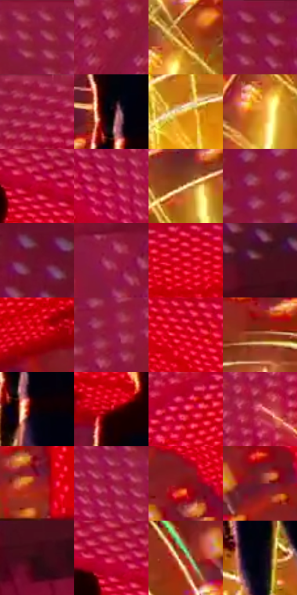

# 电影参考 012

- 状态：条件／仅归档；来源世界：early-montage-unverified。
- 视角：low-angle；景别：environment-wide；场景：industrial。
- 时段：event-time-unknown（外观依据，中置信度；具体时间／晨昏未知）；光照：event-light。
- 材质候选：metal, fabric（帧级，不是像素分割）。
- 明暗组：dark；L* P5/P50/P95：0.91811 / 35.75956 / 80.25274。
- 资格门禁：archive。
- 原截图 SHA-256：`7137f92a523d48f383451184f69893b46614387ce399caea71a93d7d5ad6e2ab`；尺寸：2880 × 1206。
- sRGB 像素 SHA-256：`10ffde6733aad95251da0858a98fc3d27026acf2ca1312ef6150b870a9818b7b`。

## 观察与迁移

能量装置强红黄，不作日常工业照明。

早期归档原帧：本轮纳入统计，世界来源未逐镜头核实，不恢复到活跃转绘库。

本公开版保存32个128×128原像素色卡上下文；图集格子并非原场景相邻位置。原rect、图集tile和像素SHA见 `data/palette-crops.json`。上下文不足时不得批准替色，不能以小样推断完整构图。

## 实测色卡

颜色比例分母为保留采样像素，不是材料面积；全部 32 色参与全库匹配。表内四舍五入仅用于阅读，原精度在 JSON。

| ID | HEX | Lab | 原图 xy | 像素数 | 比例 | 明度角色 |
| --- | --- | --- | --- | ---: | ---: | --- |
| 012-S01 | #8A183C | [30.362302, 48.350866, 8.825076] | [2188, 48] | 10026 | 5.185522% | shadow |
| 012-S02 | #AB3857 | [41.495795, 49.22308, 7.957375] | [368, 348] | 9063 | 4.687452% | midtone |
| 012-S03 | #B7661A | [51.436191, 27.399092, 52.794309] | [976, 676] | 8501 | 4.396781% | midtone |
| 012-S04 | #841237 | [28.420851, 47.852252, 9.288961] | [2368, 40] | 8033 | 4.154728% | shadow |
| 012-S05 | #A31D43 | [36.124246, 54.577778, 12.975057] | [1000, 44] | 7951 | 4.112317% | shadow |
| 012-S06 | #020001 | [0.136404, 0.662042, -0.194147] | [1520, 404] | 7791 | 4.029564% | deep-shadow |
| 012-S07 | #ECBA47 | [78.116097, 6.623308, 62.634487] | [1276, 744] | 7780 | 4.023874% | light |
| 012-S08 | #DB8C29 | [64.946887, 22.62004, 60.98973] | [932, 744] | 7352 | 3.802509% | light |
| 012-S09 | #C1022E | [40.543632, 65.625682, 33.09385] | [1664, 132] | 7336 | 3.794234% | midtone |
| 012-S10 | #AC083C | [36.50534, 60.376572, 18.336921] | [2080, 288] | 7268 | 3.759064% | shadow |
| 012-S11 | #FEE1A9 | [90.683361, 2.11449, 31.099284] | [1156, 496] | 7144 | 3.694930% | highlight |
| 012-S12 | #881B2E | [29.953423, 45.878299, 17.492282] | [260, 196] | 7072 | 3.657691% | shadow |
| 012-S13 | #6E0F2B | [23.108336, 41.390463, 9.439947] | [2644, 76] | 6863 | 3.549595% | shadow |
| 012-S14 | #952448 | [34.233737, 48.760546, 6.68412] | [2632, 696] | 6642 | 3.435292% | shadow |
| 012-S15 | #C4000C | [40.842117, 65.818197, 50.964429] | [1312, 168] | 6598 | 3.412535% | midtone |
| 012-S16 | #4D101C | [15.657784, 29.186407, 8.769584] | [2656, 360] | 6340 | 3.279096% | deep-shadow |
| 012-S17 | #D10317 | [43.780364, 68.906822, 49.796552] | [1168, 296] | 6068 | 3.138415% | midtone |
| 012-S18 | #941643 | [32.429061, 52.220101, 7.383911] | [380, 260] | 5961 | 3.083074% | shadow |
| 012-S19 | #E30A29 | [47.896928, 73.10917, 45.807597] | [1828, 300] | 5888 | 3.045318% | midtone |
| 012-S20 | #89391D | [34.670848, 32.441893, 33.399773] | [1404, 512] | 5397 | 2.791369% | shadow |
| 012-S21 | #130206 | [1.761876, 5.64354, 0.278902] | [1556, 468] | 5078 | 2.626380% | deep-shadow |
| 012-S22 | #AC081D | [36.053346, 59.123274, 37.029605] | [1508, 272] | 5036 | 2.604657% | shadow |
| 012-S23 | #E52A55 | [50.657954, 70.325321, 23.437709] | [832, 316] | 4898 | 2.533282% | midtone |
| 012-S24 | #D54B66 | [51.996963, 56.034866, 14.518126] | [500, 516] | 4455 | 2.304159% | midtone |
| 012-S25 | #961A30 | [32.784473, 50.482315, 20.390542] | [2100, 884] | 4437 | 2.294850% | shadow |
| 012-S26 | #9B0E3B | [33.136802, 55.156051, 13.861814] | [2068, 180] | 4071 | 2.105552% | shadow |
| 012-S27 | #860A15 | [27.685571, 48.34408, 30.692767] | [1888, 508] | 4046 | 2.092622% | shadow |
| 012-S28 | #711D26 | [25.352799, 37.16284, 15.951563] | [2000, 692] | 3803 | 1.966940% | shadow |
| 012-S29 | #2D0A0F | [7.313231, 18.378516, 4.873267] | [2688, 424] | 3732 | 1.930218% | deep-shadow |
| 012-S30 | #C61D45 | [43.238453, 64.184882, 22.424592] | [1632, 104] | 3542 | 1.831949% | midtone |
| 012-S31 | #9F3D28 | [39.350165, 39.505407, 33.437136] | [1884, 708] | 3180 | 1.644720% | shadow |
| 012-S32 | #050411 | [1.441269, 2.273049, -5.382581] | [1572, 672] | 1994 | 1.031312% | deep-shadow |

## 色阶与空间分布

- 采样 ROI：`[0.01, 0.02, 0.98, 0.94]`；步长：4；样本数：193346。
- 排除区：`[]`。
- 深暗、暗、中、亮、高光五段计数：`[24693, 96385, 50348, 12112, 9808]`。
- RGB 各 256 箱、L* 100 箱、13×5 色相明度表和 3×3 空间统计全部保存在 [总数据](../film-library.json)。
- [可视化档案](../../references/library.html)按需绘制直方图，不存 2,094 张重复图表图片。

## 纹理特征占比

**这是分块图像特征的面积占比，不是波点／排线／丝网／错版的精确语义覆盖率。** 窗格、发丝、织物也会产生方向或周期特征。
原图 ROI 像素 3098546；已测块覆盖 3098546（100.0000%）；未测 0。

| 特征 | 块覆盖像素 | 占已测面积 | 阈值敏感范围 |
| --- | ---: | ---: | --- |
| low-contrast | 52530 | 1.6953% | 1.3442% ~ 2.0464% |
| directional-structure | 267264 | 8.6255% | 3.3420% ~ 19.3742% |
| periodic-structure | 2696832 | 87.0354% | 78.7528% ~ 87.9153% |
| mixed-detail | 81920 | 2.6438% | 0.5288% ~ 6.6963% |

阈值敏感范围不是统计置信区间。逐块坐标、尺度、对比、方向一致性、频谱集中度、频率与角度见 [全量特征记录](../texture-features.jsonl)，以帧号定位。
四种印刷层的真实像素覆盖仍标为 `null`，不能填 0，也不能拿上表代替。不得据这些代理测量删除唯一证据。

[测量方法与保留策略](../../references/library-retention.md) · [分类索引](../archive/README.md)
