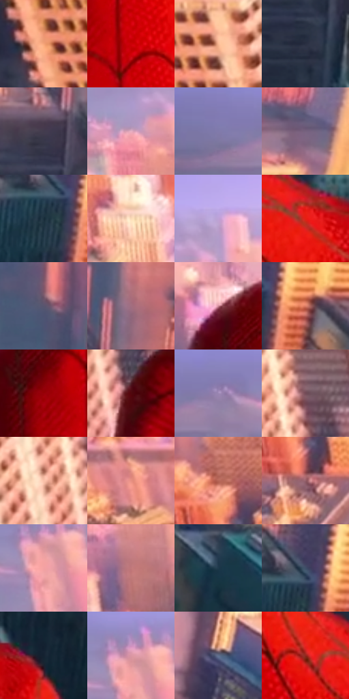

# 电影参考 013

- 状态：条件／仅归档；来源世界：early-montage-unverified。
- 视角：high-angle；景别：environment-wide；场景：city。
- 时段：daylight-time-unspecified（外观依据，中置信度；具体时间／晨昏未知）；光照：warm-day。
- 材质候选：glass, stone, sky, fabric（帧级，不是像素分割）。
- 明暗组：middle；L* P5/P50/P95：16.39626 / 51.02752 / 83.5352。
- 资格门禁：archive。
- 原截图 SHA-256：`03f7e11e9fa9ad7db54ed4b627b1de12f0d41714c888c4922e378c9cebeebc32`；尺寸：2880 × 1202。
- sRGB 像素 SHA-256：`6095a79727856013dcb52b0c5836f78d118fc0111cfd547e3745772a825d70d9`。

## 观察与迁移

金色城市和深暗服装，高亮面积小于整体暖色面积。

早期归档原帧：本轮纳入统计，世界来源未逐镜头核实，不恢复到活跃转绘库。

本公开版保存32个128×128原像素色卡上下文；图集格子并非原场景相邻位置。原rect、图集tile和像素SHA见 `data/palette-crops.json`。上下文不足时不得批准替色，不能以小样推断完整构图。

## 实测色卡

颜色比例分母为保留采样像素，不是材料面积；全部 32 色参与全库匹配。表内四舍五入仅用于阅读，原精度在 JSON。

| ID | HEX | Lab | 原图 xy | 像素数 | 比例 | 明度角色 |
| --- | --- | --- | --- | ---: | ---: | --- |
| 013-S01 | #F5A478 | [74.396462, 25.303626, 34.980039] | [372, 1056] | 8797 | 4.566359% | light |
| 013-S02 | #CB0207 | [42.398611, 67.319176, 54.240452] | [1332, 416] | 7970 | 4.137079% | midtone |
| 013-S03 | #F9B792 | [79.662724, 19.397119, 28.207667] | [572, 864] | 7922 | 4.112163% | light |
| 013-S04 | #2A2F42 | [19.7145, 3.267801, -12.624862] | [1708, 764] | 7456 | 3.870271% | deep-shadow |
| 013-S05 | #433C4E | [26.663562, 7.191365, -9.810977] | [1716, 604] | 7422 | 3.852622% | shadow |
| 013-S06 | #E7AFC3 | [77.03579, 23.409462, -2.194085] | [992, 184] | 7412 | 3.847432% | light |
| 013-S07 | #807AAB | [53.436386, 13.228087, -25.213553] | [344, 156] | 7334 | 3.806943% | midtone |
| 013-S08 | #77627F | [44.503867, 14.160222, -13.005317] | [2388, 428] | 7154 | 3.713509% | midtone |
| 013-S09 | #192E3C | [17.858474, -3.595072, -11.472036] | [2000, 696] | 7132 | 3.702089% | deep-shadow |
| 013-S10 | #FBDBB7 | [89.202338, 5.816459, 21.808653] | [1068, 500] | 6937 | 3.600868% | highlight |
| 013-S11 | #BEA2D7 | [70.659579, 20.216362, -23.09731] | [1072, 96] | 6855 | 3.558303% | light |
| 013-S12 | #E51D15 | [49.002851, 70.852771, 56.201337] | [1716, 1012] | 6738 | 3.497571% | midtone |
| 013-S13 | #59556F | [37.42351, 7.616725, -14.261119] | [1648, 404] | 6450 | 3.348075% | shadow |
| 013-S14 | #A26E81 | [52.30821, 23.511015, -2.054056] | [1788, 484] | 6400 | 3.322121% | midtone |
| 013-S15 | #CB8694 | [63.249539, 28.356165, 3.477071] | [1200, 260] | 6348 | 3.295129% | light |
| 013-S16 | #DD7E68 | [62.757729, 34.535378, 28.012738] | [2092, 688] | 6087 | 3.159649% | light |
| 013-S17 | #990207 | [31.424393, 54.505036, 42.379551] | [1248, 364] | 5930 | 3.078153% | shadow |
| 013-S18 | #51070D | [15.120411, 32.875099, 17.961781] | [864, 1032] | 5892 | 3.058428% | deep-shadow |
| 013-S19 | #9C88B4 | [59.86297, 16.252129, -20.29502] | [452, 152] | 5632 | 2.923467% | midtone |
| 013-S20 | #744C58 | [37.090968, 18.805387, -0.097428] | [836, 892] | 5554 | 2.882978% | shadow |
| 013-S21 | #FAC1A9 | [82.556856, 17.180445, 19.957951] | [768, 956] | 5525 | 2.867925% | highlight |
| 013-S22 | #E89082 | [68.546463, 31.755937, 21.537264] | [312, 524] | 5427 | 2.817055% | light |
| 013-S23 | #B66557 | [51.772784, 31.058677, 22.278352] | [848, 528] | 5362 | 2.783315% | midtone |
| 013-S24 | #945E68 | [46.045098, 23.445641, 3.541132] | [868, 644] | 5301 | 2.751651% | midtone |
| 013-S25 | #F3A1A2 | [74.290003, 30.558154, 12.05983] | [664, 188] | 5245 | 2.722582% | light |
| 013-S26 | #C0787B | [58.105184, 28.527923, 10.268126] | [1036, 328] | 4778 | 2.480171% | midtone |
| 013-S27 | #1E394B | [22.688511, -4.174422, -14.166595] | [2404, 860] | 4740 | 2.460446% | shadow |
| 013-S28 | #3F4F68 | [33.238379, 0.723524, -16.48751] | [2024, 644] | 4477 | 2.323928% | shadow |
| 013-S29 | #152231 | [12.766933, -0.404871, -11.627036] | [1872, 1016] | 4150 | 2.154188% | deep-shadow |
| 013-S30 | #DA97A4 | [69.270757, 26.945133, 3.397721] | [664, 148] | 4051 | 2.102799% | light |
| 013-S31 | #60708C | [46.932421, 1.026067, -17.266056] | [2284, 608] | 3907 | 2.028051% | midtone |
| 013-S32 | #90291F | [33.169895, 42.622568, 31.093546] | [1524, 932] | 2263 | 1.174681% | shadow |

## 色阶与空间分布

- 采样 ROI：`[0.01, 0.02, 0.98, 0.94]`；步长：4；样本数：192648。
- 排除区：`[]`。
- 深暗、暗、中、亮、高光五段计数：`[19729, 40600, 59120, 56307, 16892]`。
- RGB 各 256 箱、L* 100 箱、13×5 色相明度表和 3×3 空间统计全部保存在 [总数据](../film-library.json)。
- [可视化档案](../../references/library.html)按需绘制直方图，不存 2,094 张重复图表图片。

## 纹理特征占比

**这是分块图像特征的面积占比，不是波点／排线／丝网／错版的精确语义覆盖率。** 窗格、发丝、织物也会产生方向或周期特征。
原图 ROI 像素 3087370；已测块覆盖 3087370（100.0000%）；未测 0。

| 特征 | 块覆盖像素 | 占已测面积 | 阈值敏感范围 |
| --- | ---: | ---: | --- |
| low-contrast | 16384 | 0.5307% | 0.0000% ~ 1.0614% |
| directional-structure | 237312 | 7.6865% | 5.2156% ~ 20.3814% |
| periodic-structure | 2665482 | 86.3350% | 77.6908% ~ 86.3350% |
| mixed-detail | 168192 | 5.4477% | 1.9279% ~ 7.8275% |

阈值敏感范围不是统计置信区间。逐块坐标、尺度、对比、方向一致性、频谱集中度、频率与角度见 [全量特征记录](../texture-features.jsonl)，以帧号定位。
四种印刷层的真实像素覆盖仍标为 `null`，不能填 0，也不能拿上表代替。不得据这些代理测量删除唯一证据。

[测量方法与保留策略](../../references/library-retention.md) · [分类索引](../archive/README.md)
