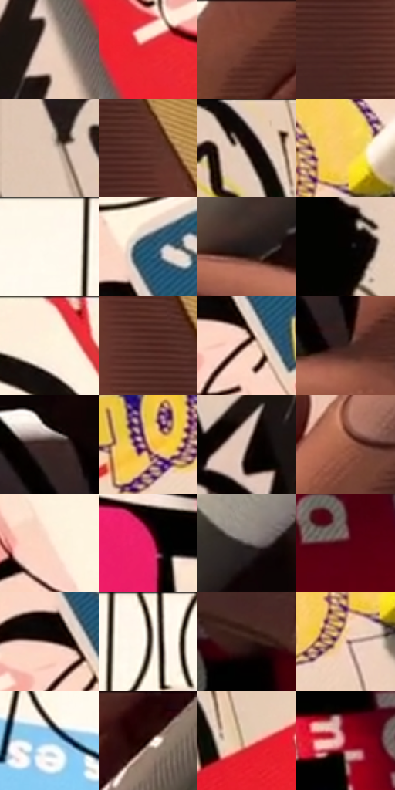

# 电影参考 014

- 状态：条件／活跃；来源世界：miles-home。
- 视角：overhead；景别：detail；场景：detail。
- 时段：interior-time-unknown（外观依据，中置信度；具体时间／晨昏未知）；光照：interior-mixed。
- 材质候选：skin, paper, plastic, paint（帧级，不是像素分割）。
- 明暗组：middle；L* P5/P50/P95：1.33129 / 40.61679 / 95.59911。
- 资格门禁：secondary-image。
- 原截图 SHA-256：`2d4541a5d55bd7046e22f5035b5d830266241a3b83bd3cba762aaac0704813a4`；尺寸：2880 × 1198。
- sRGB 像素 SHA-256：`08e99d4d679531bbb6b9b01f9b113c774dd1ed360f5c34e11433d305d05df15b`。

## 观察与迁移

手、纸卡、贴纸和笔，纸上颜色不能直接充当墙体固有色。

# 14 手绘涂鸦与印刷纸片

**笔触和材质。** 黑色自由曲线粗细、速度和墨量不同，黄字块的紫色斜排线贴着笔画内缘走，蓝条是更细的平行网纹；纸片有印刷错版和不同底色。不要把这帧误读为“所有对象都要有涂鸦文字”。

**轮廓和人物几何。** 两只手是主体：握笔手的拇指和食指形成夹角，笔尖与纸接触点决定运动；另一只手张开压纸，指宽、指节和指甲以少量几何线表示。手掌褐色受光面与细密排线随指节转面，不是皮肤照片纹理。脸和全身不在画面中，无法推断人物比例。

**后续应用。** 适合手部、手作、海报和街头物件：优先保护手指数量、握持关系、笔尖接触和文字原有位置；新可读文案不凭空生成。

本公开版保存32个128×128原像素色卡上下文；图集格子并非原场景相邻位置。原rect、图集tile和像素SHA见 `data/palette-crops.json`。上下文不足时不得批准替色，不能以小样推断完整构图。

## 实测色卡

颜色比例分母为保留采样像素，不是材料面积；全部 32 色参与全库匹配。表内四舍五入仅用于阅读，原精度在 JSON。

| ID | HEX | Lab | 原图 xy | 像素数 | 比例 | 明度角色 |
| --- | --- | --- | --- | ---: | ---: | --- |
| 014-S01 | #EBCFBC | [84.955849, 6.825315, 13.034326] | [504, 1004] | 10130 | 5.258295% | highlight |
| 014-S02 | #EA2531 | [50.737458, 71.237929, 44.759033] | [500, 716] | 9903 | 5.140463% | midtone |
| 014-S03 | #7E4536 | [35.905881, 22.840109, 19.74528] | [1728, 28] | 9706 | 5.038204% | shadow |
| 014-S04 | #49251F | [19.386759, 16.264405, 11.505991] | [2704, 484] | 9270 | 4.811885% | deep-shadow |
| 014-S05 | #DEC6B5 | [81.431808, 5.731254, 11.60399] | [64, 88] | 9215 | 4.783335% | highlight |
| 014-S06 | #623830 | [28.482882, 17.697049, 13.00587] | [2760, 416] | 8793 | 4.564283% | shadow |
| 014-S07 | #130707 | [2.762052, 3.779781, 1.332069] | [256, 40] | 8221 | 4.267368% | deep-shadow |
| 014-S08 | #F5C958 | [82.85712, 3.540521, 60.676988] | [1508, 496] | 7751 | 4.023400% | highlight |
| 014-S09 | #FEF8EB | [97.714332, -0.192991, 6.94999] | [1284, 36] | 7190 | 3.732196% | highlight |
| 014-S10 | #295877 | [35.561073, -5.593903, -22.342359] | [660, 524] | 7153 | 3.712989% | shadow |
| 014-S11 | #1E191A | [9.367971, 2.697238, 0.209037] | [1864, 304] | 7085 | 3.677692% | deep-shadow |
| 014-S12 | #030201 | [0.586869, 0.122421, 0.470628] | [96, 684] | 6632 | 3.442548% | deep-shadow |
| 014-S13 | #FDEFDD | [95.092429, 1.78432, 10.398262] | [732, 32] | 6555 | 3.402579% | highlight |
| 014-S14 | #542C25 | [23.067981, 17.579888, 12.642356] | [2644, 280] | 6065 | 3.148229% | shadow |
| 014-S15 | #9A786A | [53.324669, 11.151558, 12.770488] | [660, 640] | 6028 | 3.129023% | midtone |
| 014-S16 | #36201C | [14.960528, 10.062416, 7.125495] | [2172, 392] | 6004 | 3.116565% | deep-shadow |
| 014-S17 | #3D2723 | [18.208655, 9.741875, 6.841308] | [2112, 276] | 5698 | 2.957726% | deep-shadow |
| 014-S18 | #C68F65 | [63.829816, 15.856796, 30.512834] | [812, 648] | 5276 | 2.738674% | light |
| 014-S19 | #AA948C | [63.027703, 6.838328, 7.240727] | [408, 1104] | 5178 | 2.687804% | light |
| 014-S20 | #A3614A | [48.04796, 24.349543, 24.484024] | [1068, 968] | 5141 | 2.668598% | midtone |
| 014-S21 | #F8D8C7 | [88.540091, 8.489677, 12.472589] | [552, 400] | 5043 | 2.617728% | highlight |
| 014-S22 | #EB1F66 | [51.3898, 75.110397, 14.303377] | [1656, 936] | 4624 | 2.400233% | midtone |
| 014-S23 | #5C5351 | [36.092014, 3.293367, 2.510089] | [2068, 124] | 4550 | 2.361821% | shadow |
| 014-S24 | #4E0311 | [13.977096, 33.507197, 14.21778] | [1940, 1120] | 4532 | 2.352477% | deep-shadow |
| 014-S25 | #765B54 | [41.175419, 9.925662, 8.278316] | [624, 608] | 4379 | 2.273058% | midtone |
| 014-S26 | #090403 | [1.368451, 1.168383, 0.839248] | [1380, 36] | 4091 | 2.123562% | deep-shadow |
| 014-S27 | #2F1814 | [11.3331, 10.999682, 7.688677] | [1816, 544] | 3975 | 2.063349% | deep-shadow |
| 014-S28 | #D6B09C | [74.666414, 10.816617, 15.429321] | [1468, 580] | 3652 | 1.895685% | light |
| 014-S29 | #94CAEB | [78.771091, -9.433683, -21.872039] | [1104, 152] | 3568 | 1.852083% | light |
| 014-S30 | #260A09 | [5.86229, 13.743385, 5.341069] | [1900, 44] | 3174 | 1.647564% | deep-shadow |
| 014-S31 | #EDC5AC | [82.334688, 10.561683, 17.865225] | [348, 128] | 3055 | 1.585794% | highlight |
| 014-S32 | #9F1930 | [34.563254, 53.337614, 23.017705] | [1808, 988] | 1011 | 0.524791% | shadow |

## 色阶与空间分布

- 采样 ROI：`[0.01, 0.02, 0.98, 0.94]`；步长：4；样本数：192648。
- 排除区：`[]`。
- 深暗、暗、中、亮、高光五段计数：`[52246, 43056, 33734, 16406, 47206]`。
- RGB 各 256 箱、L* 100 箱、13×5 色相明度表和 3×3 空间统计全部保存在 [总数据](../film-library.json)。
- [可视化档案](../../references/library.html)按需绘制直方图，不存 2,094 张重复图表图片。

## 纹理特征占比

**这是分块图像特征的面积占比，不是波点／排线／丝网／错版的精确语义覆盖率。** 窗格、发丝、织物也会产生方向或周期特征。
原图 ROI 像素 3081782；已测块覆盖 3081782（100.0000%）；未测 0。

| 特征 | 块覆盖像素 | 占已测面积 | 阈值敏感范围 |
| --- | ---: | ---: | --- |
| low-contrast | 65536 | 2.1266% | 1.5949% ~ 3.7215% |
| directional-structure | 969344 | 31.4540% | 16.6262% ~ 44.0431% |
| periodic-structure | 1951414 | 63.3210% | 53.8303% ~ 70.3777% |
| mixed-detail | 95488 | 3.0985% | 0.5316% ~ 9.2746% |

阈值敏感范围不是统计置信区间。逐块坐标、尺度、对比、方向一致性、频谱集中度、频率与角度见 [全量特征记录](../texture-features.jsonl)，以帧号定位。
四种印刷层的真实像素覆盖仍标为 `null`，不能填 0，也不能拿上表代替。不得据这些代理测量删除唯一证据。

[测量方法与保留策略](../../references/library-retention.md) · [分类索引](../archive/README.md)
