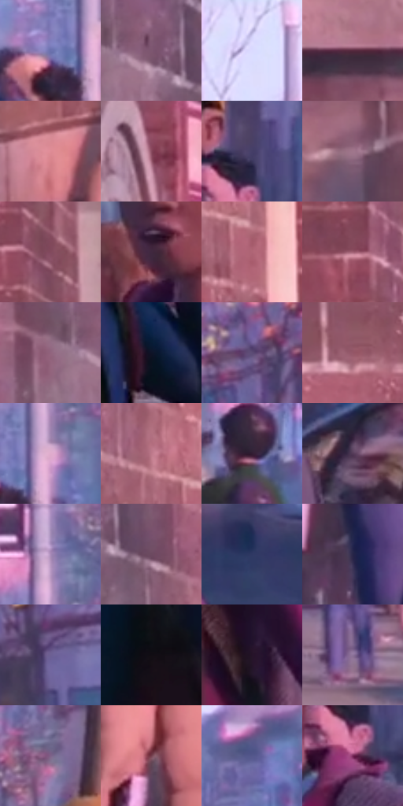

# 电影参考 015

- 状态：常规／活跃；来源世界：miles-home。
- 视角：near-level；景别：medium；场景：street。
- 时段：daylight-time-unspecified（外观依据，中置信度；具体时间／晨昏未知）；光照：warm-day。
- 材质候选：skin, fabric, brick, asphalt, sky（帧级，不是像素分割）。
- 明暗组：middle；L* P5/P50/P95：7.1635 / 41.04097 / 77.91399。
- 资格门禁：无附加门禁。
- 原截图 SHA-256：`76de45615e6d5768fb3f343e45c30cb3387f44b8ff9e75e82b5cb937d025a6d0`；尺寸：2880 × 1202。
- sRGB 像素 SHA-256：`82b0ccd1d14cf704d0d7148e191e198e9d386a23d6b23d2a0af15fad2f03cc9a`。

## 观察与迁移

人物轮廓、暖砖立面和冷街面分离，远人群减细节。

# 15 两名少年街头对话

**笔触和材质。** 砖墙的水平缝线和粗糙颗粒与衣料细网目分开；远处街道粉紫雾化，但人物面部没有同等密度的印刷噪点。右侧外套是紫红平面加随折线变化的深排线，蓝灰内衣保持更平净。眼睛、口鼻与手势是焦点，不被背景纹理遮住。

**轮廓和人物几何。** 左右人物具有不同脸型、发型、颈肩关系和身材：左侧脸部偏窄、发型轮廓上扬，转头说话；右侧面部更圆、帽檐横线扩大头部上缘，张口和伸手体现回应。两人均有少年感，但不能简单写成同一套大眼、小下巴和同样肩宽。镜头只见半身与部分手臂，无法由此量出完整头身比例；应保留可见肩宽、胸廓、背包厚度和手势方向。

**后续应用。** 适合多人生活照：个体身份、表情和身体差异比统一漫画脸更重要；粉紫环境应有明暗分层，人物局部轮廓以相邻冷暖色分离。

本公开版保存32个128×128原像素色卡上下文；图集格子并非原场景相邻位置。原rect、图集tile和像素SHA见 `data/palette-crops.json`。上下文不足时不得批准替色，不能以小样推断完整构图。

## 实测色卡

颜色比例分母为保留采样像素，不是材料面积；全部 32 色参与全库匹配。表内四舍五入仅用于阅读，原精度在 JSON。

| ID | HEX | Lab | 原图 xy | 像素数 | 比例 | 明度角色 |
| --- | --- | --- | --- | ---: | ---: | --- |
| 015-S01 | #6B71AE | [49.485333, 13.16342, -33.226518] | [1880, 504] | 8945 | 4.643183% | midtone |
| 015-S02 | #7C576F | [41.610304, 19.392074, -7.580428] | [416, 84] | 7750 | 4.022881% | midtone |
| 015-S03 | #D7D5FC | [86.535233, 8.242882, -18.745007] | [1872, 48] | 7675 | 3.983950% | highlight |
| 015-S04 | #55283C | [22.915068, 23.533881, -3.173456] | [188, 916] | 7617 | 3.953843% | shadow |
| 015-S05 | #DF8C96 | [67.013156, 32.791359, 8.063523] | [456, 804] | 7589 | 3.939309% | light |
| 015-S06 | #914860 | [40.410787, 33.536776, 0.226422] | [1264, 28] | 7452 | 3.868195% | midtone |
| 015-S07 | #443E67 | [28.520261, 13.135004, -23.152207] | [2496, 440] | 7252 | 3.764379% | shadow |
| 015-S08 | #A0778C | [54.617902, 19.466478, -5.121838] | [300, 1020] | 7200 | 3.737386% | midtone |
| 015-S09 | #824A5D | [38.611516, 26.321241, -0.787781] | [1092, 220] | 6873 | 3.567647% | shadow |
| 015-S10 | #40283F | [19.909549, 15.738687, -10.064523] | [2308, 492] | 6781 | 3.519891% | deep-shadow |
| 015-S11 | #AE6676 | [51.623224, 30.906672, 3.63323] | [736, 348] | 6732 | 3.494456% | midtone |
| 015-S12 | #A06073 | [48.358953, 28.535161, 0.461514] | [892, 112] | 6512 | 3.380258% | midtone |
| 015-S13 | #91637D | [47.527167, 22.777149, -6.973091] | [340, 92] | 6414 | 3.329388% | midtone |
| 015-S14 | #0E1427 | [6.685242, 3.845698, -13.830546] | [1460, 804] | 6359 | 3.300839% | deep-shadow |
| 015-S15 | #5D4C75 | [35.557866, 16.213988, -20.825247] | [2604, 88] | 6224 | 3.230763% | shadow |
| 015-S16 | #945768 | [44.394636, 27.446489, 1.151141] | [136, 660] | 6189 | 3.212595% | midtone |
| 015-S17 | #E0ACCD | [75.922865, 24.218, -9.368074] | [1944, 480] | 6088 | 3.160168% | light |
| 015-S18 | #BC788A | [58.000314, 29.025361, 1.378337] | [668, 272] | 6032 | 3.131099% | midtone |
| 015-S19 | #321C32 | [14.053162, 15.213397, -10.102488] | [1600, 548] | 5982 | 3.105145% | deep-shadow |
| 015-S20 | #543A57 | [28.377928, 17.18701, -12.908565] | [2700, 648] | 5820 | 3.021054% | shadow |
| 015-S21 | #A88AB8 | [61.622076, 19.96291, -19.779559] | [1940, 360] | 5637 | 2.926062% | light |
| 015-S22 | #6C4A60 | [35.850448, 18.26526, -7.077139] | [500, 128] | 5586 | 2.899589% | shadow |
| 015-S23 | #2F3863 | [24.743721, 9.678344, -26.649685] | [2764, 840] | 5349 | 2.776567% | shadow |
| 015-S24 | #262548 | [16.518163, 11.070177, -21.760453] | [608, 1124] | 5138 | 2.667040% | deep-shadow |
| 015-S25 | #6C5F93 | [43.47607, 17.051113, -26.692321] | [2676, 328] | 4880 | 2.533117% | midtone |
| 015-S26 | #120D13 | [4.186487, 2.883068, -2.486266] | [1076, 1044] | 4751 | 2.466156% | deep-shadow |
| 015-S27 | #261328 | [9.24756, 14.179288, -10.370747] | [2560, 880] | 4645 | 2.411133% | deep-shadow |
| 015-S28 | #8D739A | [52.127089, 17.685007, -17.240166] | [1740, 756] | 4337 | 2.251256% | midtone |
| 015-S29 | #7E628A | [45.642644, 19.06224, -17.81434] | [2280, 188] | 4170 | 2.164570% | midtone |
| 015-S30 | #753F4E | [33.74813, 25.397727, 1.396635] | [572, 924] | 3911 | 2.030127% | shadow |
| 015-S31 | #54588C | [39.168385, 12.183383, -29.365186] | [2104, 136] | 3487 | 1.810037% | shadow |
| 015-S32 | #732354 | [28.081794, 40.159492, -10.976249] | [2480, 524] | 3271 | 1.697915% | shadow |

## 色阶与空间分布

- 采样 ROI：`[0.01, 0.02, 0.98, 0.94]`；步长：4；样本数：192648。
- 排除区：`[]`。
- 深暗、暗、中、亮、高光五段计数：`[31497, 59642, 75067, 17706, 8736]`。
- RGB 各 256 箱、L* 100 箱、13×5 色相明度表和 3×3 空间统计全部保存在 [总数据](../film-library.json)。
- [可视化档案](../../references/library.html)按需绘制直方图，不存 2,094 张重复图表图片。

## 纹理特征占比

**这是分块图像特征的面积占比，不是波点／排线／丝网／错版的精确语义覆盖率。** 窗格、发丝、织物也会产生方向或周期特征。
原图 ROI 像素 3087370；已测块覆盖 3087370（100.0000%）；未测 0。

| 特征 | 块覆盖像素 | 占已测面积 | 阈值敏感范围 |
| --- | ---: | ---: | --- |
| low-contrast | 43136 | 1.3972% | 0.0000% ~ 1.3972% |
| directional-structure | 452608 | 14.6600% | 6.2230% ~ 24.3532% |
| periodic-structure | 2548490 | 82.5457% | 74.5855% ~ 88.3292% |
| mixed-detail | 43136 | 1.3972% | 1.0614% ~ 4.0506% |

阈值敏感范围不是统计置信区间。逐块坐标、尺度、对比、方向一致性、频谱集中度、频率与角度见 [全量特征记录](../texture-features.jsonl)，以帧号定位。
四种印刷层的真实像素覆盖仍标为 `null`，不能填 0，也不能拿上表代替。不得据这些代理测量删除唯一证据。

[测量方法与保留策略](../../references/library-retention.md) · [分类索引](../archive/README.md)
