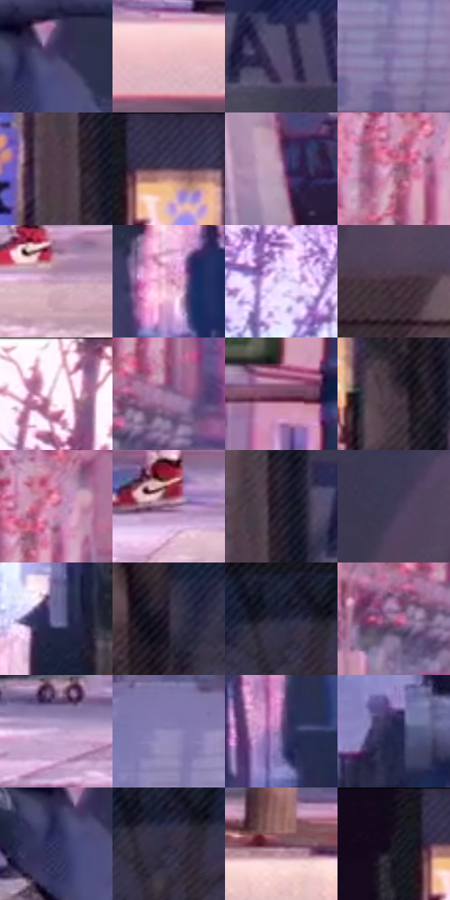

# 电影参考 016

- 状态：常规／活跃；来源世界：miles-home。
- 视角：near-level；景别：environment-wide；场景：street。
- 时段：daylight-time-unspecified（外观依据，中置信度；具体时间／晨昏未知）；光照：warm-day。
- 材质候选：skin, fabric, brick, asphalt, sky（帧级，不是像素分割）。
- 明暗组：middle；L* P5/P50/P95：11.36419 / 41.33545 / 87.64036。
- 资格门禁：无附加门禁。
- 原截图 SHA-256：`ba20bad1ca153b04f47ac507a673947c84e52ae652d1166384cd4e4f9cab514d`；尺寸：2880 × 1204。
- sRGB 像素 SHA-256：`bdd6884c64b0051c9b2dd998d185161fde6dd4f821d1f6ab28991bbfe4d3c0e4`。

## 观察与迁移

人物轮廓、暖砖立面和冷街面分离，远人群减细节。

# 16 人行道侧身动态

**笔触和材质。** 左侧楼面与树枝由粉色概括色面、细线和少量颗粒组成，右侧暗墙用顺建筑面的斜排线压暗。路缘有硬边与磨损色块，远处人物减线减对比；行李箱保持清楚的硬面和窄反光。动态并非通过整幅运动模糊制造。

**轮廓和人物几何。** 主体侧身前倾、后臂向后伸、前腿着地而后腿抬起；动作由头颈前伸、肩骨盆错位、膝踝折线与鞋底接触点连成一条方向明确的动势线。脸部侧面有鼻、下颌与头发的概括，但五官细节有限；不可推断精确体型数据。裤腿与外套依关节和受力起褶，不能把四肢画成等粗管状。

**后续应用。** 适合行走、奔跑或街头瞬间：保留原照动作时序和身体比例；背景减线而不是刻意高斯模糊，荧光粉紫可进入有面积的楼面和受光路面。

本公开版保存32个128×128原像素色卡上下文；图集格子并非原场景相邻位置。原rect、图集tile和像素SHA见 `data/palette-crops.json`。上下文不足时不得批准替色，不能以小样推断完整构图。

## 实测色卡

颜色比例分母为保留采样像素，不是材料面积；全部 32 色参与全库匹配。表内四舍五入仅用于阅读，原精度在 JSON。

| ID | HEX | Lab | 原图 xy | 像素数 | 比例 | 明度角色 |
| --- | --- | --- | --- | ---: | ---: | --- |
| 016-S01 | #443F67 | [28.806538, 12.471748, -22.703487] | [1024, 628] | 9744 | 5.057929% | shadow |
| 016-S02 | #EABCC5 | [80.455631, 17.856102, 1.753532] | [2072, 1084] | 8885 | 4.612039% | highlight |
| 016-S03 | #544A6D | [33.745138, 12.327725, -18.704199] | [1924, 512] | 7806 | 4.051950% | shadow |
| 016-S04 | #8371A6 | [51.138659, 18.282257, -25.843301] | [152, 920] | 7232 | 3.753997% | midtone |
| 016-S05 | #523E4C | [28.801487, 11.428729, -5.120305] | [1772, 552] | 7214 | 3.744653% | shadow |
| 016-S06 | #36324F | [22.408031, 9.413718, -17.129183] | [1672, 44] | 7113 | 3.692226% | shadow |
| 016-S07 | #B38AB1 | [62.453409, 22.301873, -14.455521] | [276, 760] | 6932 | 3.598272% | light |
| 016-S08 | #A06486 | [49.87045, 29.258239, -8.655978] | [432, 356] | 6895 | 3.579066% | midtone |
| 016-S09 | #C397B7 | [67.393445, 21.740311, -10.250531] | [964, 1024] | 6867 | 3.564532% | light |
| 016-S10 | #D79BBB | [70.510631, 27.247315, -7.614812] | [1152, 712] | 6566 | 3.408289% | light |
| 016-S11 | #E4D4F9 | [87.202662, 12.285703, -16.056823] | [1252, 264] | 6484 | 3.365724% | highlight |
| 016-S12 | #402C39 | [20.77737, 11.745417, -4.631337] | [2256, 604] | 6397 | 3.320564% | shadow |
| 016-S13 | #FAEDF8 | [95.021886, 6.273037, -3.724316] | [1028, 56] | 6331 | 3.286305% | highlight |
| 016-S14 | #9D7BA0 | [55.960006, 19.850914, -14.758437] | [504, 472] | 6026 | 3.127985% | midtone |
| 016-S15 | #794D67 | [38.467989, 22.753825, -7.376255] | [64, 152] | 5831 | 3.026764% | shadow |
| 016-S16 | #443542 | [24.221161, 9.373756, -5.527085] | [1780, 304] | 5815 | 3.018459% | shadow |
| 016-S17 | #C279A0 | [59.60228, 33.973579, -8.870587] | [472, 320] | 5809 | 3.015344% | midtone |
| 016-S18 | #875D7D | [44.886811, 22.5846, -11.051651] | [776, 996] | 5775 | 2.997695% | midtone |
| 016-S19 | #1E1727 | [9.282034, 7.707569, -9.660465] | [1812, 484] | 5671 | 2.943711% | deep-shadow |
| 016-S20 | #413A55 | [26.173969, 9.623539, -15.170542] | [2248, 440] | 5634 | 2.924505% | shadow |
| 016-S21 | #696899 | [45.911339, 12.198381, -26.494069] | [1528, 492] | 5591 | 2.902184% | midtone |
| 016-S22 | #2E2436 | [16.048899, 9.018651, -9.920682] | [1840, 140] | 5477 | 2.843009% | deep-shadow |
| 016-S23 | #1E203A | [13.317806, 7.283139, -17.123513] | [2116, 92] | 5473 | 2.840933% | deep-shadow |
| 016-S24 | #AC7395 | [55.281193, 27.68204, -9.236365] | [440, 504] | 5388 | 2.796811% | midtone |
| 016-S25 | #CAACD6 | [74.136713, 18.428001, -17.170086] | [560, 1024] | 5056 | 2.624476% | light |
| 016-S26 | #918ABA | [59.654334, 12.914322, -24.102984] | [128, 716] | 4901 | 2.544018% | midtone |
| 016-S27 | #655485 | [39.242659, 17.968705, -24.885227] | [1292, 732] | 4773 | 2.477576% | shadow |
| 016-S28 | #24294E | [17.967392, 9.739948, -23.557083] | [1500, 712] | 4544 | 2.358706% | deep-shadow |
| 016-S29 | #343562 | [24.186521, 12.784034, -26.859105] | [988, 660] | 4518 | 2.345210% | shadow |
| 016-S30 | #332D42 | [19.939018, 7.986475, -12.207494] | [2128, 116] | 4075 | 2.115257% | deep-shadow |
| 016-S31 | #6B3E52 | [32.215088, 22.65234, -3.590134] | [2676, 1028] | 3949 | 2.049853% | shadow |
| 016-S32 | #140E1B | [4.895196, 5.252218, -7.305103] | [1592, 40] | 3876 | 2.011960% | deep-shadow |

## 色阶与空间分布

- 采样 ROI：`[0.01, 0.02, 0.98, 0.94]`；步长：4；样本数：192648。
- 排除区：`[]`。
- 深暗、暗、中、亮、高光五段计数：`[29026, 64880, 47225, 34573, 16944]`。
- RGB 各 256 箱、L* 100 箱、13×5 色相明度表和 3×3 空间统计全部保存在 [总数据](../film-library.json)。
- [可视化档案](../../references/library.html)按需绘制直方图，不存 2,094 张重复图表图片。

## 纹理特征占比

**这是分块图像特征的面积占比，不是波点／排线／丝网／错版的精确语义覆盖率。** 窗格、发丝、织物也会产生方向或周期特征。
原图 ROI 像素 3092958；已测块覆盖 3092958（100.0000%）；未测 0。

| 特征 | 块覆盖像素 | 占已测面积 | 阈值敏感范围 |
| --- | ---: | ---: | --- |
| low-contrast | 16384 | 0.5297% | 0.5297% ~ 0.5297% |
| directional-structure | 651136 | 21.0522% | 11.6373% ~ 39.0089% |
| periodic-structure | 2343518 | 75.7695% | 59.9317% ~ 81.4764% |
| mixed-detail | 81920 | 2.6486% | 0.5297% ~ 6.3566% |

阈值敏感范围不是统计置信区间。逐块坐标、尺度、对比、方向一致性、频谱集中度、频率与角度见 [全量特征记录](../texture-features.jsonl)，以帧号定位。
四种印刷层的真实像素覆盖仍标为 `null`，不能填 0，也不能拿上表代替。不得据这些代理测量删除唯一证据。

[测量方法与保留策略](../../references/library-retention.md) · [分类索引](../archive/README.md)
