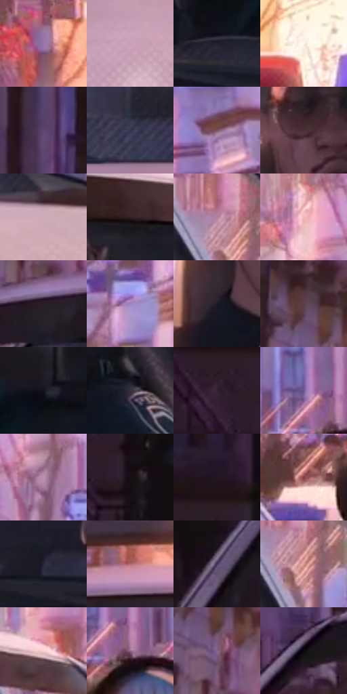

# 电影参考 017

- 状态：常规／活跃；来源世界：miles-home。
- 视角：near-level；景别：medium；场景：vehicle。
- 时段：daylight-time-unspecified（外观依据，中置信度；具体时间／晨昏未知）；光照：warm-day。
- 材质候选：skin, fabric, glass, painted-metal, plastic（帧级，不是像素分割）。
- 明暗组：dark；L* P5/P50/P95：6.15771 / 35.06039 / 88.16857。
- 资格门禁：无附加门禁。
- 原截图 SHA-256：`b339f5219002a2cc88b6a22daa3f48e55a860a6827d84f624644f9a757d6bfea`；尺寸：2880 × 1204。
- sRGB 像素 SHA-256：`456e8e234be27c50a5eb67cf5c6827ee2267390de77a491d7888d1795652c644`。

## 观察与迁移

车窗透射、漆面、内饰与人物分别处理；车内暗部仍保留颜色。

正面警车与暖色街口

前后景由车窗暗面和街道暖亮面分开。车盖细密半调低对比，车内顶棚沿横向略带排线；警灯局部有点阵而不是把整车涂成网点。人物脸保持少量转折线与清楚的眼口，车窗遮挡关系比纹理更重要。车缘高反差处可见轻微彩边，玻璃中不作大幅错位。

本公开版保存32个128×128原像素色卡上下文；图集格子并非原场景相邻位置。原rect、图集tile和像素SHA见 `data/palette-crops.json`。上下文不足时不得批准替色，不能以小样推断完整构图。

## 实测色卡

颜色比例分母为保留采样像素，不是材料面积；全部 32 色参与全库匹配。表内四舍五入仅用于阅读，原精度在 JSON。

| ID | HEX | Lab | 原图 xy | 像素数 | 比例 | 明度角色 |
| --- | --- | --- | --- | ---: | ---: | --- |
| 017-S01 | #96779D | [54.146045, 19.107887, -15.835823] | [1088, 44] | 10112 | 5.248951% | midtone |
| 017-S02 | #CBA0B6 | [70.327622, 19.439869, -5.248082] | [1572, 1060] | 8475 | 4.399215% | light |
| 017-S03 | #252030 | [13.470078, 6.563849, -9.706564] | [1972, 852] | 7676 | 3.984469% | deep-shadow |
| 017-S04 | #FFF7EC | [97.566849, 0.817225, 6.232566] | [1328, 112] | 7605 | 3.947614% | highlight |
| 017-S05 | #5E4673 | [33.978353, 19.828621, -22.023389] | [312, 316] | 7330 | 3.804867% | shadow |
| 017-S06 | #37344D | [23.012367, 7.804423, -14.849399] | [1220, 928] | 7201 | 3.737905% | shadow |
| 017-S07 | #7B5360 | [39.986257, 18.735446, -0.749739] | [2688, 232] | 6954 | 3.609692% | shadow |
| 017-S08 | #4B2F36 | [22.983512, 13.968596, 0.836939] | [1872, 576] | 6953 | 3.609173% | shadow |
| 017-S09 | #CFABB9 | [73.477544, 15.377609, -2.219941] | [2588, 1016] | 6709 | 3.482517% | light |
| 017-S10 | #352026 | [15.115432, 11.224375, 0.159325] | [2044, 472] | 6652 | 3.452930% | deep-shadow |
| 017-S11 | #AE819B | [59.036156, 21.559805, -7.082622] | [2288, 576] | 6556 | 3.403098% | midtone |
| 017-S12 | #F0B7B8 | [79.531643, 20.736379, 7.506834] | [2224, 144] | 6454 | 3.350152% | light |
| 017-S13 | #291D26 | [12.545209, 7.812406, -3.826026] | [744, 436] | 6449 | 3.347556% | deep-shadow |
| 017-S14 | #A085BF | [59.897926, 21.722726, -26.44995] | [2428, 328] | 6386 | 3.314854% | midtone |
| 017-S15 | #1B1B26 | [10.234719, 3.14036, -7.481244] | [1804, 700] | 6296 | 3.268137% | deep-shadow |
| 017-S16 | #5A3E4D | [29.800279, 14.911673, -4.181584] | [696, 228] | 6290 | 3.265022% | shadow |
| 017-S17 | #11121A | [5.657752, 1.578707, -5.424421] | [2088, 712] | 5954 | 3.090611% | deep-shadow |
| 017-S18 | #352F3E | [20.587158, 6.29673, -8.467155] | [2208, 748] | 5946 | 3.086458% | shadow |
| 017-S19 | #342433 | [16.655145, 10.753723, -6.815931] | [92, 596] | 5625 | 2.919833% | deep-shadow |
| 017-S20 | #705692 | [41.493749, 23.559166, -29.160467] | [2684, 516] | 5539 | 2.875192% | midtone |
| 017-S21 | #B990AE | [64.417424, 20.482291, -9.750971] | [2344, 192] | 5429 | 2.818093% | light |
| 017-S22 | #190F15 | [5.442248, 5.506353, -1.892365] | [180, 652] | 5271 | 2.736078% | deep-shadow |
| 017-S23 | #211620 | [9.003661, 7.830226, -4.808564] | [120, 504] | 5268 | 2.734521% | deep-shadow |
| 017-S24 | #863F45 | [36.088682, 30.989998, 10.816479] | [2604, 644] | 5057 | 2.624995% | shadow |
| 017-S25 | #28273A | [16.540948, 5.689247, -12.021044] | [796, 844] | 5038 | 2.615132% | deep-shadow |
| 017-S26 | #B3696E | [52.746204, 30.147216, 10.053994] | [1120, 356] | 4909 | 2.548171% | midtone |
| 017-S27 | #483759 | [26.248809, 15.208692, -17.61252] | [288, 776] | 4691 | 2.435011% | shadow |
| 017-S28 | #D79592 | [68.035367, 24.453476, 11.627079] | [2316, 620] | 4668 | 2.423072% | light |
| 017-S29 | #F7D3D1 | [87.469536, 12.237472, 5.659582] | [2244, 432] | 4607 | 2.391408% | highlight |
| 017-S30 | #926984 | [49.351267, 20.92012, -8.414713] | [2732, 564] | 3827 | 1.986525% | midtone |
| 017-S31 | #836388 | [46.347573, 19.794021, -15.493865] | [728, 312] | 3736 | 1.939288% | midtone |
| 017-S32 | #0A060A | [1.957423, 1.602068, -1.144942] | [560, 492] | 2985 | 1.549458% | deep-shadow |

## 色阶与空间分布

- 采样 ROI：`[0.01, 0.02, 0.98, 0.94]`；步长：4；样本数：192648。
- 排除区：`[]`。
- 深暗、暗、中、亮、高光五段计数：`[60397, 44345, 38984, 34024, 14898]`。
- RGB 各 256 箱、L* 100 箱、13×5 色相明度表和 3×3 空间统计全部保存在 [总数据](../film-library.json)。
- [可视化档案](../../references/library.html)按需绘制直方图，不存 2,094 张重复图表图片。

## 纹理特征占比

**这是分块图像特征的面积占比，不是波点／排线／丝网／错版的精确语义覆盖率。** 窗格、发丝、织物也会产生方向或周期特征。
原图 ROI 像素 3092958；已测块覆盖 3092958（100.0000%）；未测 0。

| 特征 | 块覆盖像素 | 占已测面积 | 阈值敏感范围 |
| --- | ---: | ---: | --- |
| low-contrast | 63744 | 2.0609% | 0.3435% ~ 2.7479% |
| directional-structure | 1211648 | 39.1744% | 24.1809% ~ 52.1401% |
| periodic-structure | 1790558 | 57.8914% | 46.6432% ~ 70.0791% |
| mixed-detail | 27008 | 0.8732% | 0.8732% ~ 2.9921% |

阈值敏感范围不是统计置信区间。逐块坐标、尺度、对比、方向一致性、频谱集中度、频率与角度见 [全量特征记录](../texture-features.jsonl)，以帧号定位。
四种印刷层的真实像素覆盖仍标为 `null`，不能填 0，也不能拿上表代替。不得据这些代理测量删除唯一证据。

[测量方法与保留策略](../../references/library-retention.md) · [分类索引](../archive/README.md)
