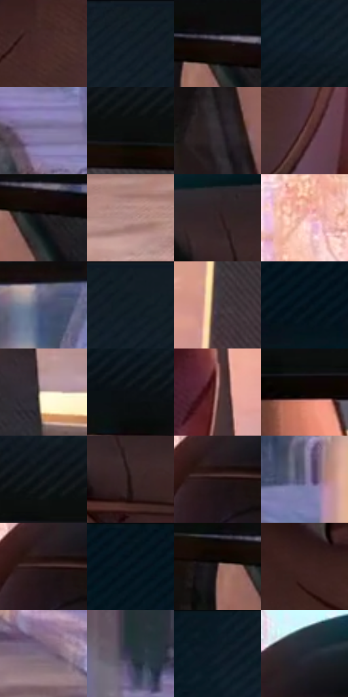

# 电影参考 018

- 状态：条件／活跃；来源世界：miles-home。
- 视角：near-level；景别：detail；场景：reflection。
- 时段：daylight-time-unspecified（外观依据，中置信度；具体时间／晨昏未知）；光照：warm-day。
- 材质候选：skin, glass, fabric（帧级，不是像素分割）。
- 明暗组：very-dark；L* P5/P50/P95：3.50521 / 15.11213 / 72.82169。
- 资格门禁：reflection。
- 原截图 SHA-256：`4e46b3567e49c673c5785cb7f52e06b1d33d1934eab23bfe0cc66a40f6220354`；尺寸：2880 × 1206。
- sRGB 像素 SHA-256：`43b3b1485f8257d1986c7224abacbf3893d0d2634f4901bafabcc9761f735363`。

## 观察与迁移

后视镜限定映像范围，两张脸不新增现场人物。

后视镜中的双人表情

镜框是粗而稳的构图边；镜内眉、眼、眼镜与鼻梁用少量有方向的线辨认身份，眼白留净。顶棚是低对比斜线，镜外街景有细印刷颗粒但不抢镜。这里的波点并非主视觉，不应机械加在眼睛上；彩边仅留在镜缘和远景亮暗交界。

本公开版保存32个128×128原像素色卡上下文；图集格子并非原场景相邻位置。原rect、图集tile和像素SHA见 `data/palette-crops.json`。上下文不足时不得批准替色，不能以小样推断完整构图。

## 实测色卡

颜色比例分母为保留采样像素，不是材料面积；全部 32 色参与全库匹配。表内四舍五入仅用于阅读，原精度在 JSON。

| ID | HEX | Lab | 原图 xy | 像素数 | 比例 | 明度角色 |
| --- | --- | --- | --- | ---: | ---: | --- |
| 018-S01 | #462929 | [20.236463, 13.555354, 5.709887] | [1136, 716] | 8989 | 4.649178% | shadow |
| 018-S02 | #121D25 | [10.113538, -2.177369, -6.997975] | [2000, 28] | 8979 | 4.644006% | deep-shadow |
| 018-S03 | #150E0D | [4.539828, 2.509053, 1.401032] | [2356, 340] | 8528 | 4.410746% | deep-shadow |
| 018-S04 | #14212F | [12.231684, -0.743034, -11.024376] | [996, 124] | 8476 | 4.383851% | deep-shadow |
| 018-S05 | #847CA5 | [54.066362, 11.866322, -20.746982] | [1512, 1088] | 8461 | 4.376093% | midtone |
| 018-S06 | #0C0D0D | [3.568602, -0.300226, -0.105265] | [1704, 280] | 7689 | 3.976808% | deep-shadow |
| 018-S07 | #332C32 | [18.951839, 4.527417, -2.687743] | [2284, 568] | 7603 | 3.932329% | deep-shadow |
| 018-S08 | #674244 | [32.253286, 16.352769, 5.414935] | [1228, 804] | 7306 | 3.778718% | shadow |
| 018-S09 | #1F1D22 | [11.173889, 2.233564, -3.066552] | [2392, 380] | 7303 | 3.777166% | deep-shadow |
| 018-S10 | #B18A88 | [61.048101, 14.509142, 6.767249] | [48, 1128] | 6941 | 3.589937% | light |
| 018-S11 | #362527 | [16.767516, 8.425439, 1.860194] | [556, 396] | 6631 | 3.429603% | deep-shadow |
| 018-S12 | #DFA799 | [73.303512, 18.699977, 15.289784] | [56, 344] | 6562 | 3.393916% | light |
| 018-S13 | #4A506E | [34.637867, 5.383195, -18.024175] | [2208, 936] | 6405 | 3.312714% | shadow |
| 018-S14 | #101A23 | [8.741032, -1.400367, -7.624845] | [2080, 28] | 6351 | 3.284785% | deep-shadow |
| 018-S15 | #433A45 | [25.710772, 6.323849, -5.308008] | [1648, 484] | 6184 | 3.198411% | shadow |
| 018-S16 | #06131B | [5.271137, -2.004173, -6.855235] | [268, 132] | 6107 | 3.158586% | deep-shadow |
| 018-S17 | #F0DDD0 | [89.296213, 4.396715, 8.734768] | [1488, 776] | 5903 | 3.053076% | highlight |
| 018-S18 | #0C1014 | [4.509551, -0.465983, -2.717776] | [964, 228] | 5725 | 2.961013% | deep-shadow |
| 018-S19 | #98716F | [51.421344, 15.09371, 7.131708] | [1444, 556] | 5499 | 2.844124% | midtone |
| 018-S20 | #0A0605 | [1.858489, 0.906849, 0.747176] | [1184, 320] | 5458 | 2.822918% | deep-shadow |
| 018-S21 | #121519 | [6.64009, -0.231859, -3.192505] | [1592, 232] | 5416 | 2.801196% | deep-shadow |
| 018-S22 | #281717 | [9.998771, 8.609074, 3.546341] | [584, 460] | 5315 | 2.748958% | deep-shadow |
| 018-S23 | #201212 | [7.076578, 7.135235, 2.549043] | [224, 480] | 5275 | 2.728270% | deep-shadow |
| 018-S24 | #666286 | [43.183764, 9.888582, -19.382875] | [2120, 1080] | 5239 | 2.709650% | midtone |
| 018-S25 | #301C1D | [12.90827, 10.037906, 3.403087] | [220, 476] | 5172 | 2.674997% | deep-shadow |
| 018-S26 | #081720 | [6.943054, -2.598613, -8.166267] | [504, 32] | 4519 | 2.337261% | deep-shadow |
| 018-S27 | #4F3639 | [25.552168, 11.702874, 2.602566] | [2304, 372] | 4279 | 2.213131% | shadow |
| 018-S28 | #3D2020 | [16.15337, 14.003316, 6.096192] | [844, 700] | 3923 | 2.029005% | deep-shadow |
| 018-S29 | #7A687F | [46.406121, 11.646686, -10.104772] | [1124, 1108] | 3798 | 1.964354% | midtone |
| 018-S30 | #2F3347 | [21.677966, 3.831067, -12.949716] | [1680, 1028] | 3348 | 1.731611% | shadow |
| 018-S31 | #071B25 | [8.675252, -4.07608, -9.265173] | [932, 32] | 3334 | 1.724370% | deep-shadow |
| 018-S32 | #222632 | [15.257468, 1.639022, -8.418857] | [276, 392] | 2628 | 1.359221% | deep-shadow |

## 色阶与空间分布

- 采样 ROI：`[0.01, 0.02, 0.98, 0.94]`；步长：4；样本数：193346。
- 排除区：`[]`。
- 深暗、暗、中、亮、高光五段计数：`[116868, 34571, 25060, 10352, 6495]`。
- RGB 各 256 箱、L* 100 箱、13×5 色相明度表和 3×3 空间统计全部保存在 [总数据](../film-library.json)。
- [可视化档案](../../references/library.html)按需绘制直方图，不存 2,094 张重复图表图片。

## 纹理特征占比

**这是分块图像特征的面积占比，不是波点／排线／丝网／错版的精确语义覆盖率。** 窗格、发丝、织物也会产生方向或周期特征。
原图 ROI 像素 3098546；已测块覆盖 3098546（100.0000%）；未测 0。

| 特征 | 块覆盖像素 | 占已测面积 | 阈值敏感范围 |
| --- | ---: | ---: | --- |
| low-contrast | 390400 | 12.5995% | 9.9556% ~ 15.7720% |
| directional-structure | 1425152 | 45.9942% | 24.1414% ~ 61.2292% |
| periodic-structure | 1250226 | 40.3488% | 28.8151% ~ 56.2721% |
| mixed-detail | 32768 | 1.0575% | 0.0000% ~ 3.8145% |

阈值敏感范围不是统计置信区间。逐块坐标、尺度、对比、方向一致性、频谱集中度、频率与角度见 [全量特征记录](../texture-features.jsonl)，以帧号定位。
四种印刷层的真实像素覆盖仍标为 `null`，不能填 0，也不能拿上表代替。不得据这些代理测量删除唯一证据。

[测量方法与保留策略](../../references/library-retention.md) · [分类索引](../archive/README.md)
