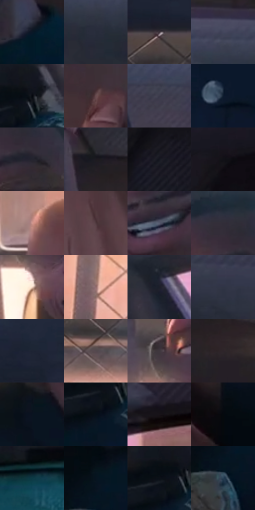

# 电影参考 019

- 状态：常规／活跃；来源世界：miles-home。
- 视角：near-level；景别：medium；场景：vehicle。
- 时段：daylight-time-unspecified（外观依据，中置信度；具体时间／晨昏未知）；光照：warm-day。
- 材质候选：skin, fabric, glass, painted-metal, plastic（帧级，不是像素分割）。
- 明暗组：very-dark；L* P5/P50/P95：3.2213 / 17.44529 / 64.94811。
- 资格门禁：无附加门禁。
- 原截图 SHA-256：`a21ca23d02f40493e873ddac32624e7ccd89fabf442f22a174b896a5f889926a`；尺寸：2880 × 1204。
- sRGB 像素 SHA-256：`0f550c9046faa14ac1c54a127e8e400be351abde3bcc15be7322bfba8e2800de`。

## 观察与迁移

车窗透射、漆面、内饰与人物分别处理；车内暗部仍保留颜色。

车内对话与体型反差

宽肩、粗前臂的前景成年人与后座较窄肩的少年形成比例差异，不是统一动漫体型。车顶暗面有稀细排线，座椅与衣服上的细网目随材质分区；皮肤主要靠明暗大面与下颌线。明亮车窗将头肩轮廓挑出，脸上不叠显眼波点或双彩重影。

本公开版保存32个128×128原像素色卡上下文；图集格子并非原场景相邻位置。原rect、图集tile和像素SHA见 `data/palette-crops.json`。上下文不足时不得批准替色，不能以小样推断完整构图。

## 实测色卡

颜色比例分母为保留采样像素，不是材料面积；全部 32 色参与全库匹配。表内四舍五入仅用于阅读，原精度在 JSON。

| ID | HEX | Lab | 原图 xy | 像素数 | 比例 | 明度角色 |
| --- | --- | --- | --- | ---: | ---: | --- |
| 019-S01 | #0A1727 | [7.440687, 0.601816, -12.668562] | [2208, 676] | 9484 | 4.922968% | deep-shadow |
| 019-S02 | #282C3B | [18.224105, 2.455562, -10.126023] | [2180, 168] | 8233 | 4.273597% | deep-shadow |
| 019-S03 | #3A3037 | [21.167309, 6.005017, -2.75922] | [1132, 320] | 7992 | 4.148499% | shadow |
| 019-S04 | #43475D | [30.616222, 3.988232, -13.506037] | [2036, 72] | 7991 | 4.147980% | shadow |
| 019-S05 | #070B10 | [2.907799, -0.212263, -2.65831] | [2600, 636] | 7584 | 3.936714% | deep-shadow |
| 019-S06 | #664A4D | [34.515751, 12.3949, 2.89477] | [2792, 964] | 7551 | 3.919584% | shadow |
| 019-S07 | #3B3B4B | [25.45965, 3.996257, -9.735789] | [1680, 152] | 7195 | 3.734791% | shadow |
| 019-S08 | #0D1D2E | [10.26986, -0.193427, -13.389157] | [1884, 1084] | 7178 | 3.725967% | deep-shadow |
| 019-S09 | #24242E | [14.591082, 2.673873, -6.573126] | [2020, 300] | 7154 | 3.713509% | deep-shadow |
| 019-S10 | #1D1A21 | [9.874586, 3.275489, -4.294478] | [2232, 496] | 6770 | 3.514181% | deep-shadow |
| 019-S11 | #151720 | [7.917178, 1.751368, -6.591936] | [160, 420] | 6748 | 3.502762% | deep-shadow |
| 019-S12 | #111117 | [5.256445, 1.356889, -3.693192] | [224, 188] | 6565 | 3.407770% | deep-shadow |
| 019-S13 | #CC958D | [66.716289, 19.581942, 12.386378] | [872, 752] | 6424 | 3.334579% | light |
| 019-S14 | #503A3F | [26.991658, 10.613549, 0.721317] | [1084, 1000] | 6189 | 3.212595% | shadow |
| 019-S15 | #585C70 | [39.409183, 3.159189, -11.866501] | [1996, 568] | 6131 | 3.182488% | shadow |
| 019-S16 | #312D38 | [19.288284, 4.468222, -6.356415] | [1968, 228] | 6086 | 3.159130% | deep-shadow |
| 019-S17 | #FBDECB | [90.351825, 7.056369, 12.983318] | [1832, 520] | 5995 | 3.111893% | highlight |
| 019-S18 | #916B6D | [49.056778, 15.45896, 4.829801] | [1012, 604] | 5873 | 3.048565% | midtone |
| 019-S19 | #1D1F2A | [12.012868, 2.240398, -7.678275] | [2572, 280] | 5665 | 2.940596% | deep-shadow |
| 019-S20 | #303445 | [21.994608, 2.904123, -11.10924] | [2460, 148] | 5573 | 2.892841% | shadow |
| 019-S21 | #1D2433 | [14.18454, 1.542224, -10.812378] | [1516, 220] | 5421 | 2.813940% | deep-shadow |
| 019-S22 | #54494E | [32.258146, 5.623012, -1.272444] | [1472, 416] | 5317 | 2.759956% | shadow |
| 019-S23 | #3F373E | [24.119249, 5.031688, -3.0589] | [1808, 416] | 5051 | 2.621880% | shadow |
| 019-S24 | #2E252A | [15.856511, 5.314158, -1.71756] | [2344, 564] | 4893 | 2.539865% | deep-shadow |
| 019-S25 | #0A1420 | [6.0437, -0.000122, -9.527164] | [1872, 692] | 4849 | 2.517026% | deep-shadow |
| 019-S26 | #060E17 | [3.74527, -0.301327, -5.987054] | [2552, 704] | 4821 | 2.502492% | deep-shadow |
| 019-S27 | #181318 | [6.556935, 3.459652, -2.472318] | [2808, 180] | 4556 | 2.364935% | deep-shadow |
| 019-S28 | #05090D | [2.318615, -0.45385, -1.980278] | [1204, 844] | 4541 | 2.357149% | deep-shadow |
| 019-S29 | #0C3945 | [21.703492, -10.172216, -11.729206] | [544, 992] | 4503 | 2.337424% | shadow |
| 019-S30 | #061420 | [5.810465, -1.046119, -9.903835] | [2456, 768] | 4191 | 2.175470% | deep-shadow |
| 019-S31 | #0B1017 | [4.548687, -0.029814, -4.778732] | [2552, 652] | 3416 | 1.773182% | deep-shadow |
| 019-S32 | #273E54 | [25.309883, -1.869177, -16.018778] | [2452, 844] | 2708 | 1.405673% | shadow |

## 色阶与空间分布

- 采样 ROI：`[0.01, 0.02, 0.98, 0.94]`；步长：4；样本数：192648。
- 排除区：`[]`。
- 深暗、暗、中、亮、高光五段计数：`[108937, 62313, 10038, 6041, 5319]`。
- RGB 各 256 箱、L* 100 箱、13×5 色相明度表和 3×3 空间统计全部保存在 [总数据](../film-library.json)。
- [可视化档案](../../references/library.html)按需绘制直方图，不存 2,094 张重复图表图片。

## 纹理特征占比

**这是分块图像特征的面积占比，不是波点／排线／丝网／错版的精确语义覆盖率。** 窗格、发丝、织物也会产生方向或周期特征。
原图 ROI 像素 3092958；已测块覆盖 3092958（100.0000%）；未测 0。

| 特征 | 块覆盖像素 | 占已测面积 | 阈值敏感范围 |
| --- | ---: | ---: | --- |
| low-contrast | 363520 | 11.7531% | 8.0741% ~ 15.8047% |
| directional-structure | 1178112 | 38.0901% | 19.3223% ~ 52.5570% |
| periodic-structure | 1464542 | 47.3509% | 38.1522% ~ 59.5096% |
| mixed-detail | 86784 | 2.8059% | 1.2167% ~ 5.3634% |

阈值敏感范围不是统计置信区间。逐块坐标、尺度、对比、方向一致性、频谱集中度、频率与角度见 [全量特征记录](../texture-features.jsonl)，以帧号定位。
四种印刷层的真实像素覆盖仍标为 `null`，不能填 0，也不能拿上表代替。不得据这些代理测量删除唯一证据。

[测量方法与保留策略](../../references/library-retention.md) · [分类索引](../archive/README.md)
