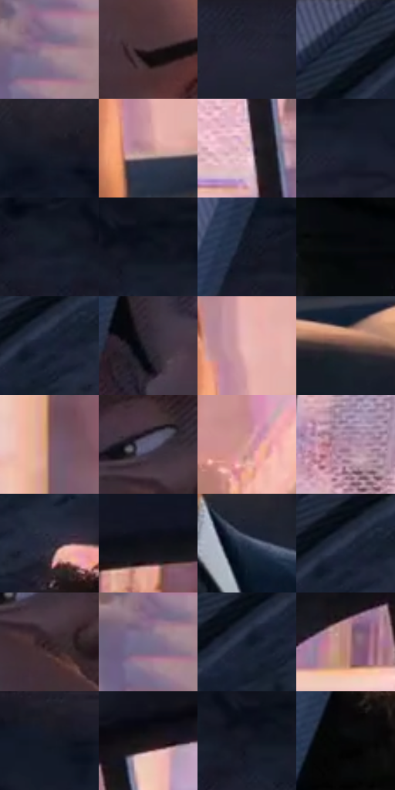

# 电影参考 020

- 状态：常规／活跃；来源世界：miles-home。
- 视角：near-level；景别：medium；场景：vehicle。
- 时段：daylight-time-unspecified（外观依据，中置信度；具体时间／晨昏未知）；光照：warm-day。
- 材质候选：skin, fabric, glass, painted-metal, plastic（帧级，不是像素分割）。
- 明暗组：very-dark；L* P5/P50/P95：3.08273 / 15.82061 / 75.23217。
- 资格门禁：无附加门禁。
- 原截图 SHA-256：`14b3829e62b9540e83309499e5eee4dc7a5aadf11049aa79b97f3a48dc129b1c`；尺寸：2880 × 1202。
- sRGB 像素 SHA-256：`f7a9c4b0bebd4db4a8bfce59b906a05056965686b184fe83fdad178dc72ab2d4`。

## 观察与迁移

车窗透射、漆面、内饰与人物分别处理；车内暗部仍保留颜色。

后座少年侧光特写

少年额、鼻、颊、下巴用少数几何面塑出情绪，眉眼和嘴角只留必要细线。车顶与安全带的斜向排线体现各自平面，窗外柔化是景深和空气层，人物不能同样糊掉。网目细而弱，波点不是此镜头焦点。亮窗边有冷暖邻接，五官中心无可见大错版。

本公开版保存32个128×128原像素色卡上下文；图集格子并非原场景相邻位置。原rect、图集tile和像素SHA见 `data/palette-crops.json`。上下文不足时不得批准替色，不能以小样推断完整构图。

## 实测色卡

颜色比例分母为保留采样像素，不是材料面积；全部 32 色参与全库匹配。表内四舍五入仅用于阅读，原精度在 JSON。

| ID | HEX | Lab | 原图 xy | 像素数 | 比例 | 明度角色 |
| --- | --- | --- | --- | ---: | ---: | --- |
| 020-S01 | #A07E90 | [56.495687, 16.167603, -4.667077] | [2628, 516] | 8803 | 4.569474% | midtone |
| 020-S02 | #44343A | [23.640198, 8.335328, -1.015506] | [712, 588] | 8161 | 4.236224% | shadow |
| 020-S03 | #21222F | [13.665632, 3.201156, -8.72519] | [2092, 36] | 7901 | 4.101262% | deep-shadow |
| 020-S04 | #1F283A | [16.075794, 1.760588, -12.80486] | [240, 48] | 7861 | 4.080499% | deep-shadow |
| 020-S05 | #171A26 | [9.488383, 2.282781, -8.660838] | [1344, 76] | 7730 | 4.012499% | deep-shadow |
| 020-S06 | #BD8D92 | [63.297855, 18.952637, 4.483851] | [968, 796] | 7560 | 3.924256% | light |
| 020-S07 | #D3ADC0 | [74.535839, 16.909115, -4.456814] | [2336, 688] | 7262 | 3.769569% | light |
| 020-S08 | #1D2332 | [13.788714, 1.928709, -10.711428] | [1052, 128] | 7236 | 3.756073% | deep-shadow |
| 020-S09 | #171D2A | [10.762307, 1.409281, -9.645705] | [836, 72] | 7181 | 3.727524% | deep-shadow |
| 020-S10 | #0F141E | [6.283055, 0.831212, -7.59852] | [952, 28] | 6953 | 3.609173% | deep-shadow |
| 020-S11 | #111723 | [7.70748, 1.221357, -9.210595] | [696, 68] | 6892 | 3.577509% | deep-shadow |
| 020-S12 | #090A0D | [2.747928, 0.191586, -1.325406] | [276, 572] | 6882 | 3.572318% | deep-shadow |
| 020-S13 | #162031 | [12.12474, 1.382707, -12.619774] | [348, 88] | 6402 | 3.323159% | deep-shadow |
| 020-S14 | #2C2832 | [16.909016, 4.287905, -5.820535] | [468, 828] | 6224 | 3.230763% | deep-shadow |
| 020-S15 | #ECBAB7 | [79.825124, 17.535612, 8.414797] | [972, 708] | 6211 | 3.224015% | light |
| 020-S16 | #593F41 | [29.565496, 11.687461, 3.271923] | [1144, 908] | 6158 | 3.196503% | shadow |
| 020-S17 | #885D5F | [44.074938, 17.898961, 5.975133] | [2632, 288] | 6068 | 3.149786% | midtone |
| 020-S18 | #5E5D7A | [40.594767, 7.183303, -16.139168] | [608, 772] | 5795 | 3.008077% | midtone |
| 020-S19 | #D89E98 | [70.40106, 20.752278, 11.652299] | [956, 396] | 5694 | 2.955650% | light |
| 020-S20 | #BA93AD | [65.219482, 18.984149, -7.981621] | [2088, 648] | 5274 | 2.737635% | light |
| 020-S21 | #2A2E3E | [19.19899, 2.721556, -10.681942] | [440, 128] | 5228 | 2.713758% | deep-shadow |
| 020-S22 | #101118 | [5.21191, 1.250956, -4.527443] | [2788, 164] | 5203 | 2.700781% | deep-shadow |
| 020-S23 | #2E3951 | [24.00242, 2.566229, -16.032873] | [980, 1044] | 5179 | 2.688323% | shadow |
| 020-S24 | #0A0F17 | [4.227545, 0.235916, -5.254845] | [348, 36] | 5137 | 2.666521% | deep-shadow |
| 020-S25 | #302225 | [14.986513, 7.290889, 0.60455] | [636, 840] | 4926 | 2.556995% | deep-shadow |
| 020-S26 | #77708D | [48.8013, 8.918929, -14.844743] | [2608, 536] | 4497 | 2.334309% | midtone |
| 020-S27 | #111B2A | [9.562495, 0.850029, -11.544343] | [308, 104] | 4255 | 2.208691% | deep-shadow |
| 020-S28 | #B8837E | [59.826488, 19.723764, 10.840009] | [2224, 320] | 4099 | 2.127715% | midtone |
| 020-S29 | #1D1C26 | [10.788757, 3.231373, -6.616963] | [1196, 32] | 4081 | 2.118371% | deep-shadow |
| 020-S30 | #1B161A | [7.961845, 3.479267, -1.900892] | [2340, 240] | 3985 | 2.068540% | deep-shadow |
| 020-S31 | #121521 | [6.997805, 2.281838, -8.780886] | [920, 80] | 3956 | 2.053486% | deep-shadow |
| 020-S32 | #040507 | [1.352132, 0.016501, -0.848821] | [656, 244] | 3854 | 2.000540% | deep-shadow |

## 色阶与空间分布

- 采样 ROI：`[0.01, 0.02, 0.98, 0.94]`；步长：4；样本数：192648。
- 排除区：`[]`。
- 深暗、暗、中、亮、高光五段计数：`[110792, 24129, 24138, 30266, 3323]`。
- RGB 各 256 箱、L* 100 箱、13×5 色相明度表和 3×3 空间统计全部保存在 [总数据](../film-library.json)。
- [可视化档案](../../references/library.html)按需绘制直方图，不存 2,094 张重复图表图片。

## 纹理特征占比

**这是分块图像特征的面积占比，不是波点／排线／丝网／错版的精确语义覆盖率。** 窗格、发丝、织物也会产生方向或周期特征。
原图 ROI 像素 3087370；已测块覆盖 3087370（100.0000%）；未测 0。

| 特征 | 块覆盖像素 | 占已测面积 | 阈值敏感范围 |
| --- | ---: | ---: | --- |
| low-contrast | 371200 | 12.0232% | 6.1857% ~ 14.0343% |
| directional-structure | 862592 | 27.9394% | 15.9825% ~ 47.4214% |
| periodic-structure | 1820810 | 58.9761% | 45.3315% ~ 66.4633% |
| mixed-detail | 32768 | 1.0614% | 1.0614% ~ 3.5199% |

阈值敏感范围不是统计置信区间。逐块坐标、尺度、对比、方向一致性、频谱集中度、频率与角度见 [全量特征记录](../texture-features.jsonl)，以帧号定位。
四种印刷层的真实像素覆盖仍标为 `null`，不能填 0，也不能拿上表代替。不得据这些代理测量删除唯一证据。

[测量方法与保留策略](../../references/library-retention.md) · [分类索引](../archive/README.md)
