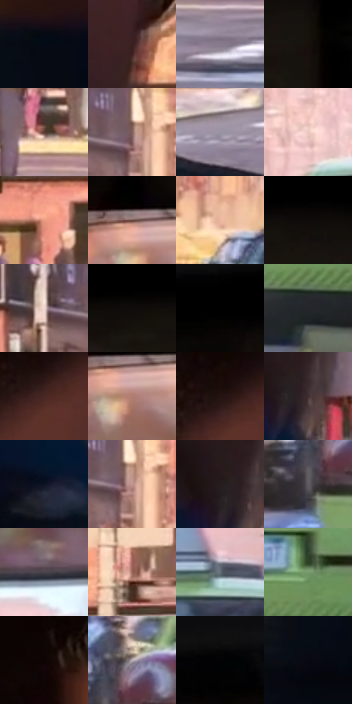

# 电影参考 021

- 状态：常规／活跃；来源世界：miles-home。
- 视角：near-level；景别：medium；场景：vehicle。
- 时段：daylight-time-unspecified（外观依据，中置信度；具体时间／晨昏未知）；光照：warm-day。
- 材质候选：skin, fabric, glass, painted-metal, plastic（帧级，不是像素分割）。
- 明暗组：dark；L* P5/P50/P95：1.19352 / 29.00941 / 83.21285。
- 资格门禁：无附加门禁。
- 原截图 SHA-256：`ecc70138498688949e65483aef7890c98785d8d79113c2c47c52013ed69534c5`；尺寸：2880 × 1182。
- sRGB 像素 SHA-256：`dbeeed08c38dc7ccbddfd3fae2c44539321a293b229d835fedfed0e4532dde8e`。

## 观察与迁移

车窗透射、漆面、内饰与人物分别处理；车内暗部仍保留颜色。

透过前挡风玻璃看街道

前景人物背影以大黑面和肩形压住画幅，街道招牌与车流只保留可读的分层。挡风玻璃的反射、后视镜软反光与远景空气颗粒是三种不同质地。远景可有浅网目，车窗边的彩色邻接比人影暗面更明显；不把招牌文字当生成指令。

本公开版保存32个128×128原像素色卡上下文；图集格子并非原场景相邻位置。原rect、图集tile和像素SHA见 `data/palette-crops.json`。上下文不足时不得批准替色，不能以小样推断完整构图。

## 实测色卡

颜色比例分母为保留采样像素，不是材料面积；全部 32 色参与全库匹配。表内四舍五入仅用于阅读，原精度在 JSON。

| ID | HEX | Lab | 原图 xy | 像素数 | 比例 | 明度角色 |
| --- | --- | --- | --- | ---: | ---: | --- |
| 021-S01 | #040B16 | [2.918121, 0.304993, -6.477597] | [128, 744] | 9690 | 5.103868% | deep-shadow |
| 021-S02 | #391F1E | [15.189309, 12.490467, 6.085919] | [768, 360] | 8349 | 4.397543% | deep-shadow |
| 021-S03 | #867B8B | [53.057053, 7.338837, -7.135004] | [1612, 924] | 8026 | 4.227414% | midtone |
| 021-S04 | #170F0B | [4.950035, 2.61069, 2.934745] | [2812, 136] | 7681 | 4.045698% | deep-shadow |
| 021-S05 | #58372E | [26.748424, 13.535004, 11.727022] | [1000, 808] | 7421 | 3.908752% | shadow |
| 021-S06 | #7F5E5A | [43.147005, 12.838105, 7.54935] | [1796, 560] | 7419 | 3.907698% | midtone |
| 021-S07 | #9A93A2 | [61.951708, 5.489851, -6.94695] | [1236, 948] | 7378 | 3.886103% | light |
| 021-S08 | #E8C6BF | [82.543729, 10.906813, 7.965863] | [2316, 612] | 7336 | 3.863981% | highlight |
| 021-S09 | #EA9C82 | [71.47677, 26.171983, 25.536889] | [1372, 620] | 6773 | 3.567441% | light |
| 021-S10 | #6C4B45 | [35.302621, 13.125269, 9.16717] | [2040, 244] | 6676 | 3.516349% | shadow |
| 021-S11 | #EBB79E | [78.462145, 15.384938, 19.937121] | [1912, 676] | 6527 | 3.437869% | light |
| 021-S12 | #080504 | [1.526007, 0.645367, 0.655004] | [2700, 48] | 6341 | 3.339900% | deep-shadow |
| 021-S13 | #F3DAD1 | [88.82907, 7.17198, 7.572187] | [1676, 560] | 5974 | 3.146595% | highlight |
| 021-S14 | #0F0B09 | [3.25761, 0.950531, 1.201076] | [2592, 60] | 5956 | 3.137114% | deep-shadow |
| 021-S15 | #010101 | [0.274173, -1.7e-05, 3.3e-05] | [1748, 24] | 5885 | 3.099718% | deep-shadow |
| 021-S16 | #23262C | [15.090589, 0.261355, -4.404967] | [2420, 1028] | 5857 | 3.084970% | deep-shadow |
| 021-S17 | #482924 | [20.405837, 13.80778, 9.424765] | [396, 264] | 5849 | 3.080756% | shadow |
| 021-S18 | #B07C72 | [56.940782, 18.885817, 13.546356] | [2068, 288] | 5787 | 3.048100% | midtone |
| 021-S19 | #241513 | [8.640755, 7.3415, 4.280583] | [380, 236] | 5711 | 3.008069% | deep-shadow |
| 021-S20 | #3D2A2D | [19.3816, 9.381539, 1.552954] | [720, 748] | 5499 | 2.896406% | deep-shadow |
| 021-S21 | #0D1321 | [5.971402, 1.840443, -10.386308] | [660, 908] | 5319 | 2.801597% | deep-shadow |
| 021-S22 | #C2968E | [65.932608, 15.30456, 10.571629] | [1808, 576] | 5199 | 2.738391% | light |
| 021-S23 | #251C1F | [11.433974, 5.054659, -0.389655] | [680, 724] | 5167 | 2.721536% | deep-shadow |
| 021-S24 | #615C64 | [39.774835, 3.670589, -3.850825] | [2180, 880] | 5153 | 2.714162% | shadow |
| 021-S25 | #49444A | [29.526099, 3.410094, -2.847531] | [2520, 432] | 5086 | 2.678872% | shadow |
| 021-S26 | #976559 | [47.763941, 18.632855, 15.011388] | [1252, 360] | 4968 | 2.616720% | midtone |
| 021-S27 | #656F78 | [46.29996, -1.735928, -6.263442] | [2560, 636] | 4959 | 2.611980% | midtone |
| 021-S28 | #799A6E | [60.160172, -20.10273, 19.474362] | [2576, 912] | 4365 | 2.299111% | light |
| 021-S29 | #0F0604 | [2.173287, 2.268328, 1.654304] | [428, 48] | 4125 | 2.172699% | deep-shadow |
| 021-S30 | #BBB0B5 | [72.860289, 4.815956, -1.13747] | [2220, 800] | 4107 | 2.163218% | light |
| 021-S31 | #040405 | [1.116481, 0.138974, -0.378292] | [1116, 60] | 2677 | 1.410016% | deep-shadow |
| 021-S32 | #090D14 | [3.580768, 0.246682, -4.095781] | [32, 868] | 2596 | 1.367352% | deep-shadow |

## 色阶与空间分布

- 采样 ROI：`[0.01, 0.02, 0.98, 0.94]`；步长：4；样本数：189856。
- 排除区：`[]`。
- 深暗、暗、中、亮、高光五段计数：`[80974, 28544, 36103, 29885, 14350]`。
- RGB 各 256 箱、L* 100 箱、13×5 色相明度表和 3×3 空间统计全部保存在 [总数据](../film-library.json)。
- [可视化档案](../../references/library.html)按需绘制直方图，不存 2,094 张重复图表图片。

## 纹理特征占比

**这是分块图像特征的面积占比，不是波点／排线／丝网／错版的精确语义覆盖率。** 窗格、发丝、织物也会产生方向或周期特征。
原图 ROI 像素 3039872；已测块覆盖 3039872（100.0000%）；未测 0。

| 特征 | 块覆盖像素 | 占已测面积 | 阈值敏感范围 |
| --- | ---: | ---: | --- |
| low-contrast | 311296 | 10.2404% | 7.0066% ~ 14.0132% |
| directional-structure | 965248 | 31.7529% | 18.0555% ~ 43.7871% |
| periodic-structure | 1632256 | 53.6949% | 45.9725% ~ 62.5416% |
| mixed-detail | 131072 | 4.3118% | 3.2338% ~ 5.3897% |

阈值敏感范围不是统计置信区间。逐块坐标、尺度、对比、方向一致性、频谱集中度、频率与角度见 [全量特征记录](../texture-features.jsonl)，以帧号定位。
四种印刷层的真实像素覆盖仍标为 `null`，不能填 0，也不能拿上表代替。不得据这些代理测量删除唯一证据。

[测量方法与保留策略](../../references/library-retention.md) · [分类索引](../archive/README.md)
