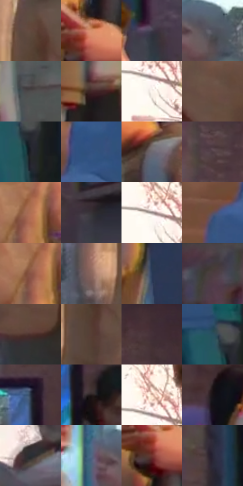

# 电影参考 022

- 状态：常规／活跃；来源世界：miles-home。
- 视角：near-level；景别：full-body；场景：street。
- 时段：daylight-time-unspecified（外观依据，中置信度；具体时间／晨昏未知）；光照：warm-day。
- 材质候选：skin, fabric, brick, asphalt（帧级，不是像素分割）。
- 明暗组：dark；L* P5/P50/P95：10.87841 / 31.4589 / 78.89146。
- 资格门禁：无附加门禁。
- 原截图 SHA-256：`2fc3d44725dd5fdc47f5a0aba481efc56f454cb1166b33754b33fbede38e1da4`；尺寸：2880 × 1200。
- sRGB 像素 SHA-256：`380c3d3cdd6916ffada73850f30b57860bacff3a3fab3d59f04f0cc73f1eae32`。

## 观察与迁移

前景行人与暖街景，边缘人物不必同等锐利。

街道人群与身形多样性

同一街景内保留不同年龄、肩宽、腰腹、腿长与姿势；身份感由轮廓和衣服体积先成立。外套与裤腿有方向性细线，立面细网目弱于人物，远景行人逐级减去五官细节。高亮边缘和树叶附近有小范围彩边，不能让每个人都成双重轮廓。

本公开版保存32个128×128原像素色卡上下文；图集格子并非原场景相邻位置。原rect、图集tile和像素SHA见 `data/palette-crops.json`。上下文不足时不得批准替色，不能以小样推断完整构图。

## 实测色卡

颜色比例分母为保留采样像素，不是材料面积；全部 32 色参与全库匹配。表内四舍五入仅用于阅读，原精度在 JSON。

| ID | HEX | Lab | 原图 xy | 像素数 | 比例 | 明度角色 |
| --- | --- | --- | --- | ---: | ---: | --- |
| 022-S01 | #62493E | [33.371496, 8.923592, 10.712108] | [460, 476] | 7947 | 4.125140% | shadow |
| 022-S02 | #D5906C | [65.887406, 22.113296, 29.697748] | [1000, 572] | 7886 | 4.093476% | light |
| 022-S03 | #433D4D | [26.923622, 6.277963, -8.76014] | [2420, 320] | 7781 | 4.038973% | shadow |
| 022-S04 | #52535E | [35.573676, 2.105515, -6.515007] | [1580, 436] | 7703 | 3.998484% | shadow |
| 022-S05 | #4E4B4C | [32.1991, 1.450323, -0.150356] | [1504, 772] | 7342 | 3.811096% | shadow |
| 022-S06 | #422729 | [19.096578, 13.024668, 4.016069] | [1368, 832] | 7336 | 3.807981% | deep-shadow |
| 022-S07 | #FAF3EC | [96.19631, 1.143939, 4.203053] | [176, 228] | 7329 | 3.804348% | highlight |
| 022-S08 | #6E5044 | [36.874418, 10.801692, 12.006074] | [712, 916] | 7053 | 3.661081% | shadow |
| 022-S09 | #212127 | [12.969118, 1.576672, -4.014657] | [2776, 976] | 6997 | 3.632013% | deep-shadow |
| 022-S10 | #335280 | [34.592165, 3.554768, -29.382245] | [2684, 516] | 6949 | 3.607097% | shadow |
| 022-S11 | #6E6972 | [45.127481, 3.7982, -4.322126] | [1196, 364] | 6641 | 3.447220% | midtone |
| 022-S12 | #4F3D43 | [27.859305, 8.994473, -0.660326] | [1756, 104] | 6574 | 3.412441% | shadow |
| 022-S13 | #AF6F54 | [53.0861, 22.425318, 25.550416] | [804, 444] | 6401 | 3.322640% | midtone |
| 022-S14 | #373236 | [21.430803, 3.113555, -1.724263] | [2764, 248] | 6358 | 3.300320% | shadow |
| 022-S15 | #978C8A | [59.132103, 3.727866, 2.545505] | [164, 196] | 6218 | 3.227648% | midtone |
| 022-S16 | #615058 | [35.952535, 8.59207, -2.025773] | [2576, 588] | 5976 | 3.102031% | shadow |
| 022-S17 | #8A5444 | [41.473304, 20.631807, 18.815778] | [784, 460] | 5903 | 3.064138% | midtone |
| 022-S18 | #8B675D | [46.949194, 12.973171, 11.285533] | [364, 600] | 5831 | 3.026764% | midtone |
| 022-S19 | #2B3B57 | [24.731644, 2.314882, -18.864077] | [972, 1016] | 5807 | 3.014306% | shadow |
| 022-S20 | #433A3C | [25.399278, 4.336182, 0.207203] | [1616, 44] | 5745 | 2.982123% | shadow |
| 022-S21 | #50322E | [24.271578, 13.037605, 8.158013] | [572, 1004] | 5703 | 2.960321% | shadow |
| 022-S22 | #573E35 | [28.717937, 9.556147, 9.839691] | [476, 580] | 5383 | 2.794215% | shadow |
| 022-S23 | #433038 | [22.277081, 10.159819, -1.680762] | [2048, 100] | 5309 | 2.755803% | shadow |
| 022-S24 | #2A505F | [31.932413, -8.764042, -12.912846] | [2740, 912] | 5212 | 2.705452% | shadow |
| 022-S25 | #283547 | [21.770356, 0.065724, -12.854209] | [1780, 316] | 5203 | 2.700781% | shadow |
| 022-S26 | #241B1B | [10.835608, 4.431912, 1.683833] | [1824, 448] | 5198 | 2.698185% | deep-shadow |
| 022-S27 | #DFBFAB | [79.552168, 8.33073, 14.312464] | [172, 156] | 4875 | 2.530522% | light |
| 022-S28 | #181215 | [6.151085, 3.322012, -0.870834] | [2080, 368] | 4813 | 2.498339% | deep-shadow |
| 022-S29 | #292E32 | [18.608387, -1.133948, -3.306482] | [216, 608] | 4639 | 2.408019% | deep-shadow |
| 022-S30 | #4F6782 | [42.723722, -1.575354, -17.828078] | [1480, 424] | 3791 | 1.967838% | midtone |
| 022-S31 | #71332F | [29.624786, 27.003426, 15.591078] | [980, 620] | 3591 | 1.864021% | shadow |
| 022-S32 | #292536 | [15.803462, 6.304646, -10.345456] | [2544, 140] | 3154 | 1.637183% | deep-shadow |

## 色阶与空间分布

- 采样 ROI：`[0.01, 0.02, 0.98, 0.94]`；步长：4；样本数：192648。
- 排除区：`[]`。
- 深暗、暗、中、亮、高光五段计数：`[31922, 107512, 30562, 13264, 9388]`。
- RGB 各 256 箱、L* 100 箱、13×5 色相明度表和 3×3 空间统计全部保存在 [总数据](../film-library.json)。
- [可视化档案](../../references/library.html)按需绘制直方图，不存 2,094 张重复图表图片。

## 纹理特征占比

**这是分块图像特征的面积占比，不是波点／排线／丝网／错版的精确语义覆盖率。** 窗格、发丝、织物也会产生方向或周期特征。
原图 ROI 像素 3084576；已测块覆盖 3084576（100.0000%）；未测 0。

| 特征 | 块覆盖像素 | 占已测面积 | 阈值敏感范围 |
| --- | ---: | ---: | --- |
| low-contrast | 16384 | 0.5312% | 0.5312% ~ 1.9255% |
| directional-structure | 554752 | 17.9847% | 6.6395% ~ 34.6249% |
| periodic-structure | 2455808 | 79.6157% | 64.3128% ~ 89.5667% |
| mixed-detail | 57632 | 1.8684% | 0.5312% ~ 1.8684% |

阈值敏感范围不是统计置信区间。逐块坐标、尺度、对比、方向一致性、频谱集中度、频率与角度见 [全量特征记录](../texture-features.jsonl)，以帧号定位。
四种印刷层的真实像素覆盖仍标为 `null`，不能填 0，也不能拿上表代替。不得据这些代理测量删除唯一证据。

[测量方法与保留策略](../../references/library-retention.md) · [分类索引](../archive/README.md)
