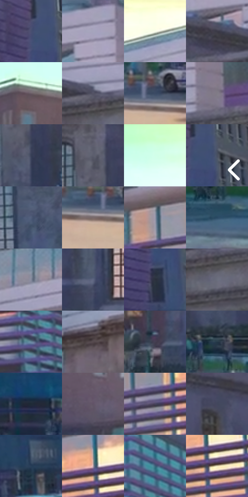

# 电影参考 023

- 状态：常规／活跃；来源世界：miles-home。
- 视角：low-angle；景别：environment-wide；场景：city。
- 时段：daylight-time-unspecified（外观依据，中置信度；具体时间／晨昏未知）；光照：neutral-day。
- 材质候选：brick, glass, painted-metal, asphalt, sky（帧级，不是像素分割）。
- 明暗组：dark；L* P5/P50/P95：21.03341 / 38.00007 / 97.37169。
- 资格门禁：无附加门禁。
- 原截图 SHA-256：`6e7ed66c6a4bedd45c1e6e566d16253efc78094eb8e8f510af2fb18be92a3f78`；尺寸：2880 × 1202。
- sRGB 像素 SHA-256：`592f16e8bcf5a0c12b227886d6e65f6d881419b51bc53510a2b1e56cb57c27f1`。

## 观察与迁移

校区街面与立面大体块、窗组和车流分开。

学校外立面与冷暖建筑层次

立面不是统一滤镜：石墙、格栅、玻璃各有独立色面与透视线。细斜排线落在石墙阴影和格栅结构，细网目弱铺大面，天空保持较净。入口和车辆是小尺度标记；不把局部紫青反光扩成整栋楼同纯度荧光。明显波点较少，不能据此推断所有建筑画面要满铺点。

本公开版保存32个128×128原像素色卡上下文；图集格子并非原场景相邻位置。原rect、图集tile和像素SHA见 `data/palette-crops.json`。上下文不足时不得批准替色，不能以小样推断完整构图。

## 实测色卡

颜色比例分母为保留采样像素，不是材料面积；全部 32 色参与全库匹配。表内四舍五入仅用于阅读，原精度在 JSON。

| ID | HEX | Lab | 原图 xy | 像素数 | 比例 | 明度角色 |
| --- | --- | --- | --- | ---: | ---: | --- |
| 023-S01 | #494F70 | [34.350756, 6.278768, -19.72413] | [2756, 560] | 11380 | 5.907147% | shadow |
| 023-S02 | #A5A4BD | [68.185373, 5.394122, -12.68002] | [1548, 68] | 10435 | 5.416615% | light |
| 023-S03 | #F8FEE9 | [98.718971, -5.575481, 9.362314] | [896, 128] | 9346 | 4.851335% | highlight |
| 023-S04 | #3B3946 | [24.633794, 4.003558, -7.671788] | [1376, 400] | 8812 | 4.574146% | shadow |
| 023-S05 | #6B5F68 | [41.704399, 6.581928, -3.347746] | [72, 292] | 8105 | 4.207155% | midtone |
| 023-S06 | #535365 | [35.916749, 4.191714, -10.37511] | [1520, 428] | 7425 | 3.854180% | shadow |
| 023-S07 | #3A4A64 | [31.153376, 1.149272, -17.202187] | [524, 1072] | 6940 | 3.602425% | shadow |
| 023-S08 | #817C87 | [52.764808, 4.1, -5.27919] | [1644, 380] | 6701 | 3.478365% | midtone |
| 023-S09 | #383F56 | [26.92606, 3.407641, -14.731394] | [1232, 756] | 6638 | 3.445663% | shadow |
| 023-S10 | #5C5D6D | [39.92859, 3.234813, -9.205925] | [1204, 644] | 6471 | 3.358976% | shadow |
| 023-S11 | #D1FFE9 | [96.392131, -18.829558, 5.679479] | [428, 108] | 6459 | 3.352747% | highlight |
| 023-S12 | #494F61 | [33.713378, 2.072247, -11.281543] | [2812, 572] | 6400 | 3.322121% | shadow |
| 023-S13 | #505E7B | [39.816023, 2.222242, -18.03989] | [1464, 792] | 5994 | 3.111374% | shadow |
| 023-S14 | #7A6A6B | [46.321638, 6.48861, 1.76824] | [480, 1100] | 5825 | 3.023649% | midtone |
| 023-S15 | #9394A8 | [61.834719, 3.755018, -10.57963] | [1856, 288] | 5753 | 2.986275% | light |
| 023-S16 | #294963 | [29.75516, -3.263014, -18.812993] | [1844, 1108] | 5713 | 2.965512% | shadow |
| 023-S17 | #858A9D | [57.652942, 2.227406, -10.692425] | [912, 324] | 5650 | 2.932810% | midtone |
| 023-S18 | #5D6681 | [43.381186, 3.150396, -16.131809] | [1072, 876] | 5611 | 2.912566% | midtone |
| 023-S19 | #2B313D | [20.231321, 0.723942, -8.414089] | [2760, 692] | 5399 | 2.802521% | shadow |
| 023-S20 | #6B6E7E | [46.689543, 2.392755, -9.21702] | [1556, 492] | 5362 | 2.783315% | midtone |
| 023-S21 | #66879C | [54.607823, -6.247377, -14.919738] | [2300, 492] | 5311 | 2.756841% | midtone |
| 023-S22 | #56484F | [32.208375, 7.293056, -1.961489] | [592, 492] | 5058 | 2.625514% | shadow |
| 023-S23 | #443E51 | [27.485693, 7.0207, -10.517353] | [304, 892] | 5033 | 2.612537% | shadow |
| 023-S24 | #263948 | [23.019349, -2.930055, -11.617156] | [944, 980] | 4947 | 2.567896% | shadow |
| 023-S25 | #1F2A36 | [16.569844, -1.012653, -9.248642] | [2256, 924] | 4490 | 2.330676% | deep-shadow |
| 023-S26 | #605266 | [36.893939, 9.916203, -9.404832] | [244, 632] | 4479 | 2.324966% | shadow |
| 023-S27 | #48445D | [30.16235, 7.721468, -14.162625] | [1980, 352] | 4377 | 2.272019% | shadow |
| 023-S28 | #42475E | [30.574952, 3.921508, -14.216391] | [1872, 576] | 4370 | 2.268386% | shadow |
| 023-S29 | #263D57 | [25.067533, -0.419347, -18.364163] | [2740, 896] | 3931 | 2.040509% | shadow |
| 023-S30 | #B19FA7 | [67.227442, 7.99156, -1.747622] | [2092, 296] | 3914 | 2.031685% | light |
| 023-S31 | #3A647B | [40.316996, -7.685162, -17.384914] | [2396, 324] | 3367 | 1.747747% | midtone |
| 023-S32 | #E4DAB3 | [86.944244, -2.75284, 20.469406] | [2120, 340] | 2952 | 1.532328% | highlight |

## 色阶与空间分布

- 采样 ROI：`[0.01, 0.02, 0.98, 0.94]`；步长：4；样本数：192648。
- 排除区：`[]`。
- 深暗、暗、中、亮、高光五段计数：`[7408, 99024, 47462, 20876, 17878]`。
- RGB 各 256 箱、L* 100 箱、13×5 色相明度表和 3×3 空间统计全部保存在 [总数据](../film-library.json)。
- [可视化档案](../../references/library.html)按需绘制直方图，不存 2,094 张重复图表图片。

## 纹理特征占比

**这是分块图像特征的面积占比，不是波点／排线／丝网／错版的精确语义覆盖率。** 窗格、发丝、织物也会产生方向或周期特征。
原图 ROI 像素 3087370；已测块覆盖 3087370（100.0000%）；未测 0。

| 特征 | 块覆盖像素 | 占已测面积 | 阈值敏感范围 |
| --- | ---: | ---: | --- |
| low-contrast | 79104 | 2.5622% | 1.5920% ~ 3.0929% |
| directional-structure | 958848 | 31.0571% | 14.7512% ~ 42.1060% |
| periodic-structure | 1967498 | 63.7273% | 56.3020% ~ 70.8538% |
| mixed-detail | 81920 | 2.6534% | 0.0000% ~ 11.3021% |

阈值敏感范围不是统计置信区间。逐块坐标、尺度、对比、方向一致性、频谱集中度、频率与角度见 [全量特征记录](../texture-features.jsonl)，以帧号定位。
四种印刷层的真实像素覆盖仍标为 `null`，不能填 0，也不能拿上表代替。不得据这些代理测量删除唯一证据。

[测量方法与保留策略](../../references/library-retention.md) · [分类索引](../archive/README.md)
