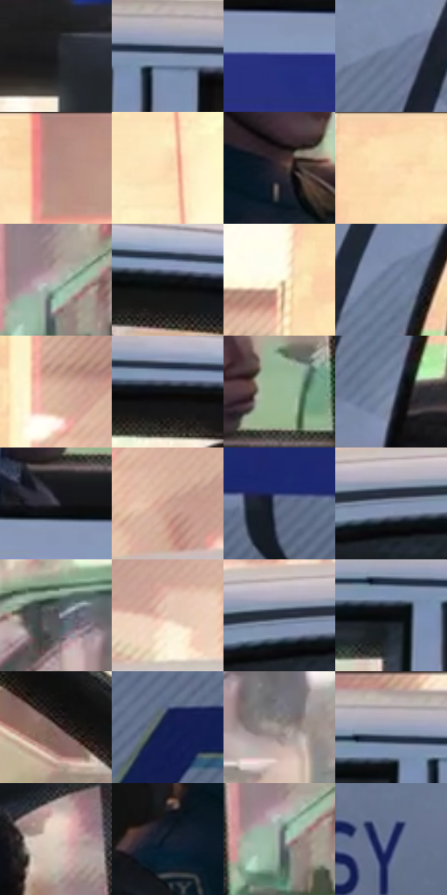

# 电影参考 024

- 状态：常规／活跃；来源世界：miles-home。
- 视角：near-level；景别：medium；场景：vehicle。
- 时段：daylight-time-unspecified（外观依据，中置信度；具体时间／晨昏未知）；光照：warm-day。
- 材质候选：skin, fabric, glass, painted-metal, plastic（帧级，不是像素分割）。
- 明暗组：middle；L* P5/P50/P95：5.01079 / 53.40281 / 91.71305。
- 资格门禁：无附加门禁。
- 原截图 SHA-256：`e635d53169fbb487bf844b9775b3301569de1e155bed1ef097a4a1757502c7e9`；尺寸：2880 × 1208。
- sRGB 像素 SHA-256：`14eeb0d1e2e6befe008b84bafc87fbc13965cb47ad1e5900c45ba7b6343bb059`。

## 观察与迁移

车窗透射、漆面、内饰与人物分别处理；车内暗部仍保留颜色。

警车侧面与白色留白

车门大色面比较干净，车顶和门下缘才显现沿车身方向的细排线；印刷颗粒在白车身与光照墙面低对比可见。人物局部脸部、眼镜、肩膀分别保形。车轮与车窗用硬线，背景有较软的高光溢出；彩色套版偏移贴在窗框与小字边，不分裂车门几何。

本公开版保存32个128×128原像素色卡上下文；图集格子并非原场景相邻位置。原rect、图集tile和像素SHA见 `data/palette-crops.json`。上下文不足时不得批准替色，不能以小样推断完整构图。

## 实测色卡

颜色比例分母为保留采样像素，不是材料面积；全部 32 色参与全库匹配。表内四舍五入仅用于阅读，原精度在 JSON。

| ID | HEX | Lab | 原图 xy | 像素数 | 比例 | 明度角色 |
| --- | --- | --- | --- | ---: | ---: | --- |
| 024-S01 | #1B1C20 | [10.317601, 0.607674, -2.909023] | [1440, 144] | 12427 | 6.427338% | deep-shadow |
| 024-S02 | #8595B4 | [61.46027, 1.388989, -18.031279] | [1372, 276] | 12083 | 6.249418% | light |
| 024-S03 | #242E7B | [22.856496, 23.274617, -45.121582] | [752, 860] | 11641 | 6.020812% | shadow |
| 024-S04 | #677591 | [49.068632, 1.596847, -16.916898] | [68, 660] | 11145 | 5.764278% | midtone |
| 024-S05 | #B28C84 | [61.557884, 13.182777, 9.780614] | [2520, 48] | 9100 | 4.706588% | light |
| 024-S06 | #F9D9B0 | [88.40126, 5.189036, 24.319025] | [2004, 84] | 8296 | 4.290753% | highlight |
| 024-S07 | #362B2E | [18.840171, 5.674902, -0.036192] | [1668, 644] | 8047 | 4.161969% | deep-shadow |
| 024-S08 | #FDDFB4 | [90.301311, 4.117876, 24.905902] | [228, 60] | 7577 | 3.918881% | highlight |
| 024-S09 | #BBB7B4 | [74.652587, 0.85962, 2.023709] | [816, 564] | 7484 | 3.870781% | light |
| 024-S10 | #121417 | [6.239582, -0.09546, -2.247372] | [1768, 312] | 7382 | 3.818026% | deep-shadow |
| 024-S11 | #FDF8DC | [97.302937, -2.919178, 14.059785] | [144, 204] | 7344 | 3.798372% | highlight |
| 024-S12 | #707F9B | [52.937817, 1.167318, -16.813806] | [204, 600] | 6662 | 3.445636% | midtone |
| 024-S13 | #DAB49D | [76.059667, 10.341385, 16.889691] | [444, 88] | 6630 | 3.429086% | light |
| 024-S14 | #0E0F11 | [4.294931, 0.047097, -1.149365] | [1548, 304] | 6522 | 3.373227% | deep-shadow |
| 024-S15 | #99B794 | [71.403248, -16.947947, 14.478971] | [668, 688] | 6476 | 3.349436% | light |
| 024-S16 | #7785A2 | [55.385, 1.676292, -17.094415] | [200, 712] | 6086 | 3.147725% | midtone |
| 024-S17 | #403F46 | [26.981694, 2.044441, -4.104507] | [612, 788] | 5924 | 3.063937% | shadow |
| 024-S18 | #C99F8F | [68.89507, 13.222219, 14.2881] | [524, 180] | 5773 | 2.985839% | light |
| 024-S19 | #596780 | [43.333798, 0.970983, -15.628478] | [84, 928] | 5535 | 2.862743% | midtone |
| 024-S20 | #7D8CAA | [58.053734, 1.540488, -17.584426] | [684, 292] | 5402 | 2.793955% | midtone |
| 024-S21 | #54545C | [35.980666, 1.778445, -4.635737] | [1040, 488] | 4877 | 2.522421% | shadow |
| 024-S22 | #E3C4B0 | [81.262585, 7.899073, 14.097397] | [956, 160] | 4211 | 2.177961% | highlight |
| 024-S23 | #242C39 | [17.790305, 0.353989, -9.435751] | [652, 284] | 4106 | 2.123654% | deep-shadow |
| 024-S24 | #090A0C | [2.725228, 0.032074, -0.891274] | [1284, 304] | 3788 | 1.959182% | deep-shadow |
| 024-S25 | #806B66 | [47.058901, 7.443717, 5.900563] | [2220, 536] | 3468 | 1.793676% | midtone |
| 024-S26 | #152153 | [14.797363, 14.221119, -32.093235] | [2784, 1096] | 3382 | 1.749196% | deep-shadow |
| 024-S27 | #988E8B | [59.785452, 3.159735, 2.93208] | [1140, 564] | 2925 | 1.512832% | midtone |
| 024-S28 | #96A0B8 | [65.815261, 1.577827, -13.57406] | [1300, 252] | 2903 | 1.501453% | light |
| 024-S29 | #DDCFC3 | [83.933935, 2.836181, 7.704041] | [660, 448] | 2112 | 1.092342% | highlight |
| 024-S30 | #152231 | [12.766933, -0.404871, -11.627036] | [1492, 680] | 2094 | 1.083032% | deep-shadow |
| 024-S31 | #7F8485 | [54.770147, -1.643557, -1.178263] | [804, 596] | 1248 | 0.645475% | midtone |
| 024-S32 | #212B5E | [19.469724, 13.627768, -31.861914] | [800, 1128] | 696 | 0.359976% | deep-shadow |

## 色阶与空间分布

- 采样 ROI：`[0.01, 0.02, 0.98, 0.94]`；步长：4；样本数：193346。
- 排除区：`[]`。
- 深暗、暗、中、亮、高光五段计数：`[46183, 25120, 45430, 47528, 29085]`。
- RGB 各 256 箱、L* 100 箱、13×5 色相明度表和 3×3 空间统计全部保存在 [总数据](../film-library.json)。
- [可视化档案](../../references/library.html)按需绘制直方图，不存 2,094 张重复图表图片。

## 纹理特征占比

**这是分块图像特征的面积占比，不是波点／排线／丝网／错版的精确语义覆盖率。** 窗格、发丝、织物也会产生方向或周期特征。
原图 ROI 像素 3104134；已测块覆盖 3104134（100.0000%）；未测 0。

| 特征 | 块覆盖像素 | 占已测面积 | 阈值敏感范围 |
| --- | ---: | ---: | --- |
| low-contrast | 11136 | 0.3587% | 0.3587% ~ 1.6041% |
| directional-structure | 1543808 | 49.7339% | 36.2706% ~ 63.8941% |
| periodic-structure | 1488902 | 47.9651% | 34.6915% ~ 58.2410% |
| mixed-detail | 60288 | 1.9422% | 1.0556% ~ 3.8844% |

阈值敏感范围不是统计置信区间。逐块坐标、尺度、对比、方向一致性、频谱集中度、频率与角度见 [全量特征记录](../texture-features.jsonl)，以帧号定位。
四种印刷层的真实像素覆盖仍标为 `null`，不能填 0，也不能拿上表代替。不得据这些代理测量删除唯一证据。

[测量方法与保留策略](../../references/library-retention.md) · [分类索引](../archive/README.md)
