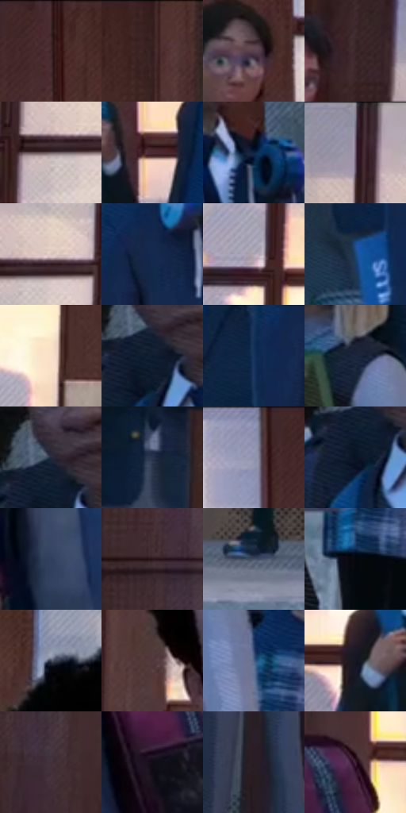

# 电影参考 025

- 状态：常规／活跃；来源世界：miles-home。
- 视角：near-level；景别：full-body；场景：interior。
- 时段：daylight-time-unspecified（外观依据，中置信度；具体时间／晨昏未知）；光照：neutral-day。
- 材质候选：skin, fabric, glass, stone, wood（帧级，不是像素分割）。
- 明暗组：dark；L* P5/P50/P95：4.46948 / 21.08496 / 82.04528。
- 资格门禁：无附加门禁。
- 原截图 SHA-256：`8243332b48a08ab910a85be147412f0f01b5de463b4191c4c89108d6c0c341b9`；尺寸：2870 × 1198。
- sRGB 像素 SHA-256：`0d53df1e677e2ad63033978780534c21e512d4a618d904ac702110771d39bb01`。

## 观察与迁移

校服群像与大堂结构，人物身份优先于背景微细节。

学校门口的人群与背包

中央少年头部、肩膀与背包的前后叠压关系清楚；旁边学生各有不同头型、肩宽、身高和表情。木门垂直框线与玻璃细网格分层，衣料小排线顺衣褶转向；背景窗格保持明亮安静。人物脸的瞳孔与眉口不承载粗波点，边缘轻微错色也不改变眼神方向。

本公开版保存32个128×128原像素色卡上下文；图集格子并非原场景相邻位置。原rect、图集tile和像素SHA见 `data/palette-crops.json`。上下文不足时不得批准替色，不能以小样推断完整构图。

## 实测色卡

颜色比例分母为保留采样像素，不是材料面积；全部 32 色参与全库匹配。表内四舍五入仅用于阅读，原精度在 JSON。

| ID | HEX | Lab | 原图 xy | 像素数 | 比例 | 明度角色 |
| --- | --- | --- | --- | ---: | ---: | --- |
| 025-S01 | #40292A | [19.404811, 10.923637, 3.720686] | [1928, 40] | 9902 | 5.154714% | deep-shadow |
| 025-S02 | #341E1F | [14.16051, 10.916566, 3.810811] | [1412, 64] | 9139 | 4.757517% | deep-shadow |
| 025-S03 | #5B424F | [31.079644, 13.172743, -3.565497] | [1968, 200] | 7685 | 4.000604% | shadow |
| 025-S04 | #382528 | [17.071033, 9.550523, 1.626493] | [508, 80] | 7327 | 3.814239% | deep-shadow |
| 025-S05 | #6B5C60 | [40.613595, 6.819358, -0.044349] | [760, 168] | 7279 | 3.789251% | midtone |
| 025-S06 | #492B32 | [21.486379, 15.011961, 1.359078] | [2040, 392] | 7172 | 3.733550% | shadow |
| 025-S07 | #102341 | [13.789871, 4.086643, -21.355077] | [2452, 252] | 6981 | 3.634120% | deep-shadow |
| 025-S08 | #7E7788 | [51.159814, 6.136984, -8.282095] | [696, 24] | 6776 | 3.527403% | midtone |
| 025-S09 | #DDC7C2 | [81.900776, 6.880333, 5.311865] | [800, 140] | 6719 | 3.497730% | highlight |
| 025-S10 | #13294D | [16.795882, 5.335918, -24.811229] | [2296, 340] | 6671 | 3.472743% | deep-shadow |
| 025-S11 | #B3A9B5 | [70.38282, 5.810158, -4.856994] | [676, 336] | 6633 | 3.452961% | light |
| 025-S12 | #1A4578 | [28.982475, 4.561213, -33.369558] | [2164, 656] | 6574 | 3.422247% | shadow |
| 025-S13 | #F9E2C9 | [91.121676, 3.983574, 15.09231] | [836, 448] | 6409 | 3.336353% | highlight |
| 025-S14 | #0E1B30 | [9.723876, 2.43505, -15.701889] | [2724, 228] | 6314 | 3.286898% | deep-shadow |
| 025-S15 | #16325C | [20.919857, 5.64819, -28.249717] | [2200, 408] | 6198 | 3.226512% | shadow |
| 025-S16 | #152137 | [12.752606, 2.654043, -15.934451] | [56, 352] | 6047 | 3.147905% | deep-shadow |
| 025-S17 | #252B3D | [17.727041, 2.701642, -12.294903] | [2720, 192] | 5810 | 3.024529% | deep-shadow |
| 025-S18 | #27344C | [21.61227, 2.117476, -16.459489] | [408, 484] | 5783 | 3.010474% | shadow |
| 025-S19 | #8E93AE | [61.371615, 3.983229, -14.710955] | [1836, 60] | 5738 | 2.987048% | light |
| 025-S20 | #071324 | [5.765034, 1.318245, -13.024597] | [2704, 264] | 5491 | 2.858467% | deep-shadow |
| 025-S21 | #303E5C | [26.291495, 3.450744, -19.666478] | [1116, 716] | 5455 | 2.839726% | shadow |
| 025-S22 | #261419 | [8.846043, 10.133138, 0.340966] | [680, 652] | 5451 | 2.837644% | deep-shadow |
| 025-S23 | #45526B | [34.7236, 1.616296, -16.049235] | [1796, 1124] | 5377 | 2.799121% | shadow |
| 025-S24 | #04070C | [1.845451, -0.073741, -2.210921] | [156, 680] | 5154 | 2.683033% | deep-shadow |
| 025-S25 | #3F4658 | [29.766601, 1.826214, -11.624578] | [1052, 100] | 5041 | 2.624209% | shadow |
| 025-S26 | #50373B | [26.021796, 11.842101, 1.965292] | [1008, 308] | 4980 | 2.592454% | shadow |
| 025-S27 | #4B6488 | [41.824695, 0.896548, -22.851571] | [152, 476] | 4880 | 2.540396% | midtone |
| 025-S28 | #141620 | [7.468405, 2.055328, -7.285585] | [1828, 388] | 4860 | 2.529985% | deep-shadow |
| 025-S29 | #42313A | [22.51572, 9.463069, -2.700565] | [736, 816] | 4728 | 2.461269% | shadow |
| 025-S30 | #100C15 | [3.859267, 3.047483, -4.308489] | [1488, 628] | 4469 | 2.326441% | deep-shadow |
| 025-S31 | #291D24 | [12.46478, 7.350136, -2.484131] | [380, 968] | 3828 | 1.992754% | deep-shadow |
| 025-S32 | #3C2032 | [16.622089, 16.620284, -6.050745] | [1528, 392] | 1225 | 0.637702% | deep-shadow |

## 色阶与空间分布

- 采样 ROI：`[0.01, 0.02, 0.98, 0.94]`；步长：4；样本数：192096。
- 排除区：`[]`。
- 深暗、暗、中、亮、高光五段计数：`[88915, 63683, 15969, 12259, 11270]`。
- RGB 各 256 箱、L* 100 箱、13×5 色相明度表和 3×3 空间统计全部保存在 [总数据](../film-library.json)。
- [可视化档案](../../references/library.html)按需绘制直方图，不存 2,094 张重复图表图片。

## 纹理特征占比

**这是分块图像特征的面积占比，不是波点／排线／丝网／错版的精确语义覆盖率。** 窗格、发丝、织物也会产生方向或周期特征。
原图 ROI 像素 3070752；已测块覆盖 3070752（100.0000%）；未测 0。

| 特征 | 块覆盖像素 | 占已测面积 | 阈值敏感范围 |
| --- | ---: | ---: | --- |
| low-contrast | 0 | 0.0000% | 0.0000% ~ 0.0000% |
| directional-structure | 757504 | 24.6684% | 10.4668% ~ 36.6024% |
| periodic-structure | 2270368 | 73.9352% | 63.0683% ~ 81.8676% |
| mixed-detail | 42880 | 1.3964% | 0.3293% ~ 7.6656% |

阈值敏感范围不是统计置信区间。逐块坐标、尺度、对比、方向一致性、频谱集中度、频率与角度见 [全量特征记录](../texture-features.jsonl)，以帧号定位。
四种印刷层的真实像素覆盖仍标为 `null`，不能填 0，也不能拿上表代替。不得据这些代理测量删除唯一证据。

[测量方法与保留策略](../../references/library-retention.md) · [分类索引](../archive/README.md)
