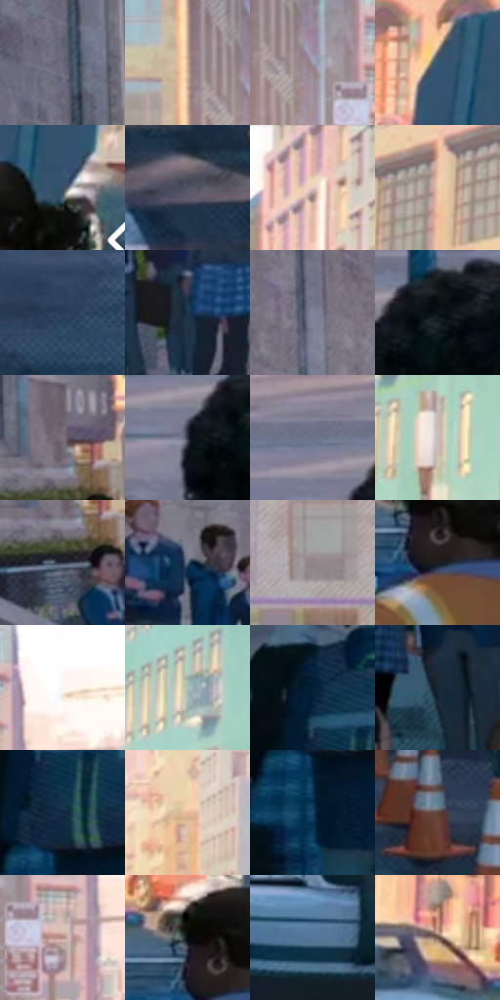

# 电影参考 026

- 状态：常规／活跃；来源世界：miles-home。
- 视角：high-angle；景别：environment-wide；场景：city。
- 时段：daylight-time-unspecified（外观依据，中置信度；具体时间／晨昏未知）；光照：neutral-day。
- 材质候选：brick, glass, painted-metal, asphalt, sky（帧级，不是像素分割）。
- 明暗组：middle；L* P5/P50/P95：5.34085 / 41.14564 / 86.92165。
- 资格门禁：无附加门禁。
- 原截图 SHA-256：`cb082dcde8886ca27e83b4efa06250b0be852410f41be2bc6d5dc90abc46b213`；尺寸：2880 × 1200。
- sRGB 像素 SHA-256：`fca3bf8f30d8e2f8aa731f31826a688f683aa5749e5c106ebde8559ffe5e9c3d`。

## 观察与迁移

校区街面与立面大体块、窗组和车流分开。

学校街道的长透视

人群靠头身尺寸、站位、校服大面区分远近，不必给远处每张脸同样线密度。道路与人行道有低对比细网目；斑马线和路沿为大块几何，不把照片纹理原样留下。天光与楼面有淡粉、青的彩色邻接，但最远消失点保持宽阔明亮，不让杂乱色散遮断透视。

本公开版保存32个128×128原像素色卡上下文；图集格子并非原场景相邻位置。原rect、图集tile和像素SHA见 `data/palette-crops.json`。上下文不足时不得批准替色，不能以小样推断完整构图。

## 实测色卡

颜色比例分母为保留采样像素，不是材料面积；全部 32 色参与全库匹配。表内四舍五入仅用于阅读，原精度在 JSON。

| ID | HEX | Lab | 原图 xy | 像素数 | 比例 | 明度角色 |
| --- | --- | --- | --- | ---: | ---: | --- |
| 026-S01 | #686879 | [44.552473, 3.74238, -9.451592] | [540, 100] | 7771 | 4.033782% | midtone |
| 026-S02 | #C7A798 | [70.904057, 9.367128, 12.121717] | [1232, 128] | 7513 | 3.899859% | light |
| 026-S03 | #9D9BA6 | [64.454455, 2.876775, -5.46593] | [1300, 168] | 7202 | 3.738424% | light |
| 026-S04 | #385773 | [35.780015, -2.86586, -19.470848] | [2732, 408] | 7133 | 3.702608% | shadow |
| 026-S05 | #374A61 | [30.813132, -0.710983, -15.835598] | [2788, 548] | 6996 | 3.631494% | shadow |
| 026-S06 | #4F5567 | [36.249232, 2.009938, -11.153198] | [1816, 960] | 6945 | 3.605021% | shadow |
| 026-S07 | #F0D8BE | [87.657946, 4.268267, 15.854103] | [1972, 60] | 6907 | 3.585295% | highlight |
| 026-S08 | #F0C9AC | [83.589317, 9.592912, 19.652315] | [2632, 124] | 6842 | 3.551555% | highlight |
| 026-S09 | #283F56 | [25.796007, -1.558692, -16.569427] | [1484, 688] | 6811 | 3.535464% | shadow |
| 026-S10 | #1B344A | [20.762893, -1.944113, -16.496763] | [976, 620] | 6751 | 3.504319% | shadow |
| 026-S11 | #7D8297 | [54.615374, 2.731233, -11.860614] | [672, 136] | 6598 | 3.424899% | midtone |
| 026-S12 | #081116 | [4.610573, -1.629992, -3.978257] | [1072, 884] | 6432 | 3.338732% | deep-shadow |
| 026-S13 | #7D737C | [49.589153, 5.613857, -3.545211] | [860, 404] | 6393 | 3.318488% | midtone |
| 026-S14 | #292E3A | [18.931879, 1.138975, -8.34784] | [1000, 916] | 6227 | 3.232320% | deep-shadow |
| 026-S15 | #6F768D | [49.808799, 2.620611, -13.380345] | [960, 844] | 6158 | 3.196503% | midtone |
| 026-S16 | #CBC0BA | [78.427647, 2.811101, 4.403088] | [2332, 312] | 6108 | 3.170549% | light |
| 026-S17 | #333A4A | [24.399158, 1.418649, -10.752889] | [852, 480] | 5913 | 3.069329% | shadow |
| 026-S18 | #546279 | [41.216449, 0.48875, -14.651939] | [492, 376] | 5865 | 3.044413% | midtone |
| 026-S19 | #95878C | [57.666253, 6.176422, -0.758052] | [1160, 324] | 5858 | 3.040779% | midtone |
| 026-S20 | #1D1D20 | [10.879644, 0.782016, -2.051092] | [2672, 628] | 5855 | 3.039222% | deep-shadow |
| 026-S21 | #FDF6F3 | [97.335351, 1.814764, 2.271829] | [1456, 136] | 5654 | 2.934886% | highlight |
| 026-S22 | #A8C1C0 | [76.234409, -8.645798, -2.353459] | [2264, 92] | 5633 | 2.923986% | light |
| 026-S23 | #061A2E | [8.77846, 0.422743, -15.763707] | [48, 648] | 5539 | 2.875192% | deep-shadow |
| 026-S24 | #182533 | [14.152164, -0.880319, -10.893822] | [228, 472] | 5515 | 2.862734% | deep-shadow |
| 026-S25 | #122A42 | [16.393242, -0.212666, -17.922038] | [88, 752] | 5335 | 2.769299% | deep-shadow |
| 026-S26 | #E7B599 | [77.483353, 14.289671, 21.209534] | [1740, 268] | 5265 | 2.732964% | light |
| 026-S27 | #12415C | [25.807081, -5.267666, -20.531485] | [80, 852] | 5120 | 2.657697% | shadow |
| 026-S28 | #5D4339 | [30.966528, 9.704941, 10.479694] | [1784, 720] | 5073 | 2.633300% | shadow |
| 026-S29 | #B29185 | [62.852673, 10.539559, 11.046133] | [1380, 224] | 4858 | 2.521698% | light |
| 026-S30 | #04080A | [1.999727, -0.768049, -1.125137] | [2644, 572] | 4670 | 2.424110% | deep-shadow |
| 026-S31 | #557699 | [48.4948, -2.077732, -22.60562] | [2188, 812] | 4514 | 2.343134% | midtone |
| 026-S32 | #70554C | [38.662826, 9.771082, 9.569399] | [2524, 504] | 3194 | 1.657946% | shadow |

## 色阶与空间分布

- 采样 ROI：`[0.01, 0.02, 0.98, 0.94]`；步长：4；样本数：192648。
- 排除区：`[]`。
- 深暗、暗、中、亮、高光五段计数：`[39558, 54394, 42594, 31792, 24310]`。
- RGB 各 256 箱、L* 100 箱、13×5 色相明度表和 3×3 空间统计全部保存在 [总数据](../film-library.json)。
- [可视化档案](../../references/library.html)按需绘制直方图，不存 2,094 张重复图表图片。

## 纹理特征占比

**这是分块图像特征的面积占比，不是波点／排线／丝网／错版的精确语义覆盖率。** 窗格、发丝、织物也会产生方向或周期特征。
原图 ROI 像素 3084576；已测块覆盖 3084576（100.0000%）；未测 0。

| 特征 | 块覆盖像素 | 占已测面积 | 阈值敏感范围 |
| --- | ---: | ---: | --- |
| low-contrast | 13568 | 0.4399% | 0.0000% ~ 0.9710% |
| directional-structure | 305152 | 9.8928% | 4.5812% ~ 26.5994% |
| periodic-structure | 2608160 | 84.5549% | 73.4006% ~ 84.5549% |
| mixed-detail | 157696 | 5.1124% | 0.0000% ~ 11.4199% |

阈值敏感范围不是统计置信区间。逐块坐标、尺度、对比、方向一致性、频谱集中度、频率与角度见 [全量特征记录](../texture-features.jsonl)，以帧号定位。
四种印刷层的真实像素覆盖仍标为 `null`，不能填 0，也不能拿上表代替。不得据这些代理测量删除唯一证据。

[测量方法与保留策略](../../references/library-retention.md) · [分类索引](../archive/README.md)
