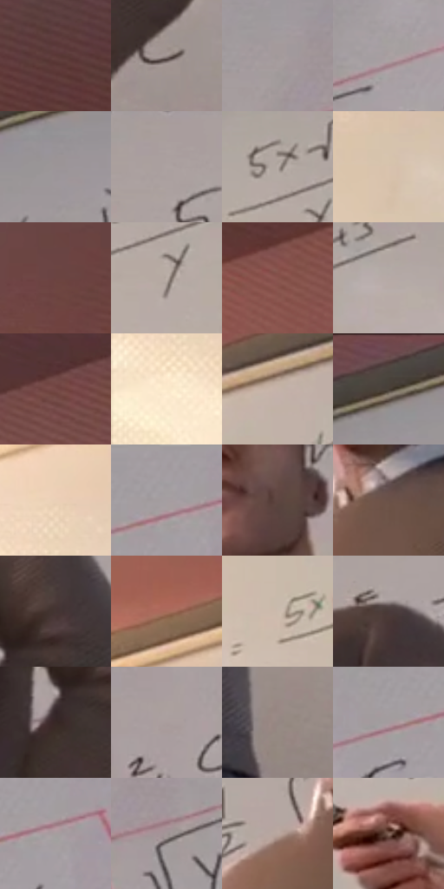

# 电影参考 028

- 状态：常规／活跃；来源世界：miles-home。
- 视角：low-angle；景别：medium；场景：classroom。
- 时段：daylight-time-unspecified（外观依据，中置信度；具体时间／晨昏未知）；光照：warm-day。
- 材质候选：skin, fabric, paint, paper, plastic（帧级，不是像素分割）。
- 明暗组：light；L* P5/P50/P95：24.12004 / 63.90296 / 84.65274。
- 资格门禁：无附加门禁。
- 原截图 SHA-256：`b70cbf18b95dbed35f45afc3bdcd2c614a0c85103e3bc6ce0332051342f90e29`；尺寸：2880 × 1208。
- sRGB 像素 SHA-256：`97a3f540040625cceaeea8042721290ef6bf64ef3c909c080abc194d312eecfb`。

## 观察与迁移

暖侧光教室，面部体块与墙面光区、衣料中间调分开。

低机位教师与白板

低机位令躯干宽大、头部相对小、手臂向镜头伸出，这是透视不是人物本体比例。毛衣表面的细斜排线顺躯干面，天花暗部另有方向线；白板是留白，原字只作为照片内容参考，不能引入别帧文字。脸以较干净的额鼻颊面与少数眉口线塑造；无明显大波点，色散只在受光边缘。

本公开版保存32个128×128原像素色卡上下文；图集格子并非原场景相邻位置。原rect、图集tile和像素SHA见 `data/palette-crops.json`。上下文不足时不得批准替色，不能以小样推断完整构图。

## 实测色卡

颜色比例分母为保留采样像素，不是材料面积；全部 32 色参与全库匹配。表内四舍五入仅用于阅读，原精度在 JSON。

| ID | HEX | Lab | 原图 xy | 像素数 | 比例 | 明度角色 |
| --- | --- | --- | --- | ---: | ---: | --- |
| 028-S01 | #5C3837 | [27.790992, 15.899386, 7.348315] | [472, 120] | 8076 | 4.176968% | shadow |
| 028-S02 | #9C8F8C | [60.432977, 4.288719, 3.343815] | [2072, 868] | 7996 | 4.135591% | light |
| 028-S03 | #A1999A | [63.911458, 3.101864, 0.524683] | [2312, 136] | 7958 | 4.115937% | light |
| 028-S04 | #A99FA0 | [66.343579, 3.808338, 0.786847] | [2528, 140] | 7764 | 4.015599% | light |
| 028-S05 | #9C9597 | [62.336211, 2.936823, -0.132113] | [1984, 96] | 7555 | 3.907503% | light |
| 028-S06 | #ADA2A1 | [67.500396, 3.799251, 1.953881] | [1944, 292] | 7290 | 3.770443% | light |
| 028-S07 | #B8ADA8 | [71.490553, 3.04928, 3.979391] | [1148, 424] | 7252 | 3.750789% | light |
| 028-S08 | #D9C2AE | [79.836816, 4.94188, 13.029714] | [348, 696] | 7112 | 3.678380% | light |
| 028-S09 | #6B4341 | [32.967788, 17.039079, 8.420403] | [92, 188] | 6937 | 3.587868% | shadow |
| 028-S10 | #BCB0A9 | [72.632503, 3.059309, 5.121842] | [1184, 500] | 6885 | 3.560974% | light |
| 028-S11 | #88544D | [41.393374, 20.782066, 13.194074] | [648, 272] | 6770 | 3.501495% | midtone |
| 028-S12 | #B6AAA6 | [70.488829, 3.600456, 3.610937] | [1348, 424] | 6591 | 3.408915% | light |
| 028-S13 | #764A47 | [36.375765, 18.329568, 9.599975] | [992, 132] | 6379 | 3.299267% | shadow |
| 028-S14 | #FAE8CD | [92.771642, 1.859439, 15.353862] | [48, 828] | 6370 | 3.294612% | highlight |
| 028-S15 | #C4B3A8 | [74.064235, 4.218736, 7.814406] | [712, 460] | 6123 | 3.166861% | light |
| 028-S16 | #51423E | [29.39676, 5.717434, 4.853513] | [1840, 36] | 6030 | 3.118761% | shadow |
| 028-S17 | #EAD0B7 | [85.009129, 5.209162, 15.741102] | [84, 708] | 5994 | 3.100142% | highlight |
| 028-S18 | #A59EA0 | [65.741916, 2.905087, -0.131578] | [2744, 68] | 5761 | 2.979632% | light |
| 028-S19 | #5E4640 | [32.102297, 9.308, 7.604223] | [1664, 324] | 5706 | 2.951186% | shadow |
| 028-S20 | #6B5248 | [37.16775, 8.82613, 9.875124] | [1628, 484] | 5628 | 2.910844% | shadow |
| 028-S21 | #443432 | [23.389729, 6.811939, 4.008919] | [2028, 676] | 5623 | 2.908258% | shadow |
| 028-S22 | #A86B5A | [51.35931, 22.372426, 19.652278] | [376, 492] | 5534 | 2.862226% | midtone |
| 028-S23 | #CBBBAD | [76.833365, 3.323869, 9.136584] | [596, 728] | 5160 | 2.668791% | light |
| 028-S24 | #493A39 | [25.975385, 6.408601, 3.11572] | [1888, 416] | 5123 | 2.649654% | shadow |
| 028-S25 | #372926 | [18.090332, 5.965253, 4.469261] | [1964, 760] | 4904 | 2.536386% | deep-shadow |
| 028-S26 | #AA9D9D | [65.822383, 4.73861, 1.716714] | [2104, 284] | 4755 | 2.459322% | light |
| 028-S27 | #958783 | [57.421291, 4.54668, 4.061805] | [1972, 1080] | 4749 | 2.456218% | midtone |
| 028-S28 | #A49C9E | [65.072211, 3.275815, 0.001065] | [2680, 96] | 4669 | 2.414842% | light |
| 028-S29 | #A69D9E | [65.506481, 3.451869, 0.655019] | [2776, 88] | 4586 | 2.371914% | light |
| 028-S30 | #A29696 | [63.091233, 4.408983, 1.595895] | [2392, 208] | 4460 | 2.306745% | light |
| 028-S31 | #B9A69E | [69.509544, 5.538764, 6.652497] | [1516, 520] | 3919 | 2.026936% | light |
| 028-S32 | #84685C | [46.418064, 9.303793, 11.025325] | [988, 1000] | 3687 | 1.906944% | midtone |

## 色阶与空间分布

- 采样 ROI：`[0.01, 0.02, 0.98, 0.94]`；步长：4；样本数：193346。
- 排除区：`[]`。
- 深暗、暗、中、亮、高光五段计数：`[2811, 53128, 20780, 100805, 15822]`。
- RGB 各 256 箱、L* 100 箱、13×5 色相明度表和 3×3 空间统计全部保存在 [总数据](../film-library.json)。
- [可视化档案](../../references/library.html)按需绘制直方图，不存 2,094 张重复图表图片。

## 纹理特征占比

**这是分块图像特征的面积占比，不是波点／排线／丝网／错版的精确语义覆盖率。** 窗格、发丝、织物也会产生方向或周期特征。
原图 ROI 像素 3104134；已测块覆盖 3104134（100.0000%）；未测 0。

| 特征 | 块覆盖像素 | 占已测面积 | 阈值敏感范围 |
| --- | ---: | ---: | --- |
| low-contrast | 770816 | 24.8319% | 19.3641% ~ 29.9410% |
| directional-structure | 871424 | 28.0730% | 16.0241% ~ 41.9858% |
| periodic-structure | 991366 | 31.9370% | 31.9370% ~ 34.8234% |
| mixed-detail | 470528 | 15.1581% | 5.1091% ~ 19.2115% |

阈值敏感范围不是统计置信区间。逐块坐标、尺度、对比、方向一致性、频谱集中度、频率与角度见 [全量特征记录](../texture-features.jsonl)，以帧号定位。
四种印刷层的真实像素覆盖仍标为 `null`，不能填 0，也不能拿上表代替。不得据这些代理测量删除唯一证据。

[测量方法与保留策略](../../references/library-retention.md) · [分类索引](../archive/README.md)
