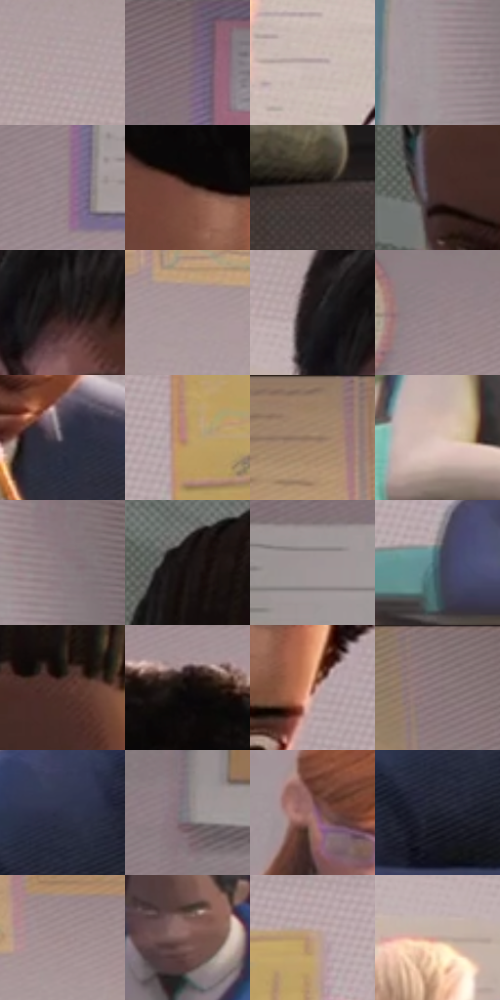

# 电影参考 029

- 状态：常规／活跃；来源世界：miles-home。
- 视角：near-level；景别：medium；场景：classroom。
- 时段：daylight-time-unspecified（外观依据，中置信度；具体时间／晨昏未知）；光照：warm-day。
- 材质候选：skin, fabric, paint, paper, plastic（帧级，不是像素分割）。
- 明暗组：middle；L* P5/P50/P95：6.1258 / 51.44173 / 73.48592。
- 资格门禁：无附加门禁。
- 原截图 SHA-256：`ef17255c7a94be7e0e2cbfd84df217ed487226da2c52e373d16b70504438938f`；尺寸：2880 × 1204。
- sRGB 像素 SHA-256：`057cdb4e7413f9617c25e4223b586a3b1f74c69acb5639e99a61a8d6843f3484`。

## 观察与迁移

暖侧光教室，面部体块与墙面光区、衣料中间调分开。

教室里不同脸型与坐姿

正面、侧面、低头、远景人物的脸部信息量各不相同；眼、眉和口的尺寸也并不统一。墙面淡斜线与纸张细网目是低对比底层；衣袖随手臂方向有排线，桌面相对净而深。窗光照亮人脸和作业纸，笔尖与手指接触要准确；不以高密度波点盖掉面部表情。

本公开版保存32个128×128原像素色卡上下文；图集格子并非原场景相邻位置。原rect、图集tile和像素SHA见 `data/palette-crops.json`。上下文不足时不得批准替色，不能以小样推断完整构图。

## 实测色卡

颜色比例分母为保留采样像素，不是材料面积；全部 32 色参与全库匹配。表内四舍五入仅用于阅读，原精度在 JSON。

| ID | HEX | Lab | 原图 xy | 像素数 | 比例 | 明度角色 |
| --- | --- | --- | --- | ---: | ---: | --- |
| 029-S01 | #B1A1A3 | [67.636906, 6.170153, 1.080903] | [2320, 360] | 11575 | 6.008368% | light |
| 029-S02 | #7E6E75 | [48.098528, 7.566531, -1.570657] | [956, 68] | 10995 | 5.707300% | midtone |
| 029-S03 | #BFAEAD | [72.472662, 5.920194, 2.72882] | [2384, 696] | 9597 | 4.981625% | light |
| 029-S04 | #A4979A | [63.638672, 5.317511, 0.157813] | [288, 240] | 9166 | 4.757900% | light |
| 029-S05 | #9A8A8E | [58.974712, 6.71587, 0.060637] | [948, 436] | 8577 | 4.452161% | midtone |
| 029-S06 | #6B483E | [34.208795, 13.574944, 12.039163] | [1588, 572] | 8426 | 4.373780% | shadow |
| 029-S07 | #3F3431 | [22.773944, 4.322284, 3.72446] | [712, 1084] | 8173 | 4.242453% | shadow |
| 029-S08 | #6B6561 | [43.206466, 1.582357, 3.109785] | [36, 544] | 7505 | 3.895706% | midtone |
| 029-S09 | #2D2220 | [14.436056, 4.862942, 3.347309] | [2748, 532] | 7380 | 3.830821% | deep-shadow |
| 029-S10 | #AA999B | [64.720257, 6.600404, 1.235447] | [2228, 252] | 7076 | 3.673020% | light |
| 029-S11 | #1C181A | [8.779212, 2.459205, -0.680988] | [2676, 492] | 6498 | 3.372991% | deep-shadow |
| 029-S12 | #928387 | [56.18103, 6.401636, -0.078657] | [1728, 188] | 6484 | 3.365724% | midtone |
| 029-S13 | #474551 | [29.88653, 3.610983, -6.861843] | [1604, 848] | 6179 | 3.207404% | shadow |
| 029-S14 | #BB9371 | [63.857202, 10.405859, 23.750055] | [1844, 716] | 5978 | 3.103069% | light |
| 029-S15 | #9C8167 | [55.835373, 6.433844, 17.990648] | [2136, 48] | 5900 | 3.062580% | midtone |
| 029-S16 | #DDC6BC | [81.506851, 6.447516, 7.956175] | [2116, 900] | 5842 | 3.032474% | highlight |
| 029-S17 | #8D7E82 | [54.234876, 6.44723, -0.075588] | [320, 80] | 5669 | 2.942673% | midtone |
| 029-S18 | #161010 | [5.22632, 2.447908, 0.863181] | [96, 360] | 5634 | 2.924505% | deep-shadow |
| 029-S19 | #9E9497 | [62.23959, 4.230662, -0.252838] | [612, 256] | 5198 | 2.698185% | light |
| 029-S20 | #4A606C | [39.418057, -5.111086, -9.497096] | [1864, 892] | 5130 | 2.662888% | shadow |
| 029-S21 | #54342B | [25.307695, 13.216064, 11.656029] | [200, 464] | 5053 | 2.622918% | shadow |
| 029-S22 | #0D0909 | [2.715947, 1.113787, 0.392792] | [1564, 364] | 5039 | 2.615651% | deep-shadow |
| 029-S23 | #995F4F | [46.342084, 21.785789, 19.063467] | [1680, 648] | 4986 | 2.588140% | midtone |
| 029-S24 | #8A797B | [52.407332, 6.898832, 1.315387] | [2696, 40] | 4775 | 2.478614% | midtone |
| 029-S25 | #2D3147 | [20.863402, 4.508088, -14.221871] | [1256, 800] | 4617 | 2.396599% | shadow |
| 029-S26 | #817C81 | [52.583636, 2.874448, -2.037548] | [496, 536] | 4397 | 2.282401% | midtone |
| 029-S27 | #9B6D78 | [50.993541, 19.970545, 1.24407] | [972, 732] | 4146 | 2.152112% | midtone |
| 029-S28 | #20212E | [13.181388, 3.223626, -8.757677] | [1236, 880] | 3501 | 1.817304% | deep-shadow |
| 029-S29 | #A18C8D | [60.120195, 8.049691, 2.378002] | [2400, 212] | 3130 | 1.624725% | light |
| 029-S30 | #7B5953 | [41.185879, 13.105842, 8.987437] | [780, 812] | 2978 | 1.545825% | midtone |
| 029-S31 | #BE9A85 | [66.331106, 10.288411, 16.090805] | [1992, 552] | 1596 | 0.828454% | light |
| 029-S32 | #C7A498 | [70.14903, 10.999332, 11.054184] | [2576, 568] | 1448 | 0.751630% | light |

## 色阶与空间分布

- 采样 ROI：`[0.01, 0.02, 0.98, 0.94]`；步长：4；样本数：192648。
- 排除区：`[]`。
- 深暗、暗、中、亮、高光五段计数：`[31491, 33992, 66333, 57924, 2908]`。
- RGB 各 256 箱、L* 100 箱、13×5 色相明度表和 3×3 空间统计全部保存在 [总数据](../film-library.json)。
- [可视化档案](../../references/library.html)按需绘制直方图，不存 2,094 张重复图表图片。

## 纹理特征占比

**这是分块图像特征的面积占比，不是波点／排线／丝网／错版的精确语义覆盖率。** 窗格、发丝、织物也会产生方向或周期特征。
原图 ROI 像素 3092958；已测块覆盖 3092958（100.0000%）；未测 0。

| 特征 | 块覆盖像素 | 占已测面积 | 阈值敏感范围 |
| --- | ---: | ---: | --- |
| low-contrast | 16384 | 0.5297% | 0.0000% ~ 2.6486% |
| directional-structure | 808286 | 26.1331% | 11.3258% ~ 41.3087% |
| periodic-structure | 2169984 | 70.1589% | 57.6318% ~ 77.0204% |
| mixed-detail | 98304 | 3.1783% | 1.0594% ~ 9.0052% |

阈值敏感范围不是统计置信区间。逐块坐标、尺度、对比、方向一致性、频谱集中度、频率与角度见 [全量特征记录](../texture-features.jsonl)，以帧号定位。
四种印刷层的真实像素覆盖仍标为 `null`，不能填 0，也不能拿上表代替。不得据这些代理测量删除唯一证据。

[测量方法与保留策略](../../references/library-retention.md) · [分类索引](../archive/README.md)
