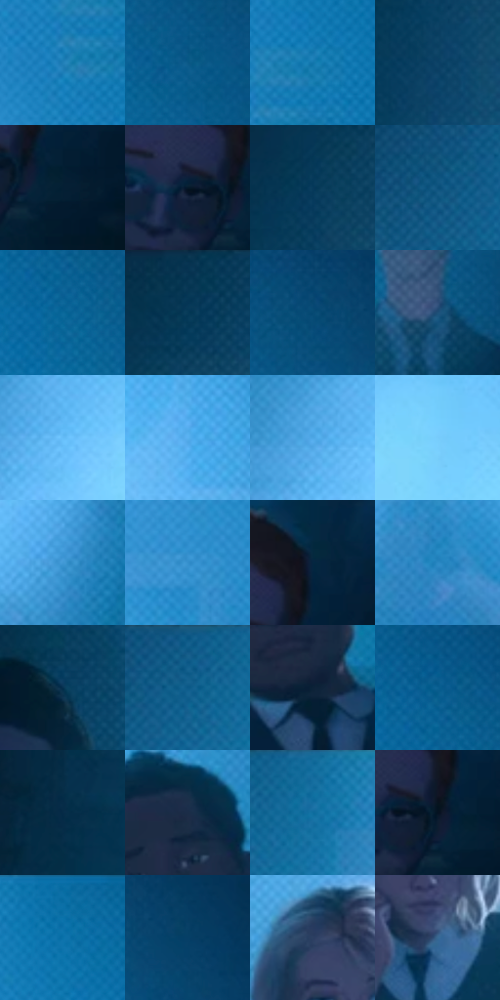

# 电影参考 030

- 状态：常规／活跃；来源世界：miles-home。
- 视角：near-level；景别：environment-wide；场景：classroom。
- 时段：interior-time-unknown（外观依据，中置信度；具体时间／晨昏未知）；光照：cool-interior。
- 材质候选：skin, fabric, paint（帧级，不是像素分割）。
- 明暗组：dark；L* P5/P50/P95：8.4458 / 34.99636 / 73.38585。
- 资格门禁：无附加门禁。
- 原截图 SHA-256：`5e66e4060dd849bfbfa349b1ac1fdce4de2e49630353384306f18e651ce0d160`；尺寸：2880 × 1206。
- sRGB 像素 SHA-256：`9af3b14dbdc07c8b12e1c204986ed7830c7aeb8ae3d13d470fc6a70b26a9fc11`。

## 观察与迁移

投影蓝光与深暗人形，不能据此给普通白天加蓝雾。

蓝色教室与蓝色环境光

强蓝色不是统一滤镜，人物和桌面仍保留明暗层次，人物清晰程度沿画面纵深逐级降低。整片蓝色空间有细密低对比网目，近景桌面和衣袖更可见斜向排线；大波点不与密网同强度叠加。中心亮蓝保持宽阔的呼吸感，彩边收在人物边缘，脸部眼口保留结构。

本公开版保存32个128×128原像素色卡上下文；图集格子并非原场景相邻位置。原rect、图集tile和像素SHA见 `data/palette-crops.json`。上下文不足时不得批准替色，不能以小样推断完整构图。

## 实测色卡

颜色比例分母为保留采样像素，不是材料面积；全部 32 色参与全库匹配。表内四舍五入仅用于阅读，原精度在 JSON。

| ID | HEX | Lab | 原图 xy | 像素数 | 比例 | 明度角色 |
| --- | --- | --- | --- | ---: | ---: | --- |
| 030-S01 | #217FB7 | [50.59203, -6.654617, -36.929473] | [2072, 312] | 9282 | 4.800720% | midtone |
| 030-S02 | #0B5886 | [35.539048, -3.68048, -31.654557] | [2448, 220] | 8893 | 4.599526% | shadow |
| 030-S03 | #1276AC | [47.055807, -6.664597, -36.142041] | [2128, 240] | 8305 | 4.295408% | midtone |
| 030-S04 | #0D4266 | [26.565157, -2.436738, -25.802646] | [372, 336] | 7590 | 3.925605% | shadow |
| 030-S05 | #041F34 | [10.946789, -1.04505, -16.696943] | [2808, 768] | 7494 | 3.875953% | deep-shadow |
| 030-S06 | #041829 | [7.57933, -0.850381, -13.969488] | [2724, 740] | 6988 | 3.614246% | deep-shadow |
| 030-S07 | #07395B | [22.745087, -1.643227, -24.716708] | [392, 164] | 6959 | 3.599247% | shadow |
| 030-S08 | #0A507B | [32.327101, -3.133636, -29.954355] | [680, 96] | 6812 | 3.523217% | shadow |
| 030-S09 | #0C689A | [41.705188, -5.570798, -33.981211] | [2324, 176] | 6565 | 3.395467% | midtone |
| 030-S10 | #063655 | [21.329191, -2.306164, -23.002696] | [456, 44] | 6544 | 3.384606% | shadow |
| 030-S11 | #074973 | [29.531436, -2.123048, -29.379572] | [2504, 120] | 6452 | 3.337023% | shadow |
| 030-S12 | #1E5178 | [32.954129, -2.767123, -27.06962] | [2428, 796] | 6418 | 3.319438% | shadow |
| 030-S13 | #65BDF8 | [73.503456, -9.541147, -37.137937] | [1100, 84] | 6399 | 3.309611% | light |
| 030-S14 | #59B2F0 | [69.648736, -8.213383, -38.837008] | [1796, 288] | 6367 | 3.293060% | light |
| 030-S15 | #4DA7E5 | [65.646475, -7.692498, -39.099821] | [1052, 72] | 6226 | 3.220134% | light |
| 030-S16 | #77CCFC | [78.538535, -12.770075, -31.443171] | [1268, 88] | 6189 | 3.200997% | light |
| 030-S17 | #4199D5 | [60.522538, -7.037765, -38.283102] | [1312, 516] | 6178 | 3.195308% | light |
| 030-S18 | #3490CC | [57.108019, -6.812668, -38.616741] | [1888, 108] | 6112 | 3.161172% | midtone |
| 030-S19 | #042640 | [14.298789, -0.659902, -19.879041] | [2792, 660] | 6053 | 3.130657% | deep-shadow |
| 030-S20 | #2A88C3 | [54.067488, -6.591992, -38.316134] | [1464, 284] | 5982 | 3.093935% | midtone |
| 030-S21 | #06304E | [18.810049, -1.215657, -22.312194] | [232, 624] | 5940 | 3.072213% | deep-shadow |
| 030-S22 | #14618F | [39.036197, -5.030897, -31.591094] | [764, 44] | 5759 | 2.978598% | shadow |
| 030-S23 | #0B2237 | [12.549958, -0.515016, -16.291613] | [2000, 876] | 5041 | 2.607243% | deep-shadow |
| 030-S24 | #0D6192 | [39.085855, -4.372051, -33.327082] | [2320, 96] | 4981 | 2.576211% | shadow |
| 030-S25 | #062B46 | [16.544946, -1.237242, -20.462872] | [176, 388] | 4933 | 2.551385% | deep-shadow |
| 030-S26 | #1B2D48 | [18.265251, 2.174631, -19.054268] | [1976, 720] | 4651 | 2.405532% | deep-shadow |
| 030-S27 | #146E9F | [43.947826, -6.733256, -33.406053] | [852, 32] | 4616 | 2.387430% | midtone |
| 030-S28 | #051221 | [5.190518, 0.291857, -11.623414] | [2768, 744] | 4504 | 2.329503% | deep-shadow |
| 030-S29 | #0D70A7 | [44.88849, -5.285561, -36.640123] | [2116, 32] | 4471 | 2.312435% | midtone |
| 030-S30 | #063F66 | [25.419625, -1.067992, -27.625226] | [2596, 136] | 4433 | 2.292781% | shadow |
| 030-S31 | #2C4062 | [26.971911, 3.065394, -22.502534] | [960, 624] | 4145 | 2.143825% | shadow |
| 030-S32 | #386994 | [42.884769, -2.804, -28.471758] | [1020, 772] | 2064 | 1.067516% | midtone |

## 色阶与空间分布

- 采样 ROI：`[0.01, 0.02, 0.98, 0.94]`；步长：4；样本数：193346。
- 排除区：`[]`。
- 深暗、暗、中、亮、高光五段计数：`[45502, 67255, 51177, 27868, 1544]`。
- RGB 各 256 箱、L* 100 箱、13×5 色相明度表和 3×3 空间统计全部保存在 [总数据](../film-library.json)。
- [可视化档案](../../references/library.html)按需绘制直方图，不存 2,094 张重复图表图片。

## 纹理特征占比

**这是分块图像特征的面积占比，不是波点／排线／丝网／错版的精确语义覆盖率。** 窗格、发丝、织物也会产生方向或周期特征。
原图 ROI 像素 3098546；已测块覆盖 3098546（100.0000%）；未测 0。

| 特征 | 块覆盖像素 | 占已测面积 | 阈值敏感范围 |
| --- | ---: | ---: | --- |
| low-contrast | 73600 | 2.3753% | 0.4379% ~ 5.8040% |
| directional-structure | 177970 | 5.7437% | 2.2241% ~ 10.3208% |
| periodic-structure | 2655872 | 85.7135% | 79.4633% ~ 85.7135% |
| mixed-detail | 191104 | 6.1675% | 4.2301% ~ 12.5086% |

阈值敏感范围不是统计置信区间。逐块坐标、尺度、对比、方向一致性、频谱集中度、频率与角度见 [全量特征记录](../texture-features.jsonl)，以帧号定位。
四种印刷层的真实像素覆盖仍标为 `null`，不能填 0，也不能拿上表代替。不得据这些代理测量删除唯一证据。

[测量方法与保留策略](../../references/library-retention.md) · [分类索引](../archive/README.md)
