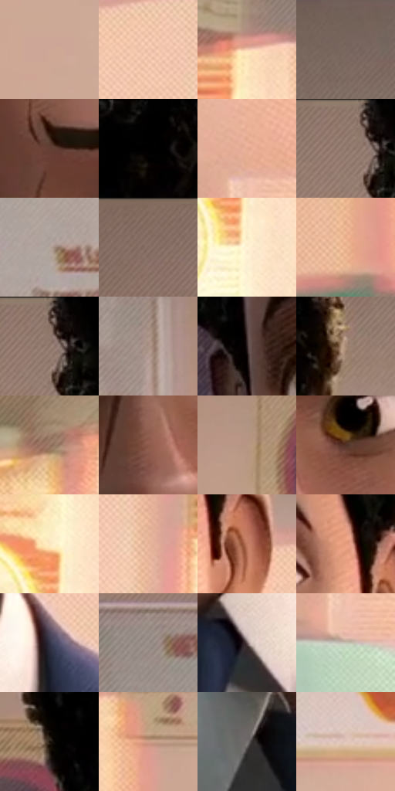

# 电影参考 031

- 状态：常规／活跃；来源世界：miles-home。
- 视角：near-level；景别：close-up；场景：classroom。
- 时段：daylight-time-unspecified（外观依据，中置信度；具体时间／晨昏未知）；光照：warm-day。
- 材质候选：skin, fabric, paint, paper, plastic（帧级，不是像素分割）。
- 明暗组：middle；L* P5/P50/P95：2.83288 / 59.93743 / 91.76108。
- 资格门禁：无附加门禁。
- 原截图 SHA-256：`2de43a964ee81c776cf279e4523492bbf5d5c746d07bbee4d27c507a88cb6907`；尺寸：2880 × 1200。
- sRGB 像素 SHA-256：`c8d8602a53afb0f73dff1748babdfd981a0eef815fd89d38f1827e31b1fa893d`。

## 观察与迁移

暖侧光教室，面部体块与墙面光区、衣料中间调分开。

教室暖光近景人像

脸部的发际、眉弓、眼窝、鼻翼、唇与下颌互相支撑，几何概括不能抹掉微表情。额头留较平净面，细排线集中在鼻侧与脸暗部；背景纸面有弱网目，大波点不压住眼睛。暖光穿过室内产生粉青邻接与亮边色散，局部用于景深和印刷感，不把瞳孔或嘴唇错开。

本公开版保存32个128×128原像素色卡上下文；图集格子并非原场景相邻位置。原rect、图集tile和像素SHA见 `data/palette-crops.json`。上下文不足时不得批准替色，不能以小样推断完整构图。

## 实测色卡

颜色比例分母为保留采样像素，不是材料面积；全部 32 色参与全库匹配。表内四舍五入仅用于阅读，原精度在 JSON。

| ID | HEX | Lab | 原图 xy | 像素数 | 比例 | 明度角色 |
| --- | --- | --- | --- | ---: | ---: | --- |
| 031-S01 | #CEA897 | [71.800857, 11.367827, 14.029283] | [1008, 820] | 9483 | 4.922449% | light |
| 031-S02 | #F3C6AC | [83.138514, 12.296267, 19.068842] | [1716, 556] | 9052 | 4.698725% | highlight |
| 031-S03 | #F9D3B4 | [87.009743, 8.81148, 20.3109] | [2340, 400] | 8698 | 4.514970% | highlight |
| 031-S04 | #78665D | [44.64116, 5.613537, 7.745796] | [2156, 68] | 8311 | 4.314086% | midtone |
| 031-S05 | #643F35 | [30.692922, 14.860463, 12.812292] | [1300, 384] | 8030 | 4.168224% | shadow |
| 031-S06 | #020101 | [0.332482, 0.261482, 0.092172] | [1456, 24] | 7658 | 3.975126% | deep-shadow |
| 031-S07 | #E5AB93 | [74.757674, 18.117911, 20.667771] | [2812, 988] | 7550 | 3.919065% | light |
| 031-S08 | #977F72 | [55.045325, 7.094932, 10.50017] | [832, 52] | 7506 | 3.896225% | midtone |
| 031-S09 | #B4A49B | [68.47621, 4.264102, 6.77374] | [368, 620] | 7419 | 3.851065% | light |
| 031-S10 | #866E61 | [48.36565, 7.362598, 10.809139] | [104, 24] | 7407 | 3.844836% | midtone |
| 031-S11 | #FEF2D5 | [95.739253, -0.605142, 15.455688] | [2328, 676] | 7191 | 3.732715% | highlight |
| 031-S12 | #F3BD99 | [80.601341, 14.692338, 25.659266] | [288, 960] | 6455 | 3.350671% | highlight |
| 031-S13 | #8D766A | [51.451647, 6.974128, 9.949144] | [852, 60] | 6442 | 3.343923% | midtone |
| 031-S14 | #A89185 | [61.886493, 6.62258, 9.543282] | [544, 360] | 6354 | 3.298243% | light |
| 031-S15 | #2E1F1F | [13.590125, 7.293181, 2.880176] | [1020, 468] | 6307 | 3.273847% | deep-shadow |
| 031-S16 | #A48672 | [58.187451, 8.391815, 15.081655] | [1660, 292] | 6262 | 3.250488% | midtone |
| 031-S17 | #977562 | [52.045552, 10.540647, 15.600464] | [2124, 420] | 5754 | 2.986795% | midtone |
| 031-S18 | #8C594A | [43.086721, 19.214969, 17.398004] | [1276, 572] | 5520 | 2.865330% | midtone |
| 031-S19 | #B79682 | [64.558226, 9.310484, 15.192681] | [712, 460] | 5365 | 2.784872% | light |
| 031-S20 | #523126 | [24.099298, 13.602736, 13.287223] | [1372, 520] | 5323 | 2.763070% | shadow |
| 031-S21 | #FCE5BE | [91.888161, 1.996266, 21.908924] | [2308, 580] | 5312 | 2.757361% | highlight |
| 031-S22 | #E8B69B | [77.86384, 14.390929, 20.675119] | [1804, 680] | 5233 | 2.716353% | light |
| 031-S23 | #C17B60 | [58.36829, 24.315612, 26.072365] | [1604, 500] | 4889 | 2.537789% | midtone |
| 031-S24 | #E69C7C | [70.91146, 24.000356, 27.961758] | [1536, 432] | 4861 | 2.523255% | light |
| 031-S25 | #333245 | [21.633231, 5.386899, -11.639282] | [1584, 888] | 4615 | 2.395561% | shadow |
| 031-S26 | #9A8E88 | [59.883362, 3.386877, 4.805996] | [192, 316] | 4579 | 2.376874% | midtone |
| 031-S27 | #655656 | [38.011373, 6.142665, 2.27968] | [1456, 1036] | 4142 | 2.150035% | shadow |
| 031-S28 | #C4C3B4 | [78.497629, -2.304746, 7.664402] | [2812, 1100] | 4093 | 2.124600% | light |
| 031-S29 | #120A08 | [3.281079, 2.31803, 1.671973] | [916, 348] | 4023 | 2.088265% | deep-shadow |
| 031-S30 | #CE9E86 | [68.967328, 14.552036, 19.430727] | [760, 712] | 3902 | 2.025456% | light |
| 031-S31 | #767170 | [48.047378, 1.727723, 1.243028] | [1284, 1036] | 3062 | 1.589427% | midtone |
| 031-S32 | #E1C7BB | [82.07881, 7.218553, 9.355353] | [2584, 764] | 1850 | 0.960301% | highlight |

## 色阶与空间分布

- 采样 ROI：`[0.01, 0.02, 0.98, 0.94]`；步长：4；样本数：192648。
- 排除区：`[]`。
- 深暗、暗、中、亮、高光五段计数：`[20033, 19509, 56993, 59374, 36739]`。
- RGB 各 256 箱、L* 100 箱、13×5 色相明度表和 3×3 空间统计全部保存在 [总数据](../film-library.json)。
- [可视化档案](../../references/library.html)按需绘制直方图，不存 2,094 张重复图表图片。

## 纹理特征占比

**这是分块图像特征的面积占比，不是波点／排线／丝网／错版的精确语义覆盖率。** 窗格、发丝、织物也会产生方向或周期特征。
原图 ROI 像素 3084576；已测块覆盖 3084576（100.0000%）；未测 0。

| 特征 | 块覆盖像素 | 占已测面积 | 阈值敏感范围 |
| --- | ---: | ---: | --- |
| low-contrast | 114688 | 3.7181% | 3.1870% ~ 5.3116% |
| directional-structure | 784384 | 25.4292% | 11.1543% ~ 36.5929% |
| periodic-structure | 2040864 | 66.1635% | 59.6890% ~ 73.9151% |
| mixed-detail | 144640 | 4.6891% | 0.5312% ~ 9.6190% |

阈值敏感范围不是统计置信区间。逐块坐标、尺度、对比、方向一致性、频谱集中度、频率与角度见 [全量特征记录](../texture-features.jsonl)，以帧号定位。
四种印刷层的真实像素覆盖仍标为 `null`，不能填 0，也不能拿上表代替。不得据这些代理测量删除唯一证据。

[测量方法与保留策略](../../references/library-retention.md) · [分类索引](../archive/README.md)
