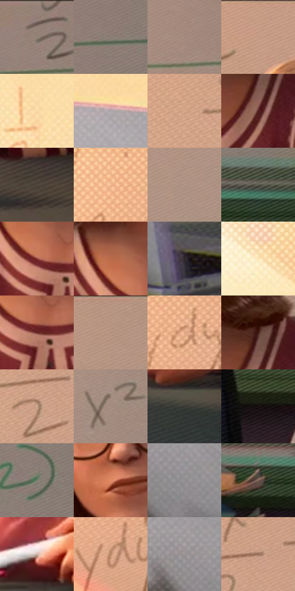

# 电影参考 032

- 状态：常规／活跃；来源世界：miles-home。
- 视角：near-level；景别：medium；场景：classroom。
- 时段：daylight-time-unspecified（外观依据，中置信度；具体时间／晨昏未知）；光照：warm-day。
- 材质候选：skin, fabric, paint, paper, plastic（帧级，不是像素分割）。
- 明暗组：middle；L* P5/P50/P95：14.3324 / 58.97818 / 88.66176。
- 资格门禁：无附加门禁。
- 原截图 SHA-256：`c4443c5c996cb8dde0358b5388afd8815d2d9af717866f6ba2cf7ad07877792d`；尺寸：2880 × 1208。
- sRGB 像素 SHA-256：`8e094f600262b75defc6940f0291d068bf393520f4296b407060cbef0af8f37d`。

## 观察与迁移

暖侧光教室，面部体块与墙面光区、衣料中间调分开。

教师桌前的人像与物件

人物为中景端坐，肩臂交叠、手握笔、眼镜和发型提供身份；不按电影角色脸型改用户照片。桌面用大暗面和随透视收缩的排线，白板网目细弱，纸张边缘有微小彩色套版。波点主要在环境大色面，脸和文字区域安静；文字仅尽力保留用户原图，不专门补造。

本公开版保存32个128×128原像素色卡上下文；图集格子并非原场景相邻位置。原rect、图集tile和像素SHA见 `data/palette-crops.json`。上下文不足时不得批准替色，不能以小样推断完整构图。

## 实测色卡

颜色比例分母为保留采样像素，不是材料面积；全部 32 色参与全库匹配。表内四舍五入仅用于阅读，原精度在 JSON。

| ID | HEX | Lab | 原图 xy | 像素数 | 比例 | 明度角色 |
| --- | --- | --- | --- | ---: | ---: | --- |
| 032-S01 | #968379 | [56.185551, 5.519421, 8.060506] | [2512, 52] | 12505 | 6.467680% | midtone |
| 032-S02 | #8A7D75 | [53.336166, 3.529893, 6.161205] | [2752, 104] | 11041 | 5.710488% | midtone |
| 032-S03 | #A58C7F | [60.148733, 7.315237, 10.444273] | [2232, 92] | 10553 | 5.458091% | light |
| 032-S04 | #C89D84 | [68.065757, 12.472644, 19.195822] | [1316, 28] | 10451 | 5.405336% | light |
| 032-S05 | #FBD8A4 | [88.114831, 4.990415, 30.174258] | [296, 412] | 8658 | 4.477982% | highlight |
| 032-S06 | #AAA5A8 | [68.229119, 2.351168, -0.906984] | [496, 616] | 8552 | 4.423158% | light |
| 032-S07 | #D7A88C | [72.460643, 13.421575, 21.086636] | [924, 120] | 7458 | 3.857333% | light |
| 032-S08 | #52201E | [19.725103, 23.21357, 12.926415] | [1628, 660] | 7411 | 3.833025% | deep-shadow |
| 032-S09 | #51473F | [30.913555, 2.713079, 6.360872] | [1660, 1068] | 7098 | 3.671139% | shadow |
| 032-S10 | #F3B78F | [78.988503, 16.73947, 28.785424] | [388, 68] | 6756 | 3.494254% | light |
| 032-S11 | #B59888 | [65.009427, 8.273452, 12.442009] | [1892, 296] | 6447 | 3.334437% | light |
| 032-S12 | #605E55 | [39.828934, -0.988553, 5.446613] | [2752, 696] | 6225 | 3.219617% | shadow |
| 032-S13 | #8C4035 | [36.93121, 31.379578, 22.107065] | [1420, 716] | 6188 | 3.200480% | shadow |
| 032-S14 | #BA6B49 | [53.425805, 28.261058, 32.472768] | [1388, 652] | 6104 | 3.157035% | midtone |
| 032-S15 | #2E272A | [16.499167, 3.909059, -0.771781] | [868, 1084] | 6088 | 3.148759% | deep-shadow |
| 032-S16 | #FCE3B5 | [91.22172, 1.827193, 25.636399] | [92, 132] | 6020 | 3.113589% | highlight |
| 032-S17 | #6B2C27 | [26.946047, 27.722376, 17.106787] | [1448, 736] | 5777 | 2.987908% | shadow |
| 032-S18 | #B49380 | [63.45072, 9.502377, 14.725548] | [1800, 28] | 5739 | 2.968254% | light |
| 032-S19 | #DFA583 | [72.388599, 17.144567, 26.005816] | [484, 132] | 5672 | 2.933601% | light |
| 032-S20 | #3B1710 | [13.109522, 17.102905, 12.889952] | [1632, 584] | 5424 | 2.805333% | deep-shadow |
| 032-S21 | #C9A48B | [70.059721, 9.961715, 18.110722] | [1048, 156] | 5182 | 2.680169% | light |
| 032-S22 | #AA9286 | [62.360483, 7.001387, 9.676747] | [2132, 348] | 5137 | 2.656895% | light |
| 032-S23 | #3B3A36 | [24.393107, -0.445849, 2.639372] | [1264, 1052] | 5118 | 2.647068% | shadow |
| 032-S24 | #1B1313 | [6.736799, 3.83174, 1.350942] | [1936, 792] | 4886 | 2.527076% | deep-shadow |
| 032-S25 | #747E6C | [51.516139, -7.278766, 8.556633] | [2712, 368] | 4681 | 2.421048% | midtone |
| 032-S26 | #E18B64 | [66.056443, 28.911572, 34.542391] | [1412, 444] | 3752 | 1.940563% | light |
| 032-S27 | #929091 | [59.980679, 0.9249, -0.266809] | [632, 960] | 3222 | 1.666443% | midtone |
| 032-S28 | #7D6456 | [44.442814, 7.824765, 11.751246] | [2568, 744] | 3188 | 1.648857% | midtone |
| 032-S29 | #CFB6A9 | [75.815184, 6.849302, 9.899756] | [1132, 940] | 2447 | 1.265607% | light |
| 032-S30 | #B78564 | [59.675349, 15.065495, 25.330619] | [464, 276] | 2446 | 1.265090% | midtone |
| 032-S31 | #9C9695 | [62.55045, 2.005301, 1.311205] | [540, 904] | 1605 | 0.830118% | light |
| 032-S32 | #956F58 | [50.054379, 11.886999, 18.671363] | [1096, 108] | 1515 | 0.783569% | midtone |

## 色阶与空间分布

- 采样 ROI：`[0.01, 0.02, 0.98, 0.94]`；步长：4；样本数：193346。
- 排除区：`[]`。
- 深暗、暗、中、亮、高光五段计数：`[19651, 30469, 50553, 75297, 17376]`。
- RGB 各 256 箱、L* 100 箱、13×5 色相明度表和 3×3 空间统计全部保存在 [总数据](../film-library.json)。
- [可视化档案](../../references/library.html)按需绘制直方图，不存 2,094 张重复图表图片。

## 纹理特征占比

**这是分块图像特征的面积占比，不是波点／排线／丝网／错版的精确语义覆盖率。** 窗格、发丝、织物也会产生方向或周期特征。
原图 ROI 像素 3104134；已测块覆盖 3104134（100.0000%）；未测 0。

| 特征 | 块覆盖像素 | 占已测面积 | 阈值敏感范围 |
| --- | ---: | ---: | --- |
| low-contrast | 229376 | 7.3894% | 1.5834% ~ 11.5212% |
| directional-structure | 1102592 | 35.5201% | 11.8222% ~ 55.1481% |
| periodic-structure | 1663110 | 53.5773% | 42.2128% ~ 68.9209% |
| mixed-detail | 109056 | 3.5132% | 1.0556% ~ 7.7357% |

阈值敏感范围不是统计置信区间。逐块坐标、尺度、对比、方向一致性、频谱集中度、频率与角度见 [全量特征记录](../texture-features.jsonl)，以帧号定位。
四种印刷层的真实像素覆盖仍标为 `null`，不能填 0，也不能拿上表代替。不得据这些代理测量删除唯一证据。

[测量方法与保留策略](../../references/library-retention.md) · [分类索引](../archive/README.md)
