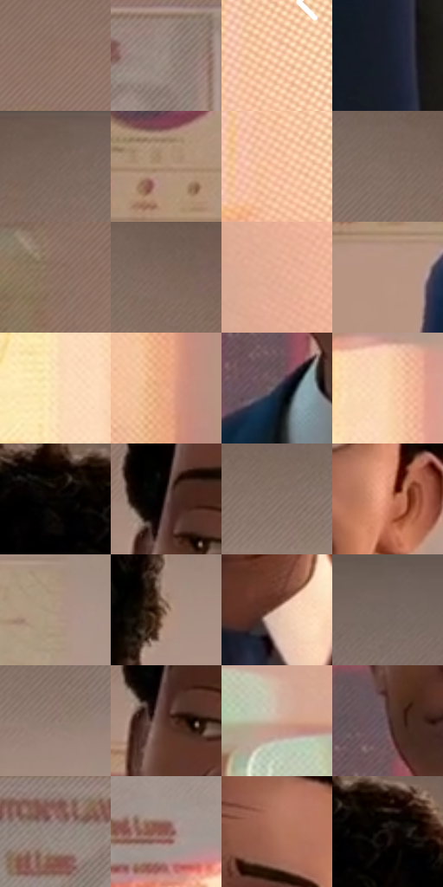

# 电影参考 033

- 状态：常规／活跃；来源世界：miles-home。
- 视角：near-level；景别：medium；场景：classroom。
- 时段：daylight-time-unspecified（外观依据，中置信度；具体时间／晨昏未知）；光照：warm-day。
- 材质候选：skin, fabric, paint, paper, plastic（帧级，不是像素分割）。
- 明暗组：middle；L* P5/P50/P95：9.36782 / 54.90287 / 87.66199。
- 资格门禁：无附加门禁。
- 原截图 SHA-256：`bc93c811ebcb2ed546d03045f5b3add9afbe2d461c5c60e2efe93c590973a558`；尺寸：2880 × 1200。
- sRGB 像素 SHA-256：`e99a29d725402a9c4c04e5c4f4c1823ea39144ee5daf8432865e509723835a0e`。

## 观察与迁移

暖侧光教室，面部体块与墙面光区、衣料中间调分开。

暖光人像与局部色散示例

这是和 31 相近环境但不同表情的一帧：人物面中线、眼神与嘴角必须随原照变化，不拿固定模板重画。背景海报、窗光和椅背边缘的粉青错位比脸部更明显，色散是局部轮廓邻色，不是把整张脸复制平移。墙面细网目、暗脸少量随形排线；波点作为背景低对比层，不要与面部焦点争夺。

本公开版保存32个128×128原像素色卡上下文；图集格子并非原场景相邻位置。原rect、图集tile和像素SHA见 `data/palette-crops.json`。上下文不足时不得批准替色，不能以小样推断完整构图。

## 实测色卡

颜色比例分母为保留采样像素，不是材料面积；全部 32 色参与全库匹配。表内四舍五入仅用于阅读，原精度在 JSON。

| ID | HEX | Lab | 原图 xy | 像素数 | 比例 | 明度角色 |
| --- | --- | --- | --- | ---: | ---: | --- |
| 033-S01 | #937869 | [52.571807, 8.130931, 12.192724] | [512, 312] | 8981 | 4.661870% | midtone |
| 033-S02 | #A08F87 | [60.665328, 4.958256, 6.568521] | [592, 440] | 8648 | 4.489016% | light |
| 033-S03 | #F7C6A4 | [83.361209, 12.807129, 23.667448] | [2812, 664] | 8114 | 4.211827% | highlight |
| 033-S04 | #171F2B | [11.528267, 0.277354, -9.195168] | [1252, 1104] | 7588 | 3.938790% | deep-shadow |
| 033-S05 | #735F55 | [41.977736, 6.397429, 8.751835] | [828, 40] | 7473 | 3.879096% | midtone |
| 033-S06 | #AD8C75 | [60.716375, 9.08709, 17.015463] | [940, 732] | 7351 | 3.815768% | light |
| 033-S07 | #F0B897 | [79.066559, 15.938153, 24.588966] | [2796, 808] | 7291 | 3.784623% | light |
| 033-S08 | #816D63 | [47.631233, 6.186061, 8.515939] | [1024, 84] | 7055 | 3.662120% | midtone |
| 033-S09 | #8A6F60 | [49.028835, 8.301171, 12.387401] | [116, 472] | 7023 | 3.645509% | midtone |
| 033-S10 | #7F675B | [45.591013, 7.639631, 10.387568] | [1116, 96] | 6828 | 3.544288% | midtone |
| 033-S11 | #DFA98F | [73.577889, 16.377829, 21.118645] | [2660, 956] | 6796 | 3.527677% | light |
| 033-S12 | #B89483 | [64.169301, 10.951612, 14.105938] | [968, 844] | 6614 | 3.433205% | light |
| 033-S13 | #FDE3B8 | [91.362604, 2.588909, 24.295909] | [2292, 832] | 6562 | 3.406212% | highlight |
| 033-S14 | #EBAA86 | [74.91088, 19.532308, 27.988491] | [800, 952] | 6428 | 3.336655% | light |
| 033-S15 | #33323F | [21.371463, 3.707664, -7.976961] | [1284, 684] | 6417 | 3.330946% | shadow |
| 033-S16 | #FBD5AE | [87.561034, 7.754361, 24.236683] | [2348, 552] | 6323 | 3.282152% | highlight |
| 033-S17 | #050201 | [0.703486, 0.645419, 0.654905] | [1536, 88] | 6030 | 3.130061% | deep-shadow |
| 033-S18 | #67524F | [36.898168, 8.206641, 5.069643] | [1308, 364] | 5990 | 3.109298% | shadow |
| 033-S19 | #89756B | [50.807599, 6.08024, 8.396435] | [1996, 164] | 5690 | 2.953573% | midtone |
| 033-S20 | #D98E6E | [65.924913, 24.987808, 28.743282] | [1600, 508] | 5613 | 2.913604% | light |
| 033-S21 | #AD9683 | [63.620165, 5.499969, 13.180306] | [2288, 380] | 5597 | 2.905299% | light |
| 033-S22 | #A28470 | [57.419593, 8.428748, 15.127612] | [1752, 312] | 5385 | 2.795254% | midtone |
| 033-S23 | #E3BDAC | [79.446648, 11.032364, 13.679592] | [1488, 740] | 5000 | 2.595407% | light |
| 033-S24 | #756761 | [44.724851, 4.45725, 5.415669] | [2200, 68] | 4812 | 2.497820% | midtone |
| 033-S25 | #988278 | [56.085275, 6.721844, 8.520876] | [2012, 220] | 4737 | 2.458889% | midtone |
| 033-S26 | #522F26 | [23.562824, 14.877869, 12.577168] | [1312, 412] | 4729 | 2.454736% | shadow |
| 033-S27 | #CCAB97 | [72.361477, 8.97564, 14.78733] | [2528, 1112] | 4727 | 2.453698% | light |
| 033-S28 | #594143 | [30.181502, 10.756635, 2.859033] | [1292, 556] | 4637 | 2.406981% | shadow |
| 033-S29 | #8C7F7A | [54.196086, 4.038766, 4.510573] | [448, 460] | 3919 | 2.034280% | midtone |
| 033-S30 | #84514A | [40.05789, 20.495993, 13.116007] | [552, 728] | 3679 | 1.909701% | midtone |
| 033-S31 | #AF735A | [54.149501, 20.770828, 23.517876] | [1524, 308] | 3570 | 1.853121% | midtone |
| 033-S32 | #1A1211 | [6.25735, 3.484741, 1.853055] | [1608, 96] | 3041 | 1.578527% | deep-shadow |

## 色阶与空间分布

- 采样 ROI：`[0.01, 0.02, 0.98, 0.94]`；步长：4；样本数：192648。
- 排除区：`[]`。
- 深暗、暗、中、亮、高光五段计数：`[20406, 20043, 73026, 53181, 25992]`。
- RGB 各 256 箱、L* 100 箱、13×5 色相明度表和 3×3 空间统计全部保存在 [总数据](../film-library.json)。
- [可视化档案](../../references/library.html)按需绘制直方图，不存 2,094 张重复图表图片。

## 纹理特征占比

**这是分块图像特征的面积占比，不是波点／排线／丝网／错版的精确语义覆盖率。** 窗格、发丝、织物也会产生方向或周期特征。
原图 ROI 像素 3084576；已测块覆盖 3084576（100.0000%）；未测 0。

| 特征 | 块覆盖像素 | 占已测面积 | 阈值敏感范围 |
| --- | ---: | ---: | --- |
| low-contrast | 32768 | 1.0623% | 1.0623% ~ 3.7181% |
| directional-structure | 657408 | 21.3128% | 9.1625% ~ 37.7787% |
| periodic-structure | 2085920 | 67.6242% | 55.3163% ~ 70.4128% |
| mixed-detail | 308480 | 10.0007% | 5.8427% ~ 16.7066% |

阈值敏感范围不是统计置信区间。逐块坐标、尺度、对比、方向一致性、频谱集中度、频率与角度见 [全量特征记录](../texture-features.jsonl)，以帧号定位。
四种印刷层的真实像素覆盖仍标为 `null`，不能填 0，也不能拿上表代替。不得据这些代理测量删除唯一证据。

[测量方法与保留策略](../../references/library-retention.md) · [分类索引](../archive/README.md)
