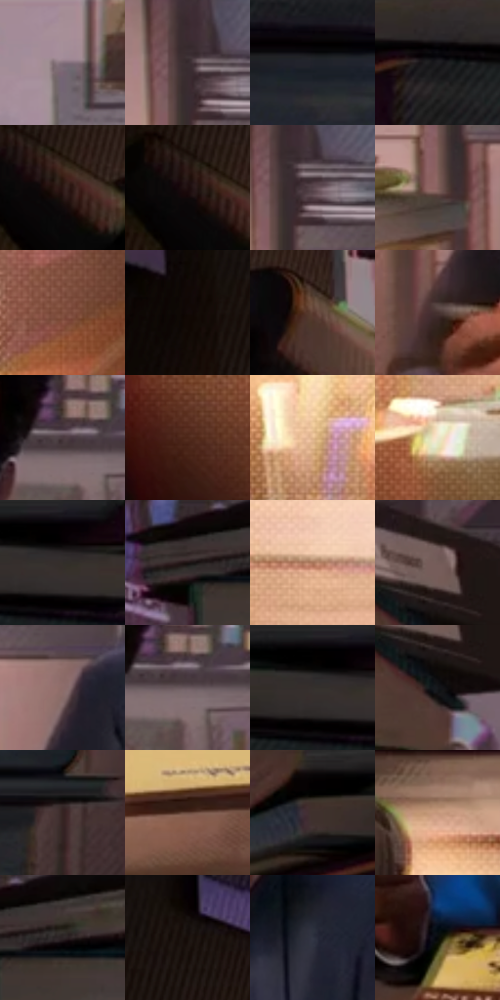

# 电影参考 034

- 状态：常规／活跃；来源世界：miles-home。
- 视角：near-level；景别：medium；场景：interior。
- 时段：interior-time-unknown（外观依据，中置信度；具体时间／晨昏未知）；光照：interior-mixed。
- 材质候选：skin, fabric, paper, wood, glass（帧级，不是像素分割）。
- 明暗组：dark；L* P5/P50/P95：1.09669 / 20.12474 / 76.76398。
- 资格门禁：无附加门禁。
- 原截图 SHA-256：`4aa4037c542ff134587b05bd6e3064588b3f52aca1eb9de1d41ebf2a62cf93bb`；尺寸：2880 × 1202。
- sRGB 像素 SHA-256：`b542560dcae497515032d7c8d935dcdf3a478ec2ecbfc858029b4ae1370e074a`。

## 观察与迁移

书桌与窗光，近物遮挡、暖台灯和冷环境保持层次。

灯下书桌与空间收束

左右书堆形成暗框，台灯和桌前人物形成明暗路径。书脊、纸页和桌面各用与表面方向一致的细排线，暗面网目低对比；波点若存在也应低调而非覆盖笔尖、手指和脸。灯罩边缘与屏幕局部有冷暖彩色邻接，其他暗部保持稳定，不能做全图 RGB 偏移。人物手的握笔方向和脸部低头角度先于纹理成立。

本公开版保存32个128×128原像素色卡上下文；图集格子并非原场景相邻位置。原rect、图集tile和像素SHA见 `data/palette-crops.json`。上下文不足时不得批准替色，不能以小样推断完整构图。

## 实测色卡

颜色比例分母为保留采样像素，不是材料面积；全部 32 色参与全库匹配。表内四舍五入仅用于阅读，原精度在 JSON。

| ID | HEX | Lab | 原图 xy | 像素数 | 比例 | 明度角色 |
| --- | --- | --- | --- | ---: | ---: | --- |
| 034-S01 | #A18A96 | [59.84951, 10.789625, -3.158278] | [1768, 60] | 8669 | 4.499917% | midtone |
| 034-S02 | #382C2F | [19.422274, 6.111718, 0.148732] | [1100, 460] | 8656 | 4.493169% | deep-shadow |
| 034-S03 | #20232B | [13.730161, 0.860849, -5.765478] | [2520, 288] | 8636 | 4.482787% | deep-shadow |
| 034-S04 | #1D1D21 | [10.919326, 1.053823, -2.730857] | [2364, 112] | 7671 | 3.981874% | deep-shadow |
| 034-S05 | #2C1714 | [10.549214, 10.178809, 6.523211] | [220, 300] | 7203 | 3.738944% | deep-shadow |
| 034-S06 | #1D0D0D | [5.222614, 7.11758, 2.508377] | [188, 284] | 7082 | 3.676135% | deep-shadow |
| 034-S07 | #58454B | [31.437977, 9.243527, -0.498894] | [1124, 480] | 6983 | 3.624746% | shadow |
| 034-S08 | #825F5B | [43.77976, 13.645893, 7.886205] | [1080, 600] | 6884 | 3.573357% | midtone |
| 034-S09 | #804F3D | [38.758509, 18.518923, 19.230319] | [952, 864] | 6881 | 3.571799% | shadow |
| 034-S10 | #120A08 | [3.281079, 2.31803, 1.671973] | [132, 112] | 6825 | 3.542731% | deep-shadow |
| 034-S11 | #59392E | [27.429446, 12.730902, 12.667571] | [360, 328] | 6618 | 3.435281% | shadow |
| 034-S12 | #463230 | [22.988346, 8.715061, 4.819774] | [1136, 772] | 6553 | 3.401541% | shadow |
| 034-S13 | #4A3B40 | [26.603575, 7.545144, -0.591145] | [1660, 400] | 6488 | 3.367800% | shadow |
| 034-S14 | #4D2719 | [20.437748, 16.303537, 17.006529] | [548, 1028] | 6334 | 3.287862% | shadow |
| 034-S15 | #E3B98F | [77.883647, 9.410193, 27.027459] | [596, 836] | 6329 | 3.285266% | light |
| 034-S16 | #EEE5CD | [91.06416, -0.893851, 12.802653] | [712, 936] | 6226 | 3.231801% | highlight |
| 034-S17 | #120F10 | [4.58569, 1.280823, -0.11778] | [2556, 48] | 5975 | 3.101512% | deep-shadow |
| 034-S18 | #090504 | [1.584316, 0.906866, 0.747143] | [504, 32] | 5757 | 2.988352% | deep-shadow |
| 034-S19 | #A9755A | [53.918155, 17.140046, 23.080052] | [756, 804] | 5519 | 2.864810% | midtone |
| 034-S20 | #1F1613 | [8.237399, 3.965596, 3.604732] | [940, 36] | 5511 | 2.860658% | deep-shadow |
| 034-S21 | #8D6C6A | [48.796459, 12.794556, 6.182841] | [1204, 584] | 5416 | 2.811345% | midtone |
| 034-S22 | #6A595E | [39.609689, 7.862579, -0.290774] | [1684, 416] | 5415 | 2.810826% | shadow |
| 034-S23 | #040302 | [0.861042, 0.122403, 0.470661] | [2520, 40] | 5313 | 2.757880% | deep-shadow |
| 034-S24 | #15171B | [7.690074, 0.174192, -3.138546] | [940, 144] | 5199 | 2.698704% | deep-shadow |
| 034-S25 | #362322 | [16.013533, 8.924825, 4.325685] | [2656, 424] | 5149 | 2.672750% | deep-shadow |
| 034-S26 | #67483C | [33.658187, 11.522524, 12.463054] | [1368, 1084] | 4911 | 2.549209% | shadow |
| 034-S27 | #020101 | [0.332482, 0.261482, 0.092172] | [2236, 40] | 4669 | 2.423591% | deep-shadow |
| 034-S28 | #C4977B | [65.982426, 13.045414, 21.249996] | [656, 456] | 4445 | 2.307317% | light |
| 034-S29 | #2C2426 | [15.154242, 4.197569, 0.07273] | [584, 64] | 4363 | 2.264752% | deep-shadow |
| 034-S30 | #0D0605 | [2.048566, 1.759293, 1.047532] | [256, 40] | 3802 | 1.973548% | deep-shadow |
| 034-S31 | #313543 | [22.317682, 2.011574, -9.261582] | [1612, 604] | 3601 | 1.869212% | shadow |
| 034-S32 | #07090A | [2.370731, -0.384111, -0.562404] | [1704, 900] | 3565 | 1.850525% | deep-shadow |

## 色阶与空间分布

- 采样 ROI：`[0.01, 0.02, 0.98, 0.94]`；步长：4；样本数：192648。
- 排除区：`[]`。
- 深暗、暗、中、亮、高光五段计数：`[95841, 48757, 26352, 13861, 7837]`。
- RGB 各 256 箱、L* 100 箱、13×5 色相明度表和 3×3 空间统计全部保存在 [总数据](../film-library.json)。
- [可视化档案](../../references/library.html)按需绘制直方图，不存 2,094 张重复图表图片。

## 纹理特征占比

**这是分块图像特征的面积占比，不是波点／排线／丝网／错版的精确语义覆盖率。** 窗格、发丝、织物也会产生方向或周期特征。
原图 ROI 像素 3087370；已测块覆盖 3087370（100.0000%）；未测 0。

| 特征 | 块覆盖像素 | 占已测面积 | 阈值敏感范围 |
| --- | ---: | ---: | --- |
| low-contrast | 96640 | 3.1302% | 2.0688% ~ 3.6609% |
| directional-structure | 920192 | 29.8050% | 17.0688% ~ 43.6524% |
| periodic-structure | 2011018 | 65.1369% | 53.7481% ~ 72.9437% |
| mixed-detail | 59520 | 1.9279% | 0.5307% ~ 6.3267% |

阈值敏感范围不是统计置信区间。逐块坐标、尺度、对比、方向一致性、频谱集中度、频率与角度见 [全量特征记录](../texture-features.jsonl)，以帧号定位。
四种印刷层的真实像素覆盖仍标为 `null`，不能填 0，也不能拿上表代替。不得据这些代理测量删除唯一证据。

[测量方法与保留策略](../../references/library-retention.md) · [分类索引](../archive/README.md)
