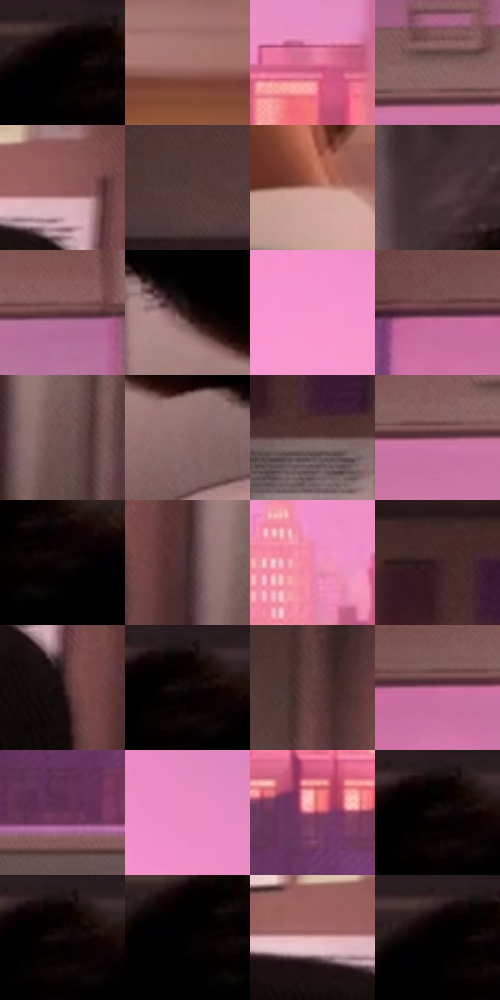

# 电影参考 035

- 状态：常规／活跃；来源世界：miles-home。
- 视角：near-level；景别：medium；场景：interior。
- 时段：interior-time-unknown（外观依据，中置信度；具体时间／晨昏未知）；光照：interior-mixed。
- 材质候选：skin, fabric, paper, wood, glass（帧级，不是像素分割）。
- 明暗组：dark；L* P5/P50/P95：0.0 / 29.60553 / 71.53278。
- 资格门禁：无附加门禁。
- 原截图 SHA-256：`4f6e5ef0c16e138d221e2e1822eee6ce70bd9a8f485fe7d8c8e70cd8527ece71`；尺寸：2880 × 1204。
- sRGB 像素 SHA-256：`52a0fc3cda59701a22d5960091daec42220fecbfef2a1523522686bf8f76ada8`。

## 观察与迁移

书桌与窗光，近物遮挡、暖台灯和冷环境保持层次。

粉色窗景与背影

黑发与背部用大轮廓承受窗外强粉光，不补造看不见的面部。窗框、远楼和室内墙面分属硬几何、空气透视与柔暗转面；细丝网落在窗外色面，室内排线较弱。粉光边可以有窄幅色散，背影中央不能被彩边冲散；天空保留净面，波点不抢建筑节奏。

本公开版保存32个128×128原像素色卡上下文；图集格子并非原场景相邻位置。原rect、图集tile和像素SHA见 `data/palette-crops.json`。上下文不足时不得批准替色，不能以小样推断完整构图。

## 实测色卡

颜色比例分母为保留采样像素，不是材料面积；全部 32 色参与全库匹配。表内四舍五入仅用于阅读，原精度在 JSON。

| ID | HEX | Lab | 原图 xy | 像素数 | 比例 | 明度角色 |
| --- | --- | --- | --- | ---: | ---: | --- |
| 035-S01 | #000000 | [0.0, 0.0, 0.0] | [2104, 52] | 30007 | 15.576077% | deep-shadow |
| 035-S02 | #A7736D | [53.581379, 19.702775, 11.597759] | [2692, 460] | 7675 | 3.983950% | midtone |
| 035-S03 | #DF7499 | [62.068083, 45.626016, -0.789647] | [1508, 552] | 7499 | 3.892592% | light |
| 035-S04 | #805C5C | [42.788798, 14.751024, 5.838003] | [1060, 80] | 7320 | 3.799676% | midtone |
| 035-S05 | #955A5B | [44.883594, 24.380512, 9.77817] | [328, 644] | 7175 | 3.724409% | midtone |
| 035-S06 | #583E41 | [29.163723, 11.887254, 2.677685] | [116, 76] | 7100 | 3.685478% | shadow |
| 035-S07 | #C1897E | [62.285219, 19.934888, 14.433968] | [2508, 1092] | 6997 | 3.632013% | light |
| 035-S08 | #4A3336 | [23.967034, 10.908493, 2.244147] | [1836, 100] | 6596 | 3.423861% | shadow |
| 035-S09 | #5A3337 | [26.208727, 18.142935, 5.076893] | [1464, 112] | 6566 | 3.408289% | shadow |
| 035-S10 | #2C1917 | [11.224398, 9.203354, 5.35413] | [1920, 964] | 6481 | 3.364167% | deep-shadow |
| 035-S11 | #F796CC | [73.513075, 43.473542, -12.157096] | [1016, 368] | 6461 | 3.353785% | light |
| 035-S12 | #4A2636 | [20.474106, 19.315225, -2.86431] | [716, 124] | 6297 | 3.268656% | shadow |
| 035-S13 | #705254 | [38.056878, 12.850936, 3.745098] | [508, 844] | 6238 | 3.238030% | shadow |
| 035-S14 | #8F696C | [48.293308, 15.667981, 4.299257] | [2028, 1060] | 6104 | 3.168473% | midtone |
| 035-S15 | #674A4C | [34.60691, 12.654108, 3.675439] | [144, 300] | 6033 | 3.131618% | shadow |
| 035-S16 | #7F465C | [37.236149, 27.31747, -2.228506] | [988, 124] | 5949 | 3.088015% | shadow |
| 035-S17 | #0D0706 | [2.264431, 1.497776, 0.955426] | [2168, 104] | 5784 | 3.002367% | deep-shadow |
| 035-S18 | #3F282C | [19.040577, 11.472248, 1.789656] | [444, 784] | 5325 | 2.764109% | deep-shadow |
| 035-S19 | #ED88AC | [68.456984, 42.729651, -1.993031] | [1372, 564] | 4906 | 2.546614% | light |
| 035-S20 | #3A2127 | [16.17488, 13.024896, 1.075333] | [100, 212] | 4795 | 2.488995% | deep-shadow |
| 035-S21 | #1D0F0D | [5.708558, 6.124863, 3.217964] | [364, 760] | 4785 | 2.483805% | deep-shadow |
| 035-S22 | #110B0B | [3.456834, 1.945893, 0.686061] | [2148, 60] | 4748 | 2.464599% | deep-shadow |
| 035-S23 | #674243 | [32.226227, 16.205555, 6.018787] | [572, 200] | 4668 | 2.423072% | shadow |
| 035-S24 | #BE6E97 | [56.422099, 37.104079, -8.466294] | [848, 128] | 4569 | 2.371683% | midtone |
| 035-S25 | #6A3454 | [29.814724, 28.479318, -8.491083] | [1032, 936] | 4383 | 2.275134% | shadow |
| 035-S26 | #EB8DC3 | [69.933664, 42.779022, -12.684615] | [1352, 384] | 4038 | 2.096051% | light |
| 035-S27 | #B1546D | [47.999647, 40.44557, 3.849501] | [1088, 816] | 3131 | 1.625244% | midtone |
| 035-S28 | #040101 | [0.4491, 0.784481, 0.276449] | [2136, 52] | 2856 | 1.482497% | deep-shadow |
| 035-S29 | #0A0403 | [1.42676, 1.429882, 0.931387] | [2144, 52] | 2689 | 1.395810% | deep-shadow |
| 035-S30 | #020202 | [0.548347, -3.5e-05, 6.6e-05] | [2096, 92] | 2612 | 1.355841% | deep-shadow |
| 035-S31 | #E6B4B7 | [77.808077, 18.534044, 5.441154] | [240, 656] | 2510 | 1.302894% | light |
| 035-S32 | #000002 | [0.039574, 0.278088, -0.756847] | [2092, 60] | 351 | 0.182198% | deep-shadow |

## 色阶与空间分布

- 采样 ROI：`[0.01, 0.02, 0.98, 0.94]`；步长：4；样本数：192648。
- 排除区：`[]`。
- 深暗、暗、中、亮、高光五段计数：`[71423, 52232, 40699, 27486, 808]`。
- RGB 各 256 箱、L* 100 箱、13×5 色相明度表和 3×3 空间统计全部保存在 [总数据](../film-library.json)。
- [可视化档案](../../references/library.html)按需绘制直方图，不存 2,094 张重复图表图片。

## 纹理特征占比

**这是分块图像特征的面积占比，不是波点／排线／丝网／错版的精确语义覆盖率。** 窗格、发丝、织物也会产生方向或周期特征。
原图 ROI 像素 3092958；已测块覆盖 3092958（100.0000%）；未测 0。

| 特征 | 块覆盖像素 | 占已测面积 | 阈值敏感范围 |
| --- | ---: | ---: | --- |
| low-contrast | 491742 | 15.8988% | 14.1162% ~ 16.2423% |
| directional-structure | 1076224 | 34.7959% | 25.1948% ~ 44.5574% |
| periodic-structure | 1411200 | 45.6262% | 40.1097% ~ 51.8918% |
| mixed-detail | 113792 | 3.6791% | 1.2167% ~ 6.6712% |

阈值敏感范围不是统计置信区间。逐块坐标、尺度、对比、方向一致性、频谱集中度、频率与角度见 [全量特征记录](../texture-features.jsonl)，以帧号定位。
四种印刷层的真实像素覆盖仍标为 `null`，不能填 0，也不能拿上表代替。不得据这些代理测量删除唯一证据。

[测量方法与保留策略](../../references/library-retention.md) · [分类索引](../archive/README.md)
