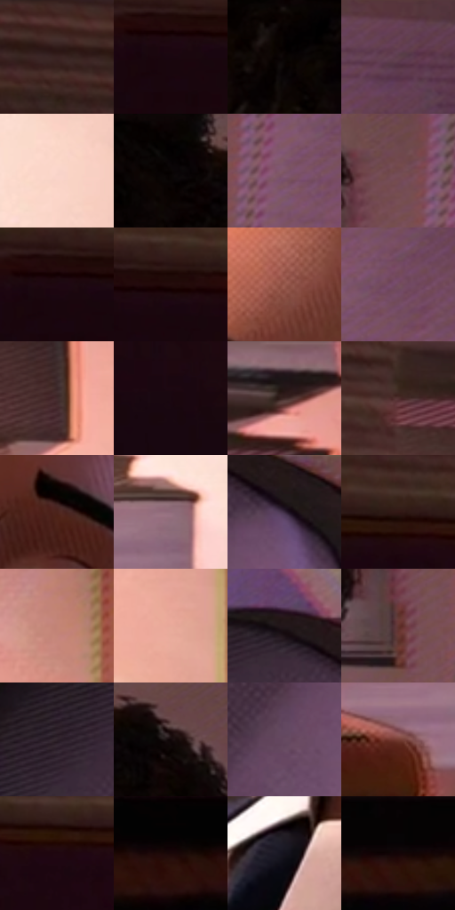

# 电影参考 036

- 状态：常规／活跃；来源世界：miles-home。
- 视角：near-level；景别：close-up；场景：interior。
- 时段：interior-time-unknown（外观依据，中置信度；具体时间／晨昏未知）；光照：interior-mixed。
- 材质候选：skin, fabric, paper, wood, glass（帧级，不是像素分割）。
- 明暗组：very-dark；L* P5/P50/P95：1.11406 / 19.52265 / 77.13868。
- 资格门禁：无附加门禁。
- 原截图 SHA-256：`12a449a2ea407d23c4810f97d7f4e21490d3d53e676728cf7a05f1e11ff09568`；尺寸：2880 × 1206。
- sRGB 像素 SHA-256：`ab8e8d00da700896f0949eb06169a15e07d5f1ff670e81af6b73cd135d4a9da8`。

## 观察与迁移

书桌与窗光，近物遮挡、暖台灯和冷环境保持层次。

倾斜近景人像

头部倾斜时，眼线、鼻梁、口角和颈肩必须随同一面中线旋转；左右脸明暗不对称，不能用正面脸模板。面颊暗部的细随形线比大波点更有用，背景的低对比网目托住人脸。色散可贴在高反差发际或书堆边，瞳孔和嘴角保持单一结构。

本公开版保存32个128×128原像素色卡上下文；图集格子并非原场景相邻位置。原rect、图集tile和像素SHA见 `data/palette-crops.json`。上下文不足时不得批准替色，不能以小样推断完整构图。

## 实测色卡

颜色比例分母为保留采样像素，不是材料面积；全部 32 色参与全库匹配。表内四舍五入仅用于阅读，原精度在 JSON。

| ID | HEX | Lab | 原图 xy | 像素数 | 比例 | 明度角色 |
| --- | --- | --- | --- | ---: | ---: | --- |
| 036-S01 | #392222 | [16.153095, 11.055508, 4.584149] | [232, 68] | 11376 | 5.883752% | deep-shadow |
| 036-S02 | #18060D | [3.193527, 7.309652, -0.527194] | [36, 256] | 10008 | 5.176213% | deep-shadow |
| 036-S03 | #0A0403 | [1.42676, 1.429882, 0.931387] | [1600, 28] | 8840 | 4.572114% | deep-shadow |
| 036-S04 | #5F404B | [30.897499, 15.347088, -1.192572] | [2484, 72] | 8805 | 4.554012% | shadow |
| 036-S05 | #FAD5CA | [88.054705, 11.211578, 10.227564] | [1176, 700] | 8268 | 4.276272% | highlight |
| 036-S06 | #050202 | [0.723273, 0.784463, 0.276482] | [1900, 32] | 8032 | 4.154211% | deep-shadow |
| 036-S07 | #7E5666 | [41.297384, 19.146387, -2.48747] | [2276, 360] | 7995 | 4.135074% | midtone |
| 036-S08 | #71494F | [35.676295, 17.959898, 3.476161] | [2196, 280] | 7854 | 4.062148% | shadow |
| 036-S09 | #1E0812 | [4.457037, 10.751793, -1.30974] | [64, 240] | 7475 | 3.866126% | deep-shadow |
| 036-S10 | #230D0B | [6.046884, 10.653365, 4.726261] | [108, 224] | 7276 | 3.763202% | deep-shadow |
| 036-S11 | #97594C | [44.585723, 24.060816, 18.459614] | [1568, 304] | 6806 | 3.520114% | midtone |
| 036-S12 | #754E61 | [38.01122, 19.535936, -4.366814] | [2352, 308] | 6449 | 3.335471% | shadow |
| 036-S13 | #432C2E | [20.797472, 10.977713, 3.004987] | [1072, 248] | 6279 | 3.247546% | shadow |
| 036-S14 | #19070F | [3.551438, 7.759544, -1.000492] | [436, 592] | 6114 | 3.162207% | deep-shadow |
| 036-S15 | #503A43 | [27.121731, 11.367294, -1.729585] | [1032, 32] | 5816 | 3.008079% | shadow |
| 036-S16 | #51302F | [23.89776, 14.917596, 6.988872] | [872, 120] | 5665 | 2.929980% | shadow |
| 036-S17 | #4C231B | [19.300198, 18.507149, 14.214837] | [1692, 496] | 5655 | 2.924808% | deep-shadow |
| 036-S18 | #8F6B79 | [49.174663, 16.649519, -2.169421] | [1028, 792] | 5505 | 2.847227% | midtone |
| 036-S19 | #39293E | [19.239465, 12.034137, -10.482062] | [2132, 932] | 5442 | 2.814643% | deep-shadow |
| 036-S20 | #321714 | [11.56323, 13.175694, 8.085977] | [280, 208] | 5413 | 2.799644% | deep-shadow |
| 036-S21 | #C38477 | [61.167058, 22.624469, 16.882538] | [1240, 100] | 5362 | 2.773267% | light |
| 036-S22 | #E7A99A | [74.635972, 20.810839, 16.728884] | [1228, 332] | 5126 | 2.651206% | light |
| 036-S23 | #22171A | [9.21848, 6.169832, 0.053883] | [2024, 856] | 4964 | 2.567418% | deep-shadow |
| 036-S24 | #62342F | [27.458974, 20.025167, 12.28088] | [2152, 416] | 4805 | 2.485182% | shadow |
| 036-S25 | #2F222B | [15.077177, 8.114443, -3.573529] | [1860, 944] | 4628 | 2.393636% | deep-shadow |
| 036-S26 | #110809 | [2.823523, 2.876155, 0.586303] | [2020, 76] | 4412 | 2.281919% | deep-shadow |
| 036-S27 | #654A60 | [35.021371, 15.543885, -8.405625] | [1968, 1092] | 4039 | 2.089001% | shadow |
| 036-S28 | #773E34 | [33.170293, 23.7142, 17.23301] | [904, 860] | 3814 | 1.972629% | shadow |
| 036-S29 | #1F0710 | [4.342552, 11.374529, -0.296453] | [384, 248] | 3102 | 1.604378% | deep-shadow |
| 036-S30 | #1A0707 | [3.495454, 7.068894, 2.490978] | [92, 920] | 3040 | 1.572311% | deep-shadow |
| 036-S31 | #15121D | [6.149082, 4.106482, -6.978771] | [1148, 1032] | 2805 | 1.450767% | deep-shadow |
| 036-S32 | #140407 | [2.266666, 5.39786, 0.619831] | [564, 912] | 2176 | 1.125444% | deep-shadow |

## 色阶与空间分布

- 采样 ROI：`[0.01, 0.02, 0.98, 0.94]`；步长：4；样本数：193346。
- 排除区：`[]`。
- 深暗、暗、中、亮、高光五段计数：`[98382, 57358, 21272, 7443, 8891]`。
- RGB 各 256 箱、L* 100 箱、13×5 色相明度表和 3×3 空间统计全部保存在 [总数据](../film-library.json)。
- [可视化档案](../../references/library.html)按需绘制直方图，不存 2,094 张重复图表图片。

## 纹理特征占比

**这是分块图像特征的面积占比，不是波点／排线／丝网／错版的精确语义覆盖率。** 窗格、发丝、织物也会产生方向或周期特征。
原图 ROI 像素 3098546；已测块覆盖 3098546（100.0000%）；未测 0。

| 特征 | 块覆盖像素 | 占已测面积 | 阈值敏感范围 |
| --- | ---: | ---: | --- |
| low-contrast | 591872 | 19.1016% | 17.2551% ~ 21.0390% |
| directional-structure | 977152 | 31.5358% | 17.6186% ~ 45.4795% |
| periodic-structure | 1414962 | 45.6654% | 36.0344% ~ 55.5301% |
| mixed-detail | 114560 | 3.6972% | 1.2310% ~ 5.8123% |

阈值敏感范围不是统计置信区间。逐块坐标、尺度、对比、方向一致性、频谱集中度、频率与角度见 [全量特征记录](../texture-features.jsonl)，以帧号定位。
四种印刷层的真实像素覆盖仍标为 `null`，不能填 0，也不能拿上表代替。不得据这些代理测量删除唯一证据。

[测量方法与保留策略](../../references/library-retention.md) · [分类索引](../archive/README.md)
