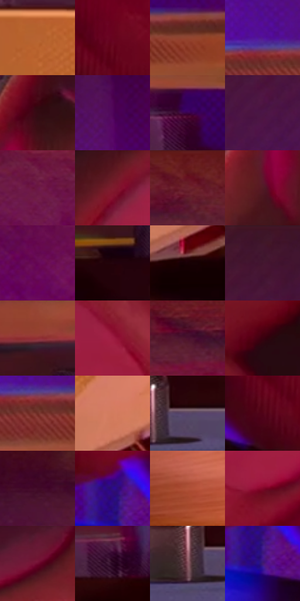

# 电影参考 037

- 状态：常规／活跃；来源世界：miles-home。
- 视角：near-level；景别：detail；场景：detail。
- 时段：interior-time-unknown（外观依据，中置信度；具体时间／晨昏未知）；光照：interior-mixed。
- 材质候选：skin, plastic, metal（帧级，不是像素分割）。
- 明暗组：dark；L* P5/P50/P95：4.07626 / 21.61544 / 51.39802。
- 资格门禁：无附加门禁。
- 原截图 SHA-256：`4aefb3fdbcc6a07d072701449158430a195f9c2191a2c3623d77844b66d07c23`；尺寸：2878 × 1202。
- sRGB 像素 SHA-256：`ac1ad17fc001d04da8e26f8e179288b93bb590794842ae2f9bb5c30cfd4b9b67`。

## 观察与迁移

唱机针头近景，硬质表面亮带与手部软体分开。

唱片针头与手部特写

针尖和唱片接触点比任何纹理都重要；手指关节、指甲和施力方向形成动作几何。唱头平面有细密网点，唱片按旋转方向表现同心细线，背景排线不应误画成唱片纹。蓝色小反射与品红外缘可有轻微错版，但针尖不能发生可见重影。

本公开版保存32个128×128原像素色卡上下文；图集格子并非原场景相邻位置。原rect、图集tile和像素SHA见 `data/palette-crops.json`。上下文不足时不得批准替色，不能以小样推断完整构图。

## 实测色卡

颜色比例分母为保留采样像素，不是材料面积；全部 32 色参与全库匹配。表内四舍五入仅用于阅读，原精度在 JSON。

| ID | HEX | Lab | 原图 xy | 像素数 | 比例 | 明度角色 |
| --- | --- | --- | --- | ---: | ---: | --- |
| 037-S01 | #B86332 | [51.090874, 30.346907, 41.990549] | [1532, 540] | 10109 | 5.247394% | midtone |
| 037-S02 | #68031E | [20.451208, 41.708103, 14.772814] | [2552, 792] | 9820 | 5.097380% | shadow |
| 037-S03 | #914530 | [38.709726, 30.360041, 27.481076] | [792, 564] | 8990 | 4.666542% | shadow |
| 037-S04 | #531391 | [24.792541, 51.298217, -55.551531] | [532, 508] | 8459 | 4.390910% | shadow |
| 037-S05 | #350B12 | [9.3213, 21.543885, 6.294867] | [1948, 172] | 8194 | 4.253353% | deep-shadow |
| 037-S06 | #4F055B | [18.037409, 42.692989, -31.880394] | [660, 276] | 8055 | 4.181201% | deep-shadow |
| 037-S07 | #3B0349 | [12.455119, 36.036626, -28.808629] | [808, 728] | 7716 | 4.005232% | deep-shadow |
| 037-S08 | #4B1646 | [17.973458, 31.640185, -17.749341] | [84, 220] | 7697 | 3.995370% | deep-shadow |
| 037-S09 | #6C1747 | [24.502563, 41.095555, -7.847091] | [1216, 220] | 7643 | 3.967339% | shadow |
| 037-S10 | #7D1B2D | [27.667616, 42.375951, 14.74422] | [2404, 372] | 7188 | 3.731157% | shadow |
| 037-S11 | #661B27 | [22.847692, 34.239151, 11.569155] | [1484, 56] | 7124 | 3.697936% | shadow |
| 037-S12 | #531923 | [18.610507, 27.846584, 7.978822] | [1880, 316] | 6973 | 3.619555% | deep-shadow |
| 037-S13 | #650853 | [22.179776, 45.164968, -19.650055] | [1032, 316] | 6657 | 3.455525% | shadow |
| 037-S14 | #24040D | [4.435772, 15.440734, 1.482823] | [64, 816] | 6599 | 3.425418% | deep-shadow |
| 037-S15 | #180004 | [1.833837, 8.425492, 1.259037] | [1740, 860] | 6542 | 3.395831% | deep-shadow |
| 037-S16 | #3F1727 | [14.492051, 21.55467, -1.28399] | [204, 28] | 6291 | 3.265541% | deep-shadow |
| 037-S17 | #902E33 | [34.239945, 41.573438, 20.07615] | [76, 688] | 6201 | 3.218824% | shadow |
| 037-S18 | #9E1D42 | [35.089857, 53.100746, 12.04469] | [2608, 392] | 6015 | 3.122275% | shadow |
| 037-S19 | #4D102F | [16.275601, 31.235022, -4.123792] | [1756, 112] | 5771 | 2.995619% | deep-shadow |
| 037-S20 | #39010F | [8.362011, 27.884968, 6.741437] | [2712, 248] | 5527 | 2.868963% | deep-shadow |
| 037-S21 | #6F2D25 | [27.820386, 28.664569, 19.647414] | [576, 560] | 5487 | 2.848200% | shadow |
| 037-S22 | #D37B5D | [60.612344, 31.286189, 31.093034] | [1768, 732] | 5443 | 2.825360% | light |
| 037-S23 | #594468 | [32.386328, 16.644376, -17.607716] | [268, 892] | 5233 | 2.716353% | shadow |
| 037-S24 | #500217 | [14.464041, 34.797611, 10.97138] | [2500, 864] | 5109 | 2.651987% | deep-shadow |
| 037-S25 | #410A26 | [12.487677, 28.602425, -3.478039] | [980, 76] | 4624 | 2.400233% | deep-shadow |
| 037-S26 | #2D0C88 | [18.355321, 47.120987, -60.716567] | [2300, 816] | 4119 | 2.138096% | deep-shadow |
| 037-S27 | #B05239 | [46.395482, 36.469327, 32.617216] | [1572, 1044] | 3733 | 1.937731% | midtone |
| 037-S28 | #82082A | [26.984479, 48.474004, 16.074214] | [2456, 604] | 3338 | 1.732694% | shadow |
| 037-S29 | #6F0A2E | [22.981386, 43.123735, 7.210803] | [2280, 136] | 3165 | 1.642893% | shadow |
| 037-S30 | #2A0622 | [6.667115, 22.137453, -9.7677] | [528, 780] | 2629 | 1.364665% | deep-shadow |
| 037-S31 | #895562 | [42.305005, 23.432301, 1.610283] | [208, 912] | 1606 | 0.833645% | midtone |
| 037-S32 | #3F1A6E | [19.725377, 36.222234, -41.780261] | [2312, 868] | 591 | 0.306777% | deep-shadow |

## 色阶与空间分布

- 采样 ROI：`[0.01, 0.02, 0.98, 0.94]`；步长：4；样本数：192648。
- 排除区：`[]`。
- 深暗、暗、中、亮、高光五段计数：`[85567, 82955, 21469, 2541, 116]`。
- RGB 各 256 箱、L* 100 箱、13×5 色相明度表和 3×3 空间统计全部保存在 [总数据](../film-library.json)。
- [可视化档案](../../references/library.html)按需绘制直方图，不存 2,094 张重复图表图片。

## 纹理特征占比

**这是分块图像特征的面积占比，不是波点／排线／丝网／错版的精确语义覆盖率。** 窗格、发丝、织物也会产生方向或周期特征。
原图 ROI 像素 3085160；已测块覆盖 3085160（100.0000%）；未测 0。

| 特征 | 块覆盖像素 | 占已测面积 | 阈值敏感范围 |
| --- | ---: | ---: | --- |
| low-contrast | 458240 | 14.8530% | 10.1731% ~ 18.2759% |
| directional-structure | 988416 | 32.0378% | 19.8773% ~ 43.7991% |
| periodic-structure | 1546344 | 50.1220% | 44.0032% ~ 55.6732% |
| mixed-detail | 92160 | 2.9872% | 2.0247% ~ 6.1736% |

阈值敏感范围不是统计置信区间。逐块坐标、尺度、对比、方向一致性、频谱集中度、频率与角度见 [全量特征记录](../texture-features.jsonl)，以帧号定位。
四种印刷层的真实像素覆盖仍标为 `null`，不能填 0，也不能拿上表代替。不得据这些代理测量删除唯一证据。

[测量方法与保留策略](../../references/library-retention.md) · [分类索引](../archive/README.md)
