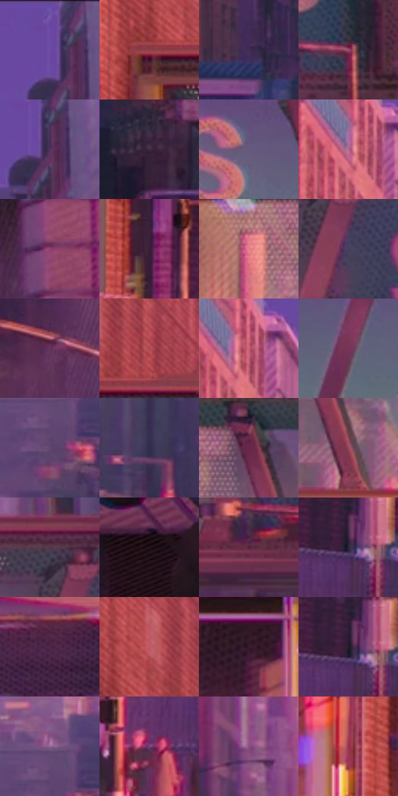

# 电影参考 038

- 状态：常规／活跃；来源世界：miles-home。
- 视角：near-level；景别：environment-wide；场景：city。
- 时段：daylight-time-unspecified（外观依据，中置信度；具体时间／晨昏未知）；光照：warm-day。
- 材质候选：glass, brick, asphalt, sky（帧级，不是像素分割）。
- 明暗组：dark；L* P5/P50/P95：12.20347 / 33.11245 / 56.48571。
- 资格门禁：无附加门禁。
- 原截图 SHA-256：`3d55bcd1b5a0af3ae4f4bc84932085212328657564b8bebda9085ec6357d2fb7`；尺寸：2880 × 1200。
- sRGB 像素 SHA-256：`bfc29e6312ee4cb7b3a2472add68d28fe6b41103f08fa14cc47bd124c800067b`。

## 观察与迁移

校桥日暮光，玻璃与墙体不能统一发亮。

紫粉天桥与长街

天桥的透视横梁与重复字形先组成硬结构，街道向后以低对比楼影收束。左侧广告和局部建筑有大点/粗半调，桥体与幕墙更多是细网目，路面排线沿街向透视变化。偏青/洋红的彩边只贴亮字、桥缘和路口灯，不能复制画面中的字到新照片。

本公开版保存32个128×128原像素色卡上下文；图集格子并非原场景相邻位置。原rect、图集tile和像素SHA见 `data/palette-crops.json`。上下文不足时不得批准替色，不能以小样推断完整构图。

## 实测色卡

颜色比例分母为保留采样像素，不是材料面积；全部 32 色参与全库匹配。表内四舍五入仅用于阅读，原精度在 JSON。

| ID | HEX | Lab | 原图 xy | 像素数 | 比例 | 明度角色 |
| --- | --- | --- | --- | ---: | ---: | --- |
| 038-S01 | #6A48A0 | [38.263834, 33.908488, -42.73017] | [1936, 28] | 9829 | 5.102051% | shadow |
| 038-S02 | #8D4145 | [37.616205, 32.638186, 13.092037] | [500, 192] | 9062 | 4.703916% | shadow |
| 038-S03 | #3F2E54 | [22.481727, 16.693525, -20.273814] | [908, 768] | 7324 | 3.801752% | shadow |
| 038-S04 | #9F5071 | [44.663146, 36.646739, -3.769647] | [2344, 456] | 7248 | 3.762302% | midtone |
| 038-S05 | #52345E | [26.899621, 21.916065, -19.768296] | [1960, 92] | 7177 | 3.725447% | shadow |
| 038-S06 | #3F2940 | [20.09552, 14.905127, -10.477944] | [1988, 876] | 6842 | 3.551555% | shadow |
| 038-S07 | #645A7B | [40.330897, 11.367299, -17.106744] | [1256, 336] | 6795 | 3.527158% | midtone |
| 038-S08 | #AD6A8E | [53.10984, 31.888427, -8.374381] | [852, 112] | 6715 | 3.485632% | midtone |
| 038-S09 | #89416F | [38.283418, 36.677119, -12.426275] | [2448, 608] | 6652 | 3.452930% | shadow |
| 038-S10 | #391F38 | [16.182685, 17.359311, -10.999765] | [488, 752] | 6646 | 3.449815% | deep-shadow |
| 038-S11 | #E17F85 | [64.066484, 38.353715, 13.533078] | [916, 320] | 6642 | 3.447739% | light |
| 038-S12 | #43415D | [28.809196, 7.916125, -16.284216] | [2160, 324] | 6520 | 3.384411% | shadow |
| 038-S13 | #64345D | [29.30131, 27.971986, -15.203168] | [2248, 672] | 6398 | 3.321083% | shadow |
| 038-S14 | #AB484F | [44.030846, 41.219603, 16.414586] | [624, 144] | 6256 | 3.247373% | midtone |
| 038-S15 | #CB6479 | [55.272083, 42.926107, 7.619762] | [876, 100] | 6255 | 3.246854% | midtone |
| 038-S16 | #793558 | [32.517159, 33.943624, -6.786215] | [1540, 388] | 6230 | 3.233877% | shadow |
| 038-S17 | #5E456C | [33.390101, 18.747533, -18.539216] | [1512, 840] | 5912 | 3.068809% | shadow |
| 038-S18 | #312D4B | [20.193994, 9.933984, -17.937419] | [1660, 772] | 5838 | 3.030397% | shadow |
| 038-S19 | #682847 | [26.494889, 32.289899, -4.930145] | [1032, 284] | 5511 | 2.860658% | shadow |
| 038-S20 | #934659 | [40.09139, 34.456906, 4.166971] | [1092, 432] | 5479 | 2.844047% | midtone |
| 038-S21 | #513446 | [25.706726, 16.246048, -5.806312] | [2116, 224] | 5467 | 2.837818% | shadow |
| 038-S22 | #21141A | [8.113538, 7.905616, -1.586349] | [2784, 808] | 5339 | 2.771376% | deep-shadow |
| 038-S23 | #511D36 | [19.617653, 27.339751, -4.011361] | [2128, 492] | 5297 | 2.749574% | deep-shadow |
| 038-S24 | #292639 | [16.270543, 6.479054, -11.731552] | [680, 828] | 5232 | 2.715834% | deep-shadow |
| 038-S25 | #4F2749 | [22.283228, 24.218045, -13.047469] | [416, 1100] | 5188 | 2.692994% | shadow |
| 038-S26 | #BC5862 | [50.163002, 41.18928, 13.754248] | [548, 108] | 5155 | 2.675865% | midtone |
| 038-S27 | #37192A | [13.678837, 17.551977, -4.826703] | [220, 384] | 5049 | 2.620842% | deep-shadow |
| 038-S28 | #1E1C2C | [11.193718, 5.500785, -10.386522] | [676, 820] | 4863 | 2.524293% | deep-shadow |
| 038-S29 | #8F6490 | [48.219911, 25.067229, -17.288406] | [1512, 772] | 4798 | 2.490553% | midtone |
| 038-S30 | #734378 | [36.014359, 29.844816, -21.782762] | [572, 912] | 4288 | 2.225821% | shadow |
| 038-S31 | #8C5181 | [42.832684, 32.044084, -16.538789] | [1192, 712] | 3947 | 2.048814% | midtone |
| 038-S32 | #95304D | [36.063256, 44.53545, 6.048361] | [412, 428] | 2694 | 1.398405% | shadow |

## 色阶与空间分布

- 采样 ROI：`[0.01, 0.02, 0.98, 0.94]`；步长：4；样本数：192648。
- 排除区：`[]`。
- 深暗、暗、中、亮、高光五段计数：`[37372, 98747, 50551, 5912, 66]`。
- RGB 各 256 箱、L* 100 箱、13×5 色相明度表和 3×3 空间统计全部保存在 [总数据](../film-library.json)。
- [可视化档案](../../references/library.html)按需绘制直方图，不存 2,094 张重复图表图片。

## 纹理特征占比

**这是分块图像特征的面积占比，不是波点／排线／丝网／错版的精确语义覆盖率。** 窗格、发丝、织物也会产生方向或周期特征。
原图 ROI 像素 3084576；已测块覆盖 3084576（100.0000%）；未测 0。

| 特征 | 块覆盖像素 | 占已测面积 | 阈值敏感范围 |
| --- | ---: | ---: | --- |
| low-contrast | 98304 | 3.1870% | 3.1870% ~ 3.1870% |
| directional-structure | 644640 | 20.8988% | 8.7071% ~ 36.8087% |
| periodic-structure | 2246144 | 72.8186% | 60.0044% ~ 77.9725% |
| mixed-detail | 95488 | 3.0957% | 0.0000% ~ 10.1335% |

阈值敏感范围不是统计置信区间。逐块坐标、尺度、对比、方向一致性、频谱集中度、频率与角度见 [全量特征记录](../texture-features.jsonl)，以帧号定位。
四种印刷层的真实像素覆盖仍标为 `null`，不能填 0，也不能拿上表代替。不得据这些代理测量删除唯一证据。

[测量方法与保留策略](../../references/library-retention.md) · [分类索引](../archive/README.md)
