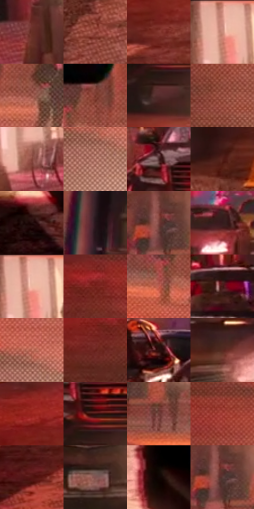

# 电影参考 039

- 状态：常规／活跃；来源世界：miles-home。
- 视角：high-angle；景别：full-body；场景：city。
- 时段：night-appearance（外观依据，中置信度；具体时间／晨昏未知）；光照：night-mixed。
- 材质候选：brick, asphalt, glass, painted-metal, sky, fabric（帧级，不是像素分割）。
- 明暗组：dark；L* P5/P50/P95：6.43484 / 30.31756 / 66.22056。
- 资格门禁：无附加门禁。
- 原截图 SHA-256：`99f3a23525f016be9dd8c355985bae6eb0c823807777dabdafc7894e533be7d2`；尺寸：2880 × 1202。
- sRGB 像素 SHA-256：`b6723a56728f2ee011c36ebb640f7e25f813761ee85241dcf378f3c91487b4bd`。

## 观察与迁移

暖灯街面与冷暗楼体，光源集中而非每窗同亮。

红色夜街与奔跑人物

斑马线和车灯为运动方向提供尺度；人物的前倾躯干、分开的双腿、脚掌离地与背包摆动必须同时成立。路面半调频繁但低对比，车身反光硬、远景霓虹碎。色散明显落在车灯、巴士边和远景灯牌，却不能让人物四肢或车道线错位到失去结构。

本公开版保存32个128×128原像素色卡上下文；图集格子并非原场景相邻位置。原rect、图集tile和像素SHA见 `data/palette-crops.json`。上下文不足时不得批准替色，不能以小样推断完整构图。

## 实测色卡

颜色比例分母为保留采样像素，不是材料面积；全部 32 色参与全库匹配。表内四舍五入仅用于阅读，原精度在 JSON。

| ID | HEX | Lab | 原图 xy | 像素数 | 比例 | 明度角色 |
| --- | --- | --- | --- | ---: | ---: | --- |
| 039-S01 | #662E25 | [26.485795, 24.347041, 17.642433] | [96, 280] | 9216 | 4.783854% | shadow |
| 039-S02 | #92443A | [38.81614, 32.026144, 21.645882] | [888, 912] | 8299 | 4.307857% | shadow |
| 039-S03 | #853930 | [34.247249, 31.932139, 21.563807] | [272, 596] | 7905 | 4.103339% | shadow |
| 039-S04 | #D29082 | [65.952629, 23.258845, 17.565621] | [208, 36] | 7662 | 3.977202% | light |
| 039-S05 | #985447 | [43.466964, 26.805379, 19.997875] | [2396, 192] | 7175 | 3.724409% | midtone |
| 039-S06 | #77362B | [31.19767, 27.487696, 20.358269] | [2300, 128] | 7119 | 3.695341% | shadow |
| 039-S07 | #562C2D | [23.571144, 19.397189, 7.997037] | [416, 360] | 6916 | 3.589967% | shadow |
| 039-S08 | #A45B4D | [46.859473, 28.377941, 21.203355] | [2000, 444] | 6718 | 3.487189% | midtone |
| 039-S09 | #86453A | [37.172566, 26.588215, 19.157373] | [236, 212] | 6487 | 3.367281% | shadow |
| 039-S10 | #AB6F61 | [52.830827, 22.119149, 17.630303] | [2316, 376] | 6419 | 3.331984% | midtone |
| 039-S11 | #442425 | [18.472778, 15.326521, 5.971616] | [376, 200] | 6282 | 3.260870% | deep-shadow |
| 039-S12 | #532019 | [19.813091, 23.23499, 16.471537] | [1188, 528] | 6277 | 3.258274% | deep-shadow |
| 039-S13 | #210B0B | [5.301633, 10.219325, 3.601181] | [2396, 1096] | 6080 | 3.156015% | deep-shadow |
| 039-S14 | #28151D | [9.611052, 11.142884, -1.529815] | [2536, 140] | 6060 | 3.145633% | deep-shadow |
| 039-S15 | #77413C | [34.044734, 22.779173, 13.349464] | [1956, 68] | 6005 | 3.117084% | shadow |
| 039-S16 | #351B1B | [13.351799, 12.844874, 5.598321] | [1204, 124] | 5974 | 3.100992% | deep-shadow |
| 039-S17 | #EFBBA9 | [80.043769, 16.192832, 16.295174] | [220, 52] | 5965 | 3.096321% | highlight |
| 039-S18 | #7A241F | [28.11298, 36.950945, 24.285795] | [1744, 312] | 5886 | 3.055313% | shadow |
| 039-S19 | #C15E4F | [51.735839, 38.367646, 27.172157] | [2232, 204] | 5860 | 3.041817% | midtone |
| 039-S20 | #431915 | [15.185402, 19.964672, 12.779886] | [536, 116] | 5804 | 3.012749% | deep-shadow |
| 039-S21 | #C87664 | [58.187956, 30.219665, 23.739148] | [2324, 312] | 5799 | 3.010153% | midtone |
| 039-S22 | #67201A | [23.645118, 31.435144, 21.321614] | [1688, 364] | 5560 | 2.886093% | shadow |
| 039-S23 | #2A0F0D | [7.796128, 13.804876, 6.516709] | [724, 140] | 5464 | 2.836261% | deep-shadow |
| 039-S24 | #562720 | [22.067885, 21.041106, 14.73988] | [924, 312] | 5126 | 2.660811% | shadow |
| 039-S25 | #9A231E | [34.33037, 48.140305, 33.494569] | [220, 476] | 5061 | 2.627071% | shadow |
| 039-S26 | #380F0D | [10.643464, 20.2468, 10.972576] | [432, 276] | 4952 | 2.570491% | deep-shadow |
| 039-S27 | #6B3933 | [30.137148, 21.386587, 13.520286] | [2040, 152] | 4806 | 2.494705% | shadow |
| 039-S28 | #A9413A | [42.036436, 42.288169, 26.50174] | [1972, 296] | 4789 | 2.485881% | midtone |
| 039-S29 | #531512 | [17.550884, 28.501381, 18.368281] | [132, 768] | 4486 | 2.328599% | deep-shadow |
| 039-S30 | #815351 | [40.326113, 18.93963, 9.116858] | [848, 444] | 4375 | 2.270981% | midtone |
| 039-S31 | #110505 | [2.156142, 3.521661, 1.241043] | [2356, 884] | 4168 | 2.163531% | deep-shadow |
| 039-S32 | #5A3935 | [27.729672, 14.099605, 8.533807] | [1964, 76] | 3953 | 2.051929% | shadow |

## 色阶与空间分布

- 采样 ROI：`[0.01, 0.02, 0.98, 0.94]`；步长：4；样本数：192648。
- 排除区：`[]`。
- 深暗、暗、中、亮、高光五段计数：`[51044, 87374, 39031, 12624, 2575]`。
- RGB 各 256 箱、L* 100 箱、13×5 色相明度表和 3×3 空间统计全部保存在 [总数据](../film-library.json)。
- [可视化档案](../../references/library.html)按需绘制直方图，不存 2,094 张重复图表图片。

## 纹理特征占比

**这是分块图像特征的面积占比，不是波点／排线／丝网／错版的精确语义覆盖率。** 窗格、发丝、织物也会产生方向或周期特征。
原图 ROI 像素 3087370；已测块覆盖 3087370（100.0000%）；未测 0。

| 特征 | 块覆盖像素 | 占已测面积 | 阈值敏感范围 |
| --- | ---: | ---: | --- |
| low-contrast | 38538 | 1.2482% | 0.7176% ~ 1.2482% |
| directional-structure | 368384 | 11.9320% | 4.0630% ~ 21.2893% |
| periodic-structure | 2271488 | 73.5736% | 66.3928% ~ 73.5736% |
| mixed-detail | 408960 | 13.2462% | 6.0655% ~ 28.2959% |

阈值敏感范围不是统计置信区间。逐块坐标、尺度、对比、方向一致性、频谱集中度、频率与角度见 [全量特征记录](../texture-features.jsonl)，以帧号定位。
四种印刷层的真实像素覆盖仍标为 `null`，不能填 0，也不能拿上表代替。不得据这些代理测量删除唯一证据。

[测量方法与保留策略](../../references/library-retention.md) · [分类索引](../archive/README.md)
