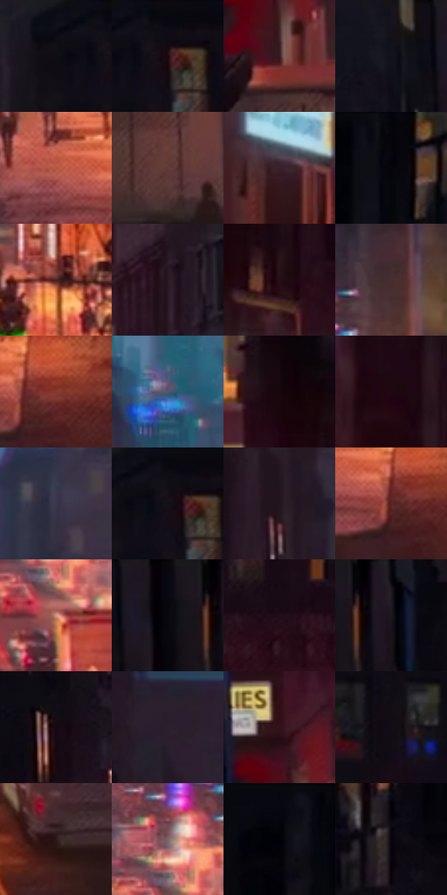

# 电影参考 040

- 状态：常规／活跃；来源世界：miles-home。
- 视角：high-angle；景别：environment-wide；场景：city。
- 时段：night-appearance（外观依据，中置信度；具体时间／晨昏未知）；光照：night-mixed。
- 材质候选：brick, asphalt, glass, painted-metal, sky, fabric（帧级，不是像素分割）。
- 明暗组：very-dark；L* P5/P50/P95：1.46875 / 9.55537 / 48.20054。
- 资格门禁：无附加门禁。
- 原截图 SHA-256：`a82230ceaf9160880efe42ea04f520821b3759737b1a4f26d721974258357904`；尺寸：2880 × 1200。
- sRGB 像素 SHA-256：`873fc7898706c2e3a3a2f1e3353a5335905f367476bea0f9a11f4d819be61d6e`。

## 观察与迁移

暖灯街面与冷暗楼体，光源集中而非每窗同亮。

蓝黑暮色街谷

楼体大块压暗而窗口选择性点亮，消失点处才聚集灯光与行人。远处车流用点状亮部，近处砖窗保留少量垂直节奏；细丝网和排线只在暗面内部轻微变化。发光灯可有局部暖冷边，夜空不需要满屏大点，也不能因荧光要求把所有暗楼提成亮蓝。

本公开版保存32个128×128原像素色卡上下文；图集格子并非原场景相邻位置。原rect、图集tile和像素SHA见 `data/palette-crops.json`。上下文不足时不得批准替色，不能以小样推断完整构图。

## 实测色卡

颜色比例分母为保留采样像素，不是材料面积；全部 32 色参与全库匹配。表内四舍五入仅用于阅读，原精度在 JSON。

| ID | HEX | Lab | 原图 xy | 像素数 | 比例 | 明度角色 |
| --- | --- | --- | --- | ---: | ---: | --- |
| 040-S01 | #0D0D15 | [3.861984, 1.591331, -4.331179] | [1528, 44] | 9281 | 4.817595% | deep-shadow |
| 040-S02 | #0D0B13 | [3.359542, 2.034206, -3.740437] | [1604, 32] | 9245 | 4.798908% | deep-shadow |
| 040-S03 | #391B1D | [14.074186, 15.015521, 5.252726] | [448, 816] | 8700 | 4.516008% | deep-shadow |
| 040-S04 | #15111A | [5.735066, 3.79535, -5.269359] | [144, 36] | 8546 | 4.436070% | deep-shadow |
| 040-S05 | #B25542 | [47.440652, 36.281196, 28.80343] | [644, 912] | 8246 | 4.280346% | midtone |
| 040-S06 | #603834 | [28.28375, 17.279685, 10.084482] | [464, 976] | 7734 | 4.014576% | shadow |
| 040-S07 | #39212A | [16.12949, 13.108091, -1.147868] | [1932, 808] | 7357 | 3.818882% | deep-shadow |
| 040-S08 | #04040A | [1.215415, 0.834193, -2.270409] | [2224, 24] | 7183 | 3.728562% | deep-shadow |
| 040-S09 | #461F20 | [17.398192, 18.772473, 8.048543] | [1240, 688] | 7140 | 3.706241% | deep-shadow |
| 040-S10 | #281823 | [10.746316, 10.270958, -4.329234] | [1392, 104] | 6895 | 3.579066% | deep-shadow |
| 040-S11 | #270F16 | [7.506448, 13.54444, 0.661954] | [1968, 620] | 6889 | 3.575952% | deep-shadow |
| 040-S12 | #482F30 | [22.388707, 11.616748, 4.003549] | [1064, 408] | 6712 | 3.484075% | shadow |
| 040-S13 | #84392D | [34.029998, 31.318709, 23.110429] | [764, 936] | 6333 | 3.287343% | shadow |
| 040-S14 | #4C5771 | [37.012675, 2.460536, -16.223538] | [788, 324] | 6242 | 3.240106% | shadow |
| 040-S15 | #17040C | [2.669953, 7.463688, -0.837492] | [1888, 516] | 6118 | 3.175740% | deep-shadow |
| 040-S16 | #1E070F | [4.178046, 10.569714, -0.010337] | [2136, 724] | 6035 | 3.132656% | deep-shadow |
| 040-S17 | #38364B | [23.628423, 6.232391, -12.558688] | [964, 220] | 5465 | 2.836780% | shadow |
| 040-S18 | #090A10 | [2.823339, 0.721509, -2.767651] | [1588, 24] | 5410 | 2.808231% | deep-shadow |
| 040-S19 | #22151D | [8.697821, 8.316759, -2.985562] | [600, 264] | 5268 | 2.734521% | deep-shadow |
| 040-S20 | #5B2420 | [22.269739, 24.934391, 15.175045] | [728, 952] | 5169 | 2.683132% | shadow |
| 040-S21 | #D9957F | [67.859619, 22.95211, 21.969689] | [968, 620] | 5146 | 2.671193% | light |
| 040-S22 | #09080F | [2.40481, 1.337302, -2.835896] | [248, 24] | 4880 | 2.533117% | deep-shadow |
| 040-S23 | #1F0F18 | [6.313575, 9.63085, -2.722412] | [1756, 320] | 4854 | 2.519621% | deep-shadow |
| 040-S24 | #09070D | [2.159694, 1.393268, -2.18436] | [332, 24] | 4825 | 2.504568% | deep-shadow |
| 040-S25 | #170812 | [3.608916, 6.948194, -2.649927] | [460, 320] | 4729 | 2.454736% | deep-shadow |
| 040-S26 | #2B202D | [14.036569, 8.255266, -6.623647] | [612, 64] | 4669 | 2.423591% | deep-shadow |
| 040-S27 | #33111A | [10.405024, 18.270399, 2.12871] | [432, 700] | 4448 | 2.308874% | deep-shadow |
| 040-S28 | #130D15 | [4.339819, 3.734292, -3.576113] | [1768, 108] | 4400 | 2.283958% | deep-shadow |
| 040-S29 | #2C1719 | [10.693637, 10.929453, 3.123901] | [1128, 900] | 4317 | 2.240875% | deep-shadow |
| 040-S30 | #826266 | [44.859111, 13.591104, 2.76624] | [952, 528] | 3766 | 1.954861% | midtone |
| 040-S31 | #020206 | [0.627494, 0.55614, -1.513628] | [2068, 56] | 3627 | 1.882708% | deep-shadow |
| 040-S32 | #0A040A | [1.565267, 2.403189, -1.717578] | [1988, 268] | 3019 | 1.567107% | deep-shadow |

## 色阶与空间分布

- 采样 ROI：`[0.01, 0.02, 0.98, 0.94]`；步长：4；样本数：192648。
- 排除区：`[]`。
- 深暗、暗、中、亮、高光五段计数：`[140476, 34581, 13470, 3428, 693]`。
- RGB 各 256 箱、L* 100 箱、13×5 色相明度表和 3×3 空间统计全部保存在 [总数据](../film-library.json)。
- [可视化档案](../../references/library.html)按需绘制直方图，不存 2,094 张重复图表图片。

## 纹理特征占比

**这是分块图像特征的面积占比，不是波点／排线／丝网／错版的精确语义覆盖率。** 窗格、发丝、织物也会产生方向或周期特征。
原图 ROI 像素 3084576；已测块覆盖 3084576（100.0000%）；未测 0。

| 特征 | 块覆盖像素 | 占已测面积 | 阈值敏感范围 |
| --- | ---: | ---: | --- |
| low-contrast | 181504 | 5.8842% | 5.0211% ~ 9.7517% |
| directional-structure | 615968 | 19.9693% | 10.9552% ~ 36.2111% |
| periodic-structure | 2211328 | 71.6899% | 58.4358% ~ 74.3799% |
| mixed-detail | 75776 | 2.4566% | 0.3320% ~ 4.9132% |

阈值敏感范围不是统计置信区间。逐块坐标、尺度、对比、方向一致性、频谱集中度、频率与角度见 [全量特征记录](../texture-features.jsonl)，以帧号定位。
四种印刷层的真实像素覆盖仍标为 `null`，不能填 0，也不能拿上表代替。不得据这些代理测量删除唯一证据。

[测量方法与保留策略](../../references/library-retention.md) · [分类索引](../archive/README.md)
