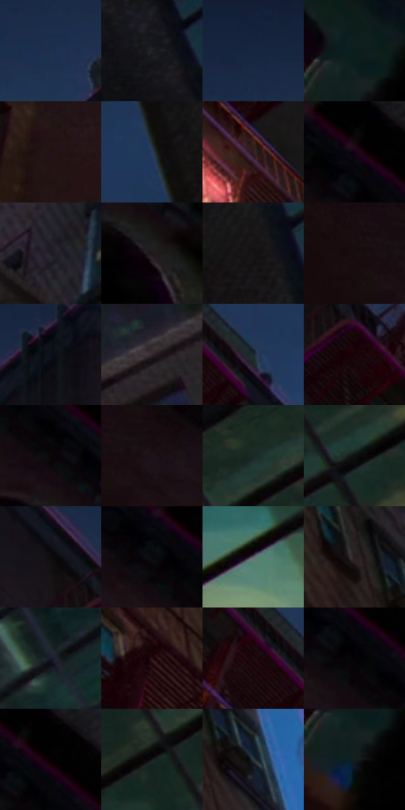

# 电影参考 041

- 状态：常规／活跃；来源世界：miles-home。
- 视角：low-angle；景别：environment-wide；场景：city。
- 时段：night-appearance（外观依据，中置信度；具体时间／晨昏未知）；光照：night-mixed。
- 材质候选：brick, asphalt, glass, painted-metal, sky, fabric（帧级，不是像素分割）。
- 明暗组：very-dark；L* P5/P50/P95：0.56572 / 8.43423 / 25.6569。
- 资格门禁：无附加门禁。
- 原截图 SHA-256：`7fa1ae1159fe2c11eac2bb3e27ee6baed080a5b3cfcc095d1ffed21eb5b98e24`；尺寸：2880 × 1200。
- sRGB 像素 SHA-256：`40036f34c49dbbb8c58c880efcd1573c0270533716ad442b9c9d7cc76be8471b`。

## 观察与迁移

暖灯街面与冷暗楼体，光源集中而非每窗同亮。

仰视消防梯与冷天光

消防梯的折线与窗口竖线顺仰视透视逐渐压缩，别用平面网格覆盖。砖面与天光采用不同尺度的细网，天空较净；少数亮窗建立节奏。色散贴在窗缘和受光梯框，人物只露局部背影，不能推断脸或完整体型。

本公开版保存32个128×128原像素色卡上下文；图集格子并非原场景相邻位置。原rect、图集tile和像素SHA见 `data/palette-crops.json`。上下文不足时不得批准替色，不能以小样推断完整构图。

## 实测色卡

颜色比例分母为保留采样像素，不是材料面积；全部 32 色参与全库匹配。表内四舍五入仅用于阅读，原精度在 JSON。

| ID | HEX | Lab | 原图 xy | 像素数 | 比例 | 明度角色 |
| --- | --- | --- | --- | ---: | ---: | --- |
| 041-S01 | #1C324D | [20.296936, 0.829935, -19.237569] | [1168, 188] | 9073 | 4.709626% | shadow |
| 041-S02 | #17161D | [7.629893, 2.415653, -4.730914] | [2036, 28] | 8903 | 4.621382% | deep-shadow |
| 041-S03 | #172640 | [15.160463, 3.067162, -18.460288] | [1176, 84] | 8567 | 4.446971% | deep-shadow |
| 041-S04 | #0B1B1A | [8.390146, -6.82139, -1.426857] | [36, 332] | 8188 | 4.250239% | deep-shadow |
| 041-S05 | #231313 | [7.860085, 8.285014, 3.12594] | [764, 852] | 7857 | 4.078423% | deep-shadow |
| 041-S06 | #293D58 | [25.300122, 0.748034, -18.641872] | [2008, 320] | 7667 | 3.979797% | shadow |
| 041-S07 | #321C1C | [13.185047, 10.853686, 4.566618] | [1772, 536] | 7258 | 3.767493% | deep-shadow |
| 041-S08 | #000000 | [0.0, 0.0, 0.0] | [384, 24] | 7198 | 3.736348% | deep-shadow |
| 041-S09 | #1F1D26 | [11.344995, 3.346953, -5.752392] | [1100, 840] | 7183 | 3.728562% | deep-shadow |
| 041-S10 | #1D1A1C | [9.671292, 1.951718, -0.8605] | [492, 300] | 7022 | 3.644990% | deep-shadow |
| 041-S11 | #161313 | [6.172608, 1.301495, 0.459417] | [2124, 300] | 6843 | 3.552074% | deep-shadow |
| 041-S12 | #170D0F | [4.55734, 4.258672, 0.441779] | [152, 104] | 6800 | 3.529754% | deep-shadow |
| 041-S13 | #0D1118 | [4.989684, 0.254331, -4.8786] | [1416, 120] | 6789 | 3.524044% | deep-shadow |
| 041-S14 | #322A2D | [18.024789, 4.322087, -0.587842] | [2600, 1080] | 6518 | 3.383373% | deep-shadow |
| 041-S15 | #1F2A33 | [16.435321, -1.991178, -7.353093] | [1840, 400] | 6387 | 3.315373% | deep-shadow |
| 041-S16 | #170408 | [2.588578, 6.891854, 0.71882] | [1612, 264] | 6101 | 3.166916% | deep-shadow |
| 041-S17 | #090708 | [2.055619, 0.661921, -0.193916] | [452, 196] | 5985 | 3.106702% | deep-shadow |
| 041-S18 | #1E1317 | [7.259446, 6.415146, -0.598346] | [228, 112] | 5976 | 3.102031% | deep-shadow |
| 041-S19 | #1A2925 | [15.163744, -7.457199, 0.591997] | [2684, 364] | 5851 | 3.037145% | deep-shadow |
| 041-S20 | #0D110F | [4.705646, -1.741631, 0.553639] | [2728, 536] | 5639 | 2.927100% | deep-shadow |
| 041-S21 | #0F0C0E | [3.578966, 1.27537, -0.556897] | [1540, 168] | 5453 | 2.830551% | deep-shadow |
| 041-S22 | #080B0E | [2.914603, -0.312692, -1.581142] | [372, 112] | 5294 | 2.748017% | deep-shadow |
| 041-S23 | #646873 | [44.013543, 0.899161, -6.673476] | [2444, 720] | 5257 | 2.728811% | midtone |
| 041-S24 | #261E21 | [12.289581, 4.530848, -0.590658] | [2036, 912] | 4999 | 2.594888% | deep-shadow |
| 041-S25 | #171C2A | [10.407331, 2.15893, -10.194419] | [2468, 160] | 4500 | 2.335866% | deep-shadow |
| 041-S26 | #2F1218 | [9.82197, 15.589398, 2.707033] | [1812, 832] | 4425 | 2.296935% | deep-shadow |
| 041-S27 | #1F0B0F | [5.10549, 9.576746, 1.36051] | [1748, 392] | 4299 | 2.231531% | deep-shadow |
| 041-S28 | #020304 | [0.783999, -0.122508, -0.470463] | [404, 132] | 4278 | 2.220630% | deep-shadow |
| 041-S29 | #060203 | [0.801369, 1.185006, -0.009803] | [420, 76] | 3741 | 1.941884% | deep-shadow |
| 041-S30 | #15191A | [8.387628, -1.609165, -1.343729] | [2620, 468] | 3481 | 1.806922% | deep-shadow |
| 041-S31 | #2D383E | [22.771516, -2.930142, -5.244424] | [2124, 976] | 3072 | 1.594618% | shadow |
| 041-S32 | #0F1D23 | [9.810434, -3.941949, -5.99845] | [44, 404] | 2044 | 1.061002% | deep-shadow |

## 色阶与空间分布

- 采样 ROI：`[0.01, 0.02, 0.98, 0.94]`；步长：4；样本数：192648。
- 排除区：`[]`。
- 深暗、暗、中、亮、高光五段计数：`[169340, 20406, 2437, 438, 27]`。
- RGB 各 256 箱、L* 100 箱、13×5 色相明度表和 3×3 空间统计全部保存在 [总数据](../film-library.json)。
- [可视化档案](../../references/library.html)按需绘制直方图，不存 2,094 张重复图表图片。

## 纹理特征占比

**这是分块图像特征的面积占比，不是波点／排线／丝网／错版的精确语义覆盖率。** 窗格、发丝、织物也会产生方向或周期特征。
原图 ROI 像素 3084576；已测块覆盖 3084576（100.0000%）；未测 0。

| 特征 | 块覆盖像素 | 占已测面积 | 阈值敏感范围 |
| --- | ---: | ---: | --- |
| low-contrast | 249856 | 8.1002% | 4.5812% ~ 12.6814% |
| directional-structure | 488704 | 15.8435% | 5.8427% ~ 29.8030% |
| periodic-structure | 2204704 | 71.4751% | 64.5534% ~ 73.1765% |
| mixed-detail | 141312 | 4.5812% | 1.0623% ~ 8.2994% |

阈值敏感范围不是统计置信区间。逐块坐标、尺度、对比、方向一致性、频谱集中度、频率与角度见 [全量特征记录](../texture-features.jsonl)，以帧号定位。
四种印刷层的真实像素覆盖仍标为 `null`，不能填 0，也不能拿上表代替。不得据这些代理测量删除唯一证据。

[测量方法与保留策略](../../references/library-retention.md) · [分类索引](../archive/README.md)
