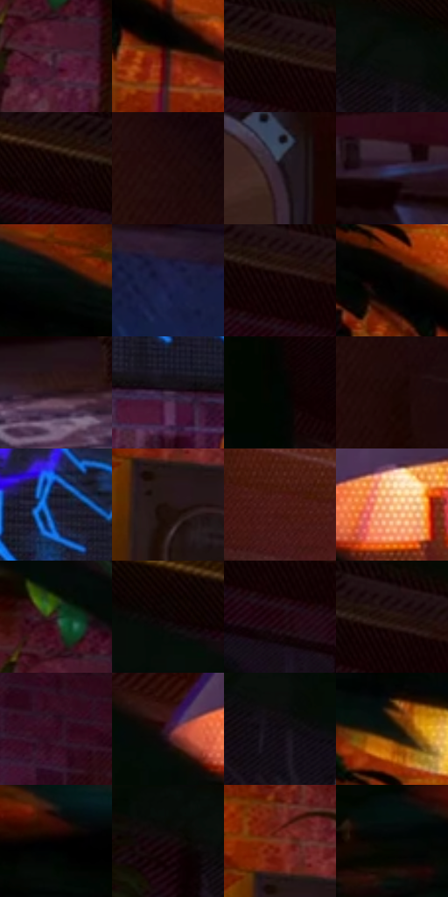

# 电影参考 042

- 状态：常规／活跃；来源世界：miles-home。
- 视角：near-level；景别：environment-wide；场景：interior。
- 时段：interior-time-unknown（外观依据，中置信度；具体时间／晨昏未知）；光照：interior-mixed。
- 材质候选：skin, fabric, wood, brick, metal, plastic（帧级，不是像素分割）。
- 明暗组：very-dark；L* P5/P50/P95：1.03504 / 6.44507 / 30.80939。
- 资格门禁：无附加门禁。
- 原截图 SHA-256：`1d9351241a98b97b5d1abf5b0a02eea5c655bd1ee4587c9a219504f11297996c`；尺寸：2880 × 1198。
- sRGB 像素 SHA-256：`310f534eaf146277948aaa955cc1fe04a1d624f6374138c330312d9eb3e11df7`。

## 观察与迁移

暖灯住宅、暗墙和皮革式宽亮面；阴影保持体积。

暖暗唱片房

大块叶片、箱体和家具层层框出中景人物，灯、屏幕与沙发分别给不同温度。砖缝与木料排线随表面走，灯罩可见细点，屏幕另有像素/网目；三者不可统一噪声化。远景人物保留坐姿与肩臂比例即可，不凭空补造细脸；屏幕发光边可轻微错版。

本公开版保存32个128×128原像素色卡上下文；图集格子并非原场景相邻位置。原rect、图集tile和像素SHA见 `data/palette-crops.json`。上下文不足时不得批准替色，不能以小样推断完整构图。

## 实测色卡

颜色比例分母为保留采样像素，不是材料面积；全部 32 色参与全库匹配。表内四舍五入仅用于阅读，原精度在 JSON。

| ID | HEX | Lab | 原图 xy | 像素数 | 比例 | 明度角色 |
| --- | --- | --- | --- | ---: | ---: | --- |
| 042-S01 | #3C1F2C | [16.118264, 16.13034, -2.539532] | [820, 392] | 12093 | 6.277252% | deep-shadow |
| 042-S02 | #2F1209 | [9.456269, 13.939383, 10.773715] | [416, 392] | 10552 | 5.477347% | deep-shadow |
| 042-S03 | #19090C | [3.871856, 6.454315, 0.94413] | [1404, 32] | 10454 | 5.426477% | deep-shadow |
| 042-S04 | #050A07 | [2.390831, -1.724802, 0.674908] | [972, 28] | 9762 | 5.067273% | deep-shadow |
| 042-S05 | #160707 | [3.052341, 5.08165, 1.790778] | [1308, 56] | 8538 | 4.431917% | deep-shadow |
| 042-S06 | #200B0B | [5.154736, 9.560534, 3.369058] | [2484, 256] | 8368 | 4.343673% | deep-shadow |
| 042-S07 | #1D1219 | [6.901543, 7.005861, -2.669831] | [860, 832] | 7589 | 3.939309% | deep-shadow |
| 042-S08 | #32315D | [22.53085, 13.297476, -26.230721] | [2372, 996] | 7116 | 3.693783% | shadow |
| 042-S09 | #70260C | [26.327993, 31.459922, 32.610929] | [452, 24] | 7014 | 3.640837% | shadow |
| 042-S10 | #1F2047 | [14.282517, 12.364175, -24.674788] | [2500, 1108] | 6588 | 3.419708% | deep-shadow |
| 042-S11 | #160304 | [2.208669, 6.26676, 1.780777] | [1448, 88] | 6533 | 3.391159% | deep-shadow |
| 042-S12 | #030202 | [0.606656, 0.261464, 0.092205] | [312, 308] | 6466 | 3.356381% | deep-shadow |
| 042-S13 | #29161D | [10.061515, 10.902445, -0.847926] | [1300, 1124] | 6205 | 3.220900% | deep-shadow |
| 042-S14 | #4B374C | [26.010772, 13.155114, -9.401735] | [1196, 588] | 6181 | 3.208442% | shadow |
| 042-S15 | #020703 | [1.548523, -1.863794, 1.053233] | [2684, 56] | 5985 | 3.106702% | deep-shadow |
| 042-S16 | #1C0805 | [3.898316, 7.495098, 3.923435] | [2540, 432] | 5620 | 2.917238% | deep-shadow |
| 042-S17 | #1A182A | [9.320414, 6.321685, -11.861539] | [1284, 432] | 5562 | 2.887131% | deep-shadow |
| 042-S18 | #21120F | [7.140561, 7.189839, 4.366888] | [620, 492] | 5438 | 2.822765% | deep-shadow |
| 042-S19 | #491813 | [16.090501, 22.997089, 15.491606] | [1996, 260] | 5370 | 2.787467% | deep-shadow |
| 042-S20 | #B68187 | [59.339603, 21.329582, 4.957883] | [2028, 24] | 4926 | 2.556995% | midtone |
| 042-S21 | #271E22 | [12.450916, 5.233917, -1.070692] | [804, 304] | 4911 | 2.549209% | deep-shadow |
| 042-S22 | #0F0101 | [1.133537, 3.853999, 1.357984] | [1144, 24] | 4745 | 2.463041% | deep-shadow |
| 042-S23 | #240711 | [5.127049, 14.901432, 0.371065] | [1436, 152] | 4641 | 2.409057% | deep-shadow |
| 042-S24 | #110306 | [1.783773, 4.461826, 0.289983] | [1448, 24] | 4569 | 2.371683% | deep-shadow |
| 042-S25 | #33061D | [8.332393, 24.641709, -3.203818] | [1620, 364] | 4363 | 2.264752% | deep-shadow |
| 042-S26 | #3A151B | [12.704618, 19.005708, 4.827027] | [1904, 52] | 4322 | 2.243470% | deep-shadow |
| 042-S27 | #0D0910 | [2.875647, 2.236013, -2.661474] | [996, 116] | 3860 | 2.003654% | deep-shadow |
| 042-S28 | #0C100C | [4.293193, -1.986352, 1.42008] | [316, 192] | 3544 | 1.839625% | deep-shadow |
| 042-S29 | #260806 | [5.410774, 14.236198, 5.903704] | [240, 52] | 3412 | 1.771106% | deep-shadow |
| 042-S30 | #0C0808 | [2.43319, 1.075308, 0.379195] | [868, 52] | 3131 | 1.625244% | deep-shadow |
| 042-S31 | #743622 | [30.563451, 25.586343, 25.016368] | [608, 404] | 2807 | 1.457062% | shadow |
| 042-S32 | #0A0501 | [1.583264, 0.751234, 1.974552] | [32, 72] | 1983 | 1.029338% | deep-shadow |

## 色阶与空间分布

- 采样 ROI：`[0.01, 0.02, 0.98, 0.94]`；步长：4；样本数：192648。
- 排除区：`[]`。
- 深暗、暗、中、亮、高光五段计数：`[166916, 20274, 3450, 1713, 295]`。
- RGB 各 256 箱、L* 100 箱、13×5 色相明度表和 3×3 空间统计全部保存在 [总数据](../film-library.json)。
- [可视化档案](../../references/library.html)按需绘制直方图，不存 2,094 张重复图表图片。

## 纹理特征占比

**这是分块图像特征的面积占比，不是波点／排线／丝网／错版的精确语义覆盖率。** 窗格、发丝、织物也会产生方向或周期特征。
原图 ROI 像素 3081782；已测块覆盖 3081782（100.0000%）；未测 0。

| 特征 | 块覆盖像素 | 占已测面积 | 阈值敏感范围 |
| --- | ---: | ---: | --- |
| low-contrast | 457600 | 14.8486% | 12.2817% ~ 17.9470% |
| directional-structure | 382080 | 12.3980% | 7.4887% ~ 26.3453% |
| periodic-structure | 2097462 | 68.0600% | 59.8695% ~ 68.0600% |
| mixed-detail | 144640 | 4.6934% | 1.5035% ~ 10.8696% |

阈值敏感范围不是统计置信区间。逐块坐标、尺度、对比、方向一致性、频谱集中度、频率与角度见 [全量特征记录](../texture-features.jsonl)，以帧号定位。
四种印刷层的真实像素覆盖仍标为 `null`，不能填 0，也不能拿上表代替。不得据这些代理测量删除唯一证据。

[测量方法与保留策略](../../references/library-retention.md) · [分类索引](../archive/README.md)
