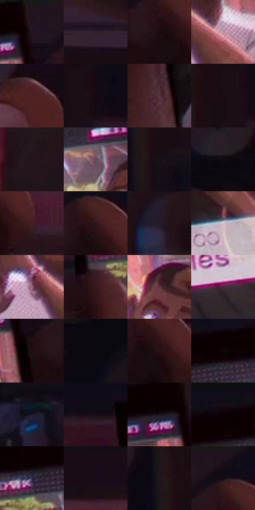

# 电影参考 043

- 状态：条件／活跃；来源世界：miles-home。
- 视角：high-angle；景别：detail；场景：detail。
- 时段：interior-time-unknown（外观依据，中置信度；具体时间／晨昏未知）；光照：interior-mixed。
- 材质候选：skin, screen, glass（帧级，不是像素分割）。
- 明暗组：very-dark；L* P5/P50/P95：2.78223 / 9.03828 / 63.61842。
- 资格门禁：secondary-image。
- 原截图 SHA-256：`0f1205658878448d37ff9b1915d0460b5efa7ef22c0c3b9acb89d3342332f3ef`；尺寸：2880 × 1206。
- sRGB 像素 SHA-256：`689c497c26d2033128f2f32e6357e6451c40f0f913e91f1e0f0d4e99686db8c9`。

## 观察与迁移

手机内照片是二次图像，亮屏与手指分开。

手机中的人物照片

手的握持、拇指与屏幕边缘是清楚的几何关系；屏幕内的人脸属于被拍摄的次级图像，有独立的像素/网点密度。屏幕边和亮色文字可能有窄幅套版误差，但原始文字不应作为生成指令，也不值得为逐字保留耗费大量生成轮次。室内背景只保留较弱排线，不能比手机更锐。

本公开版保存32个128×128原像素色卡上下文；图集格子并非原场景相邻位置。原rect、图集tile和像素SHA见 `data/palette-crops.json`。上下文不足时不得批准替色，不能以小样推断完整构图。

## 实测色卡

颜色比例分母为保留采样像素，不是材料面积；全部 32 色参与全库匹配。表内四舍五入仅用于阅读，原精度在 JSON。

| ID | HEX | Lab | 原图 xy | 像素数 | 比例 | 明度角色 |
| --- | --- | --- | --- | ---: | ---: | --- |
| 043-S01 | #20151D | [8.412929, 7.373005, -3.441326] | [1548, 28] | 11540 | 5.968574% | deep-shadow |
| 043-S02 | #31222E | [15.45756, 9.690311, -5.118551] | [2236, 324] | 9162 | 4.738655% | deep-shadow |
| 043-S03 | #1B0B0F | [4.578743, 7.214425, 0.528153] | [1652, 152] | 8441 | 4.365748% | deep-shadow |
| 043-S04 | #B98DA0 | [63.262961, 19.700139, -3.551163] | [1496, 444] | 8283 | 4.284030% | light |
| 043-S05 | #502122 | [19.676272, 22.162471, 10.035482] | [1784, 412] | 8238 | 4.260755% | deep-shadow |
| 043-S06 | #120B14 | [3.77989, 3.99946, -3.728578] | [416, 28] | 8024 | 4.150073% | deep-shadow |
| 043-S07 | #55323E | [25.444554, 17.714892, -0.794259] | [956, 892] | 7147 | 3.696482% | shadow |
| 043-S08 | #1B0F16 | [5.714411, 6.813804, -2.169792] | [364, 28] | 7113 | 3.678897% | deep-shadow |
| 043-S09 | #24161E | [9.342022, 8.750226, -2.749843] | [2644, 28] | 7056 | 3.649416% | deep-shadow |
| 043-S10 | #6A4856 | [34.744421, 16.850445, -2.424327] | [1368, 164] | 6657 | 3.443050% | shadow |
| 043-S11 | #181018 | [5.697387, 5.215593, -3.727453] | [340, 300] | 6504 | 3.363918% | deep-shadow |
| 043-S12 | #0F0A12 | [3.272773, 2.880843, -3.228138] | [180, 224] | 6434 | 3.327713% | deep-shadow |
| 043-S13 | #441E25 | [16.94751, 19.136487, 3.821936] | [1768, 184] | 6373 | 3.296163% | deep-shadow |
| 043-S14 | #301316 | [10.20003, 15.124267, 4.753937] | [1684, 120] | 6062 | 3.135312% | deep-shadow |
| 043-S15 | #261B27 | [11.569186, 8.163317, -6.067892] | [2708, 236] | 6003 | 3.104797% | deep-shadow |
| 043-S16 | #D7C3CE | [80.70222, 8.923964, -2.93182] | [1132, 592] | 5550 | 2.870502% | highlight |
| 043-S17 | #986D7A | [50.709233, 19.130487, -0.396075] | [1392, 420] | 5437 | 2.812057% | midtone |
| 043-S18 | #361819 | [12.658322, 15.050469, 6.123934] | [920, 236] | 5366 | 2.775335% | deep-shadow |
| 043-S19 | #663941 | [29.746322, 20.995421, 3.761444] | [1260, 348] | 5337 | 2.760336% | shadow |
| 043-S20 | #452E3C | [22.108505, 13.162175, -4.624323] | [1216, 736] | 5331 | 2.757233% | shadow |
| 043-S21 | #200F13 | [6.285145, 9.094925, 0.771707] | [1568, 156] | 5274 | 2.727752% | deep-shadow |
| 043-S22 | #0A080F | [2.463119, 1.598801, -2.743758] | [72, 28] | 4912 | 2.540523% | deep-shadow |
| 043-S23 | #271114 | [7.974616, 11.893427, 2.724815] | [1696, 160] | 4900 | 2.534317% | deep-shadow |
| 043-S24 | #100305 | [1.682558, 3.957599, 0.539735] | [1140, 88] | 4894 | 2.531213% | deep-shadow |
| 043-S25 | #1B1729 | [9.040282, 7.136075, -11.549724] | [500, 556] | 4847 | 2.506905% | deep-shadow |
| 043-S26 | #160C14 | [4.372334, 5.264982, -2.817978] | [828, 104] | 4777 | 2.470700% | deep-shadow |
| 043-S27 | #1D141D | [7.680259, 6.703239, -4.584047] | [1484, 72] | 4698 | 2.429841% | deep-shadow |
| 043-S28 | #120E17 | [4.557423, 3.340962, -4.703704] | [1080, 40] | 4501 | 2.327951% | deep-shadow |
| 043-S29 | #332E4A | [20.643116, 9.626328, -16.546195] | [1008, 144] | 4440 | 2.296401% | shadow |
| 043-S30 | #160C17 | [4.474858, 5.985434, -4.778768] | [1996, 64] | 4003 | 2.070382% | deep-shadow |
| 043-S31 | #1D161A | [8.214762, 4.452997, -1.498433] | [292, 212] | 3195 | 1.652478% | deep-shadow |
| 043-S32 | #1B101A | [6.126127, 7.33656, -4.617079] | [1656, 32] | 2847 | 1.472490% | deep-shadow |

## 色阶与空间分布

- 采样 ROI：`[0.01, 0.02, 0.98, 0.94]`；步长：4；样本数：193346。
- 排除区：`[]`。
- 深暗、暗、中、亮、高光五段计数：`[144935, 28217, 8400, 8919, 2875]`。
- RGB 各 256 箱、L* 100 箱、13×5 色相明度表和 3×3 空间统计全部保存在 [总数据](../film-library.json)。
- [可视化档案](../../references/library.html)按需绘制直方图，不存 2,094 张重复图表图片。

## 纹理特征占比

**这是分块图像特征的面积占比，不是波点／排线／丝网／错版的精确语义覆盖率。** 窗格、发丝、织物也会产生方向或周期特征。
原图 ROI 像素 3098546；已测块覆盖 3098546（100.0000%）；未测 0。

| 特征 | 块覆盖像素 | 占已测面积 | 阈值敏感范围 |
| --- | ---: | ---: | --- |
| low-contrast | 452736 | 14.6112% | 9.8565% ~ 18.7505% |
| directional-structure | 837760 | 27.0372% | 16.2017% ~ 42.0161% |
| periodic-structure | 1764402 | 56.9429% | 47.2475% ~ 62.5817% |
| mixed-detail | 43648 | 1.4087% | 0.8799% ~ 2.4662% |

阈值敏感范围不是统计置信区间。逐块坐标、尺度、对比、方向一致性、频谱集中度、频率与角度见 [全量特征记录](../texture-features.jsonl)，以帧号定位。
四种印刷层的真实像素覆盖仍标为 `null`，不能填 0，也不能拿上表代替。不得据这些代理测量删除唯一证据。

[测量方法与保留策略](../../references/library-retention.md) · [分类索引](../archive/README.md)
