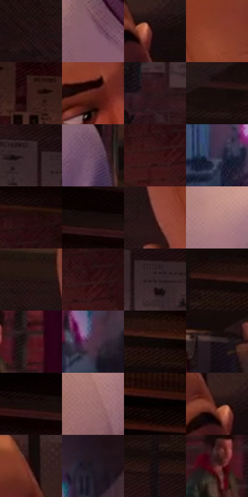

# 电影参考 044

- 状态：常规／活跃；来源世界：miles-home。
- 视角：near-level；景别：medium；场景：interior。
- 时段：interior-time-unknown（外观依据，中置信度；具体时间／晨昏未知）；光照：interior-mixed。
- 材质候选：skin, fabric, wood, brick, metal, plastic（帧级，不是像素分割）。
- 明暗组：very-dark；L* P5/P50/P95：2.11393 / 11.69422 / 47.39149。
- 资格门禁：无附加门禁。
- 原截图 SHA-256：`e3759136ad926f25216928ee8e3f8c15a99289c7da41d27086c80fb2d939f72b`；尺寸：2880 × 1206。
- sRGB 像素 SHA-256：`bcef83b428853abcd55bb45ee1d1045d19bd1709bc1cb5e2045993bfa0234b23`。

## 观察与迁移

暖灯住宅、暗墙和皮革式宽亮面；阴影保持体积。

室内成年人物近景

成年人物的长颅、颧骨、鼻梁、下巴、肩宽和胸臂体积与 36 的少年不同；身份不能被统一动漫脸替换。皮肤主要靠大色面和少数表情线，网点更多留在衣物、墙面和屏幕；头部边缘轻微彩边即可。背景远人物只需清楚动作，不需要同样细的脸。

本公开版保存32个128×128原像素色卡上下文；图集格子并非原场景相邻位置。原rect、图集tile和像素SHA见 `data/palette-crops.json`。上下文不足时不得批准替色，不能以小样推断完整构图。

## 实测色卡

颜色比例分母为保留采样像素，不是材料面积；全部 32 色参与全库匹配。表内四舍五入仅用于阅读，原精度在 JSON。

| ID | HEX | Lab | 原图 xy | 像素数 | 比例 | 明度角色 |
| --- | --- | --- | --- | ---: | ---: | --- |
| 044-S01 | #251518 | [8.955289, 8.730754, 1.23946] | [116, 240] | 9400 | 4.861750% | deep-shadow |
| 044-S02 | #855B6E | [43.646815, 20.285505, -3.825253] | [540, 836] | 8741 | 4.520911% | midtone |
| 044-S03 | #1D1012 | [6.101856, 6.518201, 1.076015] | [800, 168] | 8631 | 4.464018% | deep-shadow |
| 044-S04 | #8C3D2B | [36.155002, 32.287132, 27.197962] | [536, 164] | 8111 | 4.195070% | shadow |
| 044-S05 | #381B1A | [13.823387, 14.147668, 7.052344] | [2052, 352] | 7904 | 4.088008% | deep-shadow |
| 044-S06 | #60241E | [23.145485, 26.861184, 17.799587] | [600, 288] | 7424 | 3.839748% | shadow |
| 044-S07 | #2F191B | [11.816215, 11.316817, 3.299708] | [1408, 456] | 7386 | 3.820095% | deep-shadow |
| 044-S08 | #2D1516 | [10.200551, 12.350017, 4.678264] | [1240, 48] | 6787 | 3.510287% | deep-shadow |
| 044-S09 | #382428 | [16.776417, 10.236618, 1.200308] | [1416, 300] | 6786 | 3.509770% | deep-shadow |
| 044-S10 | #6C4B60 | [36.109618, 17.651833, -6.689283] | [1268, 792] | 6460 | 3.341160% | shadow |
| 044-S11 | #391213 | [11.618957, 19.480742, 9.01905] | [2740, 284] | 6447 | 3.334437% | deep-shadow |
| 044-S12 | #363149 | [21.806063, 8.339347, -14.043835] | [2288, 896] | 6317 | 3.267200% | shadow |
| 044-S13 | #23080A | [4.995256, 12.666107, 3.608348] | [2804, 180] | 6280 | 3.248063% | deep-shadow |
| 044-S14 | #150B0C | [3.842121, 3.728489, 0.8495] | [2716, 56] | 6241 | 3.227892% | deep-shadow |
| 044-S15 | #461E1D | [17.082731, 19.0551, 9.735304] | [412, 212] | 6214 | 3.213927% | deep-shadow |
| 044-S16 | #B78884 | [61.083335, 17.373737, 9.180477] | [1028, 796] | 6191 | 3.202032% | light |
| 044-S17 | #231310 | [7.773345, 7.800121, 4.784839] | [332, 116] | 5979 | 3.092384% | deep-shadow |
| 044-S18 | #2E0C0F | [7.934878, 17.75625, 5.805893] | [2776, 260] | 5776 | 2.987390% | deep-shadow |
| 044-S19 | #2E1F22 | [13.688188, 7.861263, 0.847377] | [1480, 332] | 5630 | 2.911878% | deep-shadow |
| 044-S20 | #1C0C0C | [4.845447, 6.83671, 2.409369] | [1404, 28] | 5617 | 2.905154% | deep-shadow |
| 044-S21 | #491118 | [14.864881, 26.940203, 10.462439] | [1768, 660] | 5554 | 2.872570% | deep-shadow |
| 044-S22 | #4D3141 | [24.181575, 15.550863, -4.798618] | [2552, 856] | 5426 | 2.806368% | shadow |
| 044-S23 | #0D0607 | [2.08814, 2.037381, 0.290685] | [1488, 80] | 5396 | 2.790852% | deep-shadow |
| 044-S24 | #271B1D | [11.303229, 6.332036, 0.929405] | [880, 260] | 5232 | 2.706030% | deep-shadow |
| 044-S25 | #090101 | [0.740644, 2.091977, 0.737141] | [2620, 28] | 5041 | 2.607243% | deep-shadow |
| 044-S26 | #98686A | [49.029301, 19.559252, 6.68403] | [336, 972] | 4640 | 2.399843% | midtone |
| 044-S27 | #170304 | [2.313352, 6.736239, 1.946196] | [2144, 52] | 4561 | 2.358983% | deep-shadow |
| 044-S28 | #25100D | [7.163588, 10.477824, 5.485828] | [760, 148] | 4444 | 2.298470% | deep-shadow |
| 044-S29 | #190806 | [3.554829, 6.004954, 2.970971] | [720, 52] | 4394 | 2.272610% | deep-shadow |
| 044-S30 | #1F1923 | [9.859962, 5.476122, -5.784805] | [2580, 680] | 4369 | 2.259680% | deep-shadow |
| 044-S31 | #170F12 | [5.126197, 3.848596, -0.434355] | [1340, 156] | 3573 | 1.847982% | deep-shadow |
| 044-S32 | #673335 | [28.138242, 23.445854, 9.394933] | [1676, 680] | 2394 | 1.238195% | shadow |

## 色阶与空间分布

- 采样 ROI：`[0.01, 0.02, 0.98, 0.94]`；步长：4；样本数：193346。
- 排除区：`[]`。
- 深暗、暗、中、亮、高光五段计数：`[140621, 31790, 17467, 3468, 0]`。
- RGB 各 256 箱、L* 100 箱、13×5 色相明度表和 3×3 空间统计全部保存在 [总数据](../film-library.json)。
- [可视化档案](../../references/library.html)按需绘制直方图，不存 2,094 张重复图表图片。

## 纹理特征占比

**这是分块图像特征的面积占比，不是波点／排线／丝网／错版的精确语义覆盖率。** 窗格、发丝、织物也会产生方向或周期特征。
原图 ROI 像素 3098546；已测块覆盖 3098546（100.0000%）；未测 0。

| 特征 | 块覆盖像素 | 占已测面积 | 阈值敏感范围 |
| --- | ---: | ---: | --- |
| low-contrast | 49152 | 1.5863% | 0.0000% ~ 2.9950% |
| directional-structure | 532352 | 17.1807% | 4.5812% ~ 34.9811% |
| periodic-structure | 2312754 | 74.6400% | 63.0898% ~ 75.7925% |
| mixed-detail | 204288 | 6.5930% | 1.9292% ~ 16.6313% |

阈值敏感范围不是统计置信区间。逐块坐标、尺度、对比、方向一致性、频谱集中度、频率与角度见 [全量特征记录](../texture-features.jsonl)，以帧号定位。
四种印刷层的真实像素覆盖仍标为 `null`，不能填 0，也不能拿上表代替。不得据这些代理测量删除唯一证据。

[测量方法与保留策略](../../references/library-retention.md) · [分类索引](../archive/README.md)
