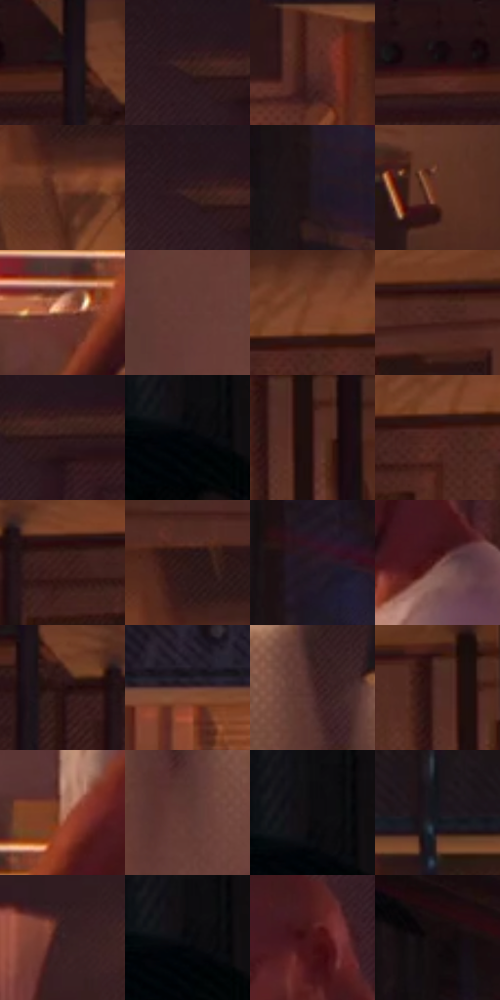

# 电影参考 045

- 状态：常规／活跃；来源世界：miles-home。
- 视角：near-level；景别：medium；场景：interior。
- 时段：interior-time-unknown（外观依据，中置信度；具体时间／晨昏未知）；光照：interior-mixed。
- 材质候选：skin, fabric, wood, brick, metal, plastic（帧级，不是像素分割）。
- 明暗组：very-dark；L* P5/P50/P95：3.1544 / 16.04358 / 41.69443。
- 资格门禁：无附加门禁。
- 原截图 SHA-256：`4ff7b9b7118f238dd545fc22af63d7d425b7c195a44a093905f201c911890e89`；尺寸：2880 × 1202。
- sRGB 像素 SHA-256：`91d0b42c1b27d23364249f6585dbea0db343cac5d94bc1403214a33b93faff03`。

## 观察与迁移

暖灯住宅、暗墙和皮革式宽亮面；阴影保持体积。

厨房暖光与锅具

柜门框线和悬挂锅具的位置是空间锚点；金属锅边有窄高光，木柜使用较宽暖色转面，墙面细网目更平。人物侧身的头颈与肩臂比例依姿态而定，脸部阴影保留可读的眼鼻口。光线从上方锥形落下而非全屋同亮；色散只在金属与受光边轻微出现。

本公开版保存32个128×128原像素色卡上下文；图集格子并非原场景相邻位置。原rect、图集tile和像素SHA见 `data/palette-crops.json`。上下文不足时不得批准替色，不能以小样推断完整构图。

## 实测色卡

颜色比例分母为保留采样像素，不是材料面积；全部 32 色参与全库匹配。表内四舍五入仅用于阅读，原精度在 JSON。

| ID | HEX | Lab | 原图 xy | 像素数 | 比例 | 明度角色 |
| --- | --- | --- | --- | ---: | ---: | --- |
| 045-S01 | #1D1215 | [6.756679, 6.033702, 0.086116] | [1660, 60] | 8080 | 4.194178% | deep-shadow |
| 045-S02 | #3F221F | [16.988819, 13.494034, 8.004812] | [1164, 92] | 7683 | 3.988103% | deep-shadow |
| 045-S03 | #582D25 | [23.952376, 18.778717, 13.924184] | [1668, 680] | 7211 | 3.743096% | shadow |
| 045-S04 | #130E11 | [4.453277, 2.382865, -0.869276] | [1548, 56] | 7059 | 3.664196% | deep-shadow |
| 045-S05 | #723D29 | [31.979143, 21.166328, 22.392969] | [2668, 268] | 6951 | 3.608135% | shadow |
| 045-S06 | #341C1D | [13.528189, 11.976586, 4.36713] | [1156, 88] | 6939 | 3.601906% | deep-shadow |
| 045-S07 | #20171F | [9.147276, 6.370735, -3.852242] | [364, 532] | 6869 | 3.565570% | deep-shadow |
| 045-S08 | #623124 | [26.509537, 20.757293, 18.177693] | [2444, 988] | 6861 | 3.561418% | shadow |
| 045-S09 | #90553F | [42.439983, 22.142377, 23.218574] | [988, 1092] | 6725 | 3.490823% | midtone |
| 045-S10 | #673C37 | [30.38013, 18.284977, 11.17226] | [860, 488] | 6723 | 3.489784% | shadow |
| 045-S11 | #81462D | [36.438809, 22.822355, 25.936482] | [2076, 72] | 6541 | 3.395312% | shadow |
| 045-S12 | #48241E | [18.943577, 16.325973, 11.576094] | [2328, 120] | 6484 | 3.365724% | deep-shadow |
| 045-S13 | #2A1415 | [9.375449, 11.423825, 4.139342] | [1228, 108] | 6403 | 3.323678% | deep-shadow |
| 045-S14 | #02060A | [1.490953, -0.489926, -1.88205] | [64, 136] | 6395 | 3.319526% | deep-shadow |
| 045-S15 | #351615 | [11.857732, 15.397444, 7.899678] | [2520, 160] | 6348 | 3.295129% | deep-shadow |
| 045-S16 | #522723 | [21.456376, 19.550258, 11.792073] | [2044, 120] | 6257 | 3.247893% | shadow |
| 045-S17 | #3C1C19 | [14.743498, 15.271699, 9.131336] | [1812, 132] | 6103 | 3.167954% | deep-shadow |
| 045-S18 | #2E1816 | [11.220612, 10.766211, 6.128382] | [2660, 176] | 6095 | 3.163801% | deep-shadow |
| 045-S19 | #291C26 | [12.233929, 8.533918, -4.292664] | [392, 320] | 5959 | 3.093206% | deep-shadow |
| 045-S20 | #6F4341 | [33.512403, 18.765261, 9.261706] | [1216, 596] | 5835 | 3.028840% | shadow |
| 045-S21 | #271110 | [7.856369, 11.312369, 4.986294] | [1708, 116] | 5806 | 3.013787% | deep-shadow |
| 045-S22 | #583535 | [26.385466, 15.728525, 6.614867] | [2532, 616] | 5705 | 2.961360% | shadow |
| 045-S23 | #482928 | [20.506898, 14.337331, 6.82077] | [916, 164] | 5586 | 2.899589% | shadow |
| 045-S24 | #502C29 | [22.53968, 16.21638, 9.134487] | [2480, 128] | 5545 | 2.878307% | shadow |
| 045-S25 | #B4775F | [55.811725, 21.110784, 22.975846] | [1076, 996] | 5204 | 2.701300% | midtone |
| 045-S26 | #613934 | [28.684746, 17.106366, 10.657374] | [952, 304] | 5130 | 2.662888% | shadow |
| 045-S27 | #131015 | [5.087109, 2.207679, -2.4849] | [44, 92] | 4806 | 2.494705% | deep-shadow |
| 045-S28 | #17171D | [7.981918, 1.678158, -4.200777] | [1792, 596] | 4771 | 2.476538% | deep-shadow |
| 045-S29 | #352125 | [15.372967, 10.351063, 1.250698] | [1492, 888] | 4620 | 2.398156% | deep-shadow |
| 045-S30 | #090A0D | [2.747928, 0.191586, -1.325406] | [60, 120] | 4376 | 2.271500% | deep-shadow |
| 045-S31 | #491419 | [15.420883, 25.569878, 10.472673] | [1140, 424] | 4169 | 2.164050% | deep-shadow |
| 045-S32 | #160C0E | [4.202582, 4.072121, 0.42853] | [340, 76] | 3409 | 1.769549% | deep-shadow |

## 色阶与空间分布

- 采样 ROI：`[0.01, 0.02, 0.98, 0.94]`；步长：4；样本数：192648。
- 排除区：`[]`。
- 深暗、暗、中、亮、高光五段计数：`[114274, 67290, 9812, 1254, 18]`。
- RGB 各 256 箱、L* 100 箱、13×5 色相明度表和 3×3 空间统计全部保存在 [总数据](../film-library.json)。
- [可视化档案](../../references/library.html)按需绘制直方图，不存 2,094 张重复图表图片。

## 纹理特征占比

**这是分块图像特征的面积占比，不是波点／排线／丝网／错版的精确语义覆盖率。** 窗格、发丝、织物也会产生方向或周期特征。
原图 ROI 像素 3087370；已测块覆盖 3087370（100.0000%）；未测 0。

| 特征 | 块覆盖像素 | 占已测面积 | 阈值敏感范围 |
| --- | ---: | ---: | --- |
| low-contrast | 227712 | 7.3756% | 4.9171% ~ 12.8233% |
| directional-structure | 654080 | 21.1857% | 13.9386% ~ 34.5521% |
| periodic-structure | 2047754 | 66.3268% | 58.0723% ~ 68.1261% |
| mixed-detail | 157824 | 5.1119% | 2.4585% ~ 5.1119% |

阈值敏感范围不是统计置信区间。逐块坐标、尺度、对比、方向一致性、频谱集中度、频率与角度见 [全量特征记录](../texture-features.jsonl)，以帧号定位。
四种印刷层的真实像素覆盖仍标为 `null`，不能填 0，也不能拿上表代替。不得据这些代理测量删除唯一证据。

[测量方法与保留策略](../../references/library-retention.md) · [分类索引](../archive/README.md)
