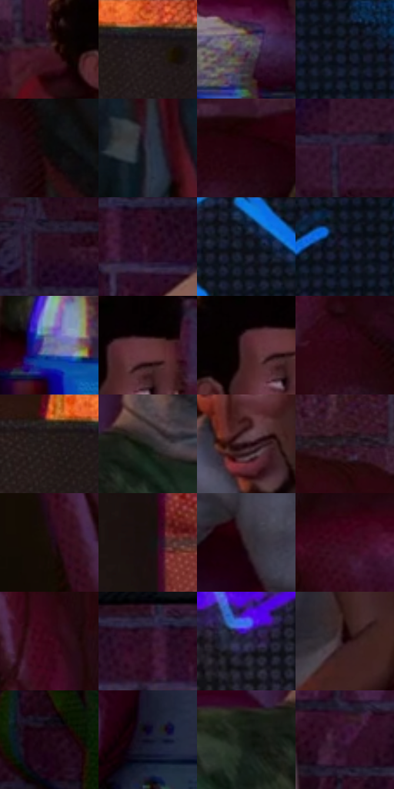

# 电影参考 046

- 状态：常规／活跃；来源世界：miles-home。
- 视角：near-level；景别：medium；场景：interior。
- 时段：interior-time-unknown（外观依据，中置信度；具体时间／晨昏未知）；光照：interior-mixed。
- 材质候选：skin, fabric, wood, brick, metal, plastic（帧级，不是像素分割）。
- 明暗组：very-dark；L* P5/P50/P95：2.61623 / 9.60423 / 32.59325。
- 资格门禁：无附加门禁。
- 原截图 SHA-256：`4771c0e90389c3b092685d0074ccdbb916e23fba9133f06e1c2bc75e0ca09323`；尺寸：2880 × 1206。
- sRGB 像素 SHA-256：`6c5da450e9393586df33a062629edb87cb4e009536a5dd118362570de35f4498`。

## 观察与迁移

暖灯住宅、暗墙和皮革式宽亮面；阴影保持体积。

沙发对话与密集屏幕网点

少年与成年人在同一沙发上有不同头身尺度和坐姿，手搭肩的接触点要准。沙发靠大曲面亮暗和局部高光成立；屏幕可有密集显像点，墙砖低对比细网，衣料随形排线。屏幕能承受比面部更强的色散，人物眼口和亲密手势不能被错版分裂。

本公开版保存32个128×128原像素色卡上下文；图集格子并非原场景相邻位置。原rect、图集tile和像素SHA见 `data/palette-crops.json`。上下文不足时不得批准替色，不能以小样推断完整构图。

## 实测色卡

颜色比例分母为保留采样像素，不是材料面积；全部 32 色参与全库匹配。表内四舍五入仅用于阅读，原精度在 JSON。

| ID | HEX | Lab | 原图 xy | 像素数 | 比例 | 明度角色 |
| --- | --- | --- | --- | ---: | ---: | --- |
| 046-S01 | #3D1A23 | [14.6932, 18.304534, 1.872284] | [1012, 388] | 9808 | 5.072771% | deep-shadow |
| 046-S02 | #1E1718 | [8.608991, 3.73103, 0.613299] | [160, 52] | 9510 | 4.918643% | deep-shadow |
| 046-S03 | #504457 | [30.707009, 9.206384, -9.40564] | [1896, 1076] | 9133 | 4.723656% | shadow |
| 046-S04 | #0C0F17 | [4.350729, 0.788365, -5.060192] | [1920, 48] | 8831 | 4.567459% | deep-shadow |
| 046-S05 | #080908 | [2.389466, -0.4007, 0.286582] | [876, 844] | 7995 | 4.135074% | deep-shadow |
| 046-S06 | #2E3141 | [20.669854, 3.034507, -10.44644] | [1112, 652] | 7867 | 4.068871% | shadow |
| 046-S07 | #24020E | [4.067523, 16.409743, 0.452971] | [820, 544] | 7729 | 3.997497% | deep-shadow |
| 046-S08 | #3D1A36 | [15.473626, 21.641105, -10.62441] | [2392, 220] | 7479 | 3.868195% | deep-shadow |
| 046-S09 | #270B1D | [6.860323, 17.179403, -5.662489] | [2404, 64] | 7233 | 3.740962% | deep-shadow |
| 046-S10 | #321028 | [10.572359, 20.772876, -8.156776] | [1656, 352] | 6863 | 3.549595% | deep-shadow |
| 046-S11 | #111620 | [7.201377, 0.857778, -7.717092] | [1424, 48] | 6825 | 3.529941% | deep-shadow |
| 046-S12 | #151B2C | [9.992731, 2.935937, -12.319653] | [1864, 36] | 6394 | 3.307025% | deep-shadow |
| 046-S13 | #63659D | [44.792263, 13.366284, -30.646373] | [2108, 1004] | 6380 | 3.299784% | midtone |
| 046-S14 | #623439 | [27.705869, 21.233563, 6.036499] | [1164, 336] | 6320 | 3.268751% | shadow |
| 046-S15 | #4F252D | [20.732557, 20.654035, 3.84422] | [1120, 348] | 6223 | 3.218582% | shadow |
| 046-S16 | #2C0511 | [6.1843, 20.61774, 2.088757] | [772, 752] | 6198 | 3.205652% | deep-shadow |
| 046-S17 | #261917 | [10.328669, 6.13878, 3.969321] | [32, 32] | 6136 | 3.173585% | deep-shadow |
| 046-S18 | #222420 | [13.862596, -1.890316, 2.360537] | [1860, 796] | 5717 | 2.956875% | deep-shadow |
| 046-S19 | #23080F | [5.108796, 13.454578, 1.436897] | [1848, 392] | 5668 | 2.931532% | deep-shadow |
| 046-S20 | #291928 | [11.414177, 11.169896, -7.000656] | [524, 468] | 5545 | 2.867916% | deep-shadow |
| 046-S21 | #180B08 | [4.07484, 4.565289, 2.902141] | [380, 964] | 5459 | 2.823436% | deep-shadow |
| 046-S22 | #171110 | [5.604826, 2.358005, 1.428443] | [360, 204] | 5440 | 2.813609% | deep-shadow |
| 046-S23 | #34272D | [17.323211, 7.314478, -1.591495] | [1780, 540] | 5424 | 2.805333% | deep-shadow |
| 046-S24 | #3A071D | [10.110674, 26.470273, -0.393612] | [684, 1032] | 5322 | 2.752578% | deep-shadow |
| 046-S25 | #370314 | [8.377545, 26.563208, 3.724475] | [540, 696] | 5247 | 2.713788% | deep-shadow |
| 046-S26 | #2D0D23 | [8.715189, 19.701873, -7.333587] | [1596, 320] | 4969 | 2.570004% | deep-shadow |
| 046-S27 | #212138 | [13.80635, 6.855501, -14.920547] | [1044, 144] | 4825 | 2.495526% | deep-shadow |
| 046-S28 | #160105 | [1.8363, 7.206925, 0.829717] | [2120, 700] | 3722 | 1.925046% | deep-shadow |
| 046-S29 | #1A0413 | [3.193233, 10.280417, -3.837988] | [2676, 52] | 2750 | 1.422321% | deep-shadow |
| 046-S30 | #100F21 | [5.072732, 5.126905, -11.741058] | [2720, 716] | 2685 | 1.388702% | deep-shadow |
| 046-S31 | #141913 | [8.048199, -3.818766, 3.174503] | [1764, 824] | 2171 | 1.122857% | deep-shadow |
| 046-S32 | #381335 | [13.00732, 23.790526, -13.802282] | [2260, 424] | 1478 | 0.764433% | deep-shadow |

## 色阶与空间分布

- 采样 ROI：`[0.01, 0.02, 0.98, 0.94]`；步长：4；样本数：193346。
- 排除区：`[]`。
- 深暗、暗、中、亮、高光五段计数：`[163746, 25065, 4406, 129, 0]`。
- RGB 各 256 箱、L* 100 箱、13×5 色相明度表和 3×3 空间统计全部保存在 [总数据](../film-library.json)。
- [可视化档案](../../references/library.html)按需绘制直方图，不存 2,094 张重复图表图片。

## 纹理特征占比

**这是分块图像特征的面积占比，不是波点／排线／丝网／错版的精确语义覆盖率。** 窗格、发丝、织物也会产生方向或周期特征。
原图 ROI 像素 3098546；已测块覆盖 3098546（100.0000%）；未测 0。

| 特征 | 块覆盖像素 | 占已测面积 | 阈值敏感范围 |
| --- | ---: | ---: | --- |
| low-contrast | 114688 | 3.7013% | 1.0575% ~ 5.6388% |
| directional-structure | 218240 | 7.0433% | 0.4379% ~ 18.6720% |
| periodic-structure | 2705586 | 87.3179% | 79.2130% ~ 87.3179% |
| mixed-detail | 60032 | 1.9374% | 1.0575% ~ 7.4853% |

阈值敏感范围不是统计置信区间。逐块坐标、尺度、对比、方向一致性、频谱集中度、频率与角度见 [全量特征记录](../texture-features.jsonl)，以帧号定位。
四种印刷层的真实像素覆盖仍标为 `null`，不能填 0，也不能拿上表代替。不得据这些代理测量删除唯一证据。

[测量方法与保留策略](../../references/library-retention.md) · [分类索引](../archive/README.md)
