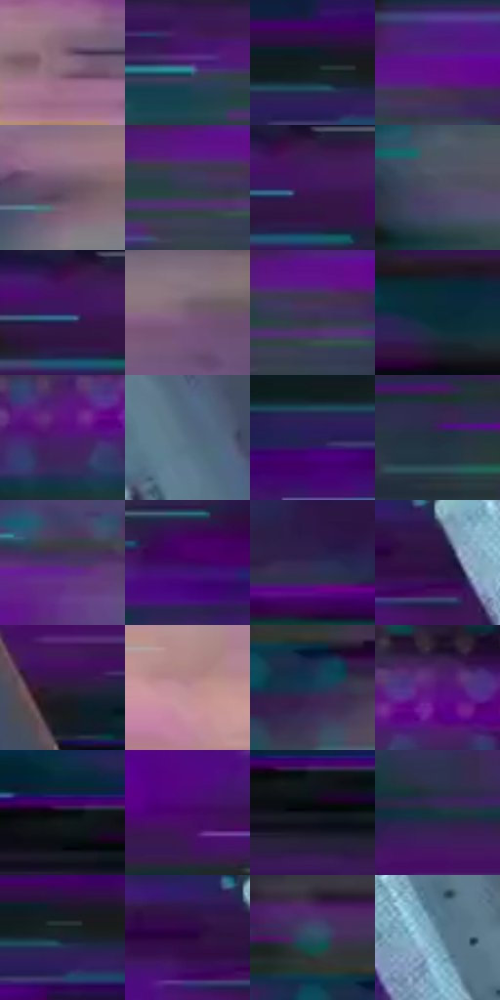

# 电影参考 047

- 状态：条件／活跃；来源世界：miles-home。
- 视角：graphic-nonphysical；景别：detail；场景：graphic。
- 时段：graphic-no-physical-time（外观依据，中置信度；具体时间／晨昏未知）；光照：graphic-field。
- 材质候选：plastic（帧级，不是像素分割）。
- 明暗组：dark；L* P5/P50/P95：6.93677 / 20.66525 / 54.6909。
- 资格门禁：motion。
- 原截图 SHA-256：`8900fd97efb941c44eba76dc848b05308cd75bfebe44e59bd1082f200b79ee1b`；尺寸：2880 × 1196。
- sRGB 像素 SHA-256：`5e4b77bb154f228413f3449d0ebfa86f1c0d16dd01d9700b7074243bcf70864c`。

## 观察与迁移

横向速度色条与主体容器，不能替换静物背景。

紫青数字故障中的胶囊

横向故障条带与矩阵点是“数字转换”这一镜头的事件，不是普通街景的通用纹理。胶囊本体仍由硬边、圆柱透视和两段材料颜色稳定成立，背景却允许高频扫描线、错帧和大幅青紫色散。迁移到日常照片时不要擅自添加数字故障；只有用户照片/需求真的包含屏幕或故障事件才借用这一强度。

本公开版保存32个128×128原像素色卡上下文；图集格子并非原场景相邻位置。原rect、图集tile和像素SHA见 `data/palette-crops.json`。上下文不足时不得批准替色，不能以小样推断完整构图。

## 实测色卡

颜色比例分母为保留采样像素，不是材料面积；全部 32 色参与全库匹配。表内四舍五入仅用于阅读，原精度在 JSON。

| ID | HEX | Lab | 原图 xy | 像素数 | 比例 | 明度角色 |
| --- | --- | --- | --- | ---: | ---: | --- |
| 047-S01 | #8E7083 | [50.66191, 15.154124, -5.914194] | [2652, 852] | 10033 | 5.207944% | midtone |
| 047-S02 | #3B1F64 | [19.348706, 29.755426, -35.885845] | [320, 364] | 8651 | 4.490573% | deep-shadow |
| 047-S03 | #141D22 | [10.129249, -2.466259, -4.739885] | [820, 84] | 7698 | 3.995889% | deep-shadow |
| 047-S04 | #620F8C | [26.250098, 53.457702, -49.969772] | [516, 348] | 7679 | 3.986026% | shadow |
| 047-S05 | #645065 | [36.717872, 12.472356, -9.004386] | [2368, 760] | 7070 | 3.669906% | shadow |
| 047-S06 | #333C4E | [25.215296, 1.275726, -12.150837] | [448, 400] | 7067 | 3.668348% | shadow |
| 047-S07 | #381B4E | [16.37847, 25.145067, -25.963655] | [1284, 28] | 6905 | 3.584257% | deep-shadow |
| 047-S08 | #4C5064 | [34.383113, 3.302831, -12.130649] | [2080, 912] | 6856 | 3.558822% | shadow |
| 047-S09 | #3F0D4E | [14.925023, 34.129171, -28.238211] | [1248, 28] | 6834 | 3.547403% | deep-shadow |
| 047-S10 | #775D77 | [42.887815, 15.478261, -10.604008] | [2568, 472] | 6823 | 3.541693% | midtone |
| 047-S11 | #3E335D | [24.264127, 15.595615, -23.413052] | [488, 396] | 6813 | 3.536502% | shadow |
| 047-S12 | #0A2B37 | [15.839749, -7.039113, -11.166593] | [1320, 916] | 6748 | 3.502762% | deep-shadow |
| 047-S13 | #481D6F | [21.594458, 36.821674, -39.333016] | [1872, 176] | 6744 | 3.500685% | shadow |
| 047-S14 | #576D82 | [45.045944, -2.724419, -14.236017] | [1728, 608] | 6530 | 3.389602% | midtone |
| 047-S15 | #271F53 | [15.673294, 19.490342, -30.605854] | [760, 140] | 6509 | 3.378701% | deep-shadow |
| 047-S16 | #252E42 | [18.973161, 2.245973, -13.804289] | [696, 468] | 6008 | 3.118641% | deep-shadow |
| 047-S17 | #4C326C | [26.448911, 24.87313, -29.574052] | [2372, 300] | 5941 | 3.083863% | shadow |
| 047-S18 | #3A0761 | [15.031931, 39.838075, -40.942011] | [940, 584] | 5742 | 2.980566% | deep-shadow |
| 047-S19 | #302B53 | [19.965675, 13.566064, -23.683261] | [752, 892] | 5673 | 2.944749% | deep-shadow |
| 047-S20 | #2C1342 | [11.921317, 23.314219, -24.898895] | [1344, 256] | 5632 | 2.923467% | deep-shadow |
| 047-S21 | #2A1E38 | [13.86367, 12.304133, -14.75947] | [1856, 544] | 5578 | 2.895436% | deep-shadow |
| 047-S22 | #B88B94 | [62.334328, 18.484002, 1.88819] | [2732, 1008] | 5479 | 2.844047% | light |
| 047-S23 | #1A3752 | [22.162982, -1.141418, -19.65534] | [2396, 148] | 5393 | 2.799406% | shadow |
| 047-S24 | #531279 | [22.486195, 46.00183, -44.233228] | [1952, 132] | 5218 | 2.708567% | shadow |
| 047-S25 | #060A0D | [2.573002, -0.592912, -1.601822] | [252, 220] | 4557 | 2.365454% | deep-shadow |
| 047-S26 | #480567 | [17.762153, 43.972038, -40.351388] | [1196, 356] | 4541 | 2.357149% | deep-shadow |
| 047-S27 | #0F121B | [5.539693, 1.153702, -6.394702] | [280, 260] | 4354 | 2.260081% | deep-shadow |
| 047-S28 | #16353C | [20.214489, -9.018629, -7.885658] | [1860, 428] | 4082 | 2.118890% | shadow |
| 047-S29 | #192131 | [12.709734, 1.637475, -11.692358] | [844, 104] | 3991 | 2.071654% | deep-shadow |
| 047-S30 | #28053D | [8.098364, 28.692846, -27.56524] | [1284, 248] | 3919 | 2.034280% | deep-shadow |
| 047-S31 | #2B4E62 | [31.448407, -6.273817, -15.552655] | [2332, 64] | 3909 | 2.029089% | shadow |
| 047-S32 | #79A1B6 | [64.10465, -8.400143, -15.22383] | [1488, 328] | 3671 | 1.905548% | light |

## 色阶与空间分布

- 采样 ROI：`[0.01, 0.02, 0.98, 0.94]`；步长：4；样本数：192648。
- 排除区：`[]`。
- 深暗、暗、中、亮、高光五段计数：`[90834, 69616, 26197, 5907, 94]`。
- RGB 各 256 箱、L* 100 箱、13×5 色相明度表和 3×3 空间统计全部保存在 [总数据](../film-library.json)。
- [可视化档案](../../references/library.html)按需绘制直方图，不存 2,094 张重复图表图片。

## 纹理特征占比

**这是分块图像特征的面积占比，不是波点／排线／丝网／错版的精确语义覆盖率。** 窗格、发丝、织物也会产生方向或周期特征。
原图 ROI 像素 3076194；已测块覆盖 3076194（100.0000%）；未测 0。

| 特征 | 块覆盖像素 | 占已测面积 | 阈值敏感范围 |
| --- | ---: | ---: | --- |
| low-contrast | 0 | 0.0000% | 0.0000% ~ 1.0652% |
| directional-structure | 2543970 | 82.6986% | 70.7483% ~ 89.9720% |
| periodic-structure | 532224 | 17.3014% | 10.0280% ~ 27.6539% |
| mixed-detail | 0 | 0.0000% | 0.0000% ~ 0.5326% |

阈值敏感范围不是统计置信区间。逐块坐标、尺度、对比、方向一致性、频谱集中度、频率与角度见 [全量特征记录](../texture-features.jsonl)，以帧号定位。
四种印刷层的真实像素覆盖仍标为 `null`，不能填 0，也不能拿上表代替。不得据这些代理测量删除唯一证据。

[测量方法与保留策略](../../references/library-retention.md) · [分类索引](../archive/README.md)
