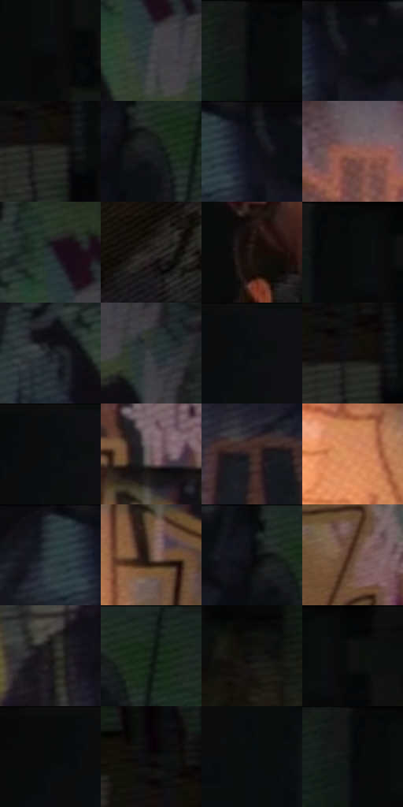

# 电影参考 048

- 状态：常规／活跃；来源世界：miles-home。
- 视角：near-level；景别：full-body；场景：interior。
- 时段：interior-time-unknown（外观依据，中置信度；具体时间／晨昏未知）；光照：interior-mixed。
- 材质候选：skin, fabric, brick, stone, paint, metal（帧级，不是像素分割）。
- 明暗组：very-dark；L* P5/P50/P95：2.37073 / 7.96952 / 44.00386。
- 资格门禁：无附加门禁。
- 原截图 SHA-256：`0cfd8b0e4d15405ae56fe020dc98eea73bbff9881ccf2dd568354daee67b129f`；尺寸：2880 × 1208。
- sRGB 像素 SHA-256：`0fc3ac8b5ca3ab33c18a6d5d7997b740649f52741a244d3f084d458f12a51c83`。

## 观察与迁移

涂鸦墙、粗糙地面和局部灯光；墙绘颜料层与基底砖石分别分析。

涂鸦墙与录音机

涂鸦区是高线密度的大墙面，右侧门洞用近黑安静色面托住人物。衣料褶线、裤腿体积、录音机矩形结构分别独立画，不能把墙的粗线叠到脸上。蓝绿反射与暖侧光在人物边缘交错，彩边局部可见；墙上的原有涂鸦不是要移植到干净背景。

本公开版保存32个128×128原像素色卡上下文；图集格子并非原场景相邻位置。原rect、图集tile和像素SHA见 `data/palette-crops.json`。上下文不足时不得批准替色，不能以小样推断完整构图。

## 实测色卡

颜色比例分母为保留采样像素，不是材料面积；全部 32 色参与全库匹配。表内四舍五入仅用于阅读，原精度在 JSON。

| ID | HEX | Lab | 原图 xy | 像素数 | 比例 | 明度角色 |
| --- | --- | --- | --- | ---: | ---: | --- |
| 048-S01 | #080C10 | [3.179269, -0.386223, -2.254908] | [1132, 112] | 10805 | 5.588427% | deep-shadow |
| 048-S02 | #3C4046 | [26.932065, -0.210765, -4.217559] | [892, 360] | 8731 | 4.515739% | shadow |
| 048-S03 | #07090A | [2.370731, -0.384111, -0.562404] | [1064, 28] | 8652 | 4.474879% | deep-shadow |
| 048-S04 | #0B0D0F | [3.554251, -0.239913, -1.143285] | [616, 28] | 8453 | 4.371955% | deep-shadow |
| 048-S05 | #2B2B26 | [17.373063, -1.141062, 3.261778] | [1628, 224] | 7939 | 4.106110% | deep-shadow |
| 048-S06 | #15191D | [8.510539, -0.714233, -3.426789] | [768, 92] | 7906 | 4.089042% | deep-shadow |
| 048-S07 | #101116 | [5.139493, 0.742075, -3.142466] | [580, 28] | 7861 | 4.065768% | deep-shadow |
| 048-S08 | #915B4E | [44.309312, 20.616456, 16.751595] | [104, 560] | 7188 | 3.717687% | midtone |
| 048-S09 | #24292D | [16.257332, -1.139958, -3.360209] | [864, 276] | 7001 | 3.620970% | deep-shadow |
| 048-S10 | #26201F | [12.88546, 2.645459, 1.73411] | [1344, 1028] | 6951 | 3.595109% | deep-shadow |
| 048-S11 | #1C1510 | [7.412902, 2.48161, 4.138792] | [1812, 376] | 6842 | 3.538734% | deep-shadow |
| 048-S12 | #070C0C | [3.022849, -1.337158, -0.47067] | [1108, 28] | 6642 | 3.435292% | deep-shadow |
| 048-S13 | #1B1D23 | [10.799101, 0.739172, -4.408399] | [760, 352] | 6005 | 3.105831% | deep-shadow |
| 048-S14 | #313638 | [22.219804, -1.635215, -1.983504] | [976, 408] | 5955 | 3.079971% | shadow |
| 048-S15 | #0D1011 | [4.485829, -0.802747, -0.879062] | [2044, 28] | 5929 | 3.066523% | deep-shadow |
| 048-S16 | #130F0D | [4.599273, 1.150014, 1.465091] | [1616, 204] | 5810 | 3.004976% | deep-shadow |
| 048-S17 | #0B0E10 | [3.817528, -0.538548, -1.301743] | [2020, 28] | 5787 | 2.993080% | deep-shadow |
| 048-S18 | #6A5859 | [39.182177, 7.542217, 2.178859] | [528, 876] | 5772 | 2.985322% | shadow |
| 048-S19 | #3C2A25 | [19.014902, 7.533547, 6.554819] | [516, 676] | 5562 | 2.876708% | deep-shadow |
| 048-S20 | #DD8E60 | [66.187261, 25.38646, 36.743826] | [360, 972] | 5464 | 2.826022% | light |
| 048-S21 | #27363A | [21.487245, -4.998042, -4.512276] | [508, 56] | 5353 | 2.768612% | shadow |
| 048-S22 | #624E41 | [34.857803, 6.255908, 10.878031] | [512, 992] | 5175 | 2.676549% | shadow |
| 048-S23 | #080C0E | [3.127764, -0.748151, -1.269879] | [732, 28] | 5104 | 2.639827% | deep-shadow |
| 048-S24 | #604334 | [31.229791, 10.41523, 14.07938] | [876, 1032] | 4810 | 2.487768% | shadow |
| 048-S25 | #1D1A1A | [9.598013, 1.461867, 0.529435] | [220, 128] | 4802 | 2.483630% | deep-shadow |
| 048-S26 | #1D2824 | [14.986641, -5.853093, 1.071439] | [824, 28] | 4483 | 2.318641% | deep-shadow |
| 048-S27 | #141313 | [5.975167, 0.416023, 0.147424] | [1296, 88] | 4421 | 2.286574% | deep-shadow |
| 048-S28 | #050607 | [1.606519, -0.12256, -0.470364] | [1168, 28] | 4416 | 2.283988% | deep-shadow |
| 048-S29 | #090A09 | [2.663639, -0.400717, 0.286615] | [1944, 28] | 4038 | 2.088484% | deep-shadow |
| 048-S30 | #0D0A0A | [2.931812, 0.85227, 0.300686] | [1584, 144] | 3571 | 1.846948% | deep-shadow |
| 048-S31 | #090E10 | [3.699424, -1.068214, -1.488369] | [2768, 260] | 3021 | 1.562484% | deep-shadow |
| 048-S32 | #080B0C | [2.867997, -0.640199, -0.689794] | [1060, 28] | 2897 | 1.498350% | deep-shadow |

## 色阶与空间分布

- 采样 ROI：`[0.01, 0.02, 0.98, 0.94]`；步长：4；样本数：193346。
- 排除区：`[]`。
- 深暗、暗、中、亮、高光五段计数：`[145244, 34753, 9242, 4104, 3]`。
- RGB 各 256 箱、L* 100 箱、13×5 色相明度表和 3×3 空间统计全部保存在 [总数据](../film-library.json)。
- [可视化档案](../../references/library.html)按需绘制直方图，不存 2,094 张重复图表图片。

## 纹理特征占比

**这是分块图像特征的面积占比，不是波点／排线／丝网／错版的精确语义覆盖率。** 窗格、发丝、织物也会产生方向或周期特征。
原图 ROI 像素 3104134；已测块覆盖 3104134（100.0000%）；未测 0。

| 特征 | 块覆盖像素 | 占已测面积 | 阈值敏感范围 |
| --- | ---: | ---: | --- |
| low-contrast | 757766 | 24.4115% | 22.5600% ~ 25.3764% |
| directional-structure | 311296 | 10.0284% | 1.0556% ~ 20.6053% |
| periodic-structure | 2035072 | 65.5601% | 56.8347% ~ 71.6258% |
| mixed-detail | 0 | 0.0000% | 0.0000% ~ 1.9422% |

阈值敏感范围不是统计置信区间。逐块坐标、尺度、对比、方向一致性、频谱集中度、频率与角度见 [全量特征记录](../texture-features.jsonl)，以帧号定位。
四种印刷层的真实像素覆盖仍标为 `null`，不能填 0，也不能拿上表代替。不得据这些代理测量删除唯一证据。

[测量方法与保留策略](../../references/library-retention.md) · [分类索引](../archive/README.md)
