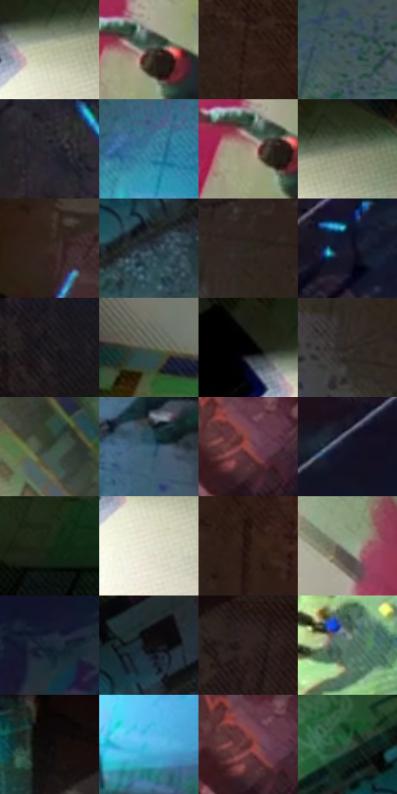

# 电影参考 049

- 状态：常规／活跃；来源世界：miles-home。
- 视角：overhead；景别：environment-wide；场景：interior。
- 时段：interior-time-unknown（外观依据，中置信度；具体时间／晨昏未知）；光照：interior-mixed。
- 材质候选：skin, fabric, brick, stone, paint, metal（帧级，不是像素分割）。
- 明暗组：dark；L* P5/P50/P95：3.30621 / 23.9435 / 76.87127。
- 资格门禁：无附加门禁。
- 原截图 SHA-256：`f8b4450cb0419ee1fd39832c48bf3f56085a297e7415233a241811d8ff2dc26a`；尺寸：2880 × 1198。
- sRGB 像素 SHA-256：`8139110362181360d01dc8bc9907a705f0545b1a25935baee59d3857c33eec86`。

## 观察与迁移

涂鸦墙、粗糙地面和局部灯光；墙绘颜料层与基底砖石分别分析。

俯视涂鸦地面与青色局部光

俯视角使人物的头、肩、手、腿和地面接触点发生透视缩短，不能按站立正面比例重画。地面裂纹、擦痕、涂鸦和印刷细网分层分布；浅墙留白与品红竖色面让画面不变成均匀脏纹。青光形成局部光池，强彩边贴发光边与暗剪影，不能把整片地面或人物身体做全图 RGB 偏移。大波点可在地面暗区分组出现，但必须低于人物、涂鸦主线和光池的可读性。

本公开版保存32个128×128原像素色卡上下文；图集格子并非原场景相邻位置。原rect、图集tile和像素SHA见 `data/palette-crops.json`。上下文不足时不得批准替色，不能以小样推断完整构图。

## 实测色卡

颜色比例分母为保留采样像素，不是材料面积；全部 32 色参与全库匹配。表内四舍五入仅用于阅读，原精度在 JSON。

| ID | HEX | Lab | 原图 xy | 像素数 | 比例 | 明度角色 |
| --- | --- | --- | --- | ---: | ---: | --- |
| 049-S01 | #B8BA9D | [74.662462, -5.731047, 14.500525] | [432, 140] | 9851 | 5.113471% | light |
| 049-S02 | #43413A | [27.516469, -0.616512, 4.577636] | [768, 592] | 9690 | 5.029899% | shadow |
| 049-S03 | #321F19 | [13.99211, 8.321745, 7.84584] | [1964, 300] | 8431 | 4.376376% | deep-shadow |
| 049-S04 | #42595F | [36.231227, -7.077057, -6.286237] | [1280, 432] | 7613 | 3.951767% | shadow |
| 049-S05 | #2A2933 | [17.07044, 3.016744, -6.298396] | [2432, 676] | 7393 | 3.837569% | deep-shadow |
| 049-S06 | #3C7FA1 | [50.347336, -10.577613, -24.520303] | [1292, 668] | 6859 | 3.560380% | midtone |
| 049-S07 | #A1907A | [60.719392, 2.732332, 14.021864] | [744, 604] | 6859 | 3.560380% | light |
| 049-S08 | #79806C | [52.49342, -6.456648, 9.993493] | [520, 112] | 6778 | 3.518334% | midtone |
| 049-S09 | #3B2C27 | [19.547707, 6.020922, 5.901528] | [1888, 804] | 6663 | 3.458640% | deep-shadow |
| 049-S10 | #2F3E4A | [25.393383, -2.631263, -9.268393] | [1152, 280] | 6617 | 3.434762% | shadow |
| 049-S11 | #2B251E | [15.118326, 1.380971, 5.698035] | [1740, 244] | 6507 | 3.377663% | deep-shadow |
| 049-S12 | #1A1A2C | [10.108716, 5.479343, -12.104375] | [2564, 316] | 6359 | 3.300839% | deep-shadow |
| 049-S13 | #1A181A | [8.545914, 1.487064, -1.050969] | [2584, 988] | 6355 | 3.298763% | deep-shadow |
| 049-S14 | #4F5848 | [36.194376, -6.921163, 8.107768] | [336, 912] | 6336 | 3.288900% | shadow |
| 049-S15 | #010102 | [0.29396, 0.139026, -0.378391] | [344, 100] | 6166 | 3.200656% | deep-shadow |
| 049-S16 | #2D2623 | [15.827401, 2.637657, 3.192748] | [1700, 332] | 6076 | 3.153939% | deep-shadow |
| 049-S17 | #303C2E | [23.859966, -8.238274, 7.056497] | [724, 156] | 5987 | 3.107741% | shadow |
| 049-S18 | #365D71 | [37.489314, -7.709362, -15.613403] | [1596, 700] | 5882 | 3.053237% | shadow |
| 049-S19 | #8D4C4B | [40.148945, 27.213961, 12.824897] | [2440, 184] | 5510 | 2.860139% | midtone |
| 049-S20 | #131424 | [6.920095, 4.460318, -11.169258] | [2760, 100] | 5439 | 2.823284% | deep-shadow |
| 049-S21 | #192716 | [13.917833, -10.271677, 9.38018] | [108, 1116] | 5364 | 2.784353% | deep-shadow |
| 049-S22 | #E2E1CF | [89.169851, -2.755764, 8.931157] | [432, 216] | 5352 | 2.778124% | highlight |
| 049-S23 | #271713 | [9.729458, 7.453677, 5.9022] | [2040, 416] | 5040 | 2.616170% | deep-shadow |
| 049-S24 | #90A48C | [65.257835, -11.682783, 10.125981] | [668, 344] | 5023 | 2.607346% | light |
| 049-S25 | #1A2735 | [15.102476, -0.939193, -10.831301] | [2792, 268] | 4957 | 2.573087% | deep-shadow |
| 049-S26 | #121112 | [5.1774, 0.584857, -0.417642] | [1180, 164] | 4904 | 2.545575% | deep-shadow |
| 049-S27 | #291E1D | [12.536291, 5.155569, 2.738308] | [1824, 36] | 4770 | 2.476018% | deep-shadow |
| 049-S28 | #5B796A | [48.183121, -14.159405, 4.733498] | [968, 684] | 4396 | 2.281882% | midtone |
| 049-S29 | #0C0909 | [2.649055, 0.813792, 0.287089] | [1576, 64] | 4383 | 2.275134% | deep-shadow |
| 049-S30 | #55BCEB | [72.156218, -15.830972, -32.241899] | [1296, 980] | 4260 | 2.211287% | light |
| 049-S31 | #5C2C2C | [24.510175, 21.887792, 10.114305] | [2428, 176] | 3415 | 1.772663% | shadow |
| 049-S32 | #315840 | [33.987568, -19.96643, 9.681317] | [976, 184] | 3413 | 1.771625% | shadow |

## 色阶与空间分布

- 采样 ROI：`[0.01, 0.02, 0.98, 0.94]`；步长：4；样本数：192648。
- 排除区：`[]`。
- 深暗、暗、中、亮、高光五段计数：`[85864, 50965, 26098, 22532, 7189]`。
- RGB 各 256 箱、L* 100 箱、13×5 色相明度表和 3×3 空间统计全部保存在 [总数据](../film-library.json)。
- [可视化档案](../../references/library.html)按需绘制直方图，不存 2,094 张重复图表图片。

## 纹理特征占比

**这是分块图像特征的面积占比，不是波点／排线／丝网／错版的精确语义覆盖率。** 窗格、发丝、织物也会产生方向或周期特征。
原图 ROI 像素 3081782；已测块覆盖 3081782（100.0000%）；未测 0。

| 特征 | 块覆盖像素 | 占已测面积 | 阈值敏感范围 |
| --- | ---: | ---: | --- |
| low-contrast | 48438 | 1.5718% | 0.7120% ~ 4.3546% |
| directional-structure | 294912 | 9.5695% | 1.5949% ~ 15.6543% |
| periodic-structure | 2210304 | 71.7216% | 65.4665% ~ 79.3806% |
| mixed-detail | 528128 | 17.1371% | 4.2531% ~ 28.5840% |

阈值敏感范围不是统计置信区间。逐块坐标、尺度、对比、方向一致性、频谱集中度、频率与角度见 [全量特征记录](../texture-features.jsonl)，以帧号定位。
四种印刷层的真实像素覆盖仍标为 `null`，不能填 0，也不能拿上表代替。不得据这些代理测量删除唯一证据。

[测量方法与保留策略](../../references/library-retention.md) · [分类索引](../archive/README.md)
