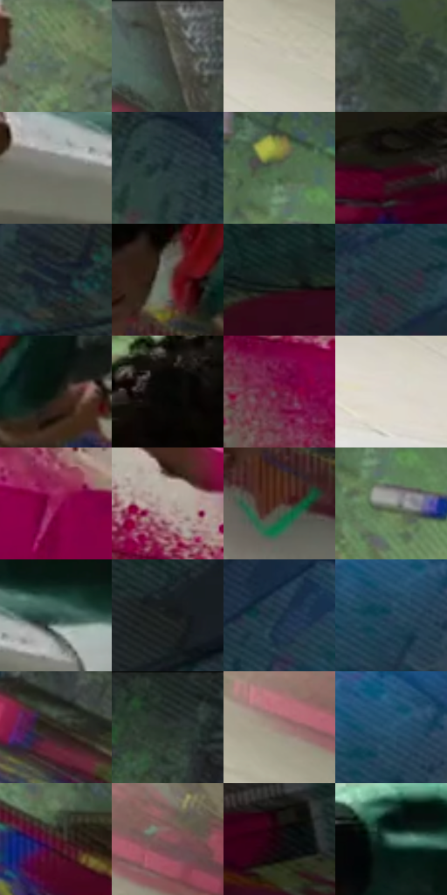

# 电影参考 050

- 状态：常规／活跃；来源世界：miles-home。
- 视角：high-angle；景别：medium；场景：interior。
- 时段：interior-time-unknown（外观依据，中置信度；具体时间／晨昏未知）；光照：interior-mixed。
- 材质候选：skin, fabric, brick, stone, paint, metal（帧级，不是像素分割）。
- 明暗组：dark；L* P5/P50/P95：3.91283 / 28.70139 / 77.95443。
- 资格门禁：无附加门禁。
- 原截图 SHA-256：`5480c5b6a54c3e3f07b61fccaaf71c8c871fe9f2823606a5dd1360be805482dc`；尺寸：2880 × 1202。
- sRGB 像素 SHA-256：`716b39483ba4f578d6b5191805a909c4159e324038e79e2499e52dbd7669f2a3`。

## 观察与迁移

涂鸦墙、粗糙地面和局部灯光；墙绘颜料层与基底砖石分别分析。

俯视喷漆动作

喷罐和握持手被广角俯视放大，前臂、肩和脚向地面收缩；喷嘴、手指和漆迹连成动作链。洋红飞沫的大小和密度从喷射核心向外衰减，是场景里的材料飞溅，不等同于全画面通用波点。墙面大块留净，地面和衣物有细网与随形排线；蓝光只在受光地面与边缘发生局部冷暖错版，手指关节与喷嘴保持清楚。

本公开版保存32个128×128原像素色卡上下文；图集格子并非原场景相邻位置。原rect、图集tile和像素SHA见 `data/palette-crops.json`。上下文不足时不得批准替色，不能以小样推断完整构图。

## 实测色卡

颜色比例分母为保留采样像素，不是材料面积；全部 32 色参与全库匹配。表内四舍五入仅用于阅读，原精度在 JSON。

| ID | HEX | Lab | 原图 xy | 像素数 | 比例 | 明度角色 |
| --- | --- | --- | --- | ---: | ---: | --- |
| 050-S01 | #6A7A60 | [49.286394, -11.1203, 12.311464] | [1876, 604] | 10085 | 5.234936% | midtone |
| 050-S02 | #4E4F44 | [33.198121, -2.666847, 6.371164] | [744, 44] | 9135 | 4.741809% | shadow |
| 050-S03 | #C4C0B2 | [77.667792, -1.060127, 7.552352] | [364, 236] | 7597 | 3.943462% | light |
| 050-S04 | #374539 | [27.747011, -8.464025, 5.412336] | [888, 92] | 7578 | 3.933599% | shadow |
| 050-S05 | #7B7C74 | [51.709516, -1.940487, 4.236695] | [884, 624] | 7284 | 3.780989% | midtone |
| 050-S06 | #1D2E31 | [17.630502, -6.0553, -4.169808] | [2036, 300] | 7163 | 3.718180% | deep-shadow |
| 050-S07 | #50674D | [41.123133, -14.198348, 11.939445] | [1256, 124] | 7153 | 3.712989% | midtone |
| 050-S08 | #2D0D17 | [8.197959, 17.701524, 1.077201] | [2216, 820] | 7104 | 3.687555% | deep-shadow |
| 050-S09 | #1A252D | [14.013589, -2.273909, -6.818012] | [2724, 464] | 6683 | 3.469021% | deep-shadow |
| 050-S10 | #656357 | [41.811672, -1.540381, 7.108944] | [1488, 596] | 6462 | 3.354304% | midtone |
| 050-S11 | #19241E | [12.997657, -6.465913, 2.45141] | [2528, 880] | 6447 | 3.346518% | deep-shadow |
| 050-S12 | #273941 | [22.789318, -4.84828, -7.276367] | [2300, 400] | 6309 | 3.274885% | shadow |
| 050-S13 | #10150D | [6.102122, -3.588614, 3.628928] | [1616, 600] | 6291 | 3.265541% | deep-shadow |
| 050-S14 | #060705 | [1.821332, -0.539709, 0.66494] | [1352, 376] | 6259 | 3.248931% | deep-shadow |
| 050-S15 | #73173D | [25.55007, 42.013166, 0.654915] | [392, 964] | 6163 | 3.199099% | shadow |
| 050-S16 | #DCD7CE | [86.142876, 0.140778, 5.043705] | [144, 264] | 6088 | 3.160168% | highlight |
| 050-S17 | #931550 | [32.525353, 53.313996, -1.055785] | [604, 952] | 5754 | 2.986795% | shadow |
| 050-S18 | #B2A49C | [68.32672, 3.68322, 5.981649] | [364, 836] | 5734 | 2.976413% | light |
| 050-S19 | #50352B | [25.033935, 10.696121, 11.192821] | [1460, 712] | 5591 | 2.902184% | shadow |
| 050-S20 | #8C9386 | [60.036679, -5.048687, 6.01133] | [1280, 208] | 5520 | 2.865330% | light |
| 050-S21 | #2F4F49 | [31.060041, -13.393862, -0.177179] | [984, 580] | 5481 | 2.845085% | shadow |
| 050-S22 | #161B1A | [9.23074, -2.613547, -0.094385] | [2008, 100] | 5470 | 2.839375% | deep-shadow |
| 050-S23 | #1B3345 | [20.164029, -3.13855, -14.053398] | [2240, 176] | 5391 | 2.798368% | shadow |
| 050-S24 | #24435B | [27.141939, -3.45203, -17.749757] | [2624, 252] | 5268 | 2.734521% | shadow |
| 050-S25 | #2D2720 | [16.070796, 1.358566, 5.652087] | [900, 256] | 5219 | 2.709086% | deep-shadow |
| 050-S26 | #2C3631 | [21.562885, -5.453314, 1.741182] | [1732, 64] | 5088 | 2.641086% | shadow |
| 050-S27 | #9F7F7A | [56.043535, 11.527175, 7.402016] | [340, 96] | 5020 | 2.605789% | midtone |
| 050-S28 | #2B5774 | [35.18297, -5.630172, -21.066633] | [2640, 216] | 4346 | 2.255928% | shadow |
| 050-S29 | #4C1620 | [16.577553, 26.374047, 7.10089] | [1904, 776] | 4267 | 2.214920% | deep-shadow |
| 050-S30 | #8B535B | [41.894595, 24.383505, 5.35881] | [476, 92] | 3791 | 1.967838% | midtone |
| 050-S31 | #16080D | [3.372281, 5.55148, -0.291772] | [2336, 868] | 3608 | 1.872846% | deep-shadow |
| 050-S32 | #527A6F | [48.083061, -16.590797, 1.566634] | [880, 448] | 3299 | 1.712450% | midtone |

## 色阶与空间分布

- 采样 ROI：`[0.01, 0.02, 0.98, 0.94]`；步长：4；样本数：192648。
- 排除区：`[]`。
- 深暗、暗、中、亮、高光五段计数：`[62646, 66476, 40734, 14894, 7898]`。
- RGB 各 256 箱、L* 100 箱、13×5 色相明度表和 3×3 空间统计全部保存在 [总数据](../film-library.json)。
- [可视化档案](../../references/library.html)按需绘制直方图，不存 2,094 张重复图表图片。

## 纹理特征占比

**这是分块图像特征的面积占比，不是波点／排线／丝网／错版的精确语义覆盖率。** 窗格、发丝、织物也会产生方向或周期特征。
原图 ROI 像素 3087370；已测块覆盖 3087370（100.0000%）；未测 0。

| 特征 | 块覆盖像素 | 占已测面积 | 阈值敏感范围 |
| --- | ---: | ---: | --- |
| low-contrast | 37120 | 1.2023% | 0.8665% ~ 1.2023% |
| directional-structure | 521472 | 16.8905% | 9.5522% ~ 32.6080% |
| periodic-structure | 2266762 | 73.4205% | 62.6698% ~ 73.4205% |
| mixed-detail | 262016 | 8.4867% | 3.8557% ~ 15.9994% |

阈值敏感范围不是统计置信区间。逐块坐标、尺度、对比、方向一致性、频谱集中度、频率与角度见 [全量特征记录](../texture-features.jsonl)，以帧号定位。
四种印刷层的真实像素覆盖仍标为 `null`，不能填 0，也不能拿上表代替。不得据这些代理测量删除唯一证据。

[测量方法与保留策略](../../references/library-retention.md) · [分类索引](../archive/README.md)
