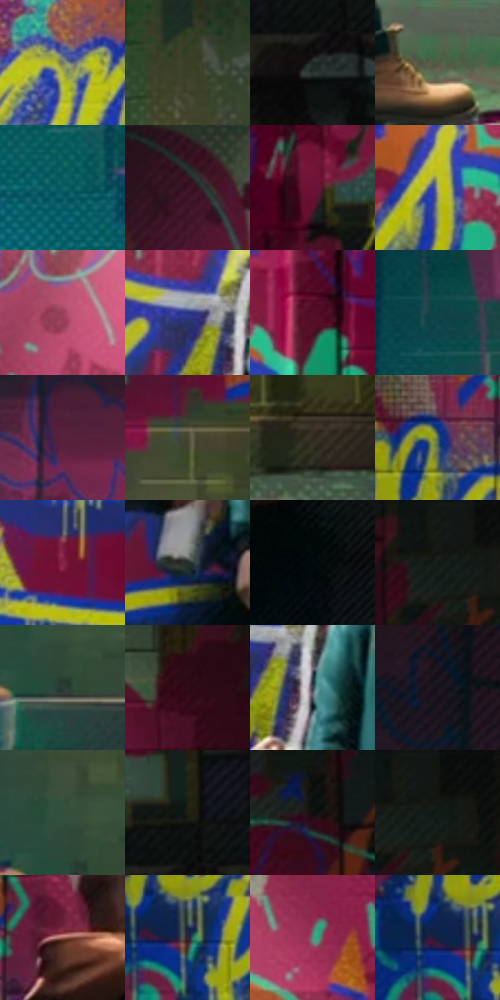

# 电影参考 051

- 状态：常规／活跃；来源世界：miles-home。
- 视角：near-level；景别：full-body；场景：interior。
- 时段：interior-time-unknown（外观依据，中置信度；具体时间／晨昏未知）；光照：interior-mixed。
- 材质候选：skin, fabric, brick, stone, paint, metal（帧级，不是像素分割）。
- 明暗组：dark；L* P5/P50/P95：4.56957 / 23.91732 / 55.98983。
- 资格门禁：无附加门禁。
- 原截图 SHA-256：`f79bf0367a30f920c6b215eb296e8e72b0cf099f8b2c2a11c0aae58818f52876`；尺寸：2880 × 1206。
- sRGB 像素 SHA-256：`ed49ec43b68495c35e4d98ed0d0a316259a53020d60a18932f902caedc2cd271`。

## 观察与迁移

涂鸦墙、粗糙地面和局部灯光；墙绘颜料层与基底砖石分别分析。

双人观看完成的涂鸦

前景成年人与站高的少年形成尺度对照，前景肩臂是观看方向，后方人物的脚与箱体接触决定身高。涂鸦的粗色块、喷涂边、滴流、印刷点和细网不是同一层：局部大点在字形内部聚集，砖墙网目较低对比，服装排线沿躯干转折。黄蓝亮笔画可有窄幅错版，脸和伸出的手保持稳定；原有字形不移植到新照片。

本公开版保存32个128×128原像素色卡上下文；图集格子并非原场景相邻位置。原rect、图集tile和像素SHA见 `data/palette-crops.json`。上下文不足时不得批准替色，不能以小样推断完整构图。

## 实测色卡

颜色比例分母为保留采样像素，不是材料面积；全部 32 色参与全库匹配。表内四舍五入仅用于阅读，原精度在 JSON。

| ID | HEX | Lab | 原图 xy | 像素数 | 比例 | 明度角色 |
| --- | --- | --- | --- | ---: | ---: | --- |
| 051-S01 | #767A63 | [50.30075, -5.831026, 12.117362] | [1636, 320] | 12298 | 6.360618% | midtone |
| 051-S02 | #3A3E25 | [25.193876, -6.568489, 14.839283] | [2680, 320] | 9950 | 5.146215% | shadow |
| 051-S03 | #1A2322 | [12.842158, -4.26685, -0.651494] | [2484, 560] | 8565 | 4.429882% | deep-shadow |
| 051-S04 | #545A46 | [37.187257, -6.384504, 10.789196] | [1128, 1080] | 8277 | 4.280926% | shadow |
| 051-S05 | #0E6167 | [37.153729, -20.503077, -10.067902] | [308, 1032] | 7531 | 3.895090% | shadow |
| 051-S06 | #3A1426 | [12.86016, 21.161269, -3.072099] | [544, 120] | 7505 | 3.881642% | deep-shadow |
| 051-S07 | #6D1435 | [23.702859, 40.427117, 3.313043] | [2340, 452] | 7315 | 3.783373% | shadow |
| 051-S08 | #B2AE77 | [70.224859, -7.149436, 28.805919] | [1832, 336] | 7260 | 3.754926% | light |
| 051-S09 | #9A3E59 | [39.64496, 41.050041, 3.67026] | [1124, 80] | 6797 | 3.515459% | shadow |
| 051-S10 | #283683 | [25.943701, 21.443566, -45.127215] | [1172, 288] | 6770 | 3.501495% | shadow |
| 051-S11 | #550D27 | [17.302332, 34.017583, 3.347899] | [1964, 260] | 6385 | 3.302370% | deep-shadow |
| 051-S12 | #0F4246 | [25.075178, -14.758177, -7.259296] | [236, 760] | 6336 | 3.277027% | shadow |
| 051-S13 | #57223E | [22.011306, 28.042205, -5.854854] | [388, 656] | 6150 | 3.180826% | shadow |
| 051-S14 | #474636 | [29.377977, -2.735026, 9.829176] | [668, 696] | 6116 | 3.163241% | shadow |
| 051-S15 | #2E281D | [16.440522, 0.634123, 8.274155] | [2216, 1060] | 6113 | 3.161689% | deep-shadow |
| 051-S16 | #546A64 | [42.932484, -9.550282, 0.665368] | [680, 260] | 5817 | 3.008596% | midtone |
| 051-S17 | #852145 | [30.65321, 44.705474, 3.123544] | [1748, 536] | 5803 | 3.001355% | shadow |
| 051-S18 | #242F2A | [18.255366, -5.986499, 1.668118] | [1184, 504] | 5735 | 2.966185% | deep-shadow |
| 051-S19 | #040B0D | [2.657461, -1.526684, -1.49248] | [860, 348] | 5589 | 2.890673% | deep-shadow |
| 051-S20 | #141A16 | [8.528252, -3.879651, 1.844607] | [2400, 64] | 5502 | 2.845676% | deep-shadow |
| 051-S21 | #293B34 | [23.159569, -9.074043, 2.001928] | [624, 1024] | 5116 | 2.646034% | shadow |
| 051-S22 | #310B18 | [8.640286, 20.620647, 1.062565] | [2220, 76] | 5074 | 2.624311% | deep-shadow |
| 051-S23 | #3A424C | [27.621178, -0.710064, -7.133162] | [1232, 332] | 5031 | 2.602071% | shadow |
| 051-S24 | #15141A | [6.633015, 1.960961, -3.94212] | [116, 168] | 5022 | 2.597416% | deep-shadow |
| 051-S25 | #33503D | [31.295665, -15.570681, 7.817358] | [608, 964] | 4695 | 2.428289% | shadow |
| 051-S26 | #1E2015 | [11.71049, -3.42861, 7.176668] | [2504, 476] | 4588 | 2.372948% | deep-shadow |
| 051-S27 | #0E0D0E | [3.729851, 0.48371, -0.345456] | [2484, 204] | 4289 | 2.218303% | deep-shadow |
| 051-S28 | #12140F | [5.992436, -1.832172, 2.479288] | [2436, 28] | 3963 | 2.049693% | deep-shadow |
| 051-S29 | #9B5F52 | [46.663044, 22.938017, 17.758185] | [800, 200] | 3673 | 1.899703% | midtone |
| 051-S30 | #3A2038 | [16.593081, 17.089552, -10.356063] | [644, 392] | 3625 | 1.874877% | deep-shadow |
| 051-S31 | #5D8A7E | [54.037174, -18.158366, 1.528407] | [1852, 132] | 3317 | 1.715577% | midtone |
| 051-S32 | #102441 | [14.135773, 3.336807, -20.804739] | [608, 384] | 3139 | 1.623514% | deep-shadow |

## 色阶与空间分布

- 采样 ROI：`[0.01, 0.02, 0.98, 0.94]`；步长：4；样本数：193346。
- 排除区：`[]`。
- 深暗、暗、中、亮、高光五段计数：`[76794, 78553, 30417, 6454, 1128]`。
- RGB 各 256 箱、L* 100 箱、13×5 色相明度表和 3×3 空间统计全部保存在 [总数据](../film-library.json)。
- [可视化档案](../../references/library.html)按需绘制直方图，不存 2,094 张重复图表图片。

## 纹理特征占比

**这是分块图像特征的面积占比，不是波点／排线／丝网／错版的精确语义覆盖率。** 窗格、发丝、织物也会产生方向或周期特征。
原图 ROI 像素 3098546；已测块覆盖 3098546（100.0000%）；未测 0。

| 特征 | 块覆盖像素 | 占已测面积 | 阈值敏感范围 |
| --- | ---: | ---: | --- |
| low-contrast | 0 | 0.0000% | 0.0000% ~ 0.5288% |
| directional-structure | 223872 | 7.2251% | 2.1151% ~ 19.9980% |
| periodic-structure | 2653618 | 85.6407% | 77.9778% ~ 85.6407% |
| mixed-detail | 221056 | 7.1342% | 2.0242% ~ 12.4441% |

阈值敏感范围不是统计置信区间。逐块坐标、尺度、对比、方向一致性、频谱集中度、频率与角度见 [全量特征记录](../texture-features.jsonl)，以帧号定位。
四种印刷层的真实像素覆盖仍标为 `null`，不能填 0，也不能拿上表代替。不得据这些代理测量删除唯一证据。

[测量方法与保留策略](../../references/library-retention.md) · [分类索引](../archive/README.md)
